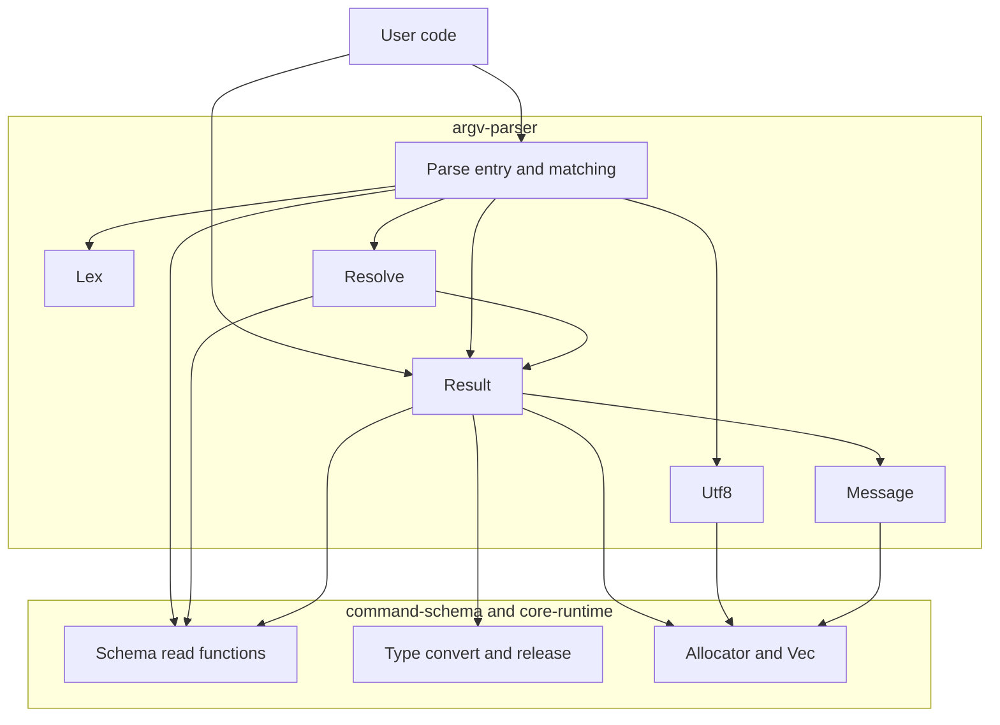
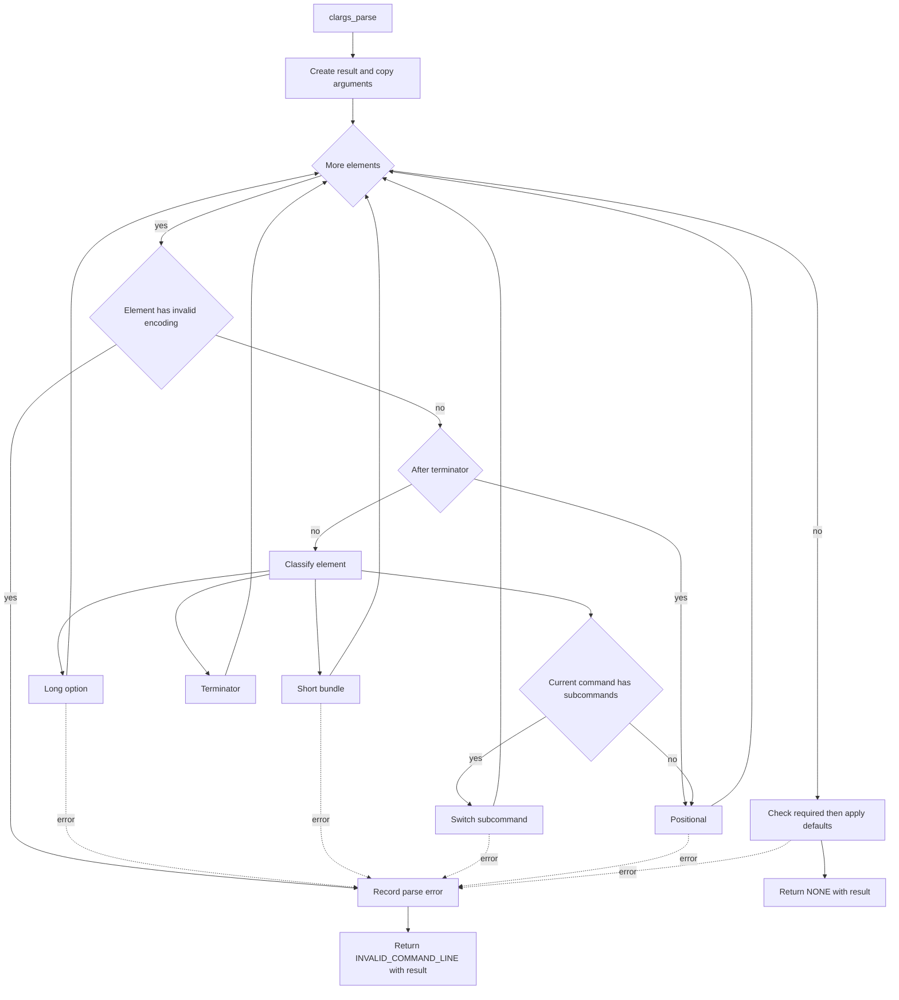

# Design Document

## Overview

**Purpose**: このスペックは、CLArgs の利用者が、検証済みのスキーマと `main` の argv を渡して解析し、型の付いた値を結果から取り出せるようにする。引数がスキーマに合わないときは、種類、問題の要素、関係する定義要素、そのまま見せられる英語のメッセージを返す。

**Users**: ライブラリ利用者（C のアプリケーション開発者）は、解析を呼び、結果を読み、破棄する。プログラムの利用者は、このスペックが定める書き方で引数を書き、メッセージを読む。

**Impact**: command-schema の上に、解析のモジュールを足す。公開ヘッダ 1 つ（`parse.h`）、エラーコード 1 つ、ソース 6 つが増える。既存の公開関数の形と意味は変えない。command-schema のソースと公開ヘッダは変更しない。

### Goals

- `clargs_parse()` 1 回の呼び出しで、要件 2〜9 の書き方を解釈し、値を変換し、既定値の適用と必須の検査まで行う。
- 結果は不透明なオブジェクト 1 つで、成功のときも解析エラーのときも同じ関数で読める。破棄は 1 回で済む。
- 解析エラーは、エラーコード 1 つ（`CLARGS_ERROR_INVALID_COMMAND_LINE`）と、結果から読む種類、位置、定義要素、メッセージで表す。
- ワイド文字の argv は、入口で UTF-8 に変換し、`char` の argv と同じ経路で解析する。
- 環境変数の対応を後から足せるように、値の解決を独立した段にし、値の出どころとエラーの位置を列挙型で表す。

### Non-Goals

- スキーマの定義と検証、値型の変換そのもの（command-schema）
- ヘルプや usage の文面。`--help` の特別扱い（help-formatter、利用者のコード）
- 長い名前の省略、レスポンスファイル、複数の値を集めるオプション、親のオプションの継承
- 環境変数や設定ファイルからの値の補完と、そのための差し込み口
- 候補の提案、コールバックによるサブコマンドの起動、メッセージの多言語化
- 低水準のイテレータ（要素を 1 つずつ利用者に渡す API）

## Boundary Commitments

### This Spec Owns

- 解析の入口 `clargs_parse()` と `clargs_parse_wide()`
- 引数の書き方の規則（要件 2〜7）: 要素の分類、長いオプション、短いオプションの束、`--`、単独の `-`、負の数、位置引数の割り当て、サブコマンドの切り替え
- 値型の変換をいつ呼ぶか、変換した値と入力の文字列をどこに、いつまで保持するか
- 既定値の適用と必須の検査（値の解決）
- 結果の型 `clargs_result_t` と、その読み取りと破棄
- 値の出どころの列挙 `clargs_source_t` と、解析エラーの種類の列挙 `clargs_parse_error_kind_t`
- 解析エラーのメッセージの文面
- エラーコード `CLARGS_ERROR_INVALID_COMMAND_LINE`
- 利用者向けの文書 `docs/parse.md`

### Out of Boundary

- スキーマの内部構造。`src/schema_internal.h` と `src/type_internal.h` を取り込まない
- 名前の規則、否定名の作り方、検証の規則（command-schema が決め、このスペックは検証済みのスキーマで成り立つこととして頼る）
- 値型の変換の実装。`clargs_type_convert()` が返した成功と失敗を使うだけである
- usage やヘルプを添えたエラーの表示。メッセージ 1 行を返すところまでが、このスペックである
- 標準出力、標準エラーへの書き込み、プロセスの終了、`getenv` の呼び出し
- アロケータ、エラーコードの仕組み、内部ユーティリティ（core-runtime）

### Allowed Dependencies

- command-schema の公開関数: `<clargs/schema.h>` の読み取りと検索、`<clargs/type.h>` の `clargs_type_kind()`、`clargs_type_name()`、`clargs_type_value_size()`、`clargs_type_convert()`、`clargs_type_release()`
- core-runtime: 内部のメモリ関数（`src/alloc_internal.h`）、`clargs_vec_t`（`src/vec.h`）、`clargs_error_t` と `CLARGS_ERROR_LIST`、`CLARGS_API`
- C 標準ライブラリ: `<assert.h>`、`<limits.h>`、`<stdbool.h>`、`<stddef.h>`（`wchar_t`）、`<stdint.h>`（`int64_t`、`WCHAR_MAX`）、`<string.h>`
- テストでは、Naos とテスト用アロケータ（`tests/support/test_allocator.h`）
- 依存してはならないもの: help-formatter のコード。command-schema の内部ヘッダ。OS の API（`WideCharToMultiByte` など）。ロケールに左右される関数（`<ctype.h>`、`wcstombs`）。標準の確保関数。変更可能な `static` 変数。`getenv`、`<stdio.h>` の出力

### Revalidation Triggers

次の変更があったら、ライブラリ利用者のコードと help-formatter（エラーの表示の例を文書に持つ場合）は、統合を確かめ直す。

- 引数の書き方の規則の変更（要件 2〜7 の表）。プログラムの利用者に見える挙動が変わる
- `clargs_parse()` の戻り値と `*out` の関係の変更
- 読み取りの関数が「値がない」ことを表す方法（`false`、`NULL`、`CLARGS_SOURCE_NONE`）の変更
- `clargs_source_t` または `clargs_parse_error_kind_t` への値の追加（利用者の `switch` は `default` を持つ前提だが、文書と例を確かめる）
- メッセージの文面の変更（文面を比較しているテストが利用者の側にありうる）
- 結果が argv を複製する、という決定の変更

次の command-schema の変更があったら、このスペックを確かめ直す。

- 読み取りと検索の関数の形、値型の契約（値が入力を参照してよいこと、変換関数が返すエラーコード）
- 名前の規則（短い名前に数字を許すこと、長い名前が 2 文字以上であること）
- 位置引数とサブコマンドの併用、可変個の位置引数の位置についての検証の規則
- オプションの種類、位置引数の個数の種類、属性の追加

## Architecture

### Existing Architecture Analysis

- 層は「build-foundation → core-runtime → command-schema → argv-parser / help-formatter」の一方向である。このスペックは command-schema の公開関数だけを使う。
- 既存の型: 不透明ハンドル、`clargs_error_t` を返す関数と `**out`、`destroy` の `NULL` は何もしない、前提条件は `assert`、エラーコードは一覧の末尾に足す、変更可能な `static` 変数を持たない。
- 文字列の値型の値は、入力の文字列へのポインタである（`type.h`）。変換に渡した文字列は、値を後始末するまで有効でなければならない。
- export の検査（`clargs.exports`）は、公開ヘッダの前処理の行を取り除いてから `CLARGS_API` の宣言を集める。`#ifdef` で囲んだ宣言も、すべての環境で export されている必要がある。
- 公開の読み取りには、定義要素がコマンドの中で何番目かを返す関数がない。

### Architecture Pattern & Boundary Map

解析を、入力の適応、字句、照合、値の解決の 4 段に分け、すべての段が 1 つの結果オブジェクトに書き込む。結果は、作りかけの状態でも破棄でき、失敗時の後始末は「結果を破棄する」の 1 通りである。



**Architecture Integration**:

- Selected pattern: 段に分けたパイプライン。brief.md の Boundary Candidates（字句、照合、値の解決、結果、エラーとメッセージ、入力の適応）を、そのままコンポーネントにした。
- 依存の向き: `Lex`、`Utf8`、`Message` は、スキーマも結果も知らない（葉）。`Result` は、スキーマの読み取り、値型、`Message` を使う。`Resolve` は `Result` を使う。`Parse` は全部を使う。逆向きの取り込みはしない。
- `Lex` はスキーマを知らない。負の数の規則（2.5）は、`Lex` が「負の数の形か」を答え、`Parse` が「現在のコマンドに数字の短い名前があるか」と組み合わせる。
- `Resolve` を `Parse` から分ける。初版では既定値と必須だけを扱うが、後から argv → 環境 → 既定値の順を足す場所になる（`roadmap.md` の Future boundaries）。`Resolve` は argv を読まない。
- 値を変換して保持する処理は `Result` の 1 か所に置く。コマンドラインの値も既定値も、同じ内部関数を通る。置き換えと後始末の規則（5.4、8.7）が 1 か所で済む。
- Existing patterns preserved: 不透明ハンドル、`create`/`destroy` の形、エラーコードの一覧、`assert` の前提条件、グローバル状態なし。
- Steering compliance: C99、C 標準ライブラリだけ、すべての確保はアロケータ経由、公開構造体を ABI にしない。

### 主な決定

| 決定 | 内容 | 理由 |
|---|---|---|
| argv の文字列 | 結果が複製して持つ（13.7） | `docs/ownership.md` の既定である。ワイド文字の入口では変換した UTF-8 を結果が持つしかないので、`char` の入口も同じにすると、経路と寿命の規則が 1 つになる。利用者は、解析の後に argv を自由にしてよい |
| 複製の単位 | すべての要素を 1 回の確保にまとめる | 確保の回数が argc によらず 1 回になり、失敗の経路が減る |
| エラーコード | 解析エラーは `CLARGS_ERROR_INVALID_COMMAND_LINE` の 1 つ。種類は結果から読む列挙 | 規約は、エラーコードに位置や対象を持たせない。戻り値は、成功、解析エラー、メモリ確保の失敗の 3 つを分ければ足りる（11.11）。種類を足しても、エラーコードの一覧が増えない |
| 解析エラーのときの `*out` | 結果を渡す（10.10）。メモリ確保の失敗では `NULL` | 既存の「失敗したら `*out` は `NULL`」の例外になる。`docs/ownership.md` と関数のコメントに書く（13.3） |
| 定義要素から結果の中の場所 | 公開の列挙で、ポインタを比べて探す | command-schema を変更しない。1 つのコマンドのオプションは数十個までの想定で、線形の探索で足りる |
| ワイド文字の入口 | すべての環境で提供する（12.6） | export の検査が条件付きの宣言を扱えない。`wchar_t` は C99 の型なので宣言はどこでも書ける。Linux と macOS の CI でも変換を確かめられる |
| UTF-8 への変換 | 自前で書く。16 ビットの `wchar_t` は UTF-16、それより広い `wchar_t` は UTF-32 として読む | C 標準ライブラリに、ロケールによらない変換がない。OS の API は使わない（14.5） |
| メッセージ | 解析エラーを記録するときに組み立てて、結果が持つ | 結果の読み取りは確保しない（10.13）。組み立ての確保に失敗したら、解析の全体をメモリ確保の失敗にする |
| argv の引数の型 | `char *const *argv`、`wchar_t *const *argv` | `main` の `char **argv` を、キャストなしで渡せる（1.2）。`const char *const *` は、C では `char **` から暗黙に変換できない |
| カウントの型 | `size_t` | 回数は argv の総バイト数を超えないので、桁あふれが起こらない |

詳しい比較は `research.md` にある。

### Technology Stack

| Layer | Choice / Version | Role in Feature | Notes |
|-------|------------------|-----------------|-------|
| 言語 | C99、拡張なし | 全体 | 公開ヘッダで `<stdint.h>`（`int64_t`）を取り込む。`wchar_t` は `<stddef.h>` から得る |
| 実行時 | C 標準ライブラリ | 文字列関数 | `<stdio.h>`、`<ctype.h>`、`<wchar.h>` の関数は使わない |
| 上流 | command-schema の公開関数 | スキーマの読み取り、値の変換 | 内部ヘッダは取り込まない |
| メモリ | core-runtime の内部のメモリ関数、`clargs_vec_t` | すべての確保 | 標準の確保関数を直接呼ばない |
| テスト | Naos v0.4.0、テスト用アロケータ | 公開 API と内部関数のテスト、失敗注入 | 既存の `clargs_add_test()` で登録する |

## File Structure Plan

### Directory Structure

```
include/clargs/
└── parse.h                解析の入口、clargs_result_t、読み取り、解析エラー、破棄
src/
├── lex.h                  内部: 要素の分類（宣言）
├── lex.c                  要素の分類、負の数の形の判定、長いオプションの名前と値の分割
├── utf8.h                 内部: ワイド文字列から UTF-8 への変換（宣言）
├── utf8.c                 UTF-16 または UTF-32 から UTF-8 への変換と、長さの計算
├── message.h              内部: 解析エラーのメッセージの組み立て（宣言）
├── message.c              種類ごとの文面と、名前、値、型名の埋め込み
├── parse_internal.h       内部: struct clargs_result と、その部品の定義、Result と Resolve の内部関数の宣言
├── result.c               結果の生成と破棄、引数の複製、コマンドの並び、値の変換と保持、エラーの記録、公開の読み取り
├── resolve.c              必須の検査と既定値の適用
└── parse.c                公開の入口 2 つ、要素の走査、オプションと位置引数とサブコマンドの照合
tests/
├── public/
│   ├── parse_option_test.c      要素の解釈、長いオプション、短いオプションの束、複数回の指定
│   ├── parse_positional_test.c  位置引数、`--`、サブコマンド
│   ├── parse_value_test.c       値の変換、既定値、必須、値の出どころ、後始末の回数
│   ├── parse_error_test.c       解析エラーの種類ごとの情報とメッセージ、エラーのときの結果
│   ├── parse_wide_test.c        ワイド文字の入口
│   └── parse_failure_test.c     確保の各回を順に失敗させる
└── internal/
    ├── lex_test.c         分類の境界
    ├── utf8_test.c        変換の境界
    ├── message_test.c     文面
    └── result_test.c      内部関数で組み立てた結果の読み取り、置き換え、破棄
docs/
└── parse.md               利用者向け: 解析から破棄までの例、書き方の一覧、エラーの表示、寿命、前提条件
```

- 公開ヘッダ `parse.h` に対する内部ヘッダは `parse_internal.h` とする（命名規約）。`lex`、`utf8`、`message` は公開ヘッダがないので、内部ヘッダは `lex.h`、`utf8.h`、`message.h` である。
- `parse_internal.h` を取り込んでよいのは、`result.c`、`resolve.c`、`parse.c` と、`tests/internal/result_test.c` だけである。
- 結果の構造体のフィールドを直接読み書きしてよいのは `result.c` だけである。`parse.c` と `resolve.c` は、`parse_internal.h` の内部関数と、公開の読み取りを通す。

### Modified Files

- `include/clargs/error.h` — `CLARGS_ERROR_LIST` の末尾に `X(CLARGS_ERROR_INVALID_COMMAND_LINE, "invalid command line")` を足す。
- `include/clargs/clargs.h` — `#include <clargs/parse.h>` を足す。
- `src/CMakeLists.txt` — `CLARGS_SOURCES` に `lex.c`、`message.c`、`parse.c`、`resolve.c`、`result.c`、`utf8.c` を足す。
- `tests/CMakeLists.txt` — 上の 10 のテストを `clargs_add_test()` で登録する。確保を伴うテストには `support/test_allocator.c` を足す。
- `docs/ownership.md` — 「スキーマ、argv、結果への適用」の表の「結果は argv の文字列を複製するか」を「複製する」に確定する。結果が存在する間はスキーマを変更しないこと、解析エラーのときは `*out` に結果が渡ることを足す。
- `docs/conventions.md` — ディレクトリ構成の一覧に、`parse.h` と `docs/parse.md` を足す。
- `docs/schema.md` — 検証を済ませていないスキーマを解析に渡すのは前提条件の違反であることと、`docs/parse.md` への案内を足す。
- `README.md` — 冒頭の現状の説明と例を、解析までできる内容に改め、`docs/parse.md` への案内を足す。

### Implementation Order

公開ヘッダに `CLARGS_API` で宣言した関数は、すべて export されていなければならない（`clargs.exports`）。公開ヘッダの宣言は、その関数を実装する作業の中で足す。

| 順 | 作業 | 触るファイル |
|---|---|---|
| 1 | エラーコード | `include/clargs/error.h` |
| 2 | Lex | `src/lex.h`、`src/lex.c`、`tests/internal/lex_test.c` |
| 3 | Utf8 | `src/utf8.h`、`src/utf8.c`、`tests/internal/utf8_test.c` |
| 4 | Message | `include/clargs/parse.h`（新規。2 つの列挙だけ）、`src/message.h`、`src/message.c`、`tests/internal/message_test.c`、`clargs.h` |
| 5 | Result | `parse.h`（`clargs_result_t`、読み取り、破棄を追記）、`src/parse_internal.h`、`src/result.c`、`tests/internal/result_test.c` |
| 6 | Parse: オプション | `parse.h`（`clargs_parse()` を追記）、`src/parse.c`、`tests/public/parse_option_test.c` |
| 7 | Parse: 位置引数とサブコマンド | `src/parse.c`、`tests/public/parse_positional_test.c` |
| 8 | Resolve | `src/resolve.c`、`src/parse.c`（呼び出しを足す）、`tests/public/parse_value_test.c`、`tests/public/parse_error_test.c` |
| 9 | ワイド文字の入口 | `parse.h`（`clargs_parse_wide()` を追記）、`src/parse.c`、`src/result.c`（引数の複製のワイド版）、`tests/public/parse_wide_test.c` |
| 10 | 失敗注入のテスト、文書 | `tests/public/parse_failure_test.c`、`docs/`、`README.md` |

- どの作業も `src/CMakeLists.txt` と `tests/CMakeLists.txt` に追記する。同じファイルを触るので、並行させず、表の順に行う。
- 5 の時点では `clargs_parse()` がまだない。`result_test.c` は、内部関数（`parse_internal.h`）で結果を組み立てて、公開の読み取りと破棄を確かめる。
- 6 と 7 の時点では、値の解決がまだない。`clargs_parse()` は、6 で「走査だけを行って結果を返す」形で入り、8 で `Resolve` の呼び出しが入る。6 と 7 のテストは、既定値と必須に頼らない内容にする。
- `src/parse_internal.h` の構造体は、5 で、Logical Data Model のとおりに全部を定義する。

## System Flows

### 解析の全体



- どの段でも、確保の失敗（値型が返したものを含む）は、結果を破棄して `*out` を `NULL` にし、`CLARGS_ERROR_OUT_OF_MEMORY` を返す。図では省いた。
- 値付きオプションが次の要素を値として取り込むときは、走査の位置を 1 つ進める。取り込まれた要素は分類されない（2.9）。ただし、不正な文字の並びの検査（12.4）は、取り込みの前にも行う。
- 解析エラーを記録したら、走査をやめ、`Resolve` を呼ばない（10.11、11.1）。

### 要素の分類と照合の規則

| 要素の形 | 条件 | 扱い | 要件 |
|---|---|---|---|
| `--` | 終端より前 | 終端。以後はすべて位置引数 | 2.2, 6.4 |
| `--x…` | 終端より前 | 長いオプション。最初の `=` で名前と値に分ける | 2.1, 3.1 |
| `-` | — | オプションではない要素 | 2.4 |
| `-N…`、`-.N…`（N は数字） | 現在のコマンドに数字の短い名前がない | オプションではない要素 | 2.5 |
| `-x…` | 上のどれでもない | 短いオプションの束 | 2.3 |
| それ以外（空の文字列を含む） | — | オプションではない要素 | 2.6 |
| すべて | 終端より後ろ | 位置引数（サブコマンドを持つコマンドでは、余分な位置引数のエラー） | 2.7, 6.5, 7.8 |

オプションではない要素は、現在のコマンドがサブコマンドを持てばサブコマンドの名前、持たなければ位置引数の値として扱う（6.1、7.1）。検証済みのスキーマでは、1 つのコマンドがサブコマンドと位置引数の両方を持つことはない。

## Requirements Traceability

| Requirement | Summary | Components | Interfaces / Flows |
|---|---|---|---|
| 1.1 | 解析して、成功、解析エラー、確保の失敗を返す | Parse | `clargs_parse()` |
| 1.2 | `main` の argc と argv をそのまま渡せる。先頭は対象外 | Parse | 引数の型 `char *const *`、走査は添字 1 から |
| 1.3 | 要素がないとき | Parse | `argc` が 0 または 1 なら走査しない |
| 1.4 | スキーマ、値型、argv を変更しない | Parse、Result | `const` の引数、引数の複製 |
| 1.5 | 繰り返しの解析が独立 | Result | 状態はすべて結果が持つ |
| 1.6 | 同時の解析 | Parse、Result | 変更可能な `static` 変数なし |
| 1.7 | 未検証のスキーマ、ルートでないコマンドは前提条件 | Parse | `assert` |
| 1.8 | 終了しない、出力しない、環境を読まない | 全体 | Allowed Dependencies |
| 2.1, 2.2, 2.3, 2.4, 2.6 | 要素の形の分類 | Lex | `clargs_lex_classify()` |
| 2.5 | 負の数 | Lex、Parse | `clargs_lex_is_negative_number()` と、数字の短い名前の有無 |
| 2.7 | 終端より後ろ | Parse | 走査の状態 `options_ended` |
| 2.8 | 先頭から順に 1 回ずつ | Parse | 解析の全体の図 |
| 2.9 | 取り込まれた要素は解釈しない | Parse | 値の取り込みで位置を進める |
| 3.1 | 名前と値の分割 | Lex | `clargs_lex_split_long()` |
| 3.2, 3.3, 3.4, 3.5 | 長い名前と否定名の照合 | Parse | `clargs_command_find_long()` |
| 3.6 | 未知の長いオプション | Parse、Result | `CLARGS_PARSE_ERROR_UNKNOWN_OPTION` |
| 3.7, 3.8 | 値の取り方 | Parse | Parse の「値の取り方」 |
| 3.9 | 値の不足 | Parse、Result | `CLARGS_PARSE_ERROR_MISSING_VALUE` |
| 3.10 | 値を取らないオプションに値 | Parse、Result | `CLARGS_PARSE_ERROR_UNEXPECTED_VALUE` |
| 4.1, 4.2, 4.3, 4.8 | 束の走査と照合 | Parse | `clargs_command_find_short()` |
| 4.4, 4.5 | 束の中の値付きオプション | Parse | Parse の「値の取り方」 |
| 4.6 | 値の不足 | Parse、Result | `CLARGS_PARSE_ERROR_MISSING_VALUE` |
| 4.7 | 未知の短いオプション | Parse、Result | `CLARGS_PARSE_ERROR_UNKNOWN_OPTION`、`clargs_result_error_short_name()` |
| 5.1, 5.2, 5.3 | フラグ、カウント、否定の複数回 | Result | `clargs_result_record_flag()`、`_record_count()`、`_record_state()` |
| 5.4, 5.5 | 値付きの複数回 | Result | `clargs_result_record_option_value()` の置き換え |
| 6.1, 6.2 | 位置引数の割り当て | Parse、Result | 位置引数のカーソル、`clargs_result_record_positional_value()` |
| 6.3 | オプションの位置によらない | Parse | 走査が 1 要素ずつ独立 |
| 6.4, 6.5 | 終端 | Parse | `options_ended` |
| 6.6 | 余分な位置引数 | Parse、Result | `CLARGS_PARSE_ERROR_UNEXPECTED_POSITIONAL` |
| 7.1, 7.2, 7.4 | サブコマンドの切り替え | Parse、Result | `clargs_command_find_subcommand()`、`clargs_result_push_command()` |
| 7.3 | 未知のサブコマンド | Parse、Result | `CLARGS_PARSE_ERROR_UNKNOWN_SUBCOMMAND` |
| 7.5, 7.6 | 現在のコマンドの定義だけ | Parse | 検索に渡すのは現在のコマンドだけ |
| 7.7 | サブコマンドなしで終わる | Parse | エラーにしない |
| 7.8 | 終端より後ろの要素 | Parse、Result | `CLARGS_PARSE_ERROR_UNEXPECTED_POSITIONAL` |
| 8.1, 8.2, 8.3 | 値型で変換する | Result | `clargs_type_convert()` を 1 か所から呼ぶ |
| 8.4, 8.5, 8.6 | 変換の結果の対応づけ | Result | Result の「変換の結果」の表 |
| 8.7 | 後始末がちょうど 1 回 | Result | 置き換えと破棄 |
| 9.1 | 読み終えたら検査と適用 | Resolve | `clargs_resolve()` |
| 9.2, 9.3, 9.4 | 必須の不足と報告の順 | Resolve | 第 1 巡 |
| 9.5, 9.6 | 既定値、値なし | Resolve、Result | 第 2 巡、`CLARGS_SOURCE_DEFAULT`、`CLARGS_SOURCE_NONE` |
| 9.7 | フラグ、カウント、否定の初期の値 | Result | `clargs_result_push_command()` での初期化 |
| 9.8 | 並びに属さないコマンドは対象外 | Resolve | 並びだけをたどる |
| 9.9 | 値の出どころの列挙 | Result | `clargs_source_t` |
| 9.10 | 差し込み口を公開しない | Parse、Resolve | 公開の関数に供給元の引数がない |
| 10.1 | 成功で結果を渡す | Parse | `*out` |
| 10.2 | 選ばれたコマンドの並び | Result | `clargs_result_command_count()`、`_command_at()`、`_command()` |
| 10.3 | 定義要素そのもので指定 | Result | 読み取りの引数 |
| 10.4 | フラグ、カウント、否定 | Result | `clargs_result_flag()`、`clargs_result_count()` |
| 10.5 | 値の有無と型の付いた値 | Result | `clargs_result_option_*()`、`clargs_result_positional_*()` |
| 10.6 | 可変個の値 | Result | `clargs_result_positional_count()`、添字 |
| 10.7 | 値の出どころ | Result | `clargs_result_option_source()`、`clargs_result_positional_source()` |
| 10.8 | 値がないことの報告 | Result | `false`、`NULL` |
| 10.9 | 並びに属さない定義要素 | Result | Result の「読み取りの規則」 |
| 10.10, 10.11, 10.12 | 解析エラーのときの結果 | Parse、Result | `*out`、`clargs_result_error()` |
| 10.13, 10.14 | 読み取りは変更も確保もしない。寿命 | Result | `const` の引数 |
| 10.15 | プログラムの誤りは前提条件 | Result | `assert` |
| 11.1 | 最初の 1 つで止める | Parse | 解析の全体の図 |
| 11.2, 11.3 | 種類 | Result | `clargs_parse_error_kind_t` |
| 11.4, 11.5, 11.6 | 種類、要素、位置、コマンド、定義要素 | Result | `clargs_result_error_*()` |
| 11.7 | 束の中の 1 文字 | Result | `clargs_result_error_short_name()` |
| 11.8, 11.9, 11.10 | メッセージ | Message、Result | `clargs_message_build()`、`clargs_result_error_message()` |
| 11.11 | エラーコード | Error（追記） | `CLARGS_ERROR_INVALID_COMMAND_LINE` |
| 11.12 | 情報とメッセージの寿命 | Result | 結果が所有する |
| 11.13 | 前提条件の文書 | 文書 | `parse.h` のコメント、`docs/parse.md` |
| 12.1, 12.6 | ワイド文字の入口と、提供する環境 | Parse | `clargs_parse_wide()`（全環境） |
| 12.2, 12.3 | UTF-8 の argv と同じ結果、UTF-8 で返す | Parse、Utf8、Result | 変換の後は同じ経路 |
| 12.4 | 変換できない並び | Utf8、Parse | `CLARGS_PARSE_ERROR_INVALID_ENCODING` |
| 12.5 | `char` の argv はバイトの並び | Parse、Result | 検査も変換もしない複製 |
| 13.1 | アロケータ | 全体 | `src/alloc_internal.h` |
| 13.2, 13.3 | 確保の失敗と `*out` | Parse、Result | 失敗時は結果を破棄して `NULL` |
| 13.4, 13.5 | 破棄 | Result | `clargs_result_destroy()` |
| 13.6, 13.7 | 寿命の規則 | Result、文書 | 引数の複製、`docs/ownership.md` |
| 13.8 | グローバル状態なし | 全体 | レビュー |
| 13.9 | 失敗注入のテスト | テスト | `parse_failure_test.c` |
| 14.1 | 不透明な型 | Result | `clargs_result_t` |
| 14.2, 14.3 | ヘッダと接頭辞 | 全体 | `clargs.h`、命名規約 |
| 14.4, 14.5 | 環境によらない結果、C99 と標準ライブラリ | 全体 | CI、Allowed Dependencies |
| 14.6 | ヘルプから独立 | 全体 | 依存の向き |
| 14.7 | 文書 | 文書 | `docs/parse.md` |

## Components and Interfaces

| Component | Layer | Intent | Req Coverage | Key Dependencies | Contracts |
|-----------|-------|--------|--------------|------------------|-----------|
| Lex | 内部 | 要素の形の分類 | 2.1–2.6, 3.1 | なし | Service |
| Utf8 | 内部 | ワイド文字列から UTF-8 へ | 12.2–12.4 | なし | Service |
| Message | 内部 | メッセージの組み立て | 11.8–11.10 | Allocator (P0) | Service |
| Result | 公開と内部 | 結果の保持、値の変換、読み取り、エラーの記録、破棄 | 5.1–5.5, 8.1–8.7, 9.7, 9.9, 10.2–10.15, 11.2–11.7, 11.12, 12.5, 13.4–13.7, 14.1 | Schema read (P0)、Type (P0)、Vec (P0)、Message (P0) | Service、State |
| Resolve | 内部 | 必須の検査と既定値の適用 | 9.1–9.6, 9.8, 9.10 | Result (P0)、Schema read (P0) | Service |
| Parse | 公開 | 入口、走査、照合 | 1.1–1.8, 2.5, 2.7–2.9, 3.2–3.10, 4.1–4.8, 6.1–6.6, 7.1–7.8, 10.1, 10.10, 11.1, 12.1, 12.6, 13.2, 13.3 | Lex (P0)、Utf8 (P0)、Result (P0)、Resolve (P0)、Schema read (P0) | Service |
| Error（追記） | 公開 | エラーコード 1 つ | 11.11 | 既存の `CLARGS_ERROR_LIST` | — |
| 文書 | 文書 | `docs/parse.md` と既存の文書への追記 | 11.13, 13.6, 13.7, 14.7 | — | — |

すべての公開関数に共通すること:

- `<clargs/clargs.h>` だけで使える。関数と型は `clargs_`、列挙の定数は `CLARGS_` で始まる（14.2、14.3）。
- 引数のポインタは、「`NULL` でもよい」と書いていない限り、`NULL` でないことが前提条件である。前提条件は `assert` で検査し、エラーコードにしない（10.15、11.13）。
- 読み取りの関数は `const clargs_result_t *` を取り、失敗せず、確保せず、結果もスキーマも変えない（10.13）。返す文字列と値へのポインタは、結果を破棄するまで有効で、呼び出し側は解放しない（10.14、11.12）。

### 内部

#### Lex

| Field | Detail |
|-------|--------|
| Intent | 要素 1 つの形を見て、種類を答える。スキーマを知らない |
| Requirements | 2.1, 2.2, 2.3, 2.4, 2.5, 2.6, 3.1 |

**Responsibilities & Constraints**

- 状態を持たない。確保をしない。文字の判定は ASCII の範囲の比較で書き、`<ctype.h>` を使わない。
- 「終端より後ろか」「値として取り込まれたか」は知らない。それは Parse が、呼ぶ前に判断する。

**Contracts**: Service [x]

```c
/* src/lex.h */
typedef enum clargs_lex_kind {
    CLARGS_LEX_PLAIN,      /* オプションではない要素: "-"、""、"-" で始まらないもの */
    CLARGS_LEX_LONG,       /* "--" に 1 文字以上が続く */
    CLARGS_LEX_SHORT,      /* "-" に、"-" でない文字が 1 文字以上続く */
    CLARGS_LEX_TERMINATOR  /* "--" だけ */
} clargs_lex_kind_t;

clargs_lex_kind_t clargs_lex_classify(const char *arg);

/* "-" の直後が数字、または "-" の直後が "." と数字。 */
bool clargs_lex_is_negative_number(const char *arg);

/* arg は CLARGS_LEX_LONG の要素。*name は "--" の直後、*name_length は最初の "=" の手前まで
 * （"=" がなければ終わりまで）の長さ。*value は最初の "=" の直後、"=" がなければ NULL。 */
void clargs_lex_split_long(const char *arg, const char **name, size_t *name_length, const char **value);
```

- Preconditions: 引数は `NULL` でない。`clargs_lex_split_long()` の `arg` は、`clargs_lex_classify()` が `CLARGS_LEX_LONG` を返した要素である。
- Postconditions: `clargs_lex_is_negative_number()` が `true` を返す要素は、`clargs_lex_classify()` では `CLARGS_LEX_SHORT` である。`--=x` は、名前の長さが 0 の `CLARGS_LEX_LONG` である（照合で未知のオプションになる）。

#### Utf8

| Field | Detail |
|-------|--------|
| Intent | `wchar_t` の文字列を UTF-8 に変換する。変換できない並びを見つける |
| Requirements | 12.2, 12.3, 12.4 |

**Responsibilities & Constraints**

- 状態を持たない。確保をしない。呼び出し側が、長さを先に求めてから、領域を用意して書かせる。
- `WCHAR_MAX` が `0xFFFF` 以下の環境では、入力を UTF-16 として読む。上位と下位のサロゲートの組を 1 つの符号位置にする。それ以外の環境では、入力を UTF-32 として読む。
- 変換できない単位は、U+FFFD（3 バイト）に置き換え、「不正な並びがあった」ことを返す。変換できない単位とは、UTF-16 では対になっていないサロゲート、UTF-32 では負の値、サロゲートの範囲（U+D800〜U+DFFF）の値、U+10FFFF を超える値である。
- 2 つの関数は、同じ入力に対して同じバイト数を数える。

**Contracts**: Service [x]

```c
/* src/utf8.h */
/* 終端を含まない UTF-8 のバイト数を返す。変換できない単位があれば *valid を false にする。 */
size_t clargs_utf8_length(const wchar_t *text, bool *valid);

/* text を UTF-8 にして out に書き、終端を付ける。書いたバイト数（終端を含まない）を返す。 */
size_t clargs_utf8_write(const wchar_t *text, char *out);
```

- Preconditions: 引数は `NULL` でない。`out` は、`clargs_utf8_length(text, …) + 1` バイト以上ある。
- 長さの合計が `size_t` に収まらない場合の検査は、呼び出し側（Result の引数の複製）が行う。

#### Message

| Field | Detail |
|-------|--------|
| Intent | 解析エラーの種類と、埋め込む文字列から、英語の 1 行のメッセージを作る |
| Requirements | 11.8, 11.9, 11.10 |

**Responsibilities & Constraints**

- 結果もスキーマも知らない。受け取るのは、種類と文字列だけである。
- 文面は次の表のとおりとする。改行を含めず、接頭辞も句点も付けない（11.10）。埋め込む文字列は、加工せずにそのまま入れる。
- 長さを先に数えて、1 回の確保で作る。`<stdio.h>` の整形関数は使わない。

| 種類 | 文面 | 例 |
|---|---|---|
| `UNKNOWN_OPTION` | `unknown option '<name>'` | `unknown option '--colour'`、`unknown option '-x'` |
| `UNKNOWN_SUBCOMMAND` | `unknown command '<value>'` | `unknown command 'comit'` |
| `MISSING_VALUE` | `option '<name>' requires a value` | `option '--output' requires a value` |
| `UNEXPECTED_VALUE` | `option '<name>' does not take a value` | `option '--no-color' does not take a value` |
| `INVALID_VALUE`（オプション） | `invalid value '<value>' for option '<name>' (expected <type>)` | `invalid value 'abc' for option '--jobs' (expected integer)` |
| `INVALID_VALUE`（位置引数） | `invalid value '<value>' for argument '<name>' (expected <type>)` | `invalid value 'x' for argument 'COUNT' (expected integer)` |
| `INVALID_VALUE`（既定値） | 上の 2 つの `invalid value` を `invalid default value` にしたもの | — |
| `MISSING_OPTION` | `missing required option '<name>'` | `missing required option '--output'` |
| `MISSING_POSITIONAL` | `missing required argument '<name>'` | `missing required argument 'FILE'` |
| `UNEXPECTED_POSITIONAL` | `unexpected argument '<value>'` | `unexpected argument 'extra'` |
| `INVALID_ENCODING` | `invalid character encoding in argument '<value>'` | — |

- オプションの `<name>` は、接頭辞（`--` または `-`）と名前をつなげたものである。プログラムの利用者が書いた形にする（否定名で書かれたら `--no-<name>`、束の中の 1 文字なら `-` とその文字）。書かれていないオプション（必須の不足、既定値）は、長い名前があれば `--<長い名前>`、なければ `-<短い名前>` とする。
- 位置引数の `<name>` は、スキーマの位置引数の名前である。`<type>` は `clargs_type_name()` である。

**Contracts**: Service [x]

```c
/* src/message.h */
typedef struct clargs_message_parts {
    clargs_parse_error_kind_t kind;
    clargs_source_t source;     /* CLARGS_SOURCE_DEFAULT なら「既定値」の文面 */
    bool for_positional;        /* INVALID_VALUE で、位置引数の文面を選ぶ */
    const char *name_prefix;    /* "--"、"-"、または ""。NULL にしない */
    const char *name;           /* 名前。使わない種類では NULL */
    size_t name_length;         /* name の長さ（name は終端で終わるとは限らない） */
    const char *value;          /* 値または要素。使わない種類では NULL */
    const char *type_name;      /* 値型の名前。INVALID_VALUE でだけ使う */
} clargs_message_parts_t;

clargs_error_t clargs_message_build(const clargs_message_parts_t *parts, char **out);
```

- Preconditions: `parts` と `out` は `NULL` でない。`parts->kind` は `CLARGS_PARSE_ERROR_NONE` でない。その種類の文面が使う文字列は `NULL` でない。
- Postconditions: 成功したら `*out` に、呼び出し側が `clargs_free()` で解放する文字列を書く。確保に失敗したら `CLARGS_ERROR_OUT_OF_MEMORY` を返し、`*out` は `NULL` である。

### 公開: 解析

```c
/* include/clargs/parse.h */
#include <clargs/error.h>
#include <clargs/export.h>
#include <clargs/schema.h>

#include <stdbool.h>
#include <stddef.h>
#include <stdint.h>

/* 解析の結果。中身は公開しない。 */
typedef struct clargs_result clargs_result_t;

/* 値の出どころ、および解析エラーの位置の出どころ。後のバージョンで値を足す。 */
typedef enum clargs_source {
    CLARGS_SOURCE_NONE,         /* 値がない。位置がない */
    CLARGS_SOURCE_DEFAULT,      /* スキーマの既定値、または初期の状態 */
    CLARGS_SOURCE_COMMAND_LINE  /* argv */
} clargs_source_t;

/* 解析エラーの種類。後のバージョンで値を足す。 */
typedef enum clargs_parse_error_kind {
    CLARGS_PARSE_ERROR_NONE,
    CLARGS_PARSE_ERROR_UNKNOWN_OPTION,
    CLARGS_PARSE_ERROR_UNKNOWN_SUBCOMMAND,
    CLARGS_PARSE_ERROR_MISSING_VALUE,
    CLARGS_PARSE_ERROR_UNEXPECTED_VALUE,
    CLARGS_PARSE_ERROR_INVALID_VALUE,
    CLARGS_PARSE_ERROR_MISSING_OPTION,
    CLARGS_PARSE_ERROR_MISSING_POSITIONAL,
    CLARGS_PARSE_ERROR_UNEXPECTED_POSITIONAL,
    CLARGS_PARSE_ERROR_INVALID_ENCODING
} clargs_parse_error_kind_t;
```

#### Parse

| Field | Detail |
|-------|--------|
| Intent | 入口。要素を先頭から走査し、スキーマと照合して、結果に記録する |
| Requirements | 1.1–1.8, 2.5, 2.7, 2.8, 2.9, 3.2–3.10, 4.1–4.8, 6.1–6.6, 7.1–7.8, 10.1, 10.10, 11.1, 12.1, 12.6, 13.2, 13.3 |

**Responsibilities & Constraints**

- 走査の状態（現在のコマンド、要素の添字、終端を過ぎたか、位置引数のカーソル、現在のコマンドに数字の短い名前があるか）は、関数の中の自動変数の構造体に持つ。結果にも、`static` 変数にも置かない。
- スキーマは、公開の読み取りと検索だけで読む。検索に渡すのは、現在のコマンドだけである（7.5）。
- 記録は、すべて Result の内部関数を通す。値の変換を自分では呼ばない。
- 「現在のコマンドに数字の短い名前があるか」は、コマンドが現在のコマンドになったときに、`'0'` から `'9'` までを `clargs_command_find_short()` で調べて決める。

**値の取り方**（3.7〜3.10、4.4〜4.6）

| 書き方 | オプションの種類 | 動作 |
|---|---|---|
| `--name=value` | 値付き | `=` の直後を値にする（空でもよい） |
| `--name` | 値付き | 次の要素を、内容にかかわらず値にする。なければ `MISSING_VALUE` |
| `--name=value`、`--no-name=value` | フラグ、否定、カウント | `UNEXPECTED_VALUE` |
| `-o` の後ろに文字が残る | 値付き | 残りの全体を値にする。束の解釈を終える |
| `-o` が束の最後 | 値付き | 次の要素を、内容にかかわらず値にする。なければ `MISSING_VALUE` |

**位置引数の割り当て**（6.1、6.2、6.6）

- カーソルは、現在のコマンドの位置引数の添字で、0 から始まる。サブコマンドに切り替えたら 0 に戻す。
- カーソルの指す位置引数が、必須または任意なら、値を 1 個割り当てて、カーソルを進める。可変個または必須の可変個なら、値を割り当てて、カーソルを進めない。
- カーソルが位置引数の個数に達していたら（位置引数を持たないコマンドを含む）、`UNEXPECTED_POSITIONAL` とする。

**Dependencies**

- Outbound: Lex — 分類 (P0)。Result — 記録 (P0)。Resolve — 値の解決 (P0)。Utf8 — Result の引数の複製を通して使う (P0)
- External: command-schema の読み取りと検索 (P0)

**Contracts**: Service [x]

```c
CLARGS_API clargs_error_t clargs_parse(const clargs_command_t *root, int argc, char *const *argv,
                                       clargs_result_t **out);
CLARGS_API clargs_error_t clargs_parse_wide(const clargs_command_t *root, int argc,
                                            wchar_t *const *argv, clargs_result_t **out);
```

| 戻り値 | `*out` | 意味 |
|---|---|---|
| `CLARGS_ERROR_NONE` | 結果 | 成功。値の解決まで済んでいる |
| `CLARGS_ERROR_INVALID_COMMAND_LINE` | 結果 | 解析エラー。結果から、エラーの情報と、エラーまでに読んだ分を読める |
| `CLARGS_ERROR_OUT_OF_MEMORY` | `NULL` | 確保の失敗。何も残らない |

- Preconditions（`assert` で検査する）:
  - `root` と `out` は `NULL` でない。`root` はルートコマンドである（`clargs_command_parent(root) == NULL`）。
  - `root` のスキーマは検証済みである（`clargs_command_is_validated(root)`）。
  - `argc` は 0 以上である。`argc` が 0 より大きければ、`argv` は `NULL` でなく、`argv[0]` から `argv[argc - 1]` は `NULL` でない。`argv[argc]` は読まない。
- Preconditions（検査しない）: 結果を破棄するまで、スキーマと、それが使う値型を、変更も破棄もしない。
- Postconditions:
  - `argv[0]` は解析しない。`argc` が 0 または 1 なら、何も指定されなかったものとして解析する。
  - `*out` が `NULL` でなければ、利用者が `clargs_result_destroy()` で破棄する。
  - argv の配列と文字列は、読むだけである。呼び出しが戻った後、利用者は argv を変更または解放してよい。
  - `clargs_parse_wide()` は、各要素を UTF-8 に変換してから、`clargs_parse()` と同じ処理を行う。`clargs_parse()` は、要素のバイトをそのまま扱う（12.5）。

**Implementation Notes**

- Integration: 2 つの入口は、結果の生成と引数の複製だけが違う。その後は 1 つの内部関数（走査と値の解決）に合流させる。
- Validation: 走査の途中で内部関数が `CLARGS_ERROR_OUT_OF_MEMORY` を返したら、結果を破棄し、`*out` を `NULL` にして返す。`CLARGS_ERROR_INVALID_COMMAND_LINE` を返したら、走査をやめ、結果を渡して返す。
- Risks: 値を次の要素から取り込むときに、添字を進め忘れる、または終端の後ろで分類してしまう誤り。テストは、取り込まれた `--` と `-x` を必ず含める。

#### Result

| Field | Detail |
|-------|--------|
| Intent | 解析の状態と結果のすべてを持つ。値を変換して保持し、読み取りに答え、破棄で全部を後始末する |
| Requirements | 5.1–5.5, 8.1–8.7, 9.7, 9.9, 10.2–10.15, 11.2–11.7, 11.12, 12.5, 13.4–13.7, 14.1 |

**Responsibilities & Constraints**

- 結果は、作りかけのどの時点でも `clargs_result_destroy()` で破棄できる。確保の失敗の後始末は、この 1 通りだけにする。
- 引数は、すべての要素を 1 回の確保で複製する。値型に渡す文字列は、この複製の中か、スキーマの既定値を指す。どちらも、結果が破棄されるまで有効である。
- 値の変換は `clargs_type_convert()` を、後始末は `clargs_type_release()` を、このコンポーネントの 1 か所ずつから呼ぶ。
- コマンドが並びに加わるとき、そのコマンドのオプションと位置引数の「枠」を作る。フラグとカウントは、指定されていない、0 回で、否定できるフラグはスキーマの初期の状態で、出どころは `CLARGS_SOURCE_DEFAULT` で始める（9.7）。値付きオプションと位置引数は、値なし、`CLARGS_SOURCE_NONE` で始める。

**変換の結果**（8.4〜8.6）

| `clargs_type_convert()` の戻り値 | 内部関数の動作 |
|---|---|
| `CLARGS_ERROR_NONE` | 値を保持する |
| `CLARGS_ERROR_OUT_OF_MEMORY` | `CLARGS_ERROR_OUT_OF_MEMORY` を返す |
| それ以外 | `CLARGS_PARSE_ERROR_INVALID_VALUE` を記録し、`CLARGS_ERROR_INVALID_COMMAND_LINE` を返す |

**値の置き換え**（5.4、5.5、8.7）

- 値 1 つごとに、`clargs_type_value_size()` バイトの領域を確保する（どんな型にも合う境界になる）。
- 値付きオプションに 2 回目の値が来たら、新しい領域に変換する。成功したら、古い値を後始末して領域を解放し、新しい値に替える。失敗したら、古い値は残り、結果の破棄で後始末される。
- 破棄は、保持しているすべての値を 1 回ずつ後始末する。

**読み取りの規則**（10.4〜10.9）

| 定義要素の状態 | フラグ | カウント | 否定できるフラグ | 値付きオプション、位置引数 | 出どころ |
|---|---|---|---|---|---|
| 並びのコマンドに属し、コマンドラインで指定された | `true` | 回数 | 最後の指定 | 値 | `COMMAND_LINE` |
| 並びのコマンドに属し、指定されず、既定値が適用された | — | — | — | 既定値 | `DEFAULT` |
| 並びのコマンドに属し、指定されなかった（上を除く） | `false` | 0 | 初期の状態 | 値なし | フラグ類は `DEFAULT`、値付きと位置引数は `NONE` |
| 並びに属さないコマンドのもの | `false` | 0 | 初期の状態 | 値なし | `NONE` |

- 解析エラーの結果では、既定値を適用していないので、2 行目は現れない（10.11）。
- 定義要素から枠を引くには、`clargs_option_command()`（または `clargs_positional_command()`）を並びの中で探し、次に、そのコマンドの列挙の中で、ポインタが一致する添字を探す。

**Dependencies**

- Outbound: Message — メッセージの組み立て (P0)。Utf8 — ワイド文字の引数の複製 (P0)。Vec — 並びと、位置引数の値 (P0)
- External: command-schema の読み取り、`clargs_type_convert()`、`clargs_type_release()` (P0)

**Contracts**: Service [x] / State [x]

公開の関数:

```c
/* 破棄。NULL は何もしない。 */
CLARGS_API void clargs_result_destroy(clargs_result_t *result);

/* 解析の成否: CLARGS_ERROR_NONE または CLARGS_ERROR_INVALID_COMMAND_LINE。 */
CLARGS_API clargs_error_t clargs_result_error(const clargs_result_t *result);

/* 選ばれたコマンドの並び。添字 0 はルート。_command() は最後のコマンド。 */
CLARGS_API size_t clargs_result_command_count(const clargs_result_t *result);
CLARGS_API const clargs_command_t *clargs_result_command_at(const clargs_result_t *result, size_t index);
CLARGS_API const clargs_command_t *clargs_result_command(const clargs_result_t *result);

/* フラグ（指定されたか）と、否定できるフラグ（オンか）。 */
CLARGS_API bool clargs_result_flag(const clargs_result_t *result, const clargs_option_t *option);
/* カウント。 */
CLARGS_API size_t clargs_result_count(const clargs_result_t *result, const clargs_option_t *option);

/* どの種類のオプションにも使える。 */
CLARGS_API clargs_source_t clargs_result_option_source(const clargs_result_t *result,
                                                       const clargs_option_t *option);

/* 値付きオプション。値があれば *out に書いて true、なければ *out を変えずに false。 */
CLARGS_API bool clargs_result_option_string(const clargs_result_t *result, const clargs_option_t *option,
                                            const char **out);
CLARGS_API bool clargs_result_option_int(const clargs_result_t *result, const clargs_option_t *option,
                                         int64_t *out);
CLARGS_API bool clargs_result_option_float(const clargs_result_t *result, const clargs_option_t *option,
                                           double *out);
CLARGS_API bool clargs_result_option_choice(const clargs_result_t *result, const clargs_option_t *option,
                                            size_t *out);
/* 値型が書き込んだ値の領域。値がなければ NULL。どの種類の値型にも使える。 */
CLARGS_API const void *clargs_result_option_value(const clargs_result_t *result,
                                                  const clargs_option_t *option);

/* 位置引数。個数は、必須と任意では 0 または 1、可変個では割り当てられた個数。 */
CLARGS_API size_t clargs_result_positional_count(const clargs_result_t *result,
                                                 const clargs_positional_t *positional);
CLARGS_API clargs_source_t clargs_result_positional_source(const clargs_result_t *result,
                                                           const clargs_positional_t *positional);
CLARGS_API bool clargs_result_positional_string(const clargs_result_t *result,
                                                const clargs_positional_t *positional, size_t index,
                                                const char **out);
CLARGS_API bool clargs_result_positional_int(const clargs_result_t *result,
                                             const clargs_positional_t *positional, size_t index,
                                             int64_t *out);
CLARGS_API bool clargs_result_positional_float(const clargs_result_t *result,
                                               const clargs_positional_t *positional, size_t index,
                                               double *out);
CLARGS_API bool clargs_result_positional_choice(const clargs_result_t *result,
                                                const clargs_positional_t *positional, size_t index,
                                                size_t *out);
CLARGS_API const void *clargs_result_positional_value(const clargs_result_t *result,
                                                      const clargs_positional_t *positional, size_t index);

/* 解析エラーの情報。解析が成功した結果では、NONE、NULL、0、'\0' を返す。 */
CLARGS_API clargs_parse_error_kind_t clargs_result_error_kind(const clargs_result_t *result);
CLARGS_API const char *clargs_result_error_message(const clargs_result_t *result);
CLARGS_API const char *clargs_result_error_argument(const clargs_result_t *result);
CLARGS_API const char *clargs_result_error_value(const clargs_result_t *result);
CLARGS_API clargs_source_t clargs_result_error_source(const clargs_result_t *result);
CLARGS_API size_t clargs_result_error_index(const clargs_result_t *result);
CLARGS_API const clargs_command_t *clargs_result_error_command(const clargs_result_t *result);
CLARGS_API const clargs_option_t *clargs_result_error_option(const clargs_result_t *result);
CLARGS_API const clargs_positional_t *clargs_result_error_positional(const clargs_result_t *result);
CLARGS_API char clargs_result_error_short_name(const clargs_result_t *result);
```

- Preconditions（`assert` で検査する）:
  - `result`、`option`、`positional`、`out` は `NULL` でない。
  - `option` と `positional` は、この結果のスキーマに属する（親をたどったルートが、解析に渡したルートである）。
  - `clargs_result_flag()` の `option` は、フラグまたは否定できるフラグである。`clargs_result_count()` の `option` は、カウントである。`clargs_result_option_*()`（`_source` を除く）の `option` は、値付きオプションである。
  - `_string`、`_int`、`_float`、`_choice` は、定義要素の値型の種類が、それぞれ `CLARGS_TYPE_STRING`、`CLARGS_TYPE_INT`、`CLARGS_TYPE_FLOAT`、`CLARGS_TYPE_CHOICE` である。
  - `clargs_result_command_at()` の `index` は、`clargs_result_command_count()` より小さい。
- Postconditions:
  - 位置引数の `index` が個数以上なら、値がないものとして `false` または `NULL` を返す（10.8）。前提条件の違反にはしない。
  - `_value` が返すポインタは、値型の値の型のオブジェクトを指す（`const char *`、`int64_t`、`double`、`size_t`、または利用者定義の値型が書いたもの）。
  - 文字列の値は、結果が持つ引数の複製の中、またはスキーマの既定値を指す。結果を破棄するまで有効である。

解析エラーの情報（11.4〜11.7）:

| 種類 | `argument`、`index`、`source` | `value` | `option` / `positional` | `short_name` |
|---|---|---|---|---|
| `UNKNOWN_OPTION` | その要素、`COMMAND_LINE` | `NULL` | `NULL` | 束の中なら、その文字 |
| `UNKNOWN_SUBCOMMAND` | その要素 | その要素 | `NULL` | `'\0'` |
| `MISSING_VALUE` | オプションを書いた要素 | `NULL` | そのオプション | 束の中なら、その文字 |
| `UNEXPECTED_VALUE` | その要素 | `=` の直後 | そのオプション | `'\0'` |
| `INVALID_VALUE`（コマンドライン） | 値を含む要素 | 値の文字列 | 定義要素 | 束の中の値付きオプションなら、その文字 |
| `INVALID_VALUE`（既定値） | `NULL`、0、`DEFAULT` | 既定値の文字列 | 定義要素 | `'\0'` |
| `MISSING_OPTION`、`MISSING_POSITIONAL` | `NULL`、0、`NONE` | `NULL` | 定義要素 | `'\0'` |
| `UNEXPECTED_POSITIONAL` | その要素 | その要素 | `NULL` | `'\0'` |
| `INVALID_ENCODING` | その要素（U+FFFD に置き換えた UTF-8） | その要素 | `NULL` | `'\0'` |

- `index` は、利用者が渡した argv での添字である（`argv[0]` が 0）。
- `command` は、エラーを見つけたときの現在のコマンドである。必須の不足と既定値では、その定義要素が属するコマンドである。
- `INVALID_VALUE` で値が次の要素から取り込まれたとき、`argument` と `index` は、値の要素のものである。

内部の関数（`src/parse_internal.h`。`parse.c` と `resolve.c` が使う）:

```c
/* 結果を作り、root を並びに加える。argc と argv を複製する。 */
clargs_error_t clargs_result_create(const clargs_command_t *root, int argc, char *const *argv,
                                    clargs_result_t **out);
clargs_error_t clargs_result_create_wide(const clargs_command_t *root, int argc, wchar_t *const *argv,
                                         clargs_result_t **out);

/* 複製した要素。index は argv の添字。 */
const char *clargs_result_arg(const clargs_result_t *result, size_t index);
/* 変換できない並びを含む最初の要素の添字（1 以上）。なければ 0。 */
size_t clargs_result_first_invalid_arg(const clargs_result_t *result);

clargs_error_t clargs_result_push_command(clargs_result_t *result, const clargs_command_t *command);

void clargs_result_record_flag(clargs_result_t *result, const clargs_option_t *option);
void clargs_result_record_state(clargs_result_t *result, const clargs_option_t *option, bool on);
void clargs_result_record_count(clargs_result_t *result, const clargs_option_t *option);

/* 値を変換して保持する。失敗は「変換の結果」の表のとおり。
 * where は、INVALID_VALUE を記録するときのエラーの位置。 */
typedef struct clargs_result_where {
    clargs_source_t source;   /* COMMAND_LINE または DEFAULT */
    size_t index;             /* 値を含む要素の添字。DEFAULT では 0 */
    char short_name;          /* 束の中の値付きオプションなら、その文字。ほかは '\0' */
    const char *name_prefix;  /* メッセージ用: 書かれた形の接頭辞 */
    const char *name;         /* メッセージ用: 書かれた形の名前 */
    size_t name_length;
} clargs_result_where_t;

clargs_error_t clargs_result_record_option_value(clargs_result_t *result, const clargs_option_t *option,
                                                 const char *text, const clargs_result_where_t *where);
clargs_error_t clargs_result_record_positional_value(clargs_result_t *result,
                                                     const clargs_positional_t *positional,
                                                     const char *text, const clargs_result_where_t *where);

/* 適用した既定値をすべて取り消す（後始末して、値なしに戻す）。 */
void clargs_result_discard_defaults(clargs_result_t *result);

/* 解析エラーを記録し、メッセージを組み立てる。CLARGS_ERROR_INVALID_COMMAND_LINE を返す。
 * メッセージの確保に失敗したら CLARGS_ERROR_OUT_OF_MEMORY を返す。 */
typedef struct clargs_result_failure {
    clargs_parse_error_kind_t kind;
    clargs_result_where_t where;
    const char *value;                      /* NULL でもよい */
    const clargs_command_t *command;
    const clargs_option_t *option;          /* NULL でもよい */
    const clargs_positional_t *positional;  /* NULL でもよい */
} clargs_result_failure_t;

clargs_error_t clargs_result_fail(clargs_result_t *result, const clargs_result_failure_t *failure);
```

- `clargs_result_create()` は公開の規約の名前の形をしているが、内部関数である。`CLARGS_API` を付けず、公開ヘッダに宣言しない。
- `record_*` の `option` と `positional` は、並びのコマンドに属するものである（前提条件。Parse と Resolve は、現在のコマンドと並びのコマンドのものしか渡さない）。
- `clargs_result_fail()` は、結果 1 つにつき 1 回だけ呼ぶ。

##### State Management

- State model: 結果は「解析中」「成功」「解析エラー」のどれかである。`clargs_result_fail()` が成功を返すと「解析エラー」になり、`Resolve` が成功すると「成功」になる。利用者に渡るのは「成功」と「解析エラー」だけである。
- Persistence & consistency: 利用者に渡った後、結果は変わらない。読み取りは `const` で、何も書かない。
- Concurrency strategy: 別々の結果は、同期なしに別々のスレッドから使える。同じ結果の読み取りも、同時に行える。

#### Resolve

| Field | Detail |
|-------|--------|
| Intent | 走査が解析エラーなしに終わった結果に、必須の検査と既定値の適用を行う |
| Requirements | 9.1, 9.2, 9.3, 9.4, 9.5, 9.6, 9.8, 9.10 |

**Responsibilities & Constraints**

- argv も、走査の状態も読まない。読むのは、結果の並びと、スキーマの属性と、公開の読み取り（出どころ、個数）だけである。
- 2 巡する。第 1 巡で必須を検査し、不足が 1 つもないときだけ、第 2 巡で既定値を適用する。
- 第 1 巡: 並びのコマンドを、ルートから順にたどる。コマンドごとに、オプションを定義した順に見て、必須で出どころが `NONE` の値付きオプションがあれば `MISSING_OPTION` を記録する。次に、位置引数を定義した順に見て、必須または必須の可変個で個数が 0 のものがあれば `MISSING_POSITIONAL` を記録する（9.4）。
- 第 2 巡: 同じ順にたどり、出どころが `NONE` で既定値を持つ値付きオプションと位置引数に、`clargs_result_record_option_value()` と `clargs_result_record_positional_value()` で、出どころ `DEFAULT` の値を入れる。
- 第 2 巡で、既定値の変換が入力の不正を返したら（検証済みのスキーマでは、利用者定義の値型が、同じ入力に違う答えを返したときにだけ起こる）、`INVALID_VALUE` が位置の出どころ `DEFAULT` で記録される。このとき、すでに適用した既定値を `clargs_result_discard_defaults()` で取り消してから返す（10.11）。
- 後から環境変数を足すときは、第 1 巡の前に「出どころが `NONE` のものへ、環境の値を入れる」巡を足す。初版では、その巡も、供給元を受け取る引数も作らない（9.10）。

**Contracts**: Service [x]

```c
/* src/parse_internal.h */
clargs_error_t clargs_resolve(clargs_result_t *result);
```

- Preconditions: `result` は「解析中」で、解析エラーが記録されていない。
- Postconditions: `CLARGS_ERROR_NONE`（結果は「成功」）、`CLARGS_ERROR_INVALID_COMMAND_LINE`（結果は「解析エラー」）、`CLARGS_ERROR_OUT_OF_MEMORY` のどれかを返す。

### 文書

- `docs/parse.md`（新規）: 解析から破棄までの一連の例（スキーマの検証、`clargs_parse()`、`--help` を先に見てからエラーを見る順序、値の読み取り、`clargs_result_destroy()`）。引数の書き方の一覧（System Flows の表と、値の取り方の表）。解析エラーの種類とメッセージの一覧。寿命の規則（結果はスキーマより先に破棄する。結果がある間はスキーマを変更しない。argv は解析の後に解放してよい）。ワイド文字の入口（すべての環境で提供すること、`wchar_t` が 16 ビットの環境では UTF-16、それより広い環境では UTF-32 として読むこと）と、`wmain` での例（12.6）。前提条件の一覧。
- `parse.h` の各関数のコメントに、既存のヘッダと同じ形で、戻り値、所有権、`Preconditions:` を英語で書く（11.13）。

## Data Models

### Domain Model

- **結果**が集約の根である。引数の複製、選ばれたコマンドの並び、並びのコマンドごとの枠、解析エラーの情報を所有する。スキーマと値型は借りる。
- 不変条件:
  - 並びは 1 つ以上で、先頭はルートである。隣り合う 2 つは、親と子である。
  - 並びのコマンドごとに、オプションの枠の個数は `clargs_command_option_count()` に、位置引数の枠の個数は `clargs_command_positional_count()` に等しい。
  - 値を持つ枠は、後始末がまだの値を、ちょうど 1 つ（可変個の位置引数では、個数ぶん）持つ。
  - 「成功」の結果には、解析エラーの情報がない。「解析エラー」の結果には、種類とメッセージが必ずあり、出どころが `DEFAULT` の値付きオプションと位置引数はない。

### Logical Data Model

`src/parse_internal.h` に定義する。フィールドを直接読み書きするのは `result.c` だけである。

```c
/* オプション 1 つの枠。 */
typedef struct clargs_option_slot {
    clargs_source_t source;
    bool on;        /* フラグ: 指定されたか。否定できるフラグ: 状態 */
    size_t count;   /* カウント */
    void *value;    /* 値付き: 値の領域。値がなければ NULL */
} clargs_option_slot_t;

/* 位置引数 1 つの枠。 */
typedef struct clargs_positional_slot {
    clargs_source_t source;
    clargs_vec_t values;   /* void * の並び。値の領域へのポインタ */
} clargs_positional_slot_t;

/* 並びのコマンド 1 つ。 */
typedef struct clargs_result_frame {
    const clargs_command_t *command;
    clargs_option_slot_t *options;          /* 個数が 0 なら NULL */
    size_t option_count;
    clargs_positional_slot_t *positionals;  /* 個数が 0 なら NULL */
    size_t positional_count;
} clargs_result_frame_t;

struct clargs_result {
    const clargs_command_t *root;
    char **args;               /* 要素の複製。配列と文字列で 1 回の確保。argc が 0 なら NULL */
    size_t arg_count;
    size_t first_invalid_arg;  /* 変換できない並びを含む最初の要素の添字。なければ 0 */
    clargs_vec_t frames;       /* clargs_result_frame_t の並び */
    clargs_error_t error;      /* CLARGS_ERROR_NONE または CLARGS_ERROR_INVALID_COMMAND_LINE */
    clargs_parse_error_kind_t error_kind;
    clargs_source_t error_source;
    size_t error_index;
    const char *error_argument;   /* args の要素、または NULL */
    const char *error_value;      /* args の中、スキーマの既定値、または NULL */
    const clargs_command_t *error_command;
    const clargs_option_t *error_option;
    const clargs_positional_t *error_positional;
    char error_short_name;
    char *error_message;          /* 所有する。なければ NULL */
};
```

- 確保の単位: 結果 1、引数の複製 1、並びの配列（伸長）、コマンドごとの枠の配列が最大 2、値 1 つごとに 1、可変個の位置引数の値の並び（伸長）、メッセージ 1。
- 個数が 0 の配列は確保しない（内部のメモリ関数は、大きさ 0 の要求でアロケータを呼ばず `NULL` を返す。それを失敗と取り違えない）。
- 引数の複製の大きさ（配列と、すべての文字列の合計）は、足し算のたびに `size_t` の桁あふれを検査し、あふれたら `CLARGS_ERROR_OUT_OF_MEMORY` とする。

## Error Handling

### Error Strategy

- 失敗は `clargs_error_t` で返す。プロセスを中断せず、何も出力せず、`errno` を変えない（1.8）。
- 解析エラーは、最初の 1 つを結果に記録して、走査をやめる（11.1）。記録するのは `clargs_result_fail()` の 1 か所である。
- 確保の失敗は、結果を破棄して `NULL` を返す。値型の変換関数が返した確保の失敗も同じに扱う（8.5）。
- プログラムの誤りは前提条件であり、`assert` で検査する（1.7、10.15）。

### Error Categories and Responses

`CLARGS_ERROR_LIST` の末尾に、1 行足す。

| エラーコード | 説明文 | 返す場面 |
|---|---|---|
| `CLARGS_ERROR_INVALID_COMMAND_LINE` | `"invalid command line"` | `clargs_parse()`、`clargs_parse_wide()`、`clargs_result_error()`: 引数がスキーマに合わない |

解析エラーの種類と、見つける場所:

| 種類 | 見つける場所 | 要件 |
|---|---|---|
| `UNKNOWN_OPTION` | Parse: 長い名前、束の 1 文字の照合 | 3.6, 4.7, 7.6 |
| `UNKNOWN_SUBCOMMAND` | Parse: サブコマンドの照合 | 7.3 |
| `MISSING_VALUE` | Parse: 値の取り込み | 3.9, 4.6 |
| `UNEXPECTED_VALUE` | Parse: 長いオプション | 3.10 |
| `INVALID_VALUE` | Result: 値の変換 | 5.5, 8.4, 8.6 |
| `MISSING_OPTION`、`MISSING_POSITIONAL` | Resolve: 第 1 巡 | 9.2, 9.3 |
| `UNEXPECTED_POSITIONAL` | Parse: 位置引数の割り当て、終端の後ろ | 6.6, 7.8 |
| `INVALID_ENCODING` | Parse: 要素を読む直前 | 12.4 |

- 既存の `CLARGS_ERROR_INVALID_VALUE` は、値型の変換関数が返すコードのままである。`clargs_parse()` は、これを返さない。

## Testing Strategy

テストは、既存の方法（`clargs_add_test()`、静的と動的、3 つの OS の CI）で実行する。公開 API のテストは `<clargs/clargs.h>` だけを取り込む（14.2）。確保を伴うテストは、テスト用アロケータを設定し、終わりに `live` と `violations` が 0 であることを確かめる（13.4）。argv は、`char *argv[] = { "tool", "-v" };` の形の配列で渡す。

### 公開 API のテスト（`tests/public/`、静的・動的の両方）

- `parse_option_test.c`:
  - `argc` が 0 と 1 で、何も指定されていない結果になること（1.2、1.3）。同じスキーマで 2 回解析して、同じ結果になること（1.5）。解析の後に argv の文字列を書き換えても、結果の文字列が変わらないこと（1.4、13.7）。
  - 長いオプション: `--name`、`--name=value`、`--name value`、`--name=`（空の値）、`--name=a=b`（最初の `=` で分ける）、`--no-name`、大文字と小文字の違い、名前の前方一致が未知になること（3.1〜3.8）。
  - 短いオプション: `-v`、`-abc`、`-vvv`、`-o value`、`-ovalue`、`-abo value`、`-abovalue`、`-o=value`（値が `=value`）、否定できるフラグの短い名前がオンになること（4.1〜4.5、4.8）。
  - 値として取り込まれる要素: `--name -x`、`--name --`、`-o --`、`-o -1` が値になり、分類されないこと（2.9、3.8、4.5）。
  - 単独の `-`、空の文字列、負の数（数字の短い名前がないコマンドで `-1`、`-.5` が位置引数になり、あるコマンドで `-1` が短いオプションになること）（2.4〜2.6）。
  - 複数回の指定: フラグ 2 回、`-v --verbose -vv` が 4 回、`--color --no-color` と逆順、`--out a --out b` が `b`、`--num x --num 5` が解析エラー（5.1〜5.5）。
- `parse_positional_test.c`:
  - 必須、任意、可変個の割り当てと順序。オプションを前、間、後ろに置いて同じ結果になること（6.1〜6.3）。
  - `--` の後ろの `-v` と `--` が位置引数になること。`--` 自体は値にならないこと（2.2、2.7、6.4、6.5）。
  - サブコマンド: 1 段と 2 段の切り替え、並びの個数と順序、最後のコマンド。親のオプションをサブコマンドの前に書けて、後ろに書くと未知になること。親と子に同じ名前があるとき、それぞれの位置で、それぞれのものになること（7.1〜7.6、10.2）。
  - サブコマンドなしで終わっても成功すること。サブコマンドを持つコマンドで `--` の後ろに要素があると、余分な位置引数になること（7.7、7.8）。
- `parse_value_test.c`:
  - 文字列、整数、浮動小数、選択肢、利用者定義の値型のオプションと位置引数で、型の付いた読み取りと `_value` が同じ値を返すこと（8.1〜8.3、10.5、10.6）。
  - 利用者定義の値型で、変換と後始末の回数を数える: 置き換えのある解析、解析エラーで終わる解析、既定値のある解析のどれでも、結果の破棄の後に、後始末の回数が成功した変換の回数に等しいこと（8.7）。
  - 利用者定義の値型が、不正、確保の失敗、そのほかのコードを返したとき、それぞれ解析エラー、`CLARGS_ERROR_OUT_OF_MEMORY`（`*out` は `NULL`）、解析エラーになること（8.4〜8.6、13.2、13.3）。
  - 既定値: 指定されないときの値と出どころ `DEFAULT`、指定されたときの `COMMAND_LINE`、既定値のない任意のものの `NONE` と `false`、可変個の 0 個（9.5、9.6、9.9、10.7、10.8）。
  - 指定されないフラグ、カウント、否定できるフラグ（初期の状態がオンとオフ）の値と出どころ（9.7）。
  - 選ばれなかったサブコマンドの定義要素: 必須でもエラーにならず、既定値も入らず、読み取りが表のとおりであること（9.8、10.9）。
- `parse_error_test.c`:
  - 解析エラーの情報の表の各行について、戻り値、`clargs_result_error()`、種類、`argument`、`value`、`index`、`source`、`command`、`option`、`positional`、`short_name`、メッセージの文面（3.6、3.9、3.10、4.6、4.7、6.6、7.3、9.2、9.3、11.2〜11.11）。
  - エラーが 2 つあるとき、argv で先のものが返ること。必須の不足が 2 つ以上あるとき、9.4 の順で最初のものが返ること（9.4、11.1）。
  - エラーのときの結果: `tool --help`（必須の位置引数あり）で、`--help` が `true` と読めること。エラーまでに読んだ値と並びが読めること。既定値が入っていないこと（10.10〜10.12）。
  - 成功した結果で、エラーの読み取りが `NONE`、`NULL`、0、`'\0'` を返すこと。`clargs_result_destroy(NULL)`（13.5）。
- `parse_wide_test.c`:
  - ASCII と、ASCII 以外（2 バイト、3 バイト、4 バイトになる文字）の引数で、同じ内容の UTF-8 の `clargs_parse()` と、値、並び、エラーの情報が一致すること（12.1〜12.3）。
  - 変換できない並び: `WCHAR_MAX` で分けて、16 ビットの環境では対になっていないサロゲート、それ以外の環境ではサロゲートの範囲の値と U+10FFFF を超える値。`INVALID_ENCODING` と、その要素の添字。それより前の要素に別のエラーがあれば、そちらが返ること。`argv[0]` の不正は無視されること（12.4）。
  - `clargs_parse()` に、UTF-8 として不正なバイトを含む引数を渡しても、そのまま値になること（12.5）。
- `parse_failure_test.c`: `docs/conventions.md` の「確保の各回を順に失敗させる」の形で書く（13.9）。どの回の失敗でも、`CLARGS_ERROR_OUT_OF_MEMORY` が返り、`*out` が `NULL` で、`live` と `violations` が 0 で、利用者定義の値型の後始末の回数が変換の成功の回数に等しく、その後に同じスキーマで解析が成功することを確かめる。操作は次の 4 つである。
  - サブコマンド 2 段、4 種類のオプション（置き換えを含む）、可変個の位置引数、既定値を持つ解析（成功する入力）。
  - 解析エラーで終わる解析（メッセージの確保を含む）。
  - 既定値の適用を含む解析。
  - `clargs_parse_wide()` での解析。

### 内部関数のテスト（`tests/internal/`）

- `lex_test.c`: `""`、`-`、`--`、`---`、`--x`、`--=x`、`-x`、`-xyz`、`-1`、`-.5`、`-.`、`-1x`、`x`、`x-y` の分類。負の数の形の判定。名前と値の分割（`=` なし、`=` 1 つ、`=` 2 つ、空の値）（2.1〜2.6、3.1）。
- `utf8_test.c`: 1〜4 バイトになる符号位置の境界（U+007F、U+0080、U+07FF、U+0800、U+FFFF、U+10000、U+10FFFF）。空の文字列。変換できない単位が U+FFFD になり、`valid` が `false` になること。長さと、書いたバイト数が一致すること。環境による入力の違いは `WCHAR_MAX` で分ける（12.2〜12.4）。
- `message_test.c`: 文面の表の各行。名前の長さが終端より短い場合。確保の失敗で `*out` が `NULL` になること（11.8〜11.10）。
- `result_test.c`: 内部関数で結果を組み立てて、公開の読み取りを確かめる。枠の初期の値、値の置き換えで古い値が 1 回だけ後始末されること、既定値の取り消し、並びに属さない定義要素の読み取り、作りかけの結果の破棄（5.4、8.7、9.7、10.9、13.4）。

### 検査（既存）

- `clargs.allocations`: 新しいソースに、標準の確保関数の直接呼び出しがないこと（13.1）。
- `clargs.exports`（動的の構成）: `parse.h` の `CLARGS_API` の付いた関数だけが export され、`clargs_lex_*`、`clargs_utf8_*`、`clargs_message_*`、`clargs_resolve`、内部の `clargs_result_*` が export されないこと。
- `error_test.c`（既存）: 足したエラーコードの説明文が、空でなく、固有であること（11.11）。

### 自動のテストで確かめないもの

- 同じスキーマでの同時の解析（1.6）と、変更可能なグローバル状態がないこと（13.8）。新しいソースに `const` でない `static` 変数がないこと、スキーマを `const` で受け取っていることを、レビューで確かめる。
- 標準出力と標準エラーに書かないこと、環境変数を読まないこと（1.8）。新しいソースが `<stdio.h>` を取り込まず、`getenv` を呼ばないことを、レビューで確かめる。
- 前提条件の違反で中断すること（1.7、10.15）。
- 結果より先にスキーマを破棄する誤用。検出しない。

## Performance & Scalability

- 目標値は置かない。解析の時間は、要素の個数と、現在のコマンドのオプションの個数の積に比例する（検索が線形であるため）。
- 結果の読み取り 1 回は、並びの長さと、そのコマンドの定義要素の個数に比例する。1 つのコマンドのオプションは数十個までを想定している。これで足りなくなったら、command-schema に番号を返す読み取り関数を足して、定数時間にする（Revalidation Triggers に当たる変更である）。
- 確保の回数は、argc によらない固定の分（結果、引数の複製、並び）と、並びのコマンドの個数、値の個数に比例する分である。
- 再帰は使わない。スタックの使用量は、入れ子の深さによらない。
