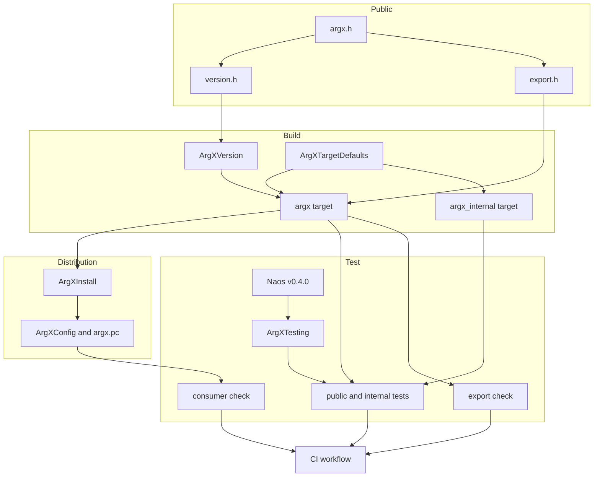
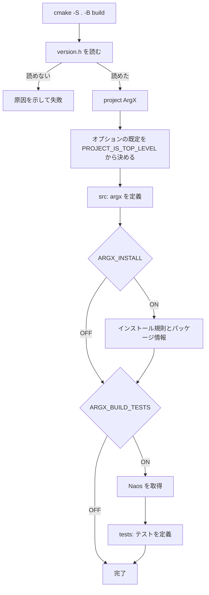
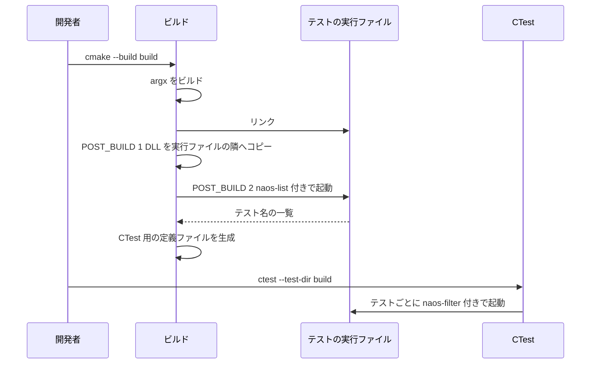

# Design Document: build-foundation

## Overview

**Purpose**: このスペックは、ArgX（ライブラリ名 `argx`）のビルド、配布、テスト基盤、CI、命名規約を用意する。ライブラリの機能は持たない。

**Users**: ライブラリ開発者は、3 つのコマンドでビルドとテストを実行し、決まった手順でソースとテストを足す。ライブラリ利用者は、`FetchContent`、`add_subdirectory`、`find_package`、pkg-config のどれかで `argx` を取り込む。

**Impact**: 現在のリポジトリにはスペック駆動開発の設定しかない。このスペックが、最初のソース、ビルド定義、CI、文書を追加する。

### Goals

- `cmake -S . -B build`、`cmake --build build`、`ctest --test-dir build` が Linux・macOS・Windows で通る。
- 同じソースから静的ライブラリと動的ライブラリをビルドでき、動的ライブラリは公開関数だけを export する。
- 4 つの取り込み方法がすべて動き、CI がそれを確かめる。
- 後続のスペックは、ビルド定義を変えずに、ソース一覧への追記と `argx_add_test()` の 1 行だけで機能とテストを足せる。

### Non-Goals

- ライブラリの機能と、その公開 API（バージョンを返す関数を除く）。
- 静的ライブラリと動的ライブラリを 1 回の構成で同時にビルドすること、同じインストール先へ両方を置くこと。
- リリースの自動化、CMake 以外のビルド定義、API リファレンスの生成、コード整形ツールの設定。
- MinGW、クロスコンパイル。動く可能性はあるが、確認しない。

## Boundary Commitments

### This Spec Owns

- CMake のプロジェクト定義、ライブラリのターゲット、コンパイル設定、オプション（`ARGX_BUILD_TESTS`、`ARGX_INSTALL`、`ARGX_WARNINGS_AS_ERRORS`）。
- 公開ヘッダの配置と、export マクロ `ARGX_API`、バージョンのマクロ、関数 `argx_version()`。
- インストール規則、`find_package(ArgX)` 用のパッケージ情報、`argx.pc`。
- テスト基盤。Naos の取り込み、`argx_add_test()`、内部関数のテスト用ターゲット `argx_internal`、export の確認、利用側の確認。
- CI のワークフロー。
- 命名規約、ディレクトリ構成、ソースとテストを足す手順の文書（`docs/conventions.md`）。
- README、ライセンス、`.gitignore`、`.editorconfig`、`.gitattributes`。

### Out of Boundary

- `argx_version()` 以外の公開関数、型、エラーコード、アロケータ（core-runtime 以降）。
- 個々の機能のテスト。ここで書くテストは、土台が動くことを確かめるものだけである。
- 共通のテスト補助（失敗を注入するアロケータなど）。core-runtime が用意する。
- Naos 自体の挙動の修正。

### Allowed Dependencies

- CMake 3.21 以上と、その標準モジュール（`FetchContent`、`GNUInstallDirs`、`CMakePackageConfigHelpers`）。
- 各 OS の C コンパイラ（GCC、Clang、MSVC）と C 標準ライブラリ。
- Naos v0.4.0。テストを有効にしたときだけ使う。ライブラリ本体と配布物は Naos に依存しない。
- GitHub Actions。CI だけが使う。
- ライブラリ本体は、C 標準ライブラリ以外にリンクしない。

### Revalidation Triggers

次の変更があったら、後続のスペックと利用者は取り込みを確かめ直す。

- `ARGX_API` の意味、または `ARGX_SHARED` / `ARGX_BUILDING` の扱いの変更。
- ターゲット名（`argx`、`ArgX::argx`、`argx_internal`）、ソース一覧の変数名、`argx_add_test()` の引数の変更。
- ディレクトリ構成、命名規約の変更。
- バージョンの符号化（`ARGX_VERSION_NUMBER` の式）、互換性の規則、SOVERSION の規則の変更。
- Naos のタグの変更。
- CMake の最低バージョンの変更。

## Architecture

### Architecture Pattern & Boundary Map

ターゲット中心の CMake 構成を採る。設定はすべてターゲットのプロパティとして持ち、全体設定（`CMAKE_C_FLAGS`、`add_compile_options()`、`CMAKE_RUNTIME_OUTPUT_DIRECTORY`）を変えない。こうすると、利用者のターゲットにも Naos にも設定が漏れない。



**Architecture Integration**:

- **Selected pattern**: ターゲット中心の CMake。機能ごとに `cmake/` のモジュールへ分け、トップの `CMakeLists.txt` は組み立てだけを行う。
- **Dependency direction**: 公開ヘッダ → ビルド（ライブラリ） → 配布 / テスト → CI。矢印の逆向きの参照をしない。ライブラリ本体はテストと配布を知らない。配布物はテストと Naos を含まない。
- **Boundaries**: バージョンの出どころは `version.h` だけ。公開関数の印は `ARGX_API` だけ。テストの登録は `argx_add_test()` だけ。それぞれ 1 か所にして、後続のスペックが迷わないようにする。
- **Steering compliance**: `roadmap.md` の Naming と Constraints（C99、CMake 3.21 以上、実行時の依存は C 標準ライブラリのみ、Naos はテスト時だけ）に従う。

### Technology Stack

| Layer | Choice / Version | Role in Feature | Notes |
|-------|------------------|-----------------|-------|
| 言語 | C99、コンパイラ拡張なし | ライブラリとテスト | MSVC でビルドできる範囲 |
| ビルド | CMake 3.21 以上 | 構成、ビルド、インストール、パッケージ生成 | `PROJECT_IS_TOP_LEVEL` と `TARGET_RUNTIME_DLLS` を使う |
| テスト | Naos v0.4.0、CTest | テストの記述と登録 | `FetchContent` でタグに固定。常に静的ライブラリになる |
| 配布 | CMake の Config パッケージ、pkg-config | 利用者による取り込み | `CMakePackageConfigHelpers`、`GNUInstallDirs` |
| CI | GitHub Actions | 4 環境 × 静的/動的 | Linux の GCC と Clang、macOS の Clang、Windows の MSVC |

## File Structure Plan

### Directory Structure

```
CMakeLists.txt                     # 組み立てだけ。バージョン読み取り、project()、オプション、各ディレクトリの追加
cmake/
├── ArgXVersion.cmake            # argx_read_version(): version.h からバージョンを読む
├── ArgXTargetDefaults.cmake     # argx_target_defaults(): C99、警告、可視性をターゲットに付ける
├── ArgXInstall.cmake            # インストール規則、Config とバージョンファイル、argx.pc の生成
├── ArgXTesting.cmake            # Naos の取り込み、argx_add_test()
├── ArgXCheckExports.cmake       # cmake -P で動くスクリプト。動的ライブラリの export を調べる
├── ArgXCTestDefaults.cmake      # ctest に構成が指定されないときの既定を与える
├── ArgXConfig.cmake.in          # find_package 用 Config のひな形
└── argx.pc.in                   # pkg-config のひな形
include/
└── argx/                          # 公開ヘッダはすべてここ。インストールされる
    ├── argx.h                     # 利用者が取り込む唯一の入口。ほかの公開ヘッダを取り込む
    ├── export.h                   # ARGX_API
    └── version.h                  # バージョンのマクロと argx_version() の宣言
src/                               # 実装と内部ヘッダ。インストールされない
├── CMakeLists.txt                 # ソース一覧 ARGX_SOURCES、ターゲット argx と argx_internal
├── version.c                      # argx_version() の実装
└── version_internal.h             # 内部関数 argx_version_pack() の宣言
tests/
├── CMakeLists.txt                 # argx_add_test() の呼び出しと、export 確認の登録
├── public/                        # 公開 API のテスト。ArgX::argx にリンクする
│   └── version_test.c
├── internal/                      # 内部関数のテスト。argx_internal にリンクする
│   └── version_internal_test.c
└── consumer/                      # 利用側の確認。本体のビルドには含めない
    ├── CMakeLists.txt             # 取り込み方法を ARGX_CONSUME_MODE で切り替える小さなプロジェクト
    ├── main.c                     # argx_version() を呼び、ヘッダの値と比べる
    └── run.cmake                  # cmake -P で動く駆動スクリプト。インストール、移動、4 つのモードの実行
docs/
└── conventions.md                 # 命名規約、ディレクトリ構成、ソースとテストを足す手順
.github/workflows/ci.yml           # CI
README.md
LICENSE
.gitignore
.editorconfig
.gitattributes
```

### Modified Files

- なし。既存のファイル（`.claude/`、`.kiro/`、`CLAUDE.md`）は変更しない。

## System Flows

### 構成時の流れ



バージョンは `project()` より前に読む。`project(ArgX VERSION ...)` に渡すためである。

### テストの実行ファイルのビルド



POST_BUILD は追加した順に走る。DLL のコピーを、Naos の列挙より前に追加する。コピーは Windows で動的ライブラリをビルドするときだけ追加する。

## Requirements Traceability

| Requirement | Summary | Components | Interfaces | Flows |
|-------------|---------|------------|------------|-------|
| 1.1 | 3 コマンドで通る | TopLevel、CTestDefaults、CI | トップの `CMakeLists.txt` | 構成時の流れ |
| 1.2, 1.3 | CMake 3.21 以上 | TopLevel | `cmake_minimum_required` | — |
| 1.4 | C99、拡張なし | TargetDefaults | `argx_target_defaults()` | — |
| 1.5 | 依存は C 標準ライブラリのみ | Library | `argx` のリンク先なし | — |
| 1.6 | 警告を有効にする | TargetDefaults | `argx_target_defaults()` | — |
| 2.1, 2.2, 2.3 | 静的/動的の切り替え | Library | `BUILD_SHARED_LIBS` | — |
| 2.4 | SOVERSION | Library、VersionSource | `SOVERSION` の規則 | — |
| 2.5 | Debug の名前 | Library、PackageInstall | `DEBUG_POSTFIX` | — |
| 3.1, 3.2 | 公開関数だけ export | ExportMacro、TargetDefaults、ExportCheck | `ARGX_API`、可視性の既定 | — |
| 3.3, 3.4 | 追加の定義なしで使える | ExportMacro、Library、PackageInstall | `ARGX_SHARED` の伝達 | — |
| 3.5 | 印の付け方は 1 つ | ExportMacro、Conventions | `ARGX_API` | — |
| 4.1 | プロジェクト名と成果物名 | TopLevel、Library | `project(ArgX)`、`OUTPUT_NAME` | — |
| 4.2 | ヘッダの置き場所 | PublicHeaders | `<argx/argx.h>` | — |
| 4.3 | 接頭辞 | Conventions、ExportCheck | 命名規約 | — |
| 4.4 | `cargs` を使わない | Conventions、TopLevel、PackageInstall | 命名規約 | — |
| 4.5, 4.6 | 規約と手順の文書 | Conventions | `docs/conventions.md` | — |
| 5.1 | コンパイル時のバージョン | VersionSource | `ARGX_VERSION_*` | — |
| 5.2 | 実行時のバージョン | VersionFunction | `argx_version()` | — |
| 5.3 | 出どころは 1 つ | VersionSource、Library、PackageInstall | `argx_read_version()` | 構成時の流れ |
| 5.4 | 読めなければ失敗 | VersionSource | `argx_read_version()` | 構成時の流れ |
| 5.5 | 公開関数は 1 つだけ | VersionFunction、ExportCheck | `argx_version()` | — |
| 6.1, 6.2 | 組み込みでターゲットを提供 | Library | `ArgX::argx` | — |
| 6.3, 6.4, 6.5 | 既定とオプション | TopLevel | `ARGX_*` オプション | 構成時の流れ |
| 6.6 | 警告を利用者へ伝えない | TargetDefaults | `PRIVATE` のコンパイルオプション | — |
| 7.1 | インストール物 | PackageInstall | インストール先の表 | — |
| 7.2 | `find_package` | PackageInstall | `ArgXConfig.cmake` | — |
| 7.3 | バージョンの互換判定 | PackageInstall | `ArgXConfigVersion.cmake` | — |
| 7.4 | pkg-config | PackageInstall | `argx.pc` | — |
| 7.5 | 再配置 | PackageInstall、ConsumerCheck | 相対パス | — |
| 7.6 | テストと内部ヘッダを含めない | PackageInstall | インストール先の表 | — |
| 7.7 | 静的でも動的でも同じ手順 | PackageInstall、ConsumerCheck | `ArgX::argx`、`argx.pc` | — |
| 8.1, 8.2 | Naos の取得 | TestHarness | `FetchContent`、`ARGX_BUILD_TESTS` | 構成時の流れ |
| 8.3 | テストの登録 | TestHarness | `argx_add_test()` | テストの実行ファイルのビルド |
| 8.4 | 公開 API のテスト | TestHarness | `argx_add_test()` | — |
| 8.5 | 内部関数のテスト | TestHarness、Library | `argx_add_test(... INTERNAL)`、`argx_internal` | — |
| 8.6 | Windows の DLL | TestHarness | DLL のコピー | テストの実行ファイルのビルド |
| 8.7 | バージョンのテスト | TestHarness、VersionFunction | `tests/public/version_test.c` | — |
| 8.8 | 失敗時の終了コード | TestHarness | CTest の標準の動作 | — |
| 9.1, 9.2, 9.3, 9.6 | CI のマトリクス | CI | `ci.yml` | — |
| 9.4 | 取り込みの確認 | ConsumerCheck、CI | `tests/consumer/run.cmake` | — |
| 9.5 | export の確認 | ExportCheck、CI | `ArgXCheckExports.cmake` | — |
| 10.1 | ライセンス | RepoFiles | `LICENSE` | — |
| 10.2 | README | RepoFiles | `README.md` | — |
| 10.3 | 生成物の除外 | RepoFiles | `.gitignore` | — |
| 10.4 | 書式の設定 | RepoFiles | `.editorconfig`、`.gitattributes` | — |

## Components and Interfaces

| Component | Domain | Intent | Req Coverage | Key Dependencies | Files |
|-----------|--------|--------|--------------|------------------|-------|
| TopLevel | ビルド | 組み立てとオプション | 1.1, 1.2, 1.3, 4.1, 4.4, 6.3, 6.4, 6.5 | VersionSource (P0) | `CMakeLists.txt` |
| VersionSource | 公開面 | バージョンの唯一の出どころ | 2.4, 5.1, 5.3, 5.4 | なし | `include/argx/version.h`、`cmake/ArgXVersion.cmake` |
| ExportMacro | 公開面 | 公開関数の印 | 3.1, 3.2, 3.3, 3.4, 3.5 | なし | `include/argx/export.h` |
| PublicHeaders | 公開面 | 利用者が取り込む入口 | 4.2 | VersionSource、ExportMacro (P0) | `include/argx/argx.h` |
| TargetDefaults | ビルド | C99、警告、可視性 | 1.4, 1.6, 3.1, 3.2, 6.6 | なし | `cmake/ArgXTargetDefaults.cmake` |
| Library | ビルド | ライブラリのターゲット | 1.5, 2.1, 2.2, 2.3, 2.4, 2.5, 3.3, 3.4, 4.1, 5.3, 6.1, 6.2, 8.5 | TargetDefaults、VersionSource (P0) | `src/CMakeLists.txt` |
| VersionFunction | 公開面 | 実行時のバージョン | 5.2, 5.5, 8.7 | VersionSource、ExportMacro (P0) | `src/version.c`、`src/version_internal.h` |
| PackageInstall | 配布 | インストールとパッケージ情報 | 2.5, 3.3, 3.4, 4.4, 5.3, 7.1, 7.2, 7.3, 7.4, 7.5, 7.6, 7.7 | Library (P0) | `cmake/ArgXInstall.cmake`、`cmake/ArgXConfig.cmake.in`、`cmake/argx.pc.in` |
| TestHarness | テスト | Naos の取り込みとテストの登録 | 8.1, 8.2, 8.3, 8.4, 8.5, 8.6, 8.7, 8.8 | Library (P0)、Naos (P0) | `cmake/ArgXTesting.cmake`、`tests/CMakeLists.txt`、`tests/public/`、`tests/internal/` |
| CTestDefaults | テスト | `ctest` の既定の構成 | 1.1 | なし | `cmake/ArgXCTestDefaults.cmake` |
| ExportCheck | テスト | export の確認 | 3.1, 3.2, 4.3, 5.5, 9.5 | Library (P0) | `cmake/ArgXCheckExports.cmake` |
| ConsumerCheck | テスト | 取り込みの確認 | 7.5, 7.7, 9.4 | PackageInstall (P0) | `tests/consumer/` |
| CI | CI | マトリクスの実行 | 1.1, 9.1, 9.2, 9.3, 9.4, 9.5, 9.6 | すべて | `.github/workflows/ci.yml` |
| Conventions | 文書 | 規約と手順 | 3.5, 4.3, 4.4, 4.5, 4.6 | なし | `docs/conventions.md` |
| RepoFiles | 文書 | 基本の文書と設定 | 10.1, 10.2, 10.3, 10.4 | なし | `README.md`、`LICENSE`、`.gitignore`、`.editorconfig`、`.gitattributes` |

### 公開面

#### VersionSource

| Field | Detail |
|-------|--------|
| Intent | バージョンを 1 か所に持ち、ビルドと配布のすべてがそこから読む |
| Requirements | 2.4, 5.1, 5.3, 5.4 |

**Responsibilities & Constraints**

- `include/argx/version.h` が、メジャー、マイナー、パッチを整数リテラルのマクロとして持つ。最初の値は 0.1.0 とする。
- 各要素は 0〜255 の範囲とする。
- `argx_read_version()` がこのヘッダを文字列として読み、`project()` に渡す形式（`<major>.<minor>.<patch>`）を返す。
- ほかの場所（CMake のファイル、`.pc` のひな形、README）にバージョンの数字を書かない。

**Contracts**: Service [x]

##### Service Interface

```c
/* include/argx/version.h */
#define ARGX_VERSION_MAJOR 0
#define ARGX_VERSION_MINOR 1
#define ARGX_VERSION_PATCH 0

#define ARGX_MAKE_VERSION(major, minor, patch) \
    (((unsigned long)(major) << 16) | ((unsigned long)(minor) << 8) | (unsigned long)(patch))

#define ARGX_VERSION_NUMBER \
    ARGX_MAKE_VERSION(ARGX_VERSION_MAJOR, ARGX_VERSION_MINOR, ARGX_VERSION_PATCH)
```

```cmake
# cmake/ArgXVersion.cmake
argx_read_version(<header-path> <out-var>)
```

- Preconditions: `<header-path>` が存在し、3 つのマクロがそれぞれ 1 行で `#define ARGX_VERSION_<PART> <整数>` の形で書かれている。
- Postconditions: `<out-var>` に `<major>.<minor>.<patch>` が入る。
- 失敗: ファイルがない、3 つのどれかが見つからない、値が 0〜255 の整数でない場合、ヘッダのパスと見つからなかったマクロ名を示して `FATAL_ERROR` にする。
- Invariants: `project()` より前に呼べる（`project()` が設定する変数に依存しない）。

#### ExportMacro

| Field | Detail |
|-------|--------|
| Intent | 公開関数に付ける印を 1 つだけ提供する |
| Requirements | 3.1, 3.2, 3.3, 3.4, 3.5 |

**Responsibilities & Constraints**

- `ARGX_API` を、次の表のとおりに展開する。

| `ARGX_SHARED` | `ARGX_BUILDING` | Windows | GCC / Clang（Windows 以外） | その他 |
|---|---|---|---|---|
| 未定義 | どちらでも | 空 | 空 | 空 |
| 定義 | 定義 | `__declspec(dllexport)` | `__attribute__((visibility("default")))` | 空 |
| 定義 | 未定義 | `__declspec(dllimport)` | `__attribute__((visibility("default")))` | 空 |

- `ARGX_SHARED` は「動的ライブラリとして使う」ことを表す。ライブラリのターゲットが動的のときに `PUBLIC` で定義し、利用者へ伝える。`argx.pc` も動的のときだけ `Cflags` に含める。
- `ARGX_BUILDING` は「ライブラリ自身をコンパイルしている」ことを表す。`PRIVATE` で定義し、利用者へ伝えない。
- 何も定義しない状態が静的である。静的ライブラリの利用者に DLL 用の属性が付くことはない。
- 公開するのは関数だけとする。変数を export しない。これにより、Windows で `ARGX_SHARED` が利用者へ伝わらなくても、動的ライブラリへのリンクは成功する。
- CMake の `GenerateExportHeader` は使わない。ヘッダをソースツリーにそろえ、ビルドディレクトリの生成物に頼らないためである。

**Contracts**: Service [x]

##### Service Interface

```c
/* 公開関数の宣言の書き方。後続のスペックも同じ形で書く */
ARGX_API unsigned long argx_version(void);
```

- Invariants: `ARGX_API` は関数宣言の先頭に置く。公開ヘッダの宣言は `extern "C"` のガードで囲む（C++ から取り込めるようにする）。

#### PublicHeaders

`include/argx/argx.h` は、`export.h` と `version.h` を取り込むだけの入口である（4.2）。利用者は `<argx/argx.h>` だけを取り込む。後続のスペックは、公開ヘッダを `include/argx/` に足し、`argx.h` に取り込みを 1 行足す。

#### VersionFunction

| Field | Detail |
|-------|--------|
| Intent | リンクしているライブラリのバージョンを実行時に返す |
| Requirements | 5.2, 5.5, 8.7 |

**Contracts**: Service [x]

##### Service Interface

```c
/* include/argx/version.h（公開） */
ARGX_API unsigned long argx_version(void);

/* src/version_internal.h（内部。export しない） */
unsigned long argx_version_pack(unsigned int major, unsigned int minor, unsigned int patch);
```

- `argx_version()` の Postconditions: ライブラリをビルドしたときの `ARGX_VERSION_NUMBER` と同じ値を返す。失敗しない。引数も状態も持たない。
- `argx_version_pack()` の Preconditions: 各引数が 0〜255。Postconditions: `ARGX_MAKE_VERSION` と同じ値を返す。
- 利用者は `argx_version() == ARGX_VERSION_NUMBER` で、ヘッダとライブラリが合っているかを確かめる。

**Implementation Notes**

- `argx_version_pack()` は、内部関数のテストと export の確認が対象を持てるように置く最小の内部関数である。`argx_version()` はこれを通して値を作る。
- このスペックでは、ほかの公開関数を足さない（5.5）。

### ビルド

#### TopLevel

| Field | Detail |
|-------|--------|
| Intent | プロジェクトを定義し、オプションを決め、各部を組み立てる |
| Requirements | 1.1, 1.2, 1.3, 4.1, 4.4, 6.3, 6.4, 6.5 |

**Responsibilities & Constraints**

- `cmake_minimum_required(VERSION 3.21)` を最初に書く。古い CMake では、CMake 自身が必要なバージョンを示して失敗する（1.3）。
- `project(ArgX VERSION <version.h から読んだ値> LANGUAGES C)`。C++ を有効にしない。
- オプションは次の 3 つ。既定は `PROJECT_IS_TOP_LEVEL` の値にする。

| オプション | トップレベルの既定 | 組み込み時の既定 | 効果 |
|---|---|---|---|
| `ARGX_BUILD_TESTS` | ON | OFF | Naos を取得し、テストをビルドして CTest に登録する |
| `ARGX_INSTALL` | ON | OFF | インストール規則とパッケージ情報を生成する |
| `ARGX_WARNINGS_AS_ERRORS` | ON | OFF | ArgX のターゲットで警告をエラーにする |

- `BUILD_SHARED_LIBS` は CMake の標準の変数をそのまま使う。ArgX 独自の切り替えを作らない。
- `ARGX_BUILD_TESTS` が ON のとき、`enable_testing()` を呼んでから `tests/` を追加する。
- トップレベルかつマルチコンフィグのジェネレータのとき、CTestDefaults を登録する。
- 全体設定を変えない。`CMAKE_C_FLAGS`、`CMAKE_C_STANDARD`、出力ディレクトリ、`add_compile_options()` に触れない。

**Implementation Notes**

- Risks: ArgX を組み込んだ親が `ARGX_BUILD_TESTS=ON` を指定した場合、親のトップレベルで `enable_testing()` を呼ばないと、ビルドディレクトリの直下で実行した `ctest` はテストを見つけない。これは CTest の仕様なので、README に書く。

#### TargetDefaults

| Field | Detail |
|-------|--------|
| Intent | ArgX のターゲットに共通のコンパイル設定を付ける |
| Requirements | 1.4, 1.6, 3.1, 3.2, 6.6 |

**Contracts**: Service [x]

##### Service Interface

```cmake
# cmake/ArgXTargetDefaults.cmake
argx_target_defaults(<target> [STRICT])
```

- 設定する内容:
  - `C_STANDARD 99`、`C_STANDARD_REQUIRED ON`、`C_EXTENSIONS OFF`。
  - `C_VISIBILITY_PRESET hidden`、`WINDOWS_EXPORT_ALL_SYMBOLS OFF`。親が全シンボルの export を有効にしていても、公開関数だけを export する。
  - 警告。すべて `PRIVATE` で付ける。

| コンパイラ | 基本 | `STRICT` で追加 | `ARGX_WARNINGS_AS_ERRORS` で追加 |
|---|---|---|---|
| GCC、Clang | `-Wall -Wextra -Wpedantic` | `-Wshadow -Wconversion -Wstrict-prototypes -Wmissing-prototypes` | `-Werror` |
| MSVC | `/W4` | なし | `/WX` |

- ライブラリ（`argx`、`argx_internal`）には `STRICT` を付ける。テストの実行ファイルには付けない。テストコードは Naos のマクロを展開するので、Naos の CI が通している範囲の警告にとどめる。
- Postconditions: `<target>` にリンクするターゲットへ、警告と C 標準の設定は伝わらない（6.6）。

#### Library

| Field | Detail |
|-------|--------|
| Intent | ライブラリのターゲットと、内部関数のテスト用ターゲットを定義する |
| Requirements | 1.5, 2.1, 2.2, 2.3, 2.4, 2.5, 3.3, 3.4, 4.1, 5.3, 6.1, 6.2, 8.5 |

**Responsibilities & Constraints**

- `src/CMakeLists.txt` が、ソース一覧を変数 `ARGX_SOURCES` に持つ。後続のスペックは、この一覧に 1 行足すだけでソースを追加する。
- ターゲット `argx`:
  - `add_library(argx ${ARGX_SOURCES})`。種類を書かないので、`BUILD_SHARED_LIBS` に従う（2.1、2.2）。
  - 別名 `ArgX::argx` を作る。インストール後のターゲット名と同じなので、利用者は取り込み方法によらず同じ名前でリンクする（6.1）。
  - 公開の取り込みパスは、ビルド時が `include/`、インストール後が `<prefix>/include`。内部ヘッダのための `src/` は `PRIVATE`。
  - `OUTPUT_NAME argx`、`DEBUG_POSTFIX d`（2.5）。Debug の成果物は `libargxd.a`、`argxd.dll` などになる。
  - `VERSION` はバージョン全体。`SOVERSION` は、メジャーが 0 の間は `0.<minor>`、1 以上は `<major>`（2.4）。
  - 動的のとき、`ARGX_SHARED` を `PUBLIC`、`ARGX_BUILDING` を `PRIVATE` で定義する。静的のとき、`ARGX_BUILDING` だけを `PRIVATE` で定義する。
  - ほかのライブラリへリンクしない（1.5）。
- ターゲット `argx_internal`（`ARGX_BUILD_TESTS` が ON のときだけ作る）:
  - 動的のとき: 同じ `ARGX_SOURCES` から作る静的ライブラリ。`ARGX_SHARED` を定義しない。インストールしない。
  - 静的のとき: `argx` にリンクするだけのインターフェースライブラリ。
  - どちらの場合も、`include/` と `src/` を取り込みパスとして利用側へ伝える。内部関数のテストは、内部ヘッダを `"version_internal.h"` の形で取り込む。

**Implementation Notes**

- Integration: `argx_internal` を動的のときに別に作る理由は、動的ライブラリが内部関数を export しないためである。本体の成果物には手を加えない。
- Risks: 動的かつテスト有効のとき、ソースを 2 回コンパイルする。

### 配布

#### PackageInstall

| Field | Detail |
|-------|--------|
| Intent | インストール規則と、2 種類のパッケージ情報を生成する |
| Requirements | 2.5, 3.3, 3.4, 4.4, 5.3, 7.1, 7.2, 7.3, 7.4, 7.5, 7.6, 7.7 |

**Responsibilities & Constraints**

- `ARGX_INSTALL` が ON のときだけ有効にする。
- インストール先は `GNUInstallDirs` に従う。

| インストール物 | 場所 |
|---|---|
| 静的ライブラリ、import ライブラリ、共有ライブラリ（Windows 以外） | `${CMAKE_INSTALL_LIBDIR}` |
| DLL | `${CMAKE_INSTALL_BINDIR}` |
| 公開ヘッダ（`include/argx/` の全体） | `${CMAKE_INSTALL_INCLUDEDIR}/argx` |
| `ArgXConfig.cmake`、`ArgXConfigVersion.cmake`、`ArgXTargets*.cmake` | `${CMAKE_INSTALL_LIBDIR}/cmake/ArgX` |
| `argx.pc` | `${CMAKE_INSTALL_LIBDIR}/pkgconfig` |

- `src/` の内部ヘッダ、テスト、Naos、`argx_internal` はインストールしない（7.6）。
- **Config パッケージ**:
  - ターゲットを名前空間 `ArgX::` で書き出す。利用者には `ArgX::argx` として見える（7.2）。
  - 動的のとき、書き出されたターゲットは `ARGX_SHARED` の定義を利用者へ伝える（3.3）。静的のときは伝えない（3.4）。
  - バージョンファイルの互換性は、メジャーが 0 の間は `SameMinorVersion`、1 以上は `SameMajorVersion`（7.3）。SOVERSION と同じ区切りである。
  - 生成物はインストール先からの相対パスで動く（7.5）。
- **pkg-config**:
  - `Name: argx`、`Version` は `version.h` の値、`Cflags` は `-I${includedir}`（動的のとき `-DARGX_SHARED` を足す）、`Libs` は `-L${libdir} -l<成果物名>`。
  - `<成果物名>` は、インストールする構成の実際の名前にする。Debug では `argxd` になる（2.5、7.4）。そのため `.pc` は構成ごとに生成する。
  - `prefix` は `${pcfiledir}` からの相対パスで書く（7.5）。`CMAKE_INSTALL_LIBDIR` が絶対パスで指定された場合は、絶対パスを書く。
- 静的と動的で、ファイル名（`ArgXConfig.cmake`、`argx.pc`）と利用者の手順は同じである（7.7）。同じインストール先に両方を置くことは対象外とする。

### テスト

#### TestHarness

| Field | Detail |
|-------|--------|
| Intent | Naos を取り込み、テストを 1 行で登録できるようにする |
| Requirements | 8.1, 8.2, 8.3, 8.4, 8.5, 8.6, 8.7, 8.8 |

**Dependencies**

- External: Naos v0.4.0 — テストの記述と列挙（P0）。`FetchContent` で `GIT_TAG v0.4.0` に固定する。タグの指定は `cmake/ArgXTesting.cmake` の 1 か所だけに書く。
- Outbound: Library — `ArgX::argx`、`argx_internal`（P0）。

**Contracts**: Service [x]

##### Service Interface

```cmake
# cmake/ArgXTesting.cmake
argx_add_test(<name>
    SOURCES <source>...
    [INTERNAL])
```

- 行うこと:
  1. 実行ファイル `argx_test_<name>` を `<source>...` から作る。
  2. `argx_target_defaults()` を `STRICT` なしで適用する。
  3. `Naos::naos` と、`INTERNAL` がなければ `ArgX::argx`、あれば `argx_internal` にリンクする。
  4. Windows で動的ライブラリをビルドしていて、`INTERNAL` がないとき、実行に必要な DLL を実行ファイルの隣へコピーする POST_BUILD を追加する（8.6）。
  5. `naos_discover_tests()` を呼ぶ。CTest での名前は `<name>.<suite>.<test>`、ラベルは `public` または `internal`。
- Preconditions: `tests/CMakeLists.txt` から呼ぶ。`<name>` は全体で一意。各ソースは、`<name>` の実行ファイルの中で `NAOS_MAIN` をちょうど 1 つ持つ。
- Postconditions: `cmake --build` の後、`ctest` がそのファイルのテストを実行する（8.3）。テストが 1 つでも失敗すれば、`ctest` は 0 以外で終わる（8.8）。
- Invariants: 4 を 5 より前に追加する。Naos の列挙が DLL を必要とするためである。

**Responsibilities & Constraints**

- `ARGX_BUILD_TESTS` が OFF のとき、このモジュールを読み込まない。Naos を取得しない（8.2）。
- テストは 1 ファイル 1 実行ファイルを基本とする。スイートを列挙する共有ファイルを持たないので、後続のスペックが並行してテストを足してもぶつからない。
- 公開 API のテスト（`tests/public/`）は、構成で選ばれた形のライブラリに対して実行される（8.4）。内部関数のテスト（`tests/internal/`）は、どちらの構成でも静的にリンクされる（8.5）。
- このスペックが置くテスト（8.7）:
  - `tests/public/version_test.c`: `argx_version()` が `ARGX_VERSION_NUMBER` と等しいこと。各要素を取り出すと `ARGX_VERSION_MAJOR` などと等しいこと。
  - `tests/internal/version_internal_test.c`: `argx_version_pack()` が `ARGX_MAKE_VERSION` と同じ値を返すこと。境界値（0 と 255）を含める。

**Implementation Notes**

- Integration: `naos_add_executable()` は使わない。列挙が必ず先に走り、DLL のコピーを前に入れられないためである。
- Validation: Naos はアサーションを 1 つも実行しないテストを失敗にする。テストは必ず 1 つ以上のアサーションを持つ。
- Risks:
  - Naos v0.4.0 には、`NAOS_CHECK_NOT_NULL` / `NAOS_REQUIRE_NOT_NULL` を未書き込みのメモリや関数ポインタに使うと警告が出る既知の問題がある。警告をエラーにしているとビルドが止まる。`docs/conventions.md` に、該当する使い方を避けるよう書く。
  - テストを有効にすると、構成のときにネットワークが要る。README に、`FETCHCONTENT_SOURCE_DIR_NAOS` で手元のコピーを使う方法と、`ARGX_BUILD_TESTS=OFF` を書く。

#### CTestDefaults

`cmake/ArgXCTestDefaults.cmake` は、`ctest` に構成が指定されなかったとき、既定を `Debug` にする小さなスクリプトである（1.1）。トップレベルかつマルチコンフィグのジェネレータのときだけ、トップのディレクトリの `TEST_INCLUDE_FILES` に登録する。`cmake --build build` が構成の指定なしでビルドするのは `Debug` なので、それに合わせる。`-C` を指定した場合は、その指定が優先される。

- Risks: この方法は CMake の文書からの推定で、実機で確かめていない。実装の最初に Windows で確かめる。動かない場合は、要件 1.1 の Windows での手順に関わるので、設計へ戻す。

#### ExportCheck

| Field | Detail |
|-------|--------|
| Intent | 動的ライブラリが export するシンボルを規則と照らす |
| Requirements | 3.1, 3.2, 4.3, 5.5, 9.5 |

**Responsibilities & Constraints**

- `cmake -P` で動くスクリプト。動的ライブラリをビルドし、テストが有効なとき、CTest に `argx.exports` という名前で登録する。開発者の手元でも CI でも同じものが走る。
- シンボルの一覧は、Linux と macOS では `nm`、MSVC では `dumpbin` で得る。道具が見つからない場合、テストは失敗する。
- 判定の規則:
  - 期待する一覧は、公開ヘッダ（`include/argx/` の全体）から `ARGX_API` の付いた関数宣言の名前を抜き出して作る。
  - export された関数の集合が、期待する一覧と完全に一致すること。公開ヘッダにない関数が export されていれば失敗（3.2）。`ARGX_API` を付けたのに export されていない関数があっても失敗（3.1）。
  - 期待する一覧の名前がすべて `argx_` で始まること（4.3）。
  - 食い違いがあれば、その名前を示して失敗。
- 公開関数と内部関数は名前では区別しない（どちらも `argx_` で始まる）。区別は `ARGX_API` の有無だけなので、このチェックも `ARGX_API` を基準にする。
- 期待する一覧を手で保守しない。後続のスペックが公開関数を足しても、このチェックを変える必要はない。

**Implementation Notes**

- Validation: macOS では、シンボル名の先頭に `_` が付く。比較の前に取り除く。公開ヘッダの読み取りは、コメントを除いたうえで、`ARGX_API` から最初の `(` までの間の最後の識別子を関数名とする。
- このスペックの時点で export されるのは `argx_version` だけなので、5.5 もこのチェックで確かめる。後続のスペックが関数を足した時点で、5.5 の確認は役目を終える。

#### ConsumerCheck

| Field | Detail |
|-------|--------|
| Intent | 4 つの取り込み方法が、リポジトリの外のプロジェクトから動くことを確かめる |
| Requirements | 7.5, 7.7, 9.4 |

**Contracts**: Batch [x]

##### Batch / Job Contract

- Trigger: `cmake -D ARGX_BUILD_DIR=<dir> -D ARGX_CONFIG=<Debug|Release> -D ARGX_SHARED=<ON|OFF> -P tests/consumer/run.cmake`。CI が呼ぶ。開発者も手元で同じコマンドを実行できる。
- Input: ビルド済みのビルドディレクトリ、構成、ライブラリの形。
- 手順:
  1. ビルドディレクトリから一時的な場所へインストールする。
  2. インストール先のディレクトリ名を変える。以後は移動後の場所を使う（7.5）。
  3. `tests/consumer/` を作業用のディレクトリへコピーし、リポジトリの外のプロジェクトとして、次の 4 つのモードで構成、ビルド、実行する。

| `ARGX_CONSUME_MODE` | 取り込み方 | 確かめること |
|---|---|---|
| `find_package` | `find_package(ArgX <version> REQUIRED)` | `ArgX::argx` にリンクして実行できる |
| `pkg_config` | pkg-config の `argx` | 返されたフラグでコンパイル、リンク、実行できる。バージョンが一致する |
| `add_subdirectory` | リポジトリを `add_subdirectory()` | 実行できる。Naos のターゲットとテストが作られていない。インストール規則が足されていない |
| `fetch_content` | `FetchContent` でリポジトリのチェックアウトを指す | `add_subdirectory` と同じ |

- Output: すべて成功すれば 0。失敗すれば、失敗したモードを示して 0 以外で終わる。
- `main.c` は `argx_version() == ARGX_VERSION_NUMBER` を確かめ、等しければ 0 を返す。
- Idempotency: 作業用のディレクトリを毎回作り直す。

**Implementation Notes**

- `fetch_content` モードは、ネットワークを使わず、手元のチェックアウトを指す。確かめたいのは「いまのコミットが `FetchContent` で組み込めること」である。
- `pkg_config` モードは Linux と macOS だけで実行する。Windows の MSVC では、`argx.pc` がインストールされていることだけを確かめる。MSVC で pkg-config を使う経路は一般的でなく、ランナーに入っている保証もないためである。
- Windows で動的ライブラリを使うモードでは、利用側のプロジェクトが DLL を実行ファイルの隣へコピーする。

### CI

#### CI

| Field | Detail |
|-------|--------|
| Intent | 対応環境のすべてで、ビルド、テスト、確認を自動で実行する |
| Requirements | 1.1, 9.1, 9.2, 9.3, 9.4, 9.5, 9.6 |

**Contracts**: Batch [x]

##### Batch / Job Contract

- Trigger: すべてのブランチへのプッシュと、プルリクエスト（9.1）。同じブランチの古い実行は取り消す。
- ジョブ:

| ジョブ | マトリクス | 手順 |
|---|---|---|
| `build` | 環境 4 つ（Linux の GCC、Linux の Clang、macOS の Clang、Windows の MSVC）× 形 2 つ（静的、動的） | Debug と Release のそれぞれで、構成、ビルド、`ctest`、ConsumerCheck |
| `quickstart` | OS 3 つ | 追加の引数なしで、3 つのコマンドだけを実行する |

- `build` は、警告をエラーにする既定のままビルドする（9.3）。動的のとき、`ctest` が `argx.exports` を実行する（9.5）。
- `quickstart` は要件 1.1 をそのまま確かめる。特に、Windows で `ctest` に `-C` を付けずに通ることを守る。
- マトリクスの 1 つが失敗しても、ほかを最後まで実行する。1 つでも失敗すれば全体が失敗になる。ジョブ名に環境と形を含め、どの組み合わせが失敗したかが分かるようにする（9.6）。
- 権限はリポジトリの読み取りだけにする。

### 文書

#### Conventions

| Field | Detail |
|-------|--------|
| Intent | 後続のスペックが従う規約と手順を 1 つの文書にまとめる |
| Requirements | 3.5, 4.3, 4.4, 4.5, 4.6 |

`docs/conventions.md` に、次を書く。

**命名規約**（4.3、4.4、4.5）

| 対象 | 規約 | 例 |
|---|---|---|
| 公開する関数と型 | `argx_` + 小文字のスネークケース | `argx_version` |
| 公開するマクロと列挙定数 | `ARGX_` + 大文字のスネークケース | `ARGX_VERSION_MAJOR` |
| 内部の関数と型（ファイルをまたぐもの） | 公開と同じ `argx_` + 小文字のスネークケース。`ARGX_API` を付けず、`src/` の内部ヘッダで宣言する | `argx_version_pack` |
| 内部のマクロ | 公開と同じ `ARGX_` + 大文字のスネークケース。`src/` の内部ヘッダで定義する | — |
| ファイル内だけの関数 | `static` を付ける。接頭辞は不要 | — |
| 公開ヘッダ | `include/argx/<名前>.h` | `include/argx/version.h` |
| ソースと内部ヘッダ | `src/<名前>.c`、`src/<名前>_internal.h` | `src/version.c` |
| テスト | `tests/public/<名前>_test.c`、`tests/internal/<名前>_test.c` | `tests/public/version_test.c` |
| CMake のオプション、関数、モジュール | `ARGX_<名前>`、`argx_<名前>()`、`cmake/ArgX<名前>.cmake` | `ARGX_BUILD_TESTS` |

- 公開と内部は接頭辞で区別しない。公開かどうかは、`include/argx/` のヘッダで `ARGX_API` を付けて宣言されているかで決まる。
- どの公開名にも `cargs` を使わない。
- 公開する変数を持たない。公開するのは関数、型、マクロだけである。

**手順**（3.5、4.6）

| したいこと | 手順 |
|---|---|
| 公開関数を足す | 公開ヘッダの宣言の先頭に `ARGX_API` を付ける。`ARGX_API`、戻り値の型、関数名、`(` をこの順に書く（export の確認が宣言を読み取るため）。`extern "C"` のガードの中に書く |
| 公開ヘッダを足す | `include/argx/` に置き、`argx.h` に取り込みを 1 行足す |
| ソースを足す | `src/` に置き、`src/CMakeLists.txt` の `ARGX_SOURCES` に 1 行足す |
| 公開 API のテストを足す | `tests/public/` に置き、`tests/CMakeLists.txt` に `argx_add_test(<name> SOURCES public/<file>)` を足す |
| 内部関数のテストを足す | `tests/internal/` に置き、`argx_add_test(<name> SOURCES internal/<file> INTERNAL)` を足す |

- テストを書くときの注意（`NAOS_MAIN` を 1 つ持つこと、アサーションを 1 つ以上実行すること、Naos v0.4.0 の既知の警告を避ける書き方）も書く。

#### RepoFiles

| ファイル | 内容 | Requirements |
|---|---|---|
| `LICENSE` | ライセンスの全文。MIT を使う | 10.1 |
| `README.md` | 概要、3 コマンドでのビルドとテスト、オプションの表、4 つの取り込み方法の例、`docs/conventions.md` への案内 | 10.2 |
| `.gitignore` | `build/` などのビルドディレクトリ、エディタと OS の生成物 | 10.3 |
| `.editorconfig` | UTF-8、LF、末尾の改行、行末の空白の削除。C と CMake は空白 4 つ、YAML は空白 2 つ | 10.4 |
| `.gitattributes` | テキストファイルの改行を LF にそろえる。Windows でチェックアウトしても変わらないようにする | 10.4 |

README の取り込み例は、`FetchContent`、`add_subdirectory`、`find_package`、pkg-config の順に、利用者がそのまま写せる形で書く。バージョンの数字は README に書かない（5.3）。

## Error Handling

### Error Strategy

失敗は、できるだけ早い段階（構成 → ビルド → テスト）で、原因と対処が分かる文面で止める。

| 段階 | 失敗 | 動作 |
|---|---|---|
| 構成 | CMake が 3.21 より古い | CMake が必要なバージョンを示して失敗する（1.3） |
| 構成 | `version.h` からバージョンを読めない | ヘッダのパスと、見つからなかったマクロ名を示して失敗する（5.4） |
| 構成 | Naos を取得できない | `FetchContent` のエラーで失敗する。README に対処を書く |
| 構成 | `argx_add_test()` の引数が誤っている | 誤りを示して失敗する |
| ビルド | 警告 | `ARGX_WARNINGS_AS_ERRORS` が ON ならエラーになる |
| ビルド | テストの列挙に失敗（DLL が見つからないなど） | Naos の POST_BUILD が失敗し、ビルドが失敗する |
| テスト | テストの失敗、export の規則違反 | `ctest` が 0 以外で終わる（8.8） |
| CI | いずれかの組み合わせの失敗 | 全体が失敗になる（9.6） |

ライブラリ本体には、このスペックの範囲で実行時のエラーはない。`argx_version()` は失敗しない。

## Testing Strategy

### Unit Tests

- `tests/public/version_test.c`: `argx_version()` が `ARGX_VERSION_NUMBER` と等しい（5.2）。戻り値から取り出したメジャー、マイナー、パッチが、ヘッダのマクロと等しい（5.1）。
- `tests/internal/version_internal_test.c`: `argx_version_pack()` が `ARGX_MAKE_VERSION` と同じ値を返す。0 と 255 の境界を含む（8.5）。

### Integration Tests

- `argx.exports`（動的のとき）: export が `argx_version` だけで、`argx_version_pack` が含まれない（3.1、3.2、5.5、9.5）。
- 公開 API のテストが、静的と動的の両方の構成で通る（2.1、2.2、8.4）。動的の構成は、`ARGX_API` による export と、Windows での DLL のコピーを確かめる（3.3、8.6）。
- 内部関数のテストが、動的の構成でもビルドでき、通る（8.5）。
- Debug の構成で、成果物の名前に `d` が付く（2.5）。ConsumerCheck が Debug のインストール物で通ることで確かめる。

### E2E Tests

- `quickstart` ジョブ: 3 つの OS で、追加の引数なしの 3 コマンドが通る（1.1）。
- ConsumerCheck の `find_package` モード: 移動後のインストール先から取り込める（7.2、7.5）。静的と動的の両方（7.7）。
- ConsumerCheck の `pkg_config` モード: フラグとバージョンが正しい（7.4）。Linux と macOS。
- ConsumerCheck の `add_subdirectory` と `fetch_content` モード: 組み込めて、Naos とテストが作られず、インストール規則が足されない（6.1、6.2、6.3）。
- バージョンの互換判定: 利用側が、マイナーの違うバージョンを要求したとき `find_package` が見つからないと報告し、同じマイナーを要求したとき見つかる（7.3）。`find_package` モードの中で確かめる。

### 手動で一度だけ確かめること

- `version.h` のマクロを 1 つ消すと、構成が原因を示して失敗する（5.4）。
- `ARGX_BUILD_TESTS=OFF` で構成すると、Naos の取得が起きない（8.2）。

## Security Considerations

- Naos はリリースタグに固定して取得する。タグは書き換えられる可能性があるので、タグを上げるときは差分を確かめる。
- CI の権限はリポジトリの読み取りだけにする。秘密情報を使わない。

## Open Questions

未決の点はない。次の 2 点は確定した。

- **ライセンス（確定）**: MIT を使う。Naos と同じで、C のライブラリで広く使われているためである。
- **Windows での pkg-config（確定）**: ConsumerCheck は、Windows では `argx.pc` が配置されることだけを確かめる。要件 9.4 の pkg-config による取り込みの確認は、Linux と macOS で行う。
