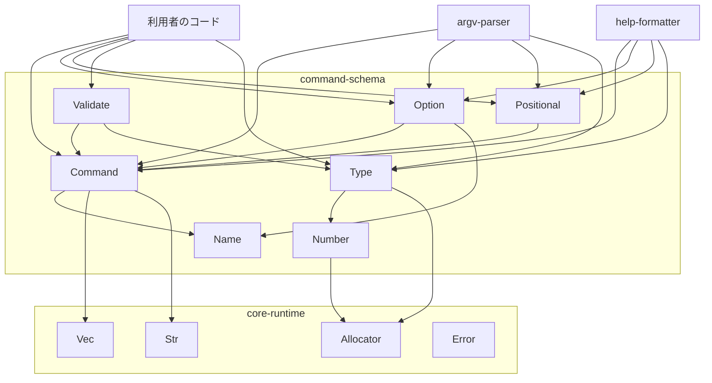
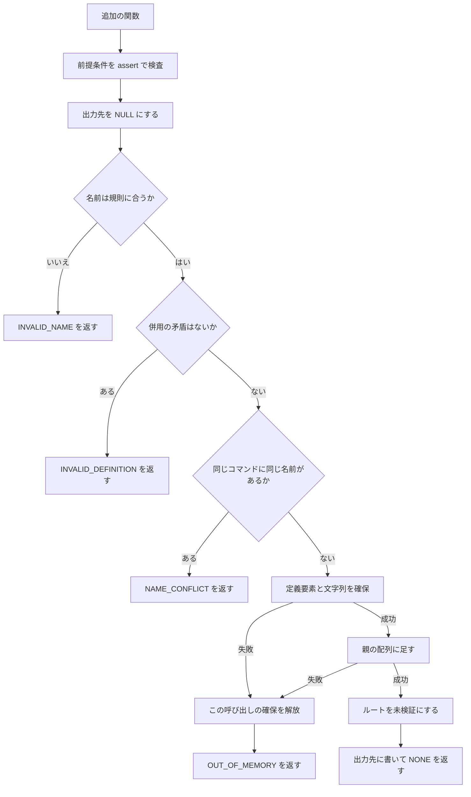
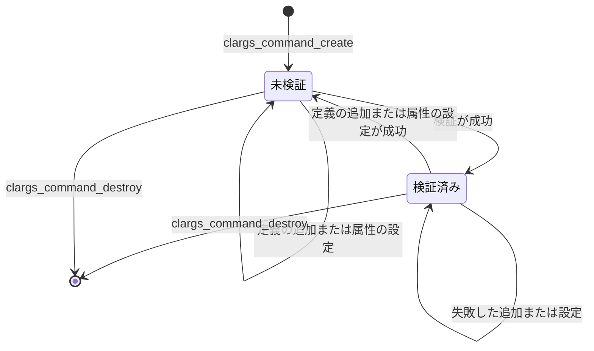
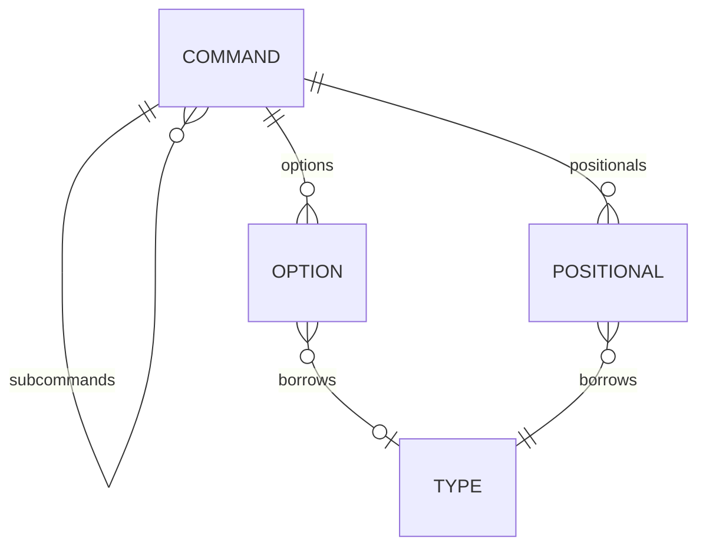

# Design Document

## Overview

**Purpose**: このスペックは、CLArgs の利用者が「プログラムがどんなコマンドラインを受け付けるか」を関数呼び出しで定義できるようにする。定義したもの（スキーマ）は、検証でき、読み取り用の関数で調べられる。

**Users**: ライブラリ利用者（C のアプリケーション開発者）は、コマンド、オプション、位置引数、値型を定義し、検証する。ライブラリ開発者（argv-parser、help-formatter の担当）は、読み取り用の関数と値型の変換だけを使ってスキーマを読む。

**Impact**: core-runtime の上に、最初のコマンドライン固有のモジュールを足す。公開ヘッダ 2 つ、エラーコード 5 つ、ソース 7 つが増える。既存の公開関数の形と意味は変えない。

### Goals

- コマンドの木、4 種類のオプション、4 種類の個数の位置引数、属性を、不透明ハンドルとビルダー関数で定義できる。
- 組み込みの値型（文字列、整数、浮動小数、選択肢）と利用者定義の値型を、同じ仕組みで扱える。
- 定義の誤りを、追加の時点または検証の時点で、種類の分かるエラーコードとして返す。失敗してもスキーマは変わらない。
- argv-parser と help-formatter が必要とする読み取りを、公開の関数として提供する。

### Non-Goals

- argv の解析、解析結果の保持、解析時のエラーの表現（argv-parser）
- ヘルプや usage の文面、`--help` の自動追加（help-formatter、利用者のコード）
- 親コマンドのオプションをサブコマンドの後でも受け付けるかどうか、同じオプションが複数回指定されたときの扱い（argv-parser）
- 複数の値を集めるオプション、オプション同士の排他や依存、環境変数との対応、別名、長い名前の省略
- 定義要素の削除、スキーマの複製

## Boundary Commitments

### This Spec Owns

- コマンド、オプション、位置引数、値型の 4 つの不透明な型と、その生成、追加、破棄
- 名前の規則（短い名前、長い名前、サブコマンド名、否定名の作り方）と、同じコマンド内での名前の衝突の判定
- 属性（説明文、値の表示名、必須、既定値、否定できるフラグの初期の状態）の保持
- 値型の契約: 値の大きさ、変換関数、後始末関数の形と、組み込みの 4 つの型の変換の規則
- スキーマの検証と、検証済みかどうかの状態
- スキーマと値型の読み取り用の公開関数
- エラーコード `CLARGS_ERROR_INVALID_NAME`、`CLARGS_ERROR_NAME_CONFLICT`、`CLARGS_ERROR_INVALID_DEFINITION`、`CLARGS_ERROR_INVALID_DEFAULT`、`CLARGS_ERROR_INVALID_VALUE`
- 利用者向けの文書 `docs/schema.md`

### Out of Boundary

- 値型の変換をいつ呼ぶか、変換した値と入力の文字列をどこに、いつまで保持するか（既定値の確認のための一時的な変換を除く）
- 未検証のスキーマを解析や文面の生成に渡されたときの扱い
- 解析の文法（`-abc` の束ね、`--name=value`、`--` など）と、解析時のエラーの種類
- 既定値を解析結果に適用すること、必須の検査を argv に対して行うこと
- 表示のための整形（折り返し、既定の表示名の決め方）
- アロケータ、エラーコードの仕組み、内部ユーティリティ（core-runtime）

### Allowed Dependencies

- core-runtime の内部のメモリ関数（`src/alloc_internal.h`）、`clargs_strdup`（`src/str.h`）、`clargs_vec_t`（`src/vec.h`）、`clargs_error_t` と `CLARGS_ERROR_LIST`（`include/clargs/error.h`）、`CLARGS_API`（`include/clargs/export.h`）
- C 標準ライブラリ: `<assert.h>`、`<errno.h>`、`<math.h>`、`<stdbool.h>`、`<stddef.h>`、`<stdint.h>`、`<stdio.h>`（`snprintf`）、`<stdlib.h>`（`strtod`）、`<string.h>`
- テストでは、Naos とテスト用アロケータ（`tests/support/test_allocator.h`）
- 依存してはならないもの: argv-parser と help-formatter のコード。標準の確保関数。変更可能な `static` 変数

### Revalidation Triggers

次の変更があったら、argv-parser と help-formatter は統合を確かめ直す。

- 読み取り用の関数の引数、戻り値、意味の変更。特に、「ない」ことの表し方（`NULL`、`'\0'`）
- 値型の契約の変更: 値型の種類と値の型の対応、入力の文字列を参照してよいこと、変換関数が返すエラーコード
- 名前の規則、否定名の作り方、大文字と小文字の区別の変更
- オプションの種類または位置引数の個数の種類の追加
- 検証が保証する内容の変更（検証済みのスキーマで成り立つこと。Data Models の不変条件）
- 位置引数とサブコマンドの併用を許す変更
- 属性の追加（help-formatter は表示を、argv-parser は適用を検討する）

## Architecture

### Existing Architecture Analysis

- 公開ヘッダは `include/clargs/<名前>.h`、ソースは `src/<名前>.c`、内部ヘッダは `src/<名前>_internal.h`（同じ名前の公開ヘッダがなければ `src/<名前>.h`）に置く。利用者が取り込むのは `<clargs/clargs.h>` だけである。
- 生成と破棄の対、文字列の複製、失敗時の出力先の `NULL`、「失敗したら既存のオブジェクトは変わらない」は、`docs/ownership.md` の規則 1、2、3、7 のとおりにする。
- エラーコードは `CLARGS_ERROR_LIST` の末尾に足す。説明文と、その固有性のテストは、一覧から生成される。
- 動的ライブラリは `CLARGS_API` の付いた関数だけを export する。内部関数のテストは `clargs_internal` にリンクする。
- 既存の規約は「エラーコードにするのは実行時の失敗だけ」としている。このスペックは、文字列の内容と定義どうしの関係に由来する誤りを、実行時の失敗として扱う（名前や選択肢が実行時のデータから来る場合があるため）。`NULL`、範囲外の添字、列挙にない値は、前提条件のままである。

### Architecture Pattern & Boundary Map



**Architecture Integration**:

- **Selected pattern**: 不透明ハンドルの木とビルダー関数。親が子を所有し、破棄はルートだけで行う。
- **Dependency direction**: `Name`・`Number` → `Type` → `Command` → `Option`・`Positional` → `Validate`。左のものは右のものを取り込まない。`Type` はスキーマを知らない。`Command` は、オプションと位置引数の中身を解放するために、それらの構造体の定義（`src/schema_internal.h`）だけを知る。
- **Domain boundaries**: 値型（`type.h`）とスキーマ（`schema.h`）を別の公開ヘッダに分ける。値型はスキーマなしで使え、単独でテストできる。
- **Existing patterns preserved**: `create`/`destroy` の対、文字列の複製、`clargs_error_t` と出力用の引数、`assert` による前提条件、`CLARGS_ERROR_LIST` への追記。
- **New components rationale**: `Name` と `Number` は、状態を持たない純粋な関数で、内部関数のテストで境界値を直接確かめるために分ける。`Validate` は、木全体を見る検査を、追加の関数から分けるために置く。
- **Steering compliance**: argv を知らない。変更可能なグローバル状態を持たない。公開構造体を持たない。

### Technology Stack

| Layer | Choice / Version | Role in Feature | Notes |
|-------|------------------|-----------------|-------|
| 言語 | C99、拡張なし | 全体 | `<stdbool.h>` と `<stdint.h>`（`int64_t`）を公開ヘッダで使う |
| 実行時 | C 標準ライブラリ | `strtod`、`snprintf`、文字列関数 | ほかの依存はない |
| メモリ | core-runtime の内部のメモリ関数 | すべての確保 | 標準の確保関数を直接呼ばない |
| テスト | Naos v0.4.0、テスト用アロケータ | 公開 API と内部関数のテスト、失敗注入 | 既存の `clargs_add_test()` で登録する |

## File Structure Plan

### Directory Structure

```
include/clargs/
├── type.h                 値型: clargs_type_t、組み込みの型、生成、破棄、読み取り、変換
└── schema.h               コマンド、オプション、位置引数: 定義、属性、検証、読み取り
src/
├── name.h                 内部: 名前の規則の判定（宣言）
├── name.c                 短い名前、長い名前、サブコマンド名の判定
├── number.h               内部: 整数と浮動小数の変換（宣言）
├── number.c               10 進の整数と、ロケールによらない浮動小数の変換
├── type_internal.h        内部: struct clargs_type の定義
├── type.c                 値型の生成と破棄、組み込みの型、読み取り、変換と後始末の呼び出し
├── schema_internal.h      内部: struct clargs_command、clargs_option、clargs_positional の定義と、共通の補助関数の宣言
├── command.c              コマンドの生成、破棄、サブコマンドの追加、説明文、読み取り、検索、共通の補助関数
├── option.c               オプションの追加（4 種類）、属性、読み取り
├── positional.c           位置引数の追加、属性、読み取り
└── validate.c             スキーマの検証、検証済みかどうかの読み取り
tests/
├── public/
│   ├── type_test.c        値型の公開 API（組み込み、選択肢、利用者定義）
│   ├── command_test.c     コマンドの木、サブコマンド、説明文、読み取り、検索
│   ├── option_test.c      オプションの追加、名前の衝突、属性、読み取り
│   ├── positional_test.c  位置引数の追加、サブコマンドとの併用、属性、読み取り
│   ├── validate_test.c    検証の規則、誤りの場所、検証の状態
│   └── schema_failure_test.c  確保の各回を順に失敗させる（定義、属性、値型、検証）
└── internal/
    ├── name_test.c        名前の規則の境界
    └── number_test.c      整数と浮動小数の変換の境界、ロケール
docs/
└── schema.md              利用者向け: 定義から検証、破棄までの例、値型の契約、破棄の順序
```

- `schema.h` という公開ヘッダに対して、内部ヘッダは `schema_internal.h`、`type.h` に対して `type_internal.h` とする（命名規約）。`name` と `number` は公開ヘッダがないので、内部ヘッダは `name.h`、`number.h` である。
- `schema_internal.h` と `type_internal.h` を取り込んでよいのは、このスペックのソース（`command.c`、`option.c`、`positional.c`、`validate.c`、`type.c`）だけである。argv-parser と help-formatter は取り込まない。

### Modified Files

- `include/clargs/error.h` — `CLARGS_ERROR_LIST` の末尾に 5 行足す（順序は Error Handling の表のとおり）。
- `include/clargs/clargs.h` — `#include <clargs/schema.h>` と `#include <clargs/type.h>` を足す。
- `src/CMakeLists.txt` — `CLARGS_SOURCES` に `command.c`、`name.c`、`number.c`、`option.c`、`positional.c`、`type.c`、`validate.c` を足す。
- `tests/CMakeLists.txt` — 上の 8 つのテストを `clargs_add_test()` で登録する。`schema_failure` と、確保を伴う公開 API のテストには `support/test_allocator.c` を足す。
- `docs/conventions.md` — ディレクトリ構成の一覧に、新しいヘッダと `docs/schema.md` を足す。「エラーコードを足す」の「エラーコードにするのは、実行時の失敗だけである」の項に、定義の誤り（文字列の内容と、定義どうしの関係に由来するもの）は実行時の失敗として扱うことを足す。`docs/ownership.md` への追記と同じ分け方を書く。
- `docs/ownership.md` — 「実行時の失敗とプログラムの誤り」に、定義の誤りをエラーコードにする理由と分け方を足す。「スキーマ、argv、結果への適用」の表に、値型の寿命（スキーマが借りる。スキーマを先に破棄する）を足す。

### Implementation Order

公開ヘッダに `CLARGS_API` で宣言した関数は、すべて export されていなければならない（既存の検査 `clargs.exports`）。宣言だけを先に足すと、動的の構成でこの検査が失敗する。そこで、公開ヘッダの宣言は、その関数を実装する作業の中で足す。

| 順 | 作業 | 触るファイル | 並行 |
|---|---|---|---|
| 1 | エラーコード | `include/clargs/error.h` | — |
| 2 | Name | `src/name.h`、`src/name.c`、`tests/internal/name_test.c` | 3 と並行できる |
| 3 | Number | `src/number.h`、`src/number.c`、`tests/internal/number_test.c` | 2 と並行できる |
| 4 | Type | `include/clargs/type.h`、`src/type_internal.h`、`src/type.c`、`tests/public/type_test.c`、`clargs.h` | 2、3 の後 |
| 5 | Command | `include/clargs/schema.h`（新規。型とコマンドの節）、`src/schema_internal.h`（新規。3 つの構造体と補助関数）、`src/command.c`、`tests/public/command_test.c`、`clargs.h` | 4 の後 |
| 6 | Option | `schema.h`（オプションの節を追記）、`src/option.c`、`tests/public/option_test.c` | 5 の後 |
| 7 | Positional | `schema.h`（位置引数の節を追記）、`src/positional.c`、`tests/public/positional_test.c` | 6 の後 |
| 8 | Validate | `schema.h`（検証の節を追記）、`src/validate.c`、`tests/public/validate_test.c` | 7 の後 |
| 9 | 失敗注入のテスト、文書 | `tests/public/schema_failure_test.c`、`docs/` | 8 の後 |

- `src/schema_internal.h` の 3 つの構造体は、5 で、Logical Data Model のとおりに全部を定義する。`command.c` の破棄が、オプションと位置引数の中身を解放するためである。6 と 7 は、このヘッダを変えない。
- 5 の時点では、オプションと位置引数を足す関数がまだない。`command.c` の列挙と検索は、空の配列に対して動く形で実装し、中身のある場合のテストは 6 と 7 で足す。位置引数を持つコマンドへのサブコマンドの追加（4.7）のテストは、7 の `positional_test.c` に置く。
- 6、7、8 は、どれも `schema.h`、`src/CMakeLists.txt`、`tests/CMakeLists.txt` に追記するので、並行させない。
- どの作業も、自分のソースを `CLARGS_SOURCES` に、自分のテストを `tests/CMakeLists.txt` に、その作業の中で足す。

## System Flows

### 定義要素の追加（失敗してもスキーマが変わらない順序）



- 親の配列に足すのは最後である。`clargs_vec_push` は失敗しても配列を変えないので、それより前の失敗では、スキーマに何も触れていない。
- ルートを未検証にするのは、成功が決まった後だけである。失敗した呼び出しは、検証の状態も変えない（8.11、10.4）。
- 属性の設定も同じ順序である: 種類の検査 → 新しい文字列の複製 → 古い文字列の解放と入れ替え → ルートを未検証にする。

### 検証の状態



## Requirements Traceability

| Requirement | Summary | Components | Interfaces | Flows |
|-------------|---------|------------|------------|-------|
| 1.1 | 空のルートコマンドを生成 | Command | `clargs_command_create` | — |
| 1.2, 1.3 | サブコマンドの追加、入れ子 | Command | `clargs_command_add_subcommand` | 追加 |
| 1.4, 1.5 | ルートの破棄で全部を解放。個別の破棄はない | Command | `clargs_command_destroy` | — |
| 1.6 | サブコマンド名の衝突 | Command | `clargs_command_add_subcommand`、`clargs_command_find_subcommand` | 追加 |
| 1.7, 1.8 | ルートの名前は空でない任意の文字列 | Command | `clargs_command_create` | — |
| 2.1, 2.2, 2.3 | 4 種類のオプション、短い名前と長い名前 | Option | `clargs_command_add_flag`、`_add_negatable`、`_add_count`、`_add_value` | 追加 |
| 2.4 | 名前のないオプション | Option | 追加の関数（`INVALID_NAME`） | 追加 |
| 2.5 | 値付きオプションは値型が必須 | Option | `clargs_command_add_value` の引数と Preconditions | — |
| 2.6, 2.7 | 否定できるフラグは長い名前が必須。否定名は `no-<name>` | Option | `clargs_command_add_negatable`、`clargs_option_negated_name` | 追加 |
| 2.8, 2.9, 2.10 | 短い名前、長い名前、否定名の衝突 | Option、Command | 追加の関数、`clargs_command_find_short`、`clargs_command_find_long` | 追加 |
| 2.11 | 別のコマンドでは同じ名前を使える | Option、Command | 検索はコマンドごと | — |
| 3.1, 3.2, 3.3 | 名前に使える文字 | Name | `clargs_name_is_short`、`clargs_name_is_long`、`clargs_name_is_subcommand` | — |
| 3.4 | 規則に合わない名前 | Name、Command、Option | 追加の関数（`INVALID_NAME`） | 追加 |
| 3.5 | 大文字と小文字を区別 | Command | 検索の関数（バイト単位の比較） | — |
| 4.1, 4.2 | 位置引数の追加、個数の種類 | Positional | `clargs_command_add_positional`、`clargs_arity_t` | 追加 |
| 4.3, 4.4, 4.5 | 位置引数の名前（空でない、重複しない） | Positional | `clargs_command_add_positional` | 追加 |
| 4.6, 4.7, 4.8 | 位置引数とサブコマンドの併用は不可。オプションは可 | Positional、Command | `clargs_command_add_positional`、`clargs_command_add_subcommand` | 追加 |
| 5.1 | 説明文 | Command、Option、Positional | `clargs_command_set_description`、`clargs_option_set_description`、`clargs_positional_set_description` | — |
| 5.2, 5.3 | 値の表示名、必須 | Option | `clargs_option_set_value_name`、`clargs_option_set_required` | — |
| 5.4 | 既定値（文字列） | Option、Positional | `clargs_option_set_default`、`clargs_positional_set_default` | — |
| 5.5 | 否定できるフラグの初期の状態 | Option | `clargs_option_set_initial` | — |
| 5.6 | 属性の初期値 | Option、Positional、Command | 読み取りの関数（`NULL`、`false`） | — |
| 5.7 | 再設定は置き換え | Command | `clargs_schema_replace_string` | — |
| 5.8 | 対象でない種類には設定できない | Option、Positional | 設定の関数（`INVALID_DEFINITION`） | — |
| 5.9 | 属性を後から足せる形 | Option、Positional | 属性ごとの設定関数と読み取り関数 | — |
| 6.1 | 組み込みの 4 つの値型 | Type | `clargs_type_string`、`_int`、`_float`、`clargs_type_create_choice` | — |
| 6.2 | 文字列の変換 | Type | `clargs_type_convert` | — |
| 6.3, 6.4 | 整数の変換 | Number、Type | `clargs_number_parse_int` | — |
| 6.5, 6.6, 6.7 | 浮動小数の変換、ロケール | Number、Type | `clargs_number_parse_float` | — |
| 6.8, 6.9, 6.10, 6.11 | 選択肢の値型 | Type | `clargs_type_create_choice`、`clargs_type_convert` | — |
| 6.12 | 登録表に頼らない | Type | `static const` のオブジェクトを返す関数 | — |
| 7.1, 7.2, 7.3 | 利用者定義の値型、変換関数、後始末 | Type | `clargs_type_create`、`clargs_convert_fn_t`、`clargs_release_fn_t` | — |
| 7.4, 7.5, 7.6 | 同じ仕組み、型の名前、変換だけを表す | Type | `struct clargs_type`、`clargs_type_name`、`clargs_type_convert` | — |
| 7.7, 7.8 | 複数の定義要素で共有。所有者と寿命 | Type、文書 | 値型を借りる契約、`docs/schema.md`、`docs/ownership.md` | — |
| 8.1, 8.2 | 木全体の検査、成功で検証済み | Validate | `clargs_command_validate` | 検証の状態 |
| 8.3, 8.4 | 位置引数の並び | Validate | `clargs_command_validate` | — |
| 8.5 | 必須と既定値の併用 | Validate | `clargs_command_validate` | — |
| 8.6, 8.7, 8.8 | 既定値を値型で確かめ、後始末する | Validate、Type | `clargs_type_convert`、`clargs_type_release` | — |
| 8.9 | 誤りの種類と場所 | Validate | `clargs_command_validate` の出力用の引数 | — |
| 8.10, 8.11, 8.12 | 失敗で未検証のまま。変更で未検証に戻る。同じ結果 | Validate、Command | `clargs_schema_touch`、`clargs_command_is_validated` | 検証の状態 |
| 8.13 | 追加の時点の誤りは追加の時点で弾く | Command、Option、Positional | 追加の関数 | 追加 |
| 9.1, 9.2 | コマンドの読み取り、定義した順の列挙 | Command | `clargs_command_name` ほか、`_count`、`_at` | — |
| 9.3 | オプションの読み取り | Option | `clargs_option_*` の読み取り | — |
| 9.4 | 位置引数の読み取り | Positional | `clargs_positional_*` の読み取り | — |
| 9.5 | 「ない」ことの区別 | Command、Option、Positional | `NULL`、`'\0'` | — |
| 9.6, 9.7, 9.8 | 名前からの検索 | Command | `clargs_command_find_short`、`_find_long`、`_find_subcommand` | — |
| 9.9 | 検証済みかどうか | Validate | `clargs_command_is_validated` | 検証の状態 |
| 9.10, 9.11 | 値型の読み取り、変換、後始末、選択肢の一覧 | Type | `clargs_type_name`、`_kind`、`_value_size`、`_convert`、`_release`、`_choice_count`、`_choice_at` | — |
| 9.12, 9.13, 9.14 | 読み取りは変更せず、失敗しない。寿命。同時の読み取り | Command、Option、Positional、Type | `const` のハンドルを取る読み取りの関数 | — |
| 9.15 | 後続のスペックから使える | 全体 | 公開ヘッダ `schema.h`、`type.h` | — |
| 10.1 | 設定されたアロケータから確保 | 全体 | `clargs_calloc` などの内部のメモリ関数 | — |
| 10.2 | 文字列を複製 | Command、Option、Positional、Type | `clargs_strdup` | — |
| 10.3, 10.4, 10.5 | 失敗してもスキーマは変わらない。出力先は `NULL` | Command、Option、Positional | 追加と設定の関数 | 追加 |
| 10.6, 10.7 | 破棄で何も残らない。`NULL` の破棄は何もしない | Command、Type | `clargs_command_destroy`、`clargs_type_destroy` | — |
| 10.8 | 確保の各回を失敗させるテスト | テスト | `tests/public/schema_failure_test.c` | — |
| 10.9 | グローバル状態を持たない | 全体 | `static const` だけ | — |
| 11.1, 11.2, 11.3 | エラーコードの追加と説明文 | Error（追記） | `CLARGS_ERROR_LIST` | — |
| 11.4 | 中断も出力もしない | 全体 | `clargs_error_t` の戻り値 | — |
| 11.5 | プログラムの誤りは前提条件 | 全体 | 各関数の Preconditions、`assert` | — |
| 12.1 | 不透明ハンドル | 全体 | `typedef struct … …_t;` だけを公開 | — |
| 12.2, 12.3 | `<clargs/clargs.h>` だけで使える。接頭辞 | 全体 | `clargs.h` への追記、命名 | — |
| 12.4, 12.5 | 静的・動的、3 つの OS で同じ。C99 と標準ライブラリだけ | 全体、Number | 既存の CI の構成、`clargs_number_parse_float` | — |
| 12.6 | 解析とヘルプに依存しない | 全体 | Allowed Dependencies | — |
| 12.7 | 使い方の文書 | 文書 | `docs/schema.md` | — |

## Components and Interfaces

| Component | Layer | Intent | Req Coverage | Key Dependencies | Contracts |
|-----------|-------|--------|--------------|------------------|-----------|
| Name | 内部 | 名前の規則の判定 | 3.1–3.4 | なし | Service |
| Number | 内部 | 整数と浮動小数の変換 | 6.3–6.7, 12.5 | Allocator (P1)、`strtod` (P0) | Service |
| Type | 公開 | 値型の生成、破棄、読み取り、変換 | 6.1, 6.2, 6.8–6.12, 7.1–7.8, 9.10, 9.11, 10.6, 10.7 | Number (P0)、Allocator (P0)、Str (P0) | Service |
| Command | 公開 | コマンドの木、説明文、列挙、検索、共通の補助 | 1.1–1.8, 2.11, 3.5, 4.7, 4.8, 5.1, 5.7, 9.1, 9.2, 9.6–9.8, 10.1–10.7 | Name (P0)、Vec (P0)、Str (P0) | Service、State |
| Option | 公開 | オプションの追加、属性、読み取り | 2.1–2.10, 5.1–5.6, 5.8, 5.9, 9.3, 9.5 | Command (P0)、Name (P0)、Type (P0) | Service |
| Positional | 公開 | 位置引数の追加、属性、読み取り | 4.1–4.6, 5.1, 5.4, 5.8, 9.4, 9.5 | Command (P0)、Type (P0) | Service |
| Validate | 公開 | 木全体の検証、検証の状態 | 8.1–8.13, 9.9 | Command (P0)、Type (P0)、Allocator (P0) | Service、State |
| Error（追記） | 公開 | エラーコード 5 つ | 11.1–11.3 | 既存の `CLARGS_ERROR_LIST` | — |
| 文書 | 文書 | `docs/schema.md` と既存の文書への追記 | 7.8, 11.5, 12.7 | — | — |

すべての公開関数に共通すること:

- `<clargs/clargs.h>` だけで使える。関数と型は `clargs_`、列挙の定数は `CLARGS_` で始まる（12.2、12.3）。
- 引数のポインタは、「`NULL` でもよい」と書いていない限り、`NULL` でないことが前提条件である。列挙の引数は、定義された定数であることが前提条件である。前提条件は `assert` で検査し、エラーコードにしない（11.5）。
- 読み取りの関数は `const` のハンドルを取り、失敗せず、何も書かない。返す文字列とハンドルは、ルートコマンド（値型では、その値型）を破棄するまで有効で、呼び出し側は解放しない（9.12、9.13）。スキーマが変更されていない間は、複数のスレッドから同時に呼べる（9.14）。
- 追加と設定の関数が失敗したら、スキーマは呼び出しの前と同じ内容で、検証の状態も変わらない。出力先は `NULL` になる（10.3〜10.5）。

### 内部

#### Name

| Field | Detail |
|-------|--------|
| Intent | 文字列または文字が、名前の規則に合うかを判定する |
| Requirements | 3.1, 3.2, 3.3, 3.4 |

**Responsibilities & Constraints**

- 状態を持たない。確保をしない。文字の判定は、ロケールに左右される `<ctype.h>` を使わず、ASCII の範囲の比較で書く。
- 「名前の先頭」は ASCII の英字または数字、「名前の続き」は ASCII の英字、数字、`-`、`_` である。

**Contracts**: Service [x]

```c
/* src/name.h */
bool clargs_name_is_short(char name);              /* 英字または数字の 1 文字 */
bool clargs_name_is_long(const char *name);        /* 2 文字以上。先頭と続きの規則に合う */
bool clargs_name_is_subcommand(const char *name);  /* 1 文字以上。先頭と続きの規則に合う */
```

- Preconditions: 文字列の引数は `NULL` でない。
- Postconditions: 空の文字列には `false` を返す。

#### Number

| Field | Detail |
|-------|--------|
| Intent | 文字列を、符号付き 64 ビットの整数、または有限の倍精度の浮動小数に変換する |
| Requirements | 6.3, 6.4, 6.5, 6.6, 6.7, 12.5 |

**Responsibilities & Constraints**

- 整数は自前で読む。受け付ける形は `[+-]?[0-9]+` だけである。1 桁ずつ、桁あふれを先に検査しながら積み上げる。`INT64_MIN` も受け付ける。
- 浮動小数は、先に形を自前で検査する。受け付ける形は `[+-]?( [0-9]+ ( "." [0-9]* )? | "." [0-9]+ ) ( [eE] [+-]? [0-9]+ )?` だけである。空白、`inf`、`nan`、16 進の表記、`,` は拒む。
- 形の検査を通った入力は、`.` を現在のロケールの小数点の文字列に置き換えた複製にして、`strtod` に渡す。小数点の文字列は、`snprintf` で `0.5` を整形した結果から得る（`localeconv` は使わない）。複製は、短い入力では関数の中の固定長の配列に、収まらない入力では `clargs_malloc` で確保した領域に作る。
- `strtod` の結果が無限大（`HUGE_VAL` の大きさ）なら、範囲を超えたとして失敗にする。0 に近すぎる入力（アンダーフロー）は、`strtod` が返した値で成功とする。
- `errno` を、呼び出しの前の値に戻してから返る。

**Dependencies**

- Outbound: Allocator — 長い入力の複製 (P1)
- External: `<stdlib.h>` の `strtod`、`<stdio.h>` の `snprintf` (P0)

**Contracts**: Service [x]

```c
/* src/number.h */
clargs_error_t clargs_number_parse_int(const char *text, int64_t *out);
clargs_error_t clargs_number_parse_float(const char *text, double *out);
```

- Preconditions: `text` と `out` は `NULL` でない。
- Postconditions: 成功したら `*out` に値を書き、`CLARGS_ERROR_NONE` を返す。入力が不正なら `CLARGS_ERROR_INVALID_VALUE`、複製の確保に失敗したら `CLARGS_ERROR_OUT_OF_MEMORY` を返し、`*out` を変えない。

### 公開: 値型

#### Type

| Field | Detail |
|-------|--------|
| Intent | 「入力の文字列をどう変換するか」を表すオブジェクト。組み込みと利用者定義を同じ構造体で表す |
| Requirements | 6.1, 6.2, 6.8, 6.9, 6.10, 6.11, 6.12, 7.1, 7.2, 7.3, 7.4, 7.5, 7.6, 7.7, 7.8, 9.10, 9.11, 10.6, 10.7 |

**Responsibilities & Constraints**

- 値型は、型の名前、種類、値の大きさ、変換関数、後始末関数（なくてもよい）、利用者のデータ（なくてもよい）を持つ。選択肢の値型は、さらに選択肢の一覧を持つ。
- 値型は、作った後は変更されない。だから、1 つの値型を複数の定義要素、複数のスキーマ、複数のスレッドで共有できる（7.7）。
- 文字列、整数、浮動小数の値型は、`src/type.c` の `static const` のオブジェクトである。関数がそのポインタを返す。確保も破棄も要らない（6.12）。
- 選択肢の値型と利用者定義の値型は、`create` で生成し、利用者が `destroy` する。スキーマは値型を借りるだけで、破棄しない。利用者は、値型を使うスキーマをすべて破棄した後に、値型を破棄する（7.8）。
- 変換の契約:
  - 変換を求める側が、`clargs_type_value_size()` バイト以上の、どの型にも使える整列の領域を用意する。
  - 変換が成功したら、領域に値が書かれている。使い終えたら、`clargs_type_release` を 1 度だけ呼ぶ。
  - 変換が失敗したら、領域の内容は不定で、`clargs_type_release` を呼んではならない。
  - 値は、入力の文字列を参照してよい。変換を求めた側は、値を後始末するまで、入力の文字列を有効に保つ。
- 値型の種類と、領域に書かれる値の型:

| 種類 | 型の名前 | 値の型 | 値 |
|---|---|---|---|
| `CLARGS_TYPE_STRING` | `"string"` | `const char *` | 入力の文字列へのポインタ |
| `CLARGS_TYPE_INT` | `"integer"` | `int64_t` | 変換した整数 |
| `CLARGS_TYPE_FLOAT` | `"float"` | `double` | 変換した値 |
| `CLARGS_TYPE_CHOICE` | `"choice"` | `size_t` | 一致した選択肢の番号（0 から） |
| `CLARGS_TYPE_CUSTOM` | 利用者が指定 | 利用者が決める | 利用者の変換関数が書く |

**Dependencies**

- Inbound: Option、Positional — 値型の指定 (P0)。Validate、argv-parser — 変換 (P0)。help-formatter — 名前と選択肢 (P1)
- Outbound: Number (P0)、Allocator (P0)、Str (P0)

**Contracts**: Service [x]

```c
/* include/clargs/type.h */
typedef struct clargs_type clargs_type_t;

typedef enum clargs_type_kind {
    CLARGS_TYPE_STRING,
    CLARGS_TYPE_INT,
    CLARGS_TYPE_FLOAT,
    CLARGS_TYPE_CHOICE,
    CLARGS_TYPE_CUSTOM
} clargs_type_kind_t;

/* text を変換し、value の指す領域に書く。成功なら CLARGS_ERROR_NONE。
 * 入力が不正なら CLARGS_ERROR_INVALID_VALUE、確保の失敗なら
 * CLARGS_ERROR_OUT_OF_MEMORY を返す。 */
typedef clargs_error_t (*clargs_convert_fn_t)(const char *text, void *value, void *context);
/* 変換に成功した値を後始末する。領域そのものは解放しない。 */
typedef void (*clargs_release_fn_t)(void *value, void *context);

CLARGS_API const clargs_type_t *clargs_type_string(void);
CLARGS_API const clargs_type_t *clargs_type_int(void);
CLARGS_API const clargs_type_t *clargs_type_float(void);

CLARGS_API clargs_error_t clargs_type_create_choice(const char *const *choices, size_t count,
                                                    clargs_type_t **out);
CLARGS_API clargs_error_t clargs_type_create(const char *name, size_t value_size,
                                             clargs_convert_fn_t convert_fn,
                                             clargs_release_fn_t release_fn, void *context,
                                             clargs_type_t **out);
CLARGS_API void clargs_type_destroy(clargs_type_t *type);

CLARGS_API const char *clargs_type_name(const clargs_type_t *type);
CLARGS_API clargs_type_kind_t clargs_type_kind(const clargs_type_t *type);
CLARGS_API size_t clargs_type_value_size(const clargs_type_t *type);
CLARGS_API size_t clargs_type_choice_count(const clargs_type_t *type);
CLARGS_API const char *clargs_type_choice_at(const clargs_type_t *type, size_t index);

CLARGS_API clargs_error_t clargs_type_convert(const clargs_type_t *type, const char *text, void *value);
CLARGS_API void clargs_type_release(const clargs_type_t *type, void *value);
```

| 関数 | 契約 |
|---|---|
| `clargs_type_create_choice` | `choices` の `count` 個の文字列を複製して持つ。`count` が 0、または同じ文字列が 2 回以上あれば `CLARGS_ERROR_INVALID_DEFINITION`（6.11）。空の文字列も選択肢にできる。Preconditions: `count` が 0 でなければ `choices` とその各要素は `NULL` でない |
| `clargs_type_create` | `name` を複製する。`name` が空なら `CLARGS_ERROR_INVALID_NAME`。`release_fn` と `context` は `NULL` でもよい。`context` は借りるだけで、利用者が値型を破棄するまで有効に保つ。Preconditions: `value_size > 0`、`convert_fn` は `NULL` でない |
| `clargs_type_destroy` | `NULL` と、組み込みの値型（`clargs_type_string()` などが返したもの）には何もしない。Preconditions: この値型を使うスキーマは、すべて破棄済みである（検査しない） |
| `clargs_type_choice_count`、`_choice_at` | 選択肢でない値型では、個数は 0。`_choice_at` の Preconditions: `index` は個数より小さい。一覧は定義した順（9.11） |
| `clargs_type_convert` | 変換関数を呼び、その戻り値をそのまま返す（7.2）。選択肢は、大文字と小文字を区別して完全に一致する選択肢を探し、なければ `CLARGS_ERROR_INVALID_VALUE`（6.8〜6.10）。文字列は必ず成功する（6.2） |
| `clargs_type_release` | 後始末関数があれば呼ぶ。なければ何もしない。組み込みの型には後始末関数がない |

- 利用者の変換関数が `CLARGS_ERROR_NONE` 以外を返したら、どの値でも失敗として扱う。入力の不正には `CLARGS_ERROR_INVALID_VALUE` を返すよう、ヘッダのコメントと `docs/schema.md` に書く。

**Implementation Notes**

- Integration: 組み込みの型も、`struct clargs_type` の `convert_fn` に内部の関数を入れて表す。選択肢の変換関数は、`context` として自分の値型を受け取る。`clargs_type_convert` は、種類で分岐せず、関数ポインタを呼ぶだけである（7.4）。
- Validation: `tests/public/type_test.c`。後始末関数が、成功した変換 1 回につき 1 回だけ呼ばれることを、利用者定義の型で数えて確かめる。
- Risks: 値を `void *` で受け渡すので、領域の大きさと型の誤りはコンパイラが検出しない。上の表を、ヘッダのコメントと `docs/schema.md` に載せる。

### 公開: スキーマ

```c
/* include/clargs/schema.h（型） */
typedef struct clargs_command clargs_command_t;
typedef struct clargs_option clargs_option_t;
typedef struct clargs_positional clargs_positional_t;

typedef enum clargs_option_kind {
    CLARGS_OPTION_FLAG,       /* 指定されたかどうか */
    CLARGS_OPTION_NEGATABLE,  /* --name と --no-name で切り替える */
    CLARGS_OPTION_COUNT,      /* 指定された回数 */
    CLARGS_OPTION_VALUE       /* 値を 1 つ取る */
} clargs_option_kind_t;

typedef enum clargs_arity {
    CLARGS_ARITY_REQUIRED,      /* ちょうど 1 個 */
    CLARGS_ARITY_OPTIONAL,      /* 0 個または 1 個 */
    CLARGS_ARITY_ZERO_OR_MORE,  /* 0 個以上 */
    CLARGS_ARITY_ONE_OR_MORE    /* 1 個以上 */
} clargs_arity_t;
```

#### Command

| Field | Detail |
|-------|--------|
| Intent | コマンドの木を作り、破棄し、列挙と検索を提供する。定義要素に共通の補助関数を持つ |
| Requirements | 1.1, 1.2, 1.3, 1.4, 1.5, 1.6, 1.7, 1.8, 2.11, 3.5, 4.7, 4.8, 5.1, 5.7, 9.1, 9.2, 9.6, 9.7, 9.8, 10.1, 10.2, 10.3, 10.4, 10.5, 10.6, 10.7 |

**Responsibilities & Constraints**

- コマンドは、名前、説明文、親、オプション・位置引数・サブコマンドの 3 つの配列（定義した順）を持つ。ルートは、さらに検証済みかどうかを持つ。
- 配列には、個別に確保した定義要素へのポインタを入れる。配列が伸びても、利用者が持つハンドルは変わらない。
- 破棄は、サブコマンドを再帰的にたどり、オプション、位置引数、文字列、配列、コマンド自身を解放する。値型は解放しない。
- 検索は、そのコマンドの定義だけを対象にし、バイト単位で比べる（2.11、3.5）。親や子のコマンドは見ない。
- 追加の関数は、検索の関数を使って衝突を調べる。

**Dependencies**

- Inbound: Option、Positional、Validate (P0)。argv-parser、help-formatter — 読み取り (P0)
- Outbound: Name (P0)、Vec (P0)、Str (P0)、Allocator (P0)

**Contracts**: Service [x] / State [x]

```c
/* include/clargs/schema.h（コマンド） */
CLARGS_API clargs_error_t clargs_command_create(const char *name, clargs_command_t **out);
CLARGS_API void clargs_command_destroy(clargs_command_t *root);
CLARGS_API clargs_error_t clargs_command_add_subcommand(clargs_command_t *command, const char *name,
                                                        clargs_command_t **out);
CLARGS_API clargs_error_t clargs_command_set_description(clargs_command_t *command, const char *text);

CLARGS_API const char *clargs_command_name(const clargs_command_t *command);
CLARGS_API const char *clargs_command_description(const clargs_command_t *command);
CLARGS_API const clargs_command_t *clargs_command_parent(const clargs_command_t *command);

CLARGS_API size_t clargs_command_option_count(const clargs_command_t *command);
CLARGS_API const clargs_option_t *clargs_command_option_at(const clargs_command_t *command, size_t index);
CLARGS_API size_t clargs_command_positional_count(const clargs_command_t *command);
CLARGS_API const clargs_positional_t *clargs_command_positional_at(const clargs_command_t *command,
                                                                   size_t index);
CLARGS_API size_t clargs_command_subcommand_count(const clargs_command_t *command);
CLARGS_API const clargs_command_t *clargs_command_subcommand_at(const clargs_command_t *command,
                                                                size_t index);

CLARGS_API const clargs_option_t *clargs_command_find_short(const clargs_command_t *command, char name);
CLARGS_API const clargs_option_t *clargs_command_find_long(const clargs_command_t *command,
                                                           const char *name, size_t length,
                                                           bool *negated);
CLARGS_API const clargs_command_t *clargs_command_find_subcommand(const clargs_command_t *command,
                                                                  const char *name);
```

| 関数 | 契約 |
|---|---|
| `clargs_command_create` | 空のルートを生成する。`name` が空なら `CLARGS_ERROR_INVALID_NAME`（1.7、1.8）。ほかの文字の制限はない |
| `clargs_command_destroy` | 木全体を解放する。`NULL` は何もしない。Preconditions: `root` は `clargs_command_create` で得たルートである（サブコマンドを渡さない） |
| `clargs_command_add_subcommand` | 順に検査する: 名前が規則に合わなければ `INVALID_NAME`。`command` が位置引数を持てば `INVALID_DEFINITION`（4.7）。同じ名前のサブコマンドがあれば `NAME_CONFLICT`（1.6）。`out` は `NULL` でもよい |
| `clargs_command_set_description` | `text` を複製し、前の説明文と置き換える。空の文字列も設定できる |
| `clargs_command_description` | 設定されていなければ `NULL` |
| `clargs_command_parent` | ルートでは `NULL` |
| `_count`、`_at` | 定義した順。`_at` の Preconditions: `index` は個数より小さい |
| `clargs_command_find_short` | なければ `NULL` |
| `clargs_command_find_long` | `name` の先頭 `length` バイトを名前として探す（NUL で終わっていなくてよい）。長い名前に一致したら `*negated` に `false`、否定名に一致したら `true` を書く。なければ `NULL` を返し、`*negated` を変えない。`negated` は `NULL` でもよい |
| `clargs_command_find_subcommand` | なければ `NULL` |

内部の補助関数（`src/schema_internal.h` で宣言し、`command.c` で定義する）:

```c
/* command が属する木のルートを返す。 */
clargs_command_t *clargs_schema_root(clargs_command_t *command);
/* command が属する木を未検証にする。成功した変更の最後に呼ぶ。 */
void clargs_schema_touch(clargs_command_t *command);
/* text を複製し、*slot の文字列（NULL でもよい）と入れ替える。
 * 失敗したら *slot を変えずに CLARGS_ERROR_OUT_OF_MEMORY を返す。 */
clargs_error_t clargs_schema_replace_string(char **slot, const char *text);
```

##### State Management

- State model: ルートが `validated`（真偽値）を 1 つ持つ。生成の直後は偽である。
- Persistence & consistency: 成功した追加と設定が `clargs_schema_touch` で偽にする。真にするのは `clargs_command_validate` の成功だけである。
- Concurrency strategy: 同期しない。同じスキーマへの変更と検証は、ほかの呼び出しと同時に行えない（`docs/ownership.md` の規則 8）。読み取りどうしは同時に行える。

**Implementation Notes**

- Integration: `clargs_command_find_long` に長さを取らせるのは、`--name=value` のように、名前が NUL で終わっていない入力から、複製なしで探せるようにするためである。追加の関数は `strlen` の結果を渡して使う。
- Validation: `tests/public/command_test.c`。入れ子 3 段以上の木を作り、列挙の順序、親、検索、破棄後に未解放のブロックがないことを確かめる。
- Risks: 破棄の再帰は、入れ子の深さに比例してスタックを使う。

#### Option

| Field | Detail |
|-------|--------|
| Intent | コマンドにオプションを足し、属性を設定し、読み取る |
| Requirements | 2.1, 2.2, 2.3, 2.4, 2.5, 2.6, 2.7, 2.8, 2.9, 2.10, 5.1, 5.2, 5.3, 5.4, 5.5, 5.6, 5.8, 5.9, 9.3, 9.5 |

**Responsibilities & Constraints**

- 追加の関数は種類ごとに分ける。値型を取るのは `clargs_command_add_value` だけである（2.5）。
- 短い名前がないことは `'\0'`、長い名前がないことは `NULL` で表す。引数でも、読み取りでも同じである（9.5）。
- 否定できるフラグは、追加の時点で否定名 `no-<name>` を作って持つ（2.7）。
- 追加の時点の検査は、次の順である。最初に当てはまったものを返す。

| 順 | 条件 | エラーコード | 要件 |
|---|---|---|---|
| 1 | 短い名前も長い名前もない | `INVALID_NAME` | 2.4 |
| 2 | 否定できるフラグに長い名前がない | `INVALID_NAME` | 2.6 |
| 3 | 短い名前または長い名前が規則に合わない | `INVALID_NAME` | 3.4 |
| 4 | 同じコマンドに、同じ短い名前のオプションがある | `NAME_CONFLICT` | 2.8 |
| 5 | 同じコマンドに、長い名前と同じ長い名前または否定名がある | `NAME_CONFLICT` | 2.9 |
| 6 | 否定できるフラグで、否定名と同じ長い名前または否定名が、同じコマンドにある | `NAME_CONFLICT` | 2.10 |

- 属性の設定は、対象の種類でなければ `INVALID_DEFINITION` を返し、何も変えない（5.8）。

| 属性 | 設定の関数 | 対象の種類 | 初期値（5.6） |
|---|---|---|---|
| 説明文 | `clargs_option_set_description` | すべて | `NULL` |
| 値の表示名 | `clargs_option_set_value_name` | `VALUE` | `NULL` |
| 必須 | `clargs_option_set_required` | `VALUE` | `false` |
| 既定値 | `clargs_option_set_default` | `VALUE` | `NULL` |
| 初期の状態 | `clargs_option_set_initial` | `NEGATABLE` | `false`（オフ） |

- 属性を足すときは、設定の関数と読み取りの関数を 1 組足す。既存の関数は変えない（5.9）。

**Dependencies**

- Inbound: Validate (P0)。argv-parser、help-formatter — 読み取り (P0)
- Outbound: Command — 検索、補助関数、配列 (P0)。Name (P0)。Type — 値型のポインタを借りる (P0)

**Contracts**: Service [x]

```c
/* include/clargs/schema.h（オプション） */
CLARGS_API clargs_error_t clargs_command_add_flag(clargs_command_t *command, char short_name,
                                                  const char *long_name, clargs_option_t **out);
CLARGS_API clargs_error_t clargs_command_add_negatable(clargs_command_t *command, char short_name,
                                                       const char *long_name, clargs_option_t **out);
CLARGS_API clargs_error_t clargs_command_add_count(clargs_command_t *command, char short_name,
                                                   const char *long_name, clargs_option_t **out);
CLARGS_API clargs_error_t clargs_command_add_value(clargs_command_t *command, char short_name,
                                                   const char *long_name, const clargs_type_t *type,
                                                   clargs_option_t **out);

CLARGS_API clargs_error_t clargs_option_set_description(clargs_option_t *option, const char *text);
CLARGS_API clargs_error_t clargs_option_set_value_name(clargs_option_t *option, const char *name);
CLARGS_API clargs_error_t clargs_option_set_required(clargs_option_t *option, bool required);
CLARGS_API clargs_error_t clargs_option_set_default(clargs_option_t *option, const char *value);
CLARGS_API clargs_error_t clargs_option_set_initial(clargs_option_t *option, bool on);

CLARGS_API const clargs_command_t *clargs_option_command(const clargs_option_t *option);
CLARGS_API clargs_option_kind_t clargs_option_kind(const clargs_option_t *option);
CLARGS_API char clargs_option_short_name(const clargs_option_t *option);
CLARGS_API const char *clargs_option_long_name(const clargs_option_t *option);
CLARGS_API const char *clargs_option_negated_name(const clargs_option_t *option);
CLARGS_API const clargs_type_t *clargs_option_type(const clargs_option_t *option);
CLARGS_API const char *clargs_option_description(const clargs_option_t *option);
CLARGS_API const char *clargs_option_value_name(const clargs_option_t *option);
CLARGS_API bool clargs_option_is_required(const clargs_option_t *option);
CLARGS_API const char *clargs_option_default(const clargs_option_t *option);
CLARGS_API bool clargs_option_initial(const clargs_option_t *option);
```

- Preconditions（追加）: `command` は `NULL` でない。`long_name` は `NULL` でもよい（長い名前なし）。`short_name` は `'\0'` でもよい（短い名前なし）。`clargs_command_add_value` の `type` は `NULL` でない。`out` は `NULL` でもよい（属性を設定しない場合）。
- Preconditions（設定）: `option` は追加の関数が返したハンドルである。文字列の引数は `NULL` でない（設定を消す操作は持たない）。
- Postconditions（読み取り）: `clargs_option_negated_name` は否定できるフラグでだけ、`clargs_option_type` は値付きオプションでだけ、`NULL` でない値を返す。設定されていない文字列の属性は `NULL` である。対象でない種類の `is_required` と `initial` は `false` である。
- Invariants: 値型は借りる。利用者は、ルートを破棄するまで値型を有効に保つ。

**Implementation Notes**

- Integration: 4 つの追加の関数は、種類と値型を引数に取るファイル内の関数 1 つを呼ぶ。検査の順序は System Flows のとおりである。
- Validation: `tests/public/option_test.c`。上の検査の表の各行、対象でない種類への設定、再設定での置き換え、失敗の後に同じ名前で足し直せることを確かめる。
- Risks: なし。

#### Positional

| Field | Detail |
|-------|--------|
| Intent | コマンドに位置引数を足し、属性を設定し、読み取る |
| Requirements | 4.1, 4.2, 4.3, 4.4, 4.5, 4.6, 5.1, 5.4, 5.8, 9.4, 9.5 |

**Responsibilities & Constraints**

- 位置引数は、名前、個数の種類、値型、説明文、既定値を持つ。コマンドの位置引数の配列の末尾に足す。
- 追加の時点の検査は、次の順である: 名前が空なら `INVALID_NAME`（4.4）。`command` がサブコマンドを持てば `INVALID_DEFINITION`（4.6）。同じコマンドに同じ名前の位置引数があれば `NAME_CONFLICT`（4.5）。
- 名前に文字の制限はない。表示と識別のためのもので、コマンドラインには現れない（4.3）。
- 既定値を設定できるのは、個数の種類が `CLARGS_ARITY_OPTIONAL` の位置引数だけである。ほかの種類では `INVALID_DEFINITION` を返す（5.4、5.8）。
- 並びの矛盾（任意の後の必須、可変個の後の位置引数）は、追加の時点では検査しない。検証で検査する。

**Dependencies**

- Inbound: Validate (P0)。argv-parser、help-formatter — 読み取り (P0)
- Outbound: Command — 補助関数、配列 (P0)。Type — 値型のポインタを借りる (P0)

**Contracts**: Service [x]

```c
/* include/clargs/schema.h（位置引数） */
CLARGS_API clargs_error_t clargs_command_add_positional(clargs_command_t *command, const char *name,
                                                        const clargs_type_t *type, clargs_arity_t arity,
                                                        clargs_positional_t **out);
CLARGS_API clargs_error_t clargs_positional_set_description(clargs_positional_t *positional,
                                                            const char *text);
CLARGS_API clargs_error_t clargs_positional_set_default(clargs_positional_t *positional,
                                                        const char *value);

CLARGS_API const clargs_command_t *clargs_positional_command(const clargs_positional_t *positional);
CLARGS_API const char *clargs_positional_name(const clargs_positional_t *positional);
CLARGS_API clargs_arity_t clargs_positional_arity(const clargs_positional_t *positional);
CLARGS_API const clargs_type_t *clargs_positional_type(const clargs_positional_t *positional);
CLARGS_API const char *clargs_positional_description(const clargs_positional_t *positional);
CLARGS_API const char *clargs_positional_default(const clargs_positional_t *positional);
```

- Preconditions: `command`、`name`、`type` は `NULL` でない。`out` は `NULL` でもよい。
- Postconditions: 設定されていない説明文と既定値は `NULL` である。
- Validation: `tests/public/positional_test.c`。

#### Validate

| Field | Detail |
|-------|--------|
| Intent | 木全体を見ないと分からない誤りを検査し、検証済みかどうかを管理する |
| Requirements | 8.1, 8.2, 8.3, 8.4, 8.5, 8.6, 8.7, 8.8, 8.9, 8.10, 8.11, 8.12, 8.13, 9.9 |

**Responsibilities & Constraints**

- 検査は、ルートから先行順（コマンド自身、次にサブコマンドを定義した順）でたどる。1 つのコマンドの中では、次の順に検査する。最初に見つけた誤りを返して終える。順序が決まっているので、定義が同じなら結果も同じである（8.12）。

| 順 | 検査 | エラーコード | 報告する定義要素 | 要件 |
|---|---|---|---|---|
| 1 | 位置引数を定義した順に見て、`OPTIONAL` または `ZERO_OR_MORE` の後に `REQUIRED` または `ONE_OR_MORE` がある | `INVALID_DEFINITION` | 後ろの位置引数 | 8.3 |
| 2 | `ZERO_OR_MORE` または `ONE_OR_MORE` の後に位置引数がある | `INVALID_DEFINITION` | 後ろの位置引数 | 8.4 |
| 3 | オプションを定義した順に見て、必須で、かつ既定値がある | `INVALID_DEFINITION` | そのオプション | 8.5 |
| 4 | オプションの既定値が、値型で変換できない | `INVALID_DEFAULT` | そのオプション | 8.6, 8.7 |
| 5 | 位置引数の既定値が、値型で変換できない | `INVALID_DEFAULT` | その位置引数 | 8.6, 8.7 |

- 1 と 2 は、位置引数ごとに、1 を先に調べる。3 と 4 は、オプションごとに、3 を先に調べる。
- 既定値の確認は、`clargs_type_value_size()` バイトを `clargs_malloc` で確保し、`clargs_type_convert` を呼び、成功したら `clargs_type_release` を呼び、領域を解放する（8.8）。変換が `CLARGS_ERROR_OUT_OF_MEMORY` を返したら、そのまま返す。それ以外の失敗は、どのコードでも `CLARGS_ERROR_INVALID_DEFAULT` にする。領域の確保の失敗は `CLARGS_ERROR_OUT_OF_MEMORY` である。
- 追加の時点で弾く誤り（不正な名前、名前の衝突、位置引数とサブコマンドの併用、対象でない種類への属性）は、検証では検査しない。追加と設定の関数が成立させないからである（8.13）。
- 検証は、定義の内容を変えない。書くのは、ルートの `validated` だけである（8.10）。

**Dependencies**

- Outbound: Command — 列挙、ルートの状態 (P0)。Type — 変換と後始末 (P0)。Allocator — 値の領域 (P0)

**Contracts**: Service [x] / State [x]

```c
/* include/clargs/schema.h（検証） */
CLARGS_API clargs_error_t clargs_command_validate(clargs_command_t *root,
                                                  const clargs_command_t **command,
                                                  const clargs_option_t **option,
                                                  const clargs_positional_t **positional);
CLARGS_API bool clargs_command_is_validated(const clargs_command_t *command);
```

`clargs_command_validate`

- Preconditions: `root` はルートである。`command`、`option`、`positional` は、それぞれ `NULL` でもよい（場所が要らない場合）。
- Postconditions:
  - 成功: `CLARGS_ERROR_NONE` を返し、木を検証済みにする。`NULL` でない 3 つの出力先に `NULL` を書く。
  - 定義の誤り: `INVALID_DEFINITION` または `INVALID_DEFAULT` を返す。`*command` に誤りのある定義要素が属するコマンドを、`*option` または `*positional` に誤りのある定義要素を書き、もう一方に `NULL` を書く（8.9）。検証の状態は変えない（すでに検証済みだった木に、誤りが残ることはない。変更が未検証に戻しているからである）。
  - 確保の失敗: `CLARGS_ERROR_OUT_OF_MEMORY` を返し、3 つの出力先に `NULL` を書く。検証の状態は変えない。
- Invariants: 返したハンドルは、ルートを破棄するまで有効である。利用者は、読み取りの関数で名前を調べられる。

`clargs_command_is_validated`

- 木のどのコマンドを渡しても、その木が検証済みかどうかを返す（9.9）。

**Implementation Notes**

- Integration: 状態の遷移は System Flows の「検証の状態」のとおりである。
- Validation: `tests/public/validate_test.c`。上の表の各行について、誤りのある定義要素が正しく返ること。誤りが 2 つあるとき、順序の早いほうが返ること。利用者定義の値型で、後始末関数が変換の成功と同じ回数だけ呼ばれること。
- Risks: 利用者の変換関数が副作用を持つと、検証のたびに起こる。変換関数は副作用を持たないものとして、`docs/schema.md` に書く。

### 文書

- `docs/schema.md`（新規）: コマンド、オプション、位置引数、値型の定義から、検証、破棄までの一連の例（12.7）。値型の種類と値の型の表。利用者定義の値型の書き方と、変換関数が返すエラーコード。値型を借りる契約と、破棄の順序（7.8）。追加の時点の誤りと検証の時点の誤りの一覧。関数ごとの前提条件は、公開ヘッダのコメントに `Preconditions:` として書く（11.5）。
- `docs/ownership.md`、`docs/conventions.md` への追記は、Modified Files のとおりである。

## Data Models

### Domain Model



- 集約のルートは、ルートコマンドである。木の中のすべての定義要素と文字列を所有する。値型は木の外にあり、借りるだけである。
- 常に成り立つ不変条件（追加と設定の関数が守る）:
  - 1 つのコマンドの中で、短い名前は互いに異なる。長い名前と否定名は、合わせて互いに異なる。サブコマンド名は互いに異なる。位置引数名は互いに異なる。
  - オプションは、短い名前か長い名前の少なくとも一方を持つ。否定できるフラグは長い名前を持つ。
  - 名前は規則に合う。
  - 1 つのコマンドが、位置引数とサブコマンドの両方を持つことはない。
  - 値付きオプションと位置引数は値型を持ち、ほかのオプションは持たない。
  - 属性は、対象の種類の定義要素にだけ付いている。
- 検証済みのスキーマで、さらに成り立つ不変条件（後続のスペックが前提にできる）:
  - 各コマンドの位置引数は、`REQUIRED` が 0 個以上、次に `OPTIONAL` が 0 個以上、最後に `ZERO_OR_MORE` が高々 1 個、の並びである。または、`REQUIRED` が 0 個以上、最後に `ONE_OR_MORE` が 1 個、の並びである。
  - 必須の値付きオプションは、既定値を持たない。
  - すべての既定値は、その値型で変換に成功する。

### Logical Data Model

内部の構造体（`src/schema_internal.h`、`src/type_internal.h`）。公開しない。

| 構造体 | フィールド |
|---|---|
| `struct clargs_command` | `char *name`、`char *description`、`clargs_command_t *parent`、`clargs_vec_t options`（`clargs_option_t *` の配列）、`clargs_vec_t positionals`（`clargs_positional_t *`）、`clargs_vec_t subcommands`（`clargs_command_t *`）、`bool validated`（ルートでだけ使う） |
| `struct clargs_option` | `clargs_command_t *command`、`clargs_option_kind_t kind`、`char short_name`、`char *long_name`、`char *negated_name`、`const clargs_type_t *type`、`char *description`、`char *value_name`、`char *default_value`、`bool required`、`bool initial` |
| `struct clargs_positional` | `clargs_command_t *command`、`char *name`、`clargs_arity_t arity`、`const clargs_type_t *type`、`char *description`、`char *default_value` |
| `struct clargs_type` | `clargs_type_kind_t kind`、`const char *name`、`size_t value_size`、`clargs_convert_fn_t convert_fn`、`clargs_release_fn_t release_fn`、`void *context`、`char **choices`、`size_t choice_count`、`bool is_static`（組み込みなら真。破棄で何もしない） |

- 文字列は、すべて `clargs_strdup` による複製である（組み込みの値型の名前を除く）。

## Error Handling

### Error Strategy

- 失敗は `clargs_error_t` で返す。プロセスを中断せず、何も出力せず、`errno` を変えない（11.4）。
- 定義の誤りは、検査が確保より前にあるので、何も確保せずに返る。確保の失敗は、その呼び出しの確保を解放してから返る。どちらの場合も、スキーマは呼び出しの前と同じ内容である。
- プログラムの誤りは前提条件であり、`assert` で検査する。

### Error Categories and Responses

`CLARGS_ERROR_LIST` の末尾に、この順で足す。

| エラーコード | 説明文 | 返す場面 |
|---|---|---|
| `CLARGS_ERROR_INVALID_NAME` | `"invalid name"` | 名前が規則に合わない。名前が空。オプションに名前がない。否定できるフラグに長い名前がない |
| `CLARGS_ERROR_NAME_CONFLICT` | `"name already in use"` | 同じコマンドの中で、名前が衝突する |
| `CLARGS_ERROR_INVALID_DEFINITION` | `"inconsistent definition"` | 位置引数とサブコマンドの併用。対象でない種類への属性。選択肢の一覧が空または重複。位置引数の並びの矛盾。必須と既定値の併用 |
| `CLARGS_ERROR_INVALID_DEFAULT` | `"default value rejected by its value type"` | 検証で、既定値が値型で変換できない |
| `CLARGS_ERROR_INVALID_VALUE` | `"invalid value"` | 値型の変換で、入力が不正 |

- `CLARGS_ERROR_INVALID_VALUE` は、要件 11.2 が挙げる 4 つに加えて足す。値型の変換関数が、入力の不正をメモリ確保の失敗と区別して返すために要る。argv-parser は、このコードを自分の解析エラーに対応づける。

## Testing Strategy

テストは、既存の方法（`clargs_add_test()`、静的と動的、3 つの OS の CI）で実行する。公開 API のテストは `<clargs/clargs.h>` だけを取り込む（12.2）。確保を伴うテストは、テスト用アロケータを設定し、終わりに `live` と `violations` が 0 であることを確かめる（10.6）。

### 公開 API のテスト（`tests/public/`、静的・動的の両方）

- `type_test.c`:
  - 3 つの組み込みの型の名前、種類、値の大きさ。同じ関数を 2 回呼ぶと同じポインタが返ること（6.1、6.12、7.5）。
  - 文字列: 空の文字列を含む入力で成功し、値が入力のポインタであること（6.2）。
  - 整数と浮動小数: 代表的な成功と失敗が、公開の `clargs_type_convert` を通して同じ結果になること（6.3〜6.6）。境界は `number_test.c` で確かめる。
  - 選択肢: 一致した番号、大文字と小文字の違いでの失敗、空の一覧と重複での `INVALID_DEFINITION`、一覧の順序、渡した配列を書き換えても影響しないこと（6.8〜6.11、9.11、10.2）。
  - 利用者定義: 変換関数に入力と `context` が渡り、戻り値がそのまま返ること。後始末関数が成功した変換 1 回につき 1 回呼ばれること。後始末関数なしでも `clargs_type_release` を呼べること（7.1〜7.4、9.10）。
  - `clargs_type_destroy(NULL)` と、組み込みの型の `destroy` が何もしないこと（10.7）。
- `command_test.c`:
  - 生成直後のルートが空で、親が `NULL`、説明文が `NULL`、未検証であること（1.1、5.6、9.1）。
  - 入れ子 3 段のサブコマンド、列挙の順序、親、`find_subcommand`（1.2、1.3、9.2、9.8）。
  - 空のルート名、規則に合わないサブコマンド名、同じ名前のサブコマンドのエラーと、その後もスキーマが使えること（1.6〜1.8、3.4、10.4）。
  - 説明文の設定と再設定。渡したバッファを書き換えても影響しないこと（5.1、5.7、10.2）。
  - `clargs_command_destroy(NULL)`（10.7）。
- `option_test.c`:
  - 4 種類の追加と、短い名前だけ、長い名前だけ、両方の読み取り。否定名が `no-<name>` であること（2.1〜2.3、2.7、9.3、9.5）。
  - Option の検査の表の 6 行それぞれ（2.4、2.6、2.8〜2.10、3.4）。親と子で同じ名前を使えること（2.11）。`-v` と `-V` が別であること（3.5）。
  - `find_short`、`find_long`（長い名前と否定名、`negated` の値、長さが名前より短い・長い場合に一致しないこと）（9.6、9.7）。
  - 各属性の設定、初期値、再設定、対象でない種類での `INVALID_DEFINITION`（5.2〜5.8）。
- `positional_test.c`:
  - 4 つの個数の種類の追加と読み取り、列挙の順序（4.1、4.2、9.4）。
  - 空の名前、同じ名前、サブコマンドのあるコマンドへの追加、位置引数のあるコマンドへのサブコマンドの追加（4.4〜4.7）。サブコマンドのあるコマンドにオプションを足せること（4.8）。
  - 既定値は `OPTIONAL` でだけ設定できること（5.4、5.8）。
- `validate_test.c`:
  - 空のルートと、誤りのない木の検証が成功し、検証済みになること。サブコマンドのハンドルからも検証済みと読めること（8.1、8.2、9.9）。
  - Validate の検査の表の 5 行それぞれについて、エラーコードと、3 つの出力先の値（8.3〜8.7、8.9）。誤りがサブコマンドの中にあっても見つかること（8.1）。
  - 誤りが 2 つあるとき、順序の早いほうが返ること。同じ定義で 2 回検証すると、同じ結果になること（8.12）。
  - 失敗の後は未検証のままであること。検証済みの木に定義を足す、または属性を設定すると未検証に戻ること。失敗した追加では戻らないこと（8.10、8.11）。
  - 利用者定義の値型の既定値で、後始末関数が呼ばれること（8.8）。
- `schema_failure_test.c`: `docs/conventions.md` の「確保の各回を順に失敗させる」の形で書く（10.8）。操作は次の 4 つである。どれも、失敗のたびに `CLARGS_ERROR_OUT_OF_MEMORY` が返り、出力先が `NULL` で、スキーマの内容（個数と名前）が呼び出しの前と同じで、破棄の後に `live` と `violations` が 0 であることを確かめる（10.3、10.5、10.6）。
  - サブコマンド、4 種類のオプション、位置引数を持つ木を組み立てる。
  - すべての属性を設定し、もう一度設定する。
  - 選択肢の値型と利用者定義の値型を生成する。
  - 既定値を持つ木を検証する。

### 内部関数のテスト（`tests/internal/`）

- `name_test.c`: 短い名前（英字、数字、`-`、`_`、`?`、空白、`'\0'`、ASCII の範囲外のバイト）。長い名前（1 文字、2 文字、先頭が `-` または `_`、途中の `-` と `_`、空白、`=`、ASCII の範囲外のバイト）。サブコマンド名（空、1 文字）（3.1〜3.3）。
- `number_test.c`:
  - 整数: `0`、`+0`、`-0`、`INT64_MAX`、`INT64_MIN`、それを 1 超える値、空、符号だけ、前後の空白、`0x10`、`1.0`、`1e3`（6.3、6.4）。
  - 浮動小数: `1`、`1.`、`.5`、`-1.5e-3`、`1E10`、`1e400`（範囲外）、空、`.`、`e5`、`1e`、`inf`、`nan`、`0x1p3`、`1,5`、前後の空白（6.5、6.6）。
  - ロケール: `setlocale(LC_NUMERIC, …)` で、小数点が `,` のロケールを名前の候補から順に試す。切り替えられたら、`"1.5"` が `1.5` になり、`"1,5"` が失敗することを確かめ、ロケールを戻す。切り替えられなくても、C ロケールでの同じ確認は必ず行う（6.7）。
  - 固定長の配列に収まらない長さの入力で、確保の失敗が `CLARGS_ERROR_OUT_OF_MEMORY` になり、未解放のブロックが残らないこと。
  - 呼び出しの前後で `errno` が変わらないこと。

### 検査（既存）

- `clargs.allocations`: 新しいソースに、標準の確保関数の直接呼び出しがないこと（10.1）。
- `clargs.exports`（動的の構成）: 公開ヘッダの `CLARGS_API` の付いた関数だけが export され、`clargs_name_*`、`clargs_number_*`、`clargs_schema_*` が export されないこと。
- `error_test.c`（既存）: 足した 5 つのエラーコードの説明文が、空でなく、固有であること（11.3）。

### 自動のテストで確かめないもの

- 同じスキーマへの同時の読み取り（9.14）と、変更可能なグローバル状態がないこと（10.9）。読み取りの関数が `const` のハンドルを取って何も書かないこと、新しいソースに `const` でない `static` 変数がないことを、レビューで確かめる。
- 前提条件の違反で中断すること（11.5）。
- 値型をスキーマより先に破棄する誤用。検出しない。

## Performance & Scalability

- 目標値は置かない。名前の検索と衝突の検査は、コマンドの中の定義要素を先頭から順に比べる。1 つのコマンドのオプションは数十個までを想定しており、追加 1 回の比較は定義要素の個数に比例する。
- 破棄と検証は再帰でたどる。スタックの使用量は、入れ子の深さに比例する。
- 検証は、既定値 1 つにつき、確保 1 回と変換 1 回を行う。
