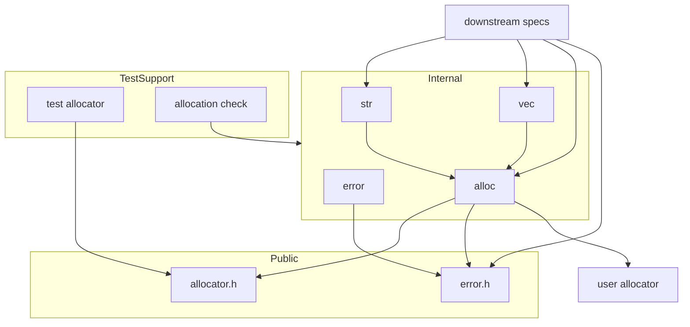
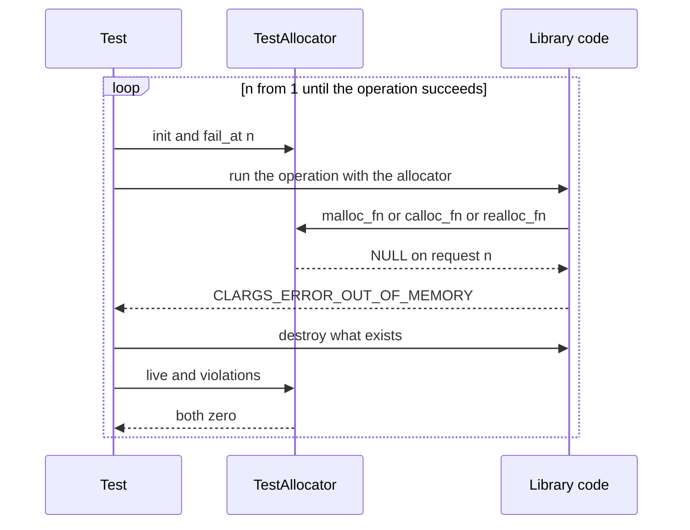

# Design Document: core-runtime

## Overview

> 用語: 要件の「エラーコード」は `clargs_error_t` の値である。成功も、この型の値 `CLARGS_ERROR_NONE` で表す。

**Purpose**: このスペックは、CLArgs のすべての機能が通る実行時の基盤を用意する。差し替え可能なアロケータ、エラーコードによるエラーモデル、所有権と寿命の規約、アロケータの上の内部ユーティリティ、確保の失敗を注入できるテスト用アロケータである。

**Users**: ライブラリ利用者は、アロケータの型とエラーコードを公開ヘッダから使う。ライブラリ開発者（後続の command-schema、argv-parser、help-formatter）は、内部 API、規約の文書、テスト用アロケータを使う。

**Impact**: 現在の公開関数は `clargs_version()` だけである。このスペックは、公開の型を 2 つ（`clargs_allocator_t`、`clargs_error_t`）と公開関数を 1 つ（`clargs_error_message()`）足し、`src/` に最初の内部モジュール群を置き、ソースを検査する CTest のテストを 1 つ足す。

### Goals

- アロケータを、関数ポインタ 4 つとコンテキストの小さな構造体として、オブジェクトごとに渡せるようにする。`NULL` は既定のアロケータを意味する。
- ライブラリのメモリ確保を `src/alloc.c` の 1 か所に集め、ほかの場所で標準の確保関数を呼んでいないことを自動で検査する。
- 失敗を `clargs_error_t` の戻り値で返す形を決め、後続のスペックがコードを足す手順を決める。
- 所有権と寿命の規約を `docs/ownership.md` に定める。
- 後続のスペックが、確保の各回を順に失敗させるテストを数行で書けるようにする。

### Non-Goals

- アロケータを受け取る公開関数（オブジェクトの生成と破棄）。後続のスペックが足す。
- 失敗の位置や対象を表す仕組み、利用者向けメッセージの整形。
- ログ、アサーションのフック、スレッド同期、アリーナやプールの実装。
- 既定のアロケータを利用者へ返す公開関数。利用者は `malloc` 系を自分で包める。必要になったら後から足せる。
- 長さ指定の文字列複製、ハッシュ表など、いま使う相手のいない内部ユーティリティ。

## Boundary Commitments

### This Spec Owns

- 公開の型 `clargs_allocator_t` と、その関数ポインタ型 4 つ。ライブラリが利用者のアロケータを呼ぶときの契約（後述の「アロケータ呼び出しの契約」）。
- 公開の型 `clargs_error_t`、その値の割り当て（番号の範囲を含む）、公開関数 `clargs_error_message()`。
- 内部 API: アロケータの解決（`clargs_allocator_resolve`）、メモリ操作（`clargs_mem_*`）、文字列の複製（`clargs_str_dup`）、伸長する配列（`clargs_vec_*`）。
- 既定のアロケータの実装。`src/alloc.c` は、標準の確保関数を呼んでよい唯一のファイルである。
- 確保関数の直接呼び出しを検査するスクリプトと、その CTest への登録（`clargs.allocations`）。
- 文書: `docs/ownership.md`（所有権と寿命）、`docs/conventions.md` への追記（エラーコードの足し方、メモリ確保の規則、テスト用アロケータの使い方）。
- テスト用アロケータ `tests/support/test_allocator.{h,c}`。

### Out of Boundary

- スキーマ、結果などのオブジェクトの生成・破棄の実装（command-schema、argv-parser）。このスペックは従うべき形だけを決める。
- 解析エラーの詳細の表現（argv-parser）。`clargs_error_t` は種類だけを表す。
- ビルド設定、`CLARGS_API`、`clargs_add_test()`、export の確認（build-foundation）。このスペックはこれらのファイルを変更しない。
- 利用者のアロケータの正しさの検査（整列、スレッド安全性）。

### Allowed Dependencies

- C 標準ライブラリ（C99）。`<stddef.h>`、`<stdlib.h>`（`src/alloc.c` だけ）、`<string.h>`（`memcpy`、`strlen`）、`<stdint.h>`（`SIZE_MAX`）。
- build-foundation の成果: `CLARGS_API`、`CLARGS_SOURCES`、`clargs_add_test()`、`clargs_internal` ターゲット、`docs/conventions.md` の命名規約。
- テストだけ: Naos v0.4.0。
- 依存の向き: `error` ← `alloc` ← `str`、`vec`。逆向きの取り込みをしない。このスペックのコードは、後続のスペックのヘッダを取り込まない。

### Revalidation Triggers

次の変更は、後続のスペックに統合の再確認を求める。

- 型の名前の規則（`_t`）の変更。
- `clargs_allocator_t` の配置（フィールドの数、順序、型）、関数ポインタ型のシグネチャ、アロケータ呼び出しの契約の変更。
- 既存の `clargs_error_t` の値や意味の変更、番号の範囲の割り当ての変更。
- `clargs_mem_*`、`clargs_str_dup`、`clargs_vec_*`、`clargs_allocator_resolve` のシグネチャや、失敗時の保証の変更。
- `docs/ownership.md` の規約の変更（特に、文字列の複製、`NULL` の扱い、失敗時の出力先の状態）。
- テスト用アロケータの API、または回数の数え方の変更。
- 検査スクリプトの禁止する名前の一覧の変更。

## Architecture

### Existing Architecture Analysis

- 公開ヘッダは `include/clargs/<名前>.h` に置き、`clargs.h` が取り込む。公開関数は `CLARGS_API` を付ける。export の確認は公開ヘッダを読んで期待する名前を得るので、公開関数を足しても一覧の修正は要らない。
- 内部関数は `src/<名前>_internal.h` で宣言し、`tests/internal/` のテストが `clargs_internal` にリンクして呼ぶ。動的の構成でも内部関数をテストできる。
- 公開 API のテストは静的と動的の両方で、3 つの OS の CI で実行される。
- 公開する変数は持てない（export の確認が失敗する）。この設計は公開の変数を足さない。
- 内部ヘッダの名前は `src/<名前>_internal.h` である。対応する公開ヘッダのないモジュール（`alloc`、`str`、`vec`）も、この既存の規約に従う。`src/` のヘッダが非公開であることが、名前だけで分かる。
- 既存の規約は型の名前の語尾を決めていない。既存のコードに型はまだない。このスペックが「型の名前は `_t` で終える」を足す。

### Architecture Pattern & Boundary Map



**Architecture Integration**:

- **Selected pattern**: 層になった小さなモジュール。`alloc` がアロケータの唯一の出入口で、`str` と `vec` はその上に載る。
- **Domain boundaries**: エラーモデル（`error`）はメモリを確保しない。メモリ（`alloc`）はコマンドラインを知らない。ユーティリティ（`str`、`vec`）は `alloc` だけを通してメモリを得る。
- **Existing patterns preserved**: 公開ヘッダ、内部ヘッダ、テストの置き方と登録方法は `docs/conventions.md` のとおり。
- **New components rationale**: 下の Components を参照。どれも要件に直接対応する。
- **Steering compliance**: C99・拡張なし、変更可能なグローバル状態なし、実行時の依存は C 標準ライブラリのみ、公開名は `clargs_` / `CLARGS_`。

### Technology Stack

| Layer | Choice / Version | Role in Feature | Notes |
|-------|------------------|-----------------|-------|
| ライブラリ | C99、拡張なし | 公開ヘッダ 2 つ、ソース 4 つ | 新しい依存はない |
| 検査 | CMake 3.21 のスクリプト（`cmake -P`） | 確保関数の直接呼び出しの検査 | `ClargsCheckExports.cmake` と同じ方式 |
| テスト | Naos v0.4.0、CTest | 公開・内部のテスト、失敗注入 | 既存の `clargs_add_test()` を使う |

## File Structure Plan

### Directory Structure

```
include/clargs/
├── error.h              clargs_error_t、clargs_error_message()
└── allocator.h           clargs_allocator_t と関数ポインタ型。関数は宣言しない
src/
├── error.c              clargs_error_message() の実装
├── alloc_internal.h      clargs_allocator_resolve、clargs_mem_* の宣言
├── alloc.c               既定のアロケータと clargs_mem_*。標準の確保関数を呼ぶ唯一のファイル
├── str_internal.h        clargs_str_dup の宣言
├── str.c                 文字列の複製
├── vec_internal.h        clargs_vec_t と clargs_vec_* の宣言
└── vec.c                 伸長する配列
cmake/
└── ClargsCheckAllocations.cmake   src/ に確保関数の直接呼び出しがないことの検査
tests/
├── support/
│   ├── test_allocator.h  テスト用アロケータの宣言
│   └── test_allocator.c  その実装。標準の malloc 系を使う
├── public/
│   ├── error_test.c            エラーコードと説明文
│   └── test_allocator_test.c    テスト用アロケータ自体と、clargs_allocator_t の型の使い方
└── internal/
    ├── alloc_internal_test.c    解決、既定、契約、桁あふれ
    ├── str_internal_test.c      複製と失敗注入
    └── vec_internal_test.c      伸長と失敗注入
docs/
└── ownership.md          所有権と寿命の規約
```

### Modified Files

- `include/clargs/clargs.h` — `error.h` と `allocator.h` の取り込みを 2 行足す。
- `src/CMakeLists.txt` — `CLARGS_SOURCES` に `alloc.c`、`error.c`、`str.c`、`vec.c` を足す。ほかは変えない。
- `tests/CMakeLists.txt` — `clargs_add_test()` を 5 行足し、`clargs.allocations` を `add_test()` で登録する（静的・動的の両方の構成で）。
- `docs/conventions.md` — 命名規約に「型の名前は `_t` で終える」を足す。「エラーコードを足す」「メモリを確保する」「テスト用アロケータを使う」の節を足し、ディレクトリ構成に `tests/support/` を足し、`docs/ownership.md` へ案内する。

`cmake/ClargsTesting.cmake` と `cmake/ClargsCheckExports.cmake` は変更しない。テスト用アロケータは、使うテストが `SOURCES` に `support/test_allocator.c` を並べて取り込む。

```cmake
clargs_add_test(vec_internal SOURCES internal/vec_internal_test.c support/test_allocator.c INTERNAL)
```

テストのソースは `#include "../support/test_allocator.h"` と書く。

## System Flows

失敗注入のテストの流れ。後続のスペックも同じ形で書く。



- 操作が `CLARGS_ERROR_NONE` を返し、要求の回数が `n` より小さかったら、すべての確保点を通ったので終える。
- 各回の終わりに、解放漏れ（`live`）と契約違反（`violations`）が 0 であることを確かめる。

## Requirements Traceability

| Requirement | Summary | Components | Interfaces | Flows |
|-------------|---------|------------|------------|-------|
| 1.1 | アロケータの公開の型 | Allocator 型 | `clargs_allocator_t` | — |
| 1.2 | 渡されたアロケータだけを使う | Alloc、所有権の規約 | `clargs_allocator_resolve`、`clargs_mem_*` | — |
| 1.3 | コンテキストをそのまま渡す | Alloc | `clargs_mem_*` | — |
| 1.4 | 同じアロケータで解放する | Alloc、TestAllocator | `clargs_mem_free`、`violations` | 失敗注入 |
| 1.5 | グローバルな設定関数を持たない | Allocator 型 | `const clargs_allocator_t *` の引数 | — |
| 1.6 | 複数のアロケータの共存 | Alloc、TestAllocator | 解決したコピーをオブジェクトが持つ | — |
| 1.7 | 関数が欠けていたら不正な引数 | Alloc | `clargs_allocator_resolve` | — |
| 1.8 | コンテキストに触れない、`NULL` 可 | Alloc | `clargs_allocator_t.context` | — |
| 2.1 | 既定は `malloc` 系 | Alloc | `clargs_allocator_resolve(NULL, …)` | — |
| 2.2 | 未指定の表し方は 1 つ | Allocator 型、所有権の規約 | `NULL` | — |
| 2.3 | 既定と同等のアロケータで同じ結果 | Alloc | アロケータ呼び出しの契約 | — |
| 3.1 | 標準の確保関数を直接呼ばない | Alloc、AllocationCheck | `src/alloc.c` だけ | — |
| 3.2 | 内部で確保する標準関数を使わない | AllocationCheck、Str | 禁止する名前の一覧 | — |
| 3.3 | 内部向けの確保の手段 | Alloc | `clargs_mem_*` | — |
| 3.4 | 変更可能なグローバル状態なし | Alloc、Error | `static const` だけ | — |
| 3.5 | 別オブジェクトへの同時呼び出し | Alloc、所有権の規約 | 状態はオブジェクトの中だけ | — |
| 3.6 | 自動の検査 | AllocationCheck | `clargs.allocations` | — |
| 4.1 | エラーコードの型 | Error | `clargs_error_t` | — |
| 4.2 | 失敗しうる公開関数はエラーコードを返す | 所有権の規約、規約文書 | 関数の形の規則 | — |
| 4.3 | 成功は 1 つ | Error | `CLARGS_ERROR_NONE` | — |
| 4.4 | 確保の失敗と不正な引数を区別 | Error | `CLARGS_ERROR_OUT_OF_MEMORY`、`CLARGS_ERROR_INVALID_ARGUMENT` | — |
| 4.5 | 説明文を返す | Error | `clargs_error_message` | — |
| 4.6 | 未知の値にも文字列 | Error | `clargs_error_message` | — |
| 4.7 | 説明文は解放不要で常に有効 | Error | 文字列リテラル | — |
| 4.8 | `errno` を使わない | Error、Alloc | — | — |
| 4.9 | 中断せず、出力しない | すべて | — | — |
| 4.10 | 失敗時の出力先の状態 | 所有権の規約、Str | 「失敗時の出力先」の規則 | — |
| 5.1 | 確保の失敗をエラーコードで返す | Alloc、Str、Vec | `NULL` → `CLARGS_ERROR_OUT_OF_MEMORY` | 失敗注入 |
| 5.2 | 途中の確保を解放して戻る | 所有権の規約、Str、Vec | — | 失敗注入 |
| 5.3 | 失敗後も使用・破棄できる | 所有権の規約、Vec | `clargs_vec_push` の保証 | 失敗注入 |
| 5.4 | 再確保の失敗で元を保つ | Alloc、Vec | `clargs_mem_realloc_array` | 失敗注入 |
| 5.5 | 大きさの桁あふれ | Alloc、Vec | `clargs_mem_calloc`、`clargs_mem_realloc_array` | — |
| 6.1 | 値を変えずに足せる | Error | 明示した値と番号の範囲 | — |
| 6.2 | 足す手順の文書 | 規約文書 | `docs/conventions.md` | — |
| 6.3 | 値を再利用しない | Error、規約文書 | 番号の規則 | — |
| 6.4 | すべてのコードに固有の説明文 | Error のテスト | `error_test.c` の網羅 | — |
| 6.5 | 種類だけを表す | Error | `clargs_error_t` | — |
| 7.1 | 規約の文書 | 所有権の規約 | `docs/ownership.md` | — |
| 7.2 | 生成と破棄の対 | 所有権の規約 | 規則 1 | — |
| 7.3 | 渡した文字列の扱い | 所有権の規約 | 規則 2 | — |
| 7.4 | 返す文字列とオブジェクト | 所有権の規約 | 規則 3 | — |
| 7.5 | `NULL` の扱い | 所有権の規約 | 規則 4 | — |
| 7.6 | アロケータとコンテキストの寿命 | 所有権の規約、Alloc | 規則 5 | — |
| 7.7 | 解放はライブラリの関数だけ | 所有権の規約 | 規則 6 | — |
| 7.8 | このスペックも規約に従う | Error、Alloc、Str、Vec | — | — |
| 8.1 | 文字列の複製 | Str | `clargs_str_dup` | — |
| 8.2 | 伸長する配列 | Vec | `clargs_vec_*` | — |
| 8.3 | 失敗時に内容を保つ | Str、Vec | — | 失敗注入 |
| 8.4 | 同じアロケータですべて解放 | Vec、Alloc | `clargs_vec_destroy`、`clargs_mem_free` | — |
| 8.5 | 公開しない | Str、Vec、Alloc | 内部ヘッダ、既存の export の確認 | — |
| 8.6 | 最小限 | Str、Vec | 関数は合わせて 6 つ | — |
| 9.1 | そのまま渡せる | TestAllocator | `clargs_test_allocator_get` | — |
| 9.2 | 指定した回を失敗させる | TestAllocator | `clargs_test_allocator_fail_at` | 失敗注入 |
| 9.3 | 指定がなければ成功 | TestAllocator | `fail_at == 0` | — |
| 9.4 | 要求の回数 | TestAllocator | `clargs_test_allocator_requests` | 失敗注入 |
| 9.5 | 未解放の個数 | TestAllocator | `clargs_test_allocator_live` | 失敗注入 |
| 9.6 | 複数インスタンス | TestAllocator | 状態は構造体の中だけ | — |
| 9.7 | 追加のビルド設定なし | TestAllocator | `SOURCES` に 1 ファイル足す | — |
| 9.8 | インストールしない | TestAllocator | `tests/support/` | — |
| 9.9 | 使い方の文書 | 規約文書 | `docs/conventions.md` | 失敗注入 |
| 10.1 | アロケータの型の互換性 | Allocator 型 | 配置を固定する | — |
| 10.2 | `<clargs/clargs.h>` だけで使える | Allocator 型、Error | `clargs.h` | — |
| 10.3 | 接頭辞 | すべての公開名 | `clargs_`、`CLARGS_` | — |
| 10.4 | 静的・動的、3 OS で同じ | Error のテスト | 既存の CI | — |
| 10.5 | C99、標準ライブラリのみ | すべて | — | — |

## Components and Interfaces

| Component | Layer | Intent | Req Coverage | Key Dependencies | Contracts |
|-----------|-------|--------|--------------|------------------|-----------|
| Error | 公開 | エラーコードと説明文 | 4.1, 4.3–4.9, 6.1, 6.3–6.5, 10.2–10.5 | なし | Service |
| Allocator 型 | 公開 | アロケータを表す値 | 1.1, 1.5, 1.8, 2.2, 10.1–10.3 | なし | Service |
| Alloc | 内部 | 解決、既定、メモリ操作 | 1.2–1.4, 1.6, 1.7, 2.1, 2.3, 3.1, 3.3–3.5, 5.1, 5.4, 5.5, 7.6 | Error (P0)、Allocator 型 (P0) | Service |
| Str | 内部 | 文字列の複製 | 8.1, 8.3, 8.5, 8.6, 4.10, 5.2 | Alloc (P0) | Service |
| Vec | 内部 | 伸長する配列 | 8.2–8.6, 5.3, 5.4, 5.5 | Alloc (P0) | Service、State |
| AllocationCheck | 検査 | 確保関数の直接呼び出しを検出 | 3.1, 3.2, 3.6 | CMake (P0) | Batch |
| TestAllocator | テスト支援 | 失敗注入と計数 | 9.1–9.8, 1.4, 1.6 | Allocator 型 (P0) | Service、State |
| 所有権の規約 | 文書 | `docs/ownership.md` | 7.1–7.8, 4.2, 4.10, 5.2, 5.3, 2.2, 3.5 | — | — |
| 規約文書 | 文書 | `docs/conventions.md` への追記 | 6.2, 6.3, 9.9, 4.2 | — | — |

### 公開

#### Error

| Field | Detail |
|-------|--------|
| Intent | 成功と失敗の種類を表す型と、その説明文 |
| Requirements | 4.1, 4.3, 4.4, 4.5, 4.6, 4.7, 4.8, 4.9, 6.1, 6.3, 6.4, 6.5, 10.2, 10.3, 10.4, 10.5 |

**Responsibilities & Constraints**

- `clargs_error_t` は失敗の種類だけを表す。位置や対象を持たない。
- 値は明示して書き、一度公開した値を変えず、別の意味に使わない。
- 説明文は英語の文字列リテラルで、メモリを確保しない。

**Contracts**: Service [x]

##### Service Interface

```c
/* include/clargs/error.h */
typedef enum clargs_error {
    CLARGS_ERROR_NONE = 0,
    CLARGS_ERROR_OUT_OF_MEMORY = 1,
    CLARGS_ERROR_INVALID_ARGUMENT = 2
} clargs_error_t;

CLARGS_API const char *clargs_error_message(clargs_error_t error);
```

- Preconditions: なし。どんな値を渡してもよい。
- Postconditions: `NULL` でない、空でない、`'\0'` で終わる文字列を返す。プログラムの終了まで有効で、利用者は解放しない。定義されていない値には `"unknown error code"` を返す。
- Invariants: `CLARGS_ERROR_NONE` だけが成功を表す。成功の判定は `error == CLARGS_ERROR_NONE` と書く。

説明文:

| 値 | 説明文 |
|---|---|
| `CLARGS_ERROR_NONE` | `"success"` |
| `CLARGS_ERROR_OUT_OF_MEMORY` | `"out of memory"` |
| `CLARGS_ERROR_INVALID_ARGUMENT` | `"invalid argument"` |
| それ以外 | `"unknown error code"` |

**エラーコードの足し方**（`docs/conventions.md` に記載する。6.1、6.2、6.3）

- すべてのエラーコードを `include/clargs/error.h` の 1 つの列挙に書く。スペックごとに別の型を作らない。
- 名前は `CLARGS_ERROR_<内容>` とする。成功は `CLARGS_ERROR_NONE` である。
- 値は明示して書く。スペックごとに範囲を割り当て、範囲の中で小さい順に使う。

  | 範囲 | 持ち主 |
  |---|---|
  | 0 | `CLARGS_ERROR_NONE` |
  | 1〜99 | core-runtime |
  | 100〜199 | command-schema |
  | 200〜299 | argv-parser |
  | 300〜399 | help-formatter |

- 一度公開した値は、削除しても番号を再利用しない。
- 足すときは 3 か所を直す: `error.h` の列挙、`src/error.c` の `switch` の `case`、`tests/public/error_test.c` の一覧。
- 利用者は、知らない値を受け取りうるものとして書く（`switch` に `default` を置く）。この注意をヘッダのコメントに書く。

**Implementation Notes**

- Integration: `clargs_error_message()` は、`default` のない `switch` で書き、未知の値は `switch` の後で扱う。GCC と Clang は、`case` のない列挙子を `-Wswitch`（`-Wall` に含まれる）で警告し、既定では警告がエラーになる。
- Validation: `tests/public/error_test.c` は、すべてのエラーコードの一覧を持ち、各コードの説明文が `NULL` でなく、空でなく、未知用の説明文と異なり、互いに異なることを確かめる。一覧の網羅は、テストの中の `default` のない `switch`（列挙子 → 一覧の添字）でコンパイラに確かめさせる（6.4）。範囲外の値（`(clargs_error_t)-1`、`(clargs_error_t)9999`）で未知用の説明文が返ることも確かめる。
- Risks: MSVC は列挙子の `case` の不足を既定では警告しない。CI の GCC と Clang の構成が検出する。列挙型の大きさを変えるコンパイラのオプション（`-fshort-enums`）は対象外とする。

#### Allocator 型

| Field | Detail |
|-------|--------|
| Intent | 利用者のアロケータを表す、公開の小さな構造体 |
| Requirements | 1.1, 1.5, 1.8, 2.2, 10.1, 10.2, 10.3 |

**Responsibilities & Constraints**

- 型だけを公開する。このヘッダは関数を宣言しない。
- 配置を固定する。フィールドを足さず、順序も型も変えない（10.1）。将来、機能を足すときは、新しい型と、それを受け取る新しい関数を足す。既存の関数は `clargs_allocator_t` を受け取り続ける。
- フィールド名は `malloc_fn`、`realloc_fn`、`calloc_fn`、`free_fn` とする。標準の関数と同じ名前（`free` など）にしないので、利用者の環境がそれらを関数形式のマクロにしていても（デバッグ用の確保ライブラリなど）、フィールドの呼び出しは書き換えられない。

**Contracts**: Service [x]

##### Service Interface

```c
/* include/clargs/allocator.h */
typedef void *(*clargs_malloc_fn_t)(void *context, size_t size);
typedef void *(*clargs_realloc_fn_t)(void *context, void *pointer, size_t size);
typedef void *(*clargs_calloc_fn_t)(void *context, size_t count, size_t size);
typedef void (*clargs_free_fn_t)(void *context, void *pointer);

typedef struct clargs_allocator {
    clargs_malloc_fn_t malloc_fn;
    clargs_realloc_fn_t realloc_fn;
    clargs_calloc_fn_t calloc_fn;
    clargs_free_fn_t free_fn;
    void *context;
} clargs_allocator_t;
```

アロケータを受け取る公開関数（後続のスペックが足す）は、引数を `const clargs_allocator_t *allocator` とする。`NULL` は既定のアロケータを意味する（2.2）。ライブラリ全体のアロケータを設定する関数はない（1.5）。

**アロケータ呼び出しの契約**

ライブラリが守ること:

- `malloc_fn` を `size > 0` で呼ぶ。
- `calloc_fn` を、`count > 0`、`size > 0` で、積が `size_t` で表せる場合にだけ呼ぶ。
- `realloc_fn` を、同じアロケータで得た `NULL` でない `pointer` と、`size > 0` で呼ぶ。
- `free_fn` を、同じアロケータで得た `NULL` でない `pointer` で呼ぶ。同じポインタを 2 度渡さない。
- どの呼び出しにも、利用者が渡した `context` をそのまま渡す。`context` の指す先を読み書きしない。

利用者のアロケータが守ること:

- `malloc_fn`、`calloc_fn`、`realloc_fn` は、どの型のオブジェクトにも使える整列のメモリを返す。失敗したら `NULL` を返す。
- `calloc_fn` は、`count * size` バイトのすべてを 0 にしたメモリを返す。
- `realloc_fn` は、成功したら先頭から古い大きさと新しい大きさの小さいほうまでの内容を保つ。失敗したら元のメモリをそのまま有効に保つ。
- 関数と `context` は、そのアロケータで生成したオブジェクトを破棄し終えるまで有効である。構造体そのものは、渡した呼び出しが戻ったら破棄してよい（ライブラリが複製する）。

**Implementation Notes**

- Validation: 構造体をゼロで初期化したもの（関数が 4 つとも `NULL`）は、既定ではなく不正な引数として扱う（1.7）。
- Risks: 配置を固定するので、後から「大きさつきの解放」などを足すには新しい型が要る。初版の範囲では受け入れる。

### 内部

#### Alloc

| Field | Detail |
|-------|--------|
| Intent | アロケータの解決、既定のアロケータ、すべてのメモリ操作の出入口 |
| Requirements | 1.2, 1.3, 1.4, 1.6, 1.7, 2.1, 2.3, 3.1, 3.3, 3.4, 3.5, 5.1, 5.4, 5.5, 7.6 |

**Responsibilities & Constraints**

- `src/alloc.c` は、標準の `malloc`、`calloc`、`realloc`、`free` を呼ぶ唯一のファイルである。既定のアロケータは、これらを包む `static` 関数 4 つと、`static const clargs_allocator_t` の定数 1 つである。変更可能な状態を持たない。
- ライブラリのほかのコードは、`clargs_mem_*` だけを通してメモリを得る。利用者のアロケータの関数ポインタを直接呼ばない。
- アロケータ呼び出しの契約のうち、ライブラリが守る側をここで保証する（大きさ 0 の切り上げ、`NULL` の解放を呼び出さない）。

**Dependencies**

- Inbound: Str、Vec、後続のスペック — メモリ操作 (P0)
- Outbound: 利用者のアロケータ — 関数ポインタの呼び出し (P0)
- External: C 標準ライブラリ `<stdlib.h>` — 既定のアロケータ (P0)

**Contracts**: Service [x]

##### Service Interface

```c
/* src/alloc_internal.h */
clargs_error_t clargs_allocator_resolve(const clargs_allocator_t *allocator, clargs_allocator_t *out);

void *clargs_mem_alloc(const clargs_allocator_t *allocator, size_t size);
void *clargs_mem_calloc(const clargs_allocator_t *allocator, size_t count, size_t item_size);
void *clargs_mem_realloc_array(const clargs_allocator_t *allocator, void *pointer,
                               size_t count, size_t item_size);
void clargs_mem_free(const clargs_allocator_t *allocator, void *pointer);
```

`clargs_allocator_resolve`

- `allocator` が `NULL` なら、既定のアロケータを `*out` に複製して `CLARGS_ERROR_NONE` を返す。
- `allocator` の関数のどれかが `NULL` なら、`*out` を変更せず、どのアロケータも呼ばずに `CLARGS_ERROR_INVALID_ARGUMENT` を返す。
- それ以外は、`*allocator` を `*out` に複製して `CLARGS_ERROR_NONE` を返す。
- Preconditions: `out` は `NULL` でない。
- 使い方: オブジェクトを生成する関数は、最初にこれを呼んでローカル変数に解決し、そのアロケータでオブジェクトを確保し、解決したコピーをオブジェクトの中に保存する。以後、そのオブジェクトに属するメモリ操作は、すべて保存したコピーを通す（1.2、1.6）。

`clargs_mem_*`

- Preconditions: `allocator` は解決済み（`NULL` でなく、関数が 4 つともある）。`clargs_mem_realloc_array` の `pointer` は、同じアロケータで得た `NULL` でないポインタ。
- `clargs_mem_alloc`: `malloc_fn` を呼ぶ。成功したら `NULL` でないポインタ、失敗したら `NULL` を返す。内容は不定である。`size` が 0 のときは 1 バイトを要求する。
- `clargs_mem_calloc`: `calloc_fn` を呼ぶ。成功したら、すべてのバイトが 0 のメモリを返す。構造体や配列の最初の確保に使う。
- `clargs_mem_realloc_array`: `realloc_fn` を呼ぶ。伸ばした部分の内容は不定である。
- `clargs_mem_calloc`、`clargs_mem_realloc_array`: `count * item_size` が `size_t` で表せないときは、アロケータを呼ばずに `NULL` を返す（5.5）。積が 0 のときは 1 バイト（`clargs_mem_calloc` は 1 個 × 1 バイト）を要求する。
- `clargs_mem_realloc_array` が `NULL` を返したとき、`pointer` の指すメモリと内容は有効なままである（5.4）。呼び出し側は、戻り値を確かめてから元のポインタを置き換える。
- `clargs_mem_free`: `pointer` が `NULL` なら何もしない。そうでなければ `free_fn` を呼ぶ。
- 呼び出し側は、`NULL` の戻り値を `CLARGS_ERROR_OUT_OF_MEMORY` として上へ返す（5.1）。
- Invariants: これらの関数は、`errno` を書かず、何も出力せず、プロセスを中断しない。

**Implementation Notes**

- Integration: 後続のスペックは `#include "alloc_internal.h"` で取り込む。
- Validation: `tests/internal/alloc_internal_test.c` で確かめる。`NULL` の解決が動作するアロケータを返すこと。関数が 1 つ欠けたアロケータ 4 通りとゼロ初期化が `CLARGS_ERROR_INVALID_ARGUMENT` になり、`*out` が変わらないこと。コンテキストが 4 つの関数のどれにもそのまま届くこと。`clargs_mem_calloc` の返すメモリがすべて 0 であること。大きさ 0 が 1 バイトの要求になること。桁あふれでアロケータが呼ばれないこと（要求の回数が増えない）。再確保の失敗で元の内容が残ること。2 つのテスト用アロケータを交互に使って、どちらにも契約違反がないこと。
- Risks: 既定のアロケータの `malloc` などが、失敗時に `errno` を設定することがある。これは C 標準ライブラリの動作であり、ライブラリは `errno` を読まず、書かない（4.8）。

#### Str

| Field | Detail |
|-------|--------|
| Intent | 指定されたアロケータで文字列を複製する |
| Requirements | 8.1, 8.3, 8.5, 8.6, 4.10, 5.2 |

**Contracts**: Service [x]

##### Service Interface

```c
/* src/str_internal.h */
clargs_error_t clargs_str_dup(const clargs_allocator_t *allocator, const char *string, char **out);
```

- Preconditions: `allocator` は解決済み。`string` と `out` は `NULL` でない。
- Postconditions: 成功したら、`*out` は `string` と同じ内容の、`'\0'` で終わる新しい文字列を指す。呼び出し側が `clargs_mem_free` で解放する。失敗したら `*out` は `NULL` になり、`CLARGS_ERROR_OUT_OF_MEMORY` を返す。
- 空文字列の複製は成功し、1 バイトの文字列を返す。

**Implementation Notes**

- Validation: `tests/internal/str_internal_test.c`。内容と終端、空文字列、元の文字列と別の領域であること、1 回目の確保の失敗で `*out` が `NULL` になり解放漏れがないこと。

#### Vec

| Field | Detail |
|-------|--------|
| Intent | 要素を末尾に足していける、要素の大きさを実行時に持つ配列 |
| Requirements | 8.2, 8.3, 8.4, 8.5, 8.6, 5.3, 5.4, 5.5 |

**Responsibilities & Constraints**

- 要素を値として複製して保持する。要素がポインタなら、指す先の所有は呼び出し側が管理する。
- アロケータを借りる。`clargs_vec_t` は、持ち主のオブジェクトが保存しているアロケータへのポインタを持つ。持ち主より長生きしない。
- 削除、挿入、並べ替えは持たない（8.6）。

**Contracts**: Service [x] / State [x]

##### Service Interface

```c
/* src/vec_internal.h */
typedef struct clargs_vec {
    const clargs_allocator_t *allocator;
    void *items;
    size_t count;
    size_t capacity;
    size_t item_size;
} clargs_vec_t;

void clargs_vec_init(clargs_vec_t *vec, const clargs_allocator_t *allocator, size_t item_size);
clargs_error_t clargs_vec_push(clargs_vec_t *vec, const void *item);
void *clargs_vec_at(const clargs_vec_t *vec, size_t index);
void clargs_vec_destroy(clargs_vec_t *vec);
```

- `clargs_vec_init`: メモリを確保しない。失敗しない。Preconditions: `item_size > 0`、`allocator` は解決済み。
- `clargs_vec_push`: `*item` の `item_size` バイトを末尾に複製する。容量が足りなければ伸ばす。失敗したら `CLARGS_ERROR_OUT_OF_MEMORY` を返し、`count`、`capacity`、既存の要素は変わらない（8.3、5.3）。容量の計算が桁あふれするときも同じである（5.5）。
- `clargs_vec_at`: `index < count` の要素へのポインタを返す。このポインタは、次の `clargs_vec_push` まで有効である。Preconditions: `index < count`。
- `clargs_vec_destroy`: 保持するメモリを、`init` で受け取ったアロケータで解放し、`init` の直後と同じ空の状態に戻す。2 度呼んでもよい。要素の指す先は解放しない。
- 要素の数は、フィールド `count` を直接読む。

##### State Management

- State model: 空（`items == NULL`、`count == 0`、`capacity == 0`）→ 要素あり（`count <= capacity`）→ `destroy` で空。
- 伸長: 最初の確保は 4 要素、以後は 2 倍。最初は `clargs_mem_calloc`、以後は `clargs_mem_realloc_array` を使う。
- Concurrency: 同期しない。1 つの `clargs_vec_t` を複数のスレッドから同時に変更しない。

**Implementation Notes**

- Validation: `tests/internal/vec_internal_test.c`。空の状態、4 を超える伸長で内容が保たれること、大きさの違う要素（`char`、`int`、構造体、ポインタ）、失敗注入の各回で `count` と既存の要素が変わらず、その後の `push` が成功すること、`destroy` の後に解放漏れがなく、再び使えること。
- Risks: 型のない `void *` の境界なので、要素の型の取り違えをコンパイラは検出しない。後続のスペックは、型ごとの薄い `static` 関数で包む。

### 検査

#### AllocationCheck

| Field | Detail |
|-------|--------|
| Intent | `src/` のソースが、`alloc.c` 以外で標準の確保関数を使っていないことを確かめる |
| Requirements | 3.1, 3.2, 3.6 |

**Contracts**: Batch [x]

##### Batch / Job Contract

- Trigger: CTest のテスト `clargs.allocations`。静的と動的のどちらの構成でも登録する。単独でも実行できる。

  ```sh
  cmake -P cmake/ClargsCheckAllocations.cmake
  ```

- Input: `CLARGS_SOURCE_DIR`（既定はこのソースツリーの `src/`）の `*.c` と `*.h` のすべて。`alloc.c` を除く。
- Validation: 各ファイルから、コメント、文字列リテラル、文字リテラルを取り除き、次の名前が単独の識別子として現れたら失敗とする。

  `malloc`、`calloc`、`realloc`、`free`、`aligned_alloc`、`strdup`、`strndup`、`wcsdup`、`asprintf`、`vasprintf`

- Output: 違反があれば、ファイル名、行番号、名前をすべて挙げて `FATAL_ERROR` で終わる。なければ、検査したファイルの数を `STATUS` で出す。対象のファイルが 1 つもない場合も失敗とする。
- Idempotency: ファイルを変更しない。何度実行しても同じ結果になる。

**Implementation Notes**

- Integration: `tests/CMakeLists.txt` に `add_test(NAME clargs.allocations COMMAND ${CMAKE_COMMAND} -DCLARGS_SOURCE_DIR=... -P ...)` を足す。スクリプトは自分でコメントを取り除く。`ClargsCheckExports.cmake` は変更しない。
- Validation: 実装時に、違反を含む一時的なディレクトリを `CLARGS_SOURCE_DIR` に渡して、検出することを手で確かめる。
- Risks: 識別子の検査なので、マクロで名前を組み立てた呼び出しは検出しない。`src/` でそのようなマクロを書かないことを `docs/conventions.md` に書く。`clargs_mem_free` や `free_fn` は、単独の識別子として一致しないので検出されない。

### テスト支援

#### TestAllocator

| Field | Detail |
|-------|--------|
| Intent | 指定した回の確保を失敗させ、要求の回数、未解放の個数、契約違反を数える |
| Requirements | 9.1, 9.2, 9.3, 9.4, 9.5, 9.6, 9.7, 9.8, 1.4, 1.6 |

**Responsibilities & Constraints**

- 状態はすべて、テストが用意する `clargs_test_allocator_t` 構造体の中にある。グローバルな状態を持たないので、複数のインスタンスを同時に使える（9.6）。
- 公開ヘッダ `<clargs/clargs.h>` だけに依存する。内部関数を呼ばないので、公開 API のテスト（動的の構成を含む）でも内部関数のテストでも使える。
- 標準の `malloc` 系で実際に確保する。`tests/` にあるので、確保関数の検査の対象外であり、インストールもされない（9.8）。

**Contracts**: Service [x] / State [x]

##### Service Interface

```c
/* tests/support/test_allocator.h */
typedef struct clargs_test_allocator {
    size_t fail_at;
    size_t requests;
    size_t live;
    size_t violations;
} clargs_test_allocator_t;

void clargs_test_allocator_init(clargs_test_allocator_t *state);
clargs_allocator_t clargs_test_allocator_get(clargs_test_allocator_t *state);
void clargs_test_allocator_fail_at(clargs_test_allocator_t *state, size_t request);
size_t clargs_test_allocator_requests(const clargs_test_allocator_t *state);
size_t clargs_test_allocator_live(const clargs_test_allocator_t *state);
size_t clargs_test_allocator_violations(const clargs_test_allocator_t *state);
```

- `init`: すべての数を 0 にする。失敗させる回の指定もなくなる。
- `get`: `context` が `state` を指す `clargs_allocator_t` を返す。`state` は、そのアロケータを使い終えるまで有効に保つ。
- `fail_at(state, n)`: `init` の後から数えて `n` 回目（1 から数える）の要求（`malloc_fn`、`calloc_fn`、`realloc_fn` のどれか）を失敗させる。その回だけが失敗し、前後の要求は成功する（9.2）。`n` が 0 なら、どの要求も失敗させない（9.3）。
- `requests`: `init` の後に受けた、`malloc_fn`、`calloc_fn`、`realloc_fn` の要求の回数。失敗させた要求も数える（9.4）。
- `live`: 確保されたまま解放されていないブロックの個数（9.5）。確保の成功で 1 増え、解放で 1 減る。再確保では変わらない。
- `violations`: アロケータ呼び出しの契約に反する呼び出しの回数。大きさ 0 または個数 0 の要求、`NULL` の再確保、`NULL` の解放、このインスタンスが確保していないブロックの再確保または解放を数える。

##### State Management

- State model: 各ブロックの前に、確保したインスタンスを記録するヘッダを置く。ヘッダは、どの型にも使える整列になる大きさにする。再確保と解放のとき、ヘッダのインスタンスが自分でなければ、`violations` を増やし、そのブロックに触れない（1.4、1.6 の検出）。
- 失敗させた再確保は、元のブロックをそのまま残す（契約どおり）。
- Concurrency: 同期しない。

**Implementation Notes**

- Integration: 使うテストは、`clargs_add_test()` の `SOURCES` に `support/test_allocator.c` を足し、`#include "../support/test_allocator.h"` と書く（9.7）。
- Validation: `tests/public/test_allocator_test.c`。指定した回だけが失敗すること（3 種類の要求のどれでも）、`calloc_fn` の返すメモリがすべて 0 であること、指定がなければ成功すること、回数と個数、2 つのインスタンスが独立に数えること、他方のブロックの解放が違反として数えられること、失敗させた再確保の後も元の内容が読めること。
- Risks: 壊れたポインタ（どのインスタンスのものでもないメモリ）を渡されたときの検出は保証しない。

### 文書

#### 所有権の規約（`docs/ownership.md`）

後続のスペックが従う規約である。このスペックの公開関数と内部ユーティリティも従う（7.8）。

1. **生成と破棄**（7.2）
   - オブジェクトを生成する関数は `clargs_error_t clargs_<型>_create(…, clargs_<型> **out)` の形にする。破棄する関数は `void clargs_<型>_destroy(clargs_<型> *object)` の形にし、失敗しない。
   - 利用者が `create` で得たオブジェクトは、対応する `destroy` でだけ破棄する。破棄すると、そのオブジェクトと、それに属するもの（ほかのオブジェクトに足した子、複製した文字列）がすべて解放される。子のハンドルは、親を破棄すると無効になる。子を個別に破棄する関数は持たない。
2. **利用者が渡す文字列**（7.3）
   - 呼び出しの後もライブラリが使う文字列は、ライブラリが複製する。利用者は、呼び出しが戻ったら文字列を変更しても解放してもよい。
   - 複製せずに借りる関数は、例外として、そのことと、利用者が文字列を有効に保つ期間を、関数のコメントに書く。書いていない関数は複製する。
3. **ライブラリが返す文字列とオブジェクト**（7.4）
   - 返した文字列とハンドルは、返したオブジェクトが所有する。そのオブジェクトを破棄するまで有効である。関数のコメントがより短い期間を書いている場合は、それに従う。利用者は解放しない。
   - `clargs_error_message()` の文字列は、プログラムの終了まで有効である。
   - あるオブジェクトが別のオブジェクトを参照する場合（結果がスキーマを参照するなど）、参照されるほうを先に破棄しない。関数のコメントにこの順序を書く。
4. **`NULL`**（7.5）
   - `destroy` に `NULL` を渡すと、何もしない。
   - アロケータの引数の `NULL` は、既定のアロケータを意味する。
   - それ以外の引数は、関数のコメントが「`NULL` でもよい」と書いていない限り、`NULL` を渡せない。エラーコードを返す関数は、そのような `NULL` に `CLARGS_ERROR_INVALID_ARGUMENT` を返し、何も変更しない。エラーコードを返さない関数は、`NULL` を渡されたときに返す値をコメントに書く。
5. **アロケータの寿命**（7.6）
   - ライブラリは、渡された `clargs_allocator_t` を複製して持つ。利用者は、呼び出しが戻ったら構造体を破棄してよい。
   - 関数と `context` の指す先は、そのアロケータで生成したオブジェクトを破棄し終えるまで有効に保つ。
6. **解放するのは確保した側**（7.7）
   - ライブラリが確保したメモリは、ライブラリの `destroy` を通してだけ解放する。利用者が `free` や自分の解放関数を直接呼ぶ公開 API を作らない。
   - 利用者が確保したメモリを、ライブラリが解放する公開 API も作らない。
7. **失敗の返し方**（4.2、4.10、5.2、5.3）
   - 失敗しうる公開関数は `clargs_error_t` を返し、結果は出力用の引数で返す。失敗しえない関数（`destroy`、単純な取得）は、値を直接返してよい。
   - 失敗したとき、生成したオブジェクトや文字列を受け取る出力先は `NULL` になる。それ以外の出力先は変更されない。出力先のポインタ自体が `NULL` の場合は、何も書かない。
   - 失敗したとき、その呼び出しの中で確保したメモリは、すべて解放してから戻る。
   - 既存のオブジェクトを変更する関数が失敗したとき、そのオブジェクトは呼び出しの前と同じ内容を保つ。それができない関数は、少なくとも使用と破棄ができる状態を保ち、残る違いをコメントに書く。
8. **スレッド**（3.5）
   - ライブラリは変更可能なグローバル状態を持たない。別々のオブジェクトへの呼び出しは、同期なしで同時に行える（利用者のアロケータが、その使われ方に耐える場合）。
   - 同じオブジェクトへの同時の呼び出しは、利用者が同期する。

`roadmap.md` が挙げる 3 つの問いへの適用:

| 問い | 規約の適用 |
|---|---|
| スキーマは文字列を複製するか | 複製する（規則 2 の既定） |
| 結果は argv の文字列を複製するか | 既定は複製する。借りる場合は、argv-parser が規則 2 の例外として関数のコメントに期間を書く。どちらにするかは argv-parser の設計で決める |
| 結果はスキーマより長生きしてよいか | よくない。結果はスキーマを参照するので、結果を先に破棄する（規則 3） |

#### 規約文書（`docs/conventions.md` への追記）

- **エラーコードを足す**: Error の「エラーコードの足し方」のとおり（6.2、6.3）。
- **メモリを確保する**: `src/` のコードは `clargs_mem_*` を通す。`alloc.c` 以外で標準の確保関数を書かない。検査 `clargs.allocations` の説明と、単独での実行方法。変更可能な `static` 変数とグローバル変数を書かない（3.4）。
- **テスト用アロケータを使う**: 取り込み方、System Flows の繰り返しをそのまま書いた例、各回で `live` と `violations` が 0 であることを確かめること（9.9）。
- ディレクトリ構成に `tests/support/` を足す。
- **命名規約への追記**: 型の名前（`typedef` で付ける名前）は、公開・内部・テスト支援のどれも `_t` で終える（`clargs_error_t`、`clargs_allocator_t`、`clargs_malloc_fn_t`、`clargs_vec_t`）。構造体と列挙のタグは `_t` を付けない（`struct clargs_allocator`、`enum clargs_error`）。関数ポインタの型は `clargs_<名前>_fn_t`、それを持つフィールドは `<名前>_fn` とする。

## Error Handling

### Error Strategy

- 失敗は戻り値の `clargs_error_t` だけで伝える。`errno`、出力、`abort`、`exit`、`assert` を使わない（4.8、4.9）。
- 内部のメモリ関数は `NULL` で失敗を返し、それを受けた関数が `CLARGS_ERROR_OUT_OF_MEMORY` に直して上へ返す。途中で握りつぶさない。
- 引数の検査は、公開関数の入口で行う。内部関数は前提条件を信頼し、検査を繰り返さない。

### Error Categories and Responses

| 種類 | エラーコード | 起こる場所 | 応答 |
|---|---|---|---|
| 利用者の誤り | `CLARGS_ERROR_INVALID_ARGUMENT` | 関数の欠けたアロケータ、必須の引数の `NULL` | 何も変更せず、何も確保せずに戻る |
| 資源の不足 | `CLARGS_ERROR_OUT_OF_MEMORY` | 確保または再確保の失敗、大きさの桁あふれ | その呼び出しの確保を解放し、オブジェクトを元の内容に保って戻る |

### Monitoring

ログは持たない（スコープ外）。利用者は、自分のアロケータで確保の回数や量を観測できる。

## Testing Strategy

テストは、既存の方法（`clargs_add_test()`、静的と動的、3 つの OS の CI）で実行する。

### 公開 API のテスト（`tests/public/`、静的・動的の両方）

- `error_test.c`: 3 つのエラーコードの説明文が表のとおりであること。`CLARGS_ERROR_NONE` が 0 であること。未定義の値に `"unknown error code"` が返ること。すべてのコードの説明文が固有であること（6.4）。`<clargs/clargs.h>` だけを取り込んで書く（10.2）。
- `test_allocator_test.c`: TestAllocator の Validation の項目。`clargs_allocator_t` を利用者の立場で組み立てて呼べること（1.1、1.8）。

### 内部関数のテスト（`tests/internal/`）

- `alloc_internal_test.c`: Alloc の Validation の項目（1.3、1.4、1.6、1.7、2.1、5.4、5.5）。同じ操作の列を、既定のアロケータと、`malloc` 系を包んだだけの利用者のアロケータで実行し、結果が同じであること（2.3）。
- `str_internal_test.c`: Str の Validation の項目（8.1、8.3、4.10）。
- `vec_internal_test.c`: Vec の Validation の項目（8.2、8.3、8.4、5.3）。失敗注入は System Flows の繰り返しで書き、後続のスペックの手本にする。

### 検査

- `clargs.allocations`: `src/` に確保関数の直接呼び出しがないこと（3.1、3.2、3.6）。
- `clargs.exports`（既存、動的の構成）: 公開されるのが `clargs_version` と `clargs_error_message` だけで、内部ユーティリティが export されないこと（8.5、10.3）。

### 自動のテストで確かめないもの

- 変更可能なグローバル状態がないこと（3.4）と、別々のオブジェクトへの同時呼び出し（3.5）は、C99 にスレッドの標準がないので、自動のテストを書かない。`src/` に `const` でない `static` 変数とファイルスコープの変数がないことを、レビューで確かめる。
- アロケータを受け取る公開関数の挙動（1.2、1.6、2.1 の利用者から見た面）は、このスペックに対象の関数がないので、内部 API の水準で確かめる。後続のスペックは、自分の `create` と変更の関数ごとに、失敗注入のテストを書く。

## Performance & Scalability

- 目標値は置かない。`clargs_mem_*` は、利用者の関数ポインタの呼び出しに、分岐を 1 つか 2 つ足すだけである。
- `clargs_vec_t` の伸長は 2 倍なので、`n` 個の追加での再確保は `log n` 回程度である。
