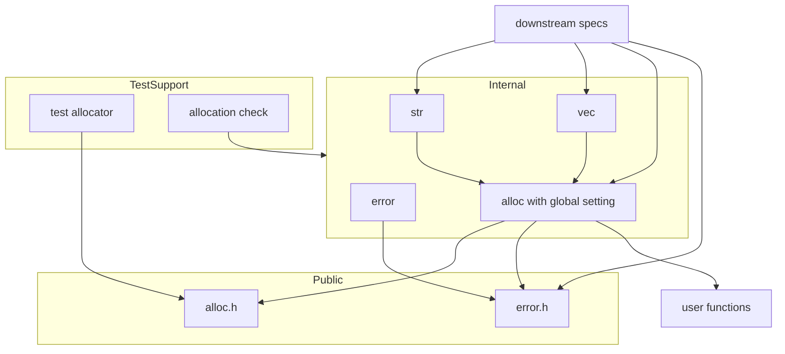
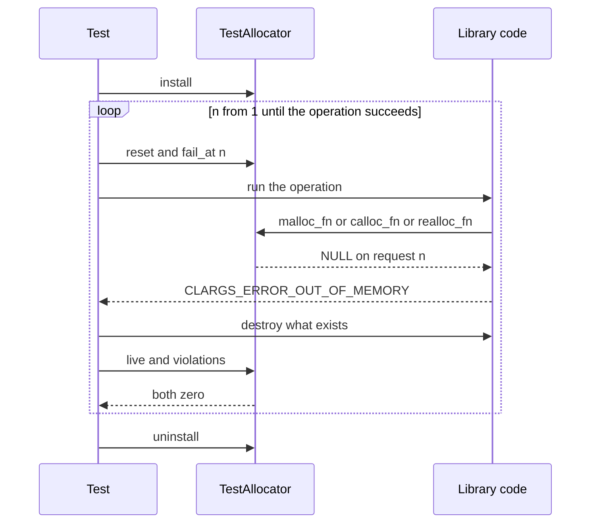

# Design Document: core-runtime

## Overview

> 用語: 要件の「エラーコード」は `clargs_error_t` の値である。成功も、この型の値 `CLARGS_ERROR_NONE` で表す。

**Purpose**: このスペックは、CLArgs のすべての機能が通る実行時の基盤を用意する。差し替え可能なアロケータ、エラーコードによるエラーモデル、所有権と寿命の規約、アロケータの上の内部ユーティリティ、確保の失敗を注入できるテスト用アロケータである。

**Users**: ライブラリ利用者は、アロケータの設定とエラーコードを公開ヘッダから使う。ライブラリ開発者（後続の command-schema、argv-parser、help-formatter）は、内部 API、規約の文書、テスト用アロケータを使う。

**Impact**: 現在の公開関数は `clargs_version()` だけである。このスペックは、公開の型を 2 つ（`clargs_allocator_t`、`clargs_error_t`）と公開関数を 2 つ（`clargs_set_allocator()`、`clargs_error_message()`）足し、`src/` に最初の内部モジュール群を置き、ソースを検査する CTest のテストを 1 つ足す。ライブラリは、設定されたアロケータという、ただ 1 つの変更可能なグローバル状態を持つようになる。

### Goals

- アロケータを、標準の `malloc`、`realloc`、`calloc`、`free` と同じ形の関数ポインタ 4 つの構造体として、ライブラリ全体に 1 つ設定できるようにする。設定しなければ標準の関数を使う。
- ライブラリのメモリ確保を `src/alloc.c` の 1 か所に集め、ほかの場所で標準の確保関数を呼んでいないことを自動で検査する。
- 失敗を `clargs_error_t` の戻り値で返す形を決め、後続のスペックがコードを足す手順を決める。
- 所有権と寿命の規約を `docs/ownership.md` に定める。
- 後続のスペックが、確保の各回を順に失敗させるテストを数行で書けるようにする。

### Non-Goals

- オブジェクトごとのアロケータ、利用者のデータ（コンテキスト）をアロケータへ渡す仕組み。
- 設定されているアロケータを取得する公開関数。
- アロケータの設定のスレッド同期。設定してよい時点を文書で決める。
- 失敗の位置や対象を表す仕組み、利用者向けメッセージの整形、ログ。
- アサーションの動作を利用者が差し替えるフック。標準の `assert` をそのまま使う。
- プログラムの誤り（必須の引数の `NULL` など）をエラーコードで報告すること。
- アリーナやプールの実装。
- 長さ指定の文字列複製、ハッシュ表など、いま使う相手のいない内部ユーティリティ。

## Boundary Commitments

### This Spec Owns

- 公開の型 `clargs_allocator_t` と、その関数ポインタ型 4 つ。公開関数 `clargs_set_allocator()`。ライブラリが利用者のアロケータを呼ぶときの契約（後述の「アロケータ呼び出しの契約」）。
- 設定されたアロケータを保持する、ライブラリでただ 1 つの変更可能なグローバル状態。
- 公開の型 `clargs_error_t`、エラーコードの一覧 `CLARGS_ERROR_LIST`、公開関数 `clargs_error_message()`。
- 内部 API: メモリ操作（`clargs_malloc`、`clargs_calloc`、`clargs_realloc`、`clargs_free`）、文字列の複製（`clargs_strdup`）、伸長する配列（`clargs_vec_*`）。
- 既定のアロケータの実装。`src/alloc.c` は、標準の確保関数を呼んでよい唯一のファイルである。
- 確保関数の直接呼び出しを検査するスクリプトと、その CTest への登録（`clargs.allocations`）。
- 文書: `docs/ownership.md`（所有権と寿命）、`docs/conventions.md` への追記と修正（型の名前の `_t`、内部ヘッダの名前、エラーコードの足し方、メモリ確保の規則、テスト用アロケータの使い方）。
- テスト用アロケータ `tests/support/test_allocator.{h,c}`。

### Out of Boundary

- スキーマ、結果などのオブジェクトの生成・破棄の実装（command-schema、argv-parser）。このスペックは従うべき形だけを決める。
- 解析エラーの詳細の表現（argv-parser）。`clargs_error_t` は種類だけを表す。
- ビルド設定、`CLARGS_API`、`clargs_add_test()`、export の確認（build-foundation）。このスペックはこれらのファイルを変更しない。
- 利用者のアロケータの正しさの検査（整列、スレッド安全性）。

### Allowed Dependencies

- C 標準ライブラリ（C99）。`<assert.h>`、`<stddef.h>`、`<stdlib.h>`（`src/alloc.c` だけ）、`<string.h>`（`memcpy`、`strlen`）、`<stdint.h>`（`SIZE_MAX`）。
- build-foundation の成果: `CLARGS_API`、`CLARGS_SOURCES`、`clargs_add_test()`、`clargs_internal` ターゲット、`docs/conventions.md` の命名規約。
- テストだけ: Naos v0.4.0。
- 依存の向き: `error` ← `alloc` ← `str`、`vec`。逆向きの取り込みをしない。このスペックのコードは、後続のスペックのヘッダを取り込まない。

### Revalidation Triggers

次の変更は、後続のスペックに統合の再確認を求める。

- アロケータの持ち方の変更（グローバルに 1 つ、という前提）。
- `clargs_allocator_t` の配置（フィールドの数、順序、型）、関数ポインタ型のシグネチャ、アロケータ呼び出しの契約の変更。
- プログラムの誤りの扱い（前提条件と `assert`）の変更。
- 既存の `clargs_error_t` の値や意味の変更、`CLARGS_ERROR_LIST` の形（引数の数と順序）の変更。
- `clargs_malloc` などの内部のメモリ関数、`clargs_strdup`、`clargs_vec_*` のシグネチャや、失敗時の保証の変更。
- `docs/ownership.md` の規約の変更（特に、文字列の複製、`NULL` の扱い、失敗時の出力先の状態、アロケータを設定してよい時点）。
- 型の名前の規則（`_t`）、内部ヘッダの名前の規則の変更。
- テスト用アロケータの API、または回数の数え方の変更。
- 検査スクリプトの禁止する名前の一覧の変更。

## Architecture

### Existing Architecture Analysis

- 公開ヘッダは `include/clargs/<名前>.h` に置き、`clargs.h` が取り込む。公開関数は `CLARGS_API` を付ける。export の確認は公開ヘッダを読んで期待する名前を得るので、公開関数を足しても一覧の修正は要らない。
- 内部関数のテストは `clargs_internal` にリンクし、動的の構成でも実行できる。動的の構成では、`clargs_internal` はライブラリのソースを静的にもう一度コンパイルしたものなので、設定されたアロケータの状態も、動的ライブラリとは別に持つ。内部関数のテストは `clargs_internal` だけにリンクするので、テストから見える状態は 1 つである。
- 公開する変数は持てない（export の確認が失敗する）。設定されたアロケータは `static` の変数として持ち、公開しない。
- 既存の規約は、内部ヘッダを `src/<名前>_internal.h` としている。このスペックは規約を次のように直す: 同じ名前の公開ヘッダがあるモジュールの内部ヘッダだけ `_internal` を付け、公開ヘッダのないモジュールの内部ヘッダは `src/<名前>.h` とする。既存の `version_internal.h` は、`version.h` があるので変わらない。
- 既存の規約は型の名前の語尾を決めていない。既存のコードに型はまだない。このスペックが「型の名前は `_t` で終える」を足す。

### Architecture Pattern & Boundary Map



**Architecture Integration**:

- **Selected pattern**: 層になった小さなモジュール。`alloc` がメモリの唯一の出入口で、`str` と `vec` はその上に載る。
- **Domain boundaries**: エラーモデル（`error`）はメモリを確保しない。メモリ（`alloc`）はコマンドラインを知らない。ユーティリティ（`str`、`vec`）は `alloc` の内部関数だけを通してメモリを得る。
- **Existing patterns preserved**: 公開ヘッダ、テストの置き方と登録方法は `docs/conventions.md` のとおり。内部ヘッダの名前の規約だけを直す。
- **New components rationale**: 下の Components を参照。どれも要件に直接対応する。
- **Steering compliance**: C99・拡張なし、実行時の依存は C 標準ライブラリのみ、公開名は `clargs_` / `CLARGS_`。変更可能なグローバル状態は、設定されたアロケータだけである（`roadmap.md` の Constraints のとおり）。

### Technology Stack

| Layer | Choice / Version | Role in Feature | Notes |
|-------|------------------|-----------------|-------|
| ライブラリ | C99、拡張なし | 公開ヘッダ 2 つ、ソース 4 つ | 新しい依存はない |
| 検査 | CMake 3.21 のスクリプト（`cmake -P`） | 確保関数の直接呼び出しの検査 | `ClargsCheckExports.cmake` と同じ方式 |
| テスト | Naos v0.4.0、CTest | 公開・内部のテスト、失敗注入 | 既存の `clargs_add_test()` を使う |

## File Structure Plan

### Directory Structure

```
include/clargs/
├── error.h               CLARGS_ERROR_LIST、clargs_error_t、clargs_error_message()
└── alloc.h           clargs_allocator_t、関数ポインタ型、clargs_set_allocator()
src/
├── error.c               clargs_error_message() の実装
├── alloc_internal.h  clargs_malloc、clargs_calloc、clargs_realloc、clargs_free の宣言
├── alloc.c           設定されたアロケータ、既定のアロケータ、clargs_set_allocator()、
│                         内部のメモリ関数。標準の確保関数を呼ぶ唯一のファイル
├── str.h                 clargs_strdup の宣言
├── str.c                 文字列の複製
├── vec.h                 clargs_vec_t と clargs_vec_* の宣言
└── vec.c                 伸長する配列
cmake/
└── ClargsCheckAllocations.cmake   src/ に確保関数の直接呼び出しがないことの検査
tests/
├── support/
│   ├── test_allocator.h  テスト用アロケータの宣言
│   └── test_allocator.c  その実装。標準の malloc 系を使う
├── public/
│   ├── error_test.c             エラーコードと説明文
│   ├── alloc_test.c         clargs_set_allocator() の検査と既定への復帰
│   └── test_allocator_test.c    テスト用アロケータ自体
└── internal/
    ├── alloc_internal_test.c  内部のメモリ関数、契約、桁あふれ
    ├── str_test.c                 複製と失敗注入
    └── vec_test.c                 伸長と失敗注入
docs/
└── ownership.md          所有権と寿命の規約
```

内部ヘッダの名前は、同じ名前の公開ヘッダがあるかどうかで決まる。`alloc` は `include/clargs/alloc.h` があるので `alloc_internal.h`、`str` と `vec` は公開ヘッダがないので `str.h`、`vec.h` である。`error` は内部ヘッダを持たない。内部関数のテストのファイル名は、内部ヘッダの名前に `_test` を付ける。

### Modified Files

- `include/clargs/clargs.h` — `error.h` と `alloc.h` の取り込みを 2 行足す。
- `src/CMakeLists.txt` — `CLARGS_SOURCES` に `alloc.c`、`error.c`、`str.c`、`vec.c` を足す。ほかは変えない。
- `tests/CMakeLists.txt` — `clargs_add_test()` を 6 行足し、`clargs.allocations` を `add_test()` で登録する（静的・動的の両方の構成で）。
- `docs/conventions.md` — 命名規約の表を直す（型の名前の `_t`、内部ヘッダの名前）。「エラーコードを足す」「メモリを確保する」「テスト用アロケータを使う」の節を足し、ディレクトリ構成に `tests/support/` を足し、`docs/ownership.md` へ案内する。

`cmake/ClargsTesting.cmake` と `cmake/ClargsCheckExports.cmake` は変更しない。テスト用アロケータは、使うテストが `SOURCES` に `support/test_allocator.c` を並べて取り込む。

```cmake
clargs_add_test(vec SOURCES internal/vec_test.c support/test_allocator.c INTERNAL)
```

テストのソースは `#include "../support/test_allocator.h"` と書く。

## System Flows

失敗注入のテストの流れ。後続のスペックも同じ形で書く。



- 操作が `CLARGS_ERROR_NONE` を返し、要求の回数が `n` より小さかったら、すべての確保点を通ったので終える。
- 各回の終わりに、解放漏れ（`live`）と契約違反（`violations`）が 0 であることを確かめる。
- `install` と `uninstall` は、ライブラリのオブジェクトが 1 つもないときに呼ぶ。

## Requirements Traceability

| Requirement | Summary | Components | Interfaces | Flows |
|-------------|---------|------------|------------|-------|
| 1.1 | アロケータの公開の型 | Allocator | `clargs_allocator_t` | — |
| 1.2 | ライブラリ全体に 1 つ設定する関数 | Allocator | `clargs_set_allocator` | — |
| 1.3 | 設定後は設定された関数だけを使う | Allocator | `clargs_malloc` などの内部関数 | — |
| 1.4 | 同じアロケータで解放する | Allocator、所有権の規約、TestAllocator | `clargs_free`、`live` | 失敗注入 |
| 1.5 | 標準の関数と同じ形 | Allocator | 関数ポインタ型 4 つ | — |
| 1.6 | 4 つの関数がそろっていることは前提条件 | Allocator、前提条件の検査 | `clargs_set_allocator` の Preconditions | — |
| 1.7 | 設定してよい時点の文書 | 所有権の規約 | 規則 5 | — |
| 2.1 | 未設定なら `malloc` 系 | Allocator | 既定のアロケータ | — |
| 2.2 | 未指定の値で既定に戻す | Allocator | `clargs_set_allocator(NULL)` | — |
| 2.3 | 既定と同等のアロケータで同じ結果 | Allocator | アロケータ呼び出しの契約 | — |
| 3.1 | 標準の確保関数を直接呼ばない | Allocator、AllocationCheck | `src/alloc.c` だけ | — |
| 3.2 | 内部で確保する標準関数を使わない | AllocationCheck、Str | 禁止する名前の一覧 | — |
| 3.3 | 内部向けの確保の手段 | Allocator | `clargs_malloc`、`clargs_calloc`、`clargs_realloc`、`clargs_free` | — |
| 3.4 | グローバル状態はアロケータだけ | Allocator、規約文書 | `static` 変数 1 つ | — |
| 3.5 | 別オブジェクトへの同時呼び出し | Allocator、所有権の規約 | 設定は読むだけ | — |
| 3.6 | 自動の検査 | AllocationCheck | `clargs.allocations` | — |
| 4.1 | エラーコードの型 | Error | `clargs_error_t` | — |
| 4.2 | 失敗しうる公開関数はエラーコードを返す | 所有権の規約 | 規則 7 | — |
| 4.3 | 成功は 1 つ | Error | `CLARGS_ERROR_NONE` | — |
| 4.4 | エラーコードは実行時の失敗だけ | Error | `CLARGS_ERROR_OUT_OF_MEMORY` | — |
| 4.5 | 説明文を返す | Error | `clargs_error_message` | — |
| 4.6 | 未知の値にも文字列 | Error | `clargs_error_message` | — |
| 4.7 | 説明文は解放不要で常に有効 | Error | 文字列リテラル | — |
| 4.8 | `errno` を使わない | Error、Allocator | — | — |
| 4.9 | 実行時の失敗では中断せず、出力しない | すべて | — | — |
| 4.10 | 失敗時の出力先の状態 | 所有権の規約 | 規則 7 | — |
| 4.11 | プログラムの誤りは前提条件として扱う | 前提条件の検査、所有権の規約 | 各関数の Preconditions、規則 4 | — |
| 4.12 | Debug 構成では中断する | 前提条件の検査 | `assert` | — |
| 4.13 | Release 構成では検査しない | 前提条件の検査 | `NDEBUG` | — |
| 5.1 | 確保の失敗をエラーコードで返す | Allocator、Str、Vec | `NULL` → `CLARGS_ERROR_OUT_OF_MEMORY` | 失敗注入 |
| 5.2 | 途中の確保を解放して戻る | 所有権の規約、Str、Vec | 規則 7 | 失敗注入 |
| 5.3 | 失敗後も使用・破棄できる | 所有権の規約、Vec | `clargs_vec_push` の保証 | 失敗注入 |
| 5.4 | 再確保の失敗で元を保つ | Allocator、Vec | `clargs_realloc` | 失敗注入 |
| 5.5 | 大きさの桁あふれ | Allocator、Vec | `clargs_calloc`、`clargs_vec_push` | — |
| 6.1 | 値を変えずに足せる | Error | `CLARGS_ERROR_LIST` の末尾に足す | — |
| 6.2 | 足す手順の文書 | 規約文書 | `docs/conventions.md` | — |
| 6.3 | 値を再利用しない | Error、規約文書 | 行を削除しない規則 | — |
| 6.4 | すべてのコードに固有の説明文 | Error のテスト | `CLARGS_ERROR_LIST` から生成した表 | — |
| 6.5 | 種類だけを表す | Error | `clargs_error_t` | — |
| 7.1 | 規約の文書 | 所有権の規約 | `docs/ownership.md` | — |
| 7.2 | 生成と破棄の対 | 所有権の規約 | 規則 1 | — |
| 7.3 | 渡した文字列の扱い | 所有権の規約 | 規則 2 | — |
| 7.4 | 返す文字列とオブジェクト | 所有権の規約 | 規則 3 | — |
| 7.5 | `NULL` の扱い | 所有権の規約 | 規則 4 | — |
| 7.6 | アロケータの関数の寿命 | 所有権の規約、Allocator | 規則 5 | — |
| 7.7 | 解放はライブラリの関数だけ | 所有権の規約 | 規則 6 | — |
| 7.8 | このスペックも規約に従う | Error、Allocator、Str、Vec | — | — |
| 8.1 | 文字列の複製 | Str | `clargs_strdup` | — |
| 8.2 | 伸長する配列 | Vec | `clargs_vec_*` | — |
| 8.3 | 失敗時に内容を保つ | Str、Vec | — | 失敗注入 |
| 8.4 | 同じアロケータですべて解放 | Vec、Allocator | `clargs_vec_destroy`、`clargs_free` | — |
| 8.5 | 公開しない | Str、Vec、Allocator | 内部ヘッダ、既存の export の確認 | — |
| 8.6 | 最小限 | Str、Vec | 関数は合わせて 5 つ | — |
| 9.1 | アロケータとして設定できる | TestAllocator | `clargs_test_allocator_install` | 失敗注入 |
| 9.2 | 指定した回を失敗させる | TestAllocator | `clargs_test_allocator_fail_at` | 失敗注入 |
| 9.3 | 指定がなければ成功 | TestAllocator | 指定が 0 | — |
| 9.4 | 要求の回数 | TestAllocator | `clargs_test_allocator_requests` | 失敗注入 |
| 9.5 | 未解放の個数 | TestAllocator | `clargs_test_allocator_live` | 失敗注入 |
| 9.6 | 初期の状態に戻す | TestAllocator | `clargs_test_allocator_reset` | 失敗注入 |
| 9.7 | 追加のビルド設定なし | TestAllocator | `SOURCES` に 1 ファイル足す | — |
| 9.8 | インストールしない | TestAllocator | `tests/support/` | — |
| 9.9 | 使い方の文書 | 規約文書 | `docs/conventions.md` | 失敗注入 |
| 10.1 | アロケータの型の互換性 | Allocator | 配置を固定する | — |
| 10.2 | `<clargs/clargs.h>` だけで使える | Allocator、Error | `clargs.h` | — |
| 10.3 | 接頭辞 | すべての公開名 | `clargs_`、`CLARGS_` | — |
| 10.4 | 静的・動的、3 OS で同じ | Error、Allocator のテスト | 既存の CI | — |
| 10.5 | C99、標準ライブラリのみ | すべて | — | — |

## Components and Interfaces

| Component | Layer | Intent | Req Coverage | Key Dependencies | Contracts |
|-----------|-------|--------|--------------|------------------|-----------|
| Error | 公開 | エラーコードと説明文 | 4.1, 4.3–4.9, 6.1, 6.3–6.5, 10.2–10.5 | なし | Service |
| 前提条件の検査 | 全体の規則 | プログラムの誤りを `assert` で検査する | 4.11–4.13, 1.6 | `<assert.h>` (P0) | — |
| Allocator | 公開と内部 | アロケータの型、設定、既定、メモリ操作 | 1.1–1.6, 2.1–2.3, 3.1, 3.3–3.5, 5.1, 5.4, 5.5, 7.6, 10.1–10.3 | Error (P0) | Service、State |
| Str | 内部 | 文字列の複製 | 8.1, 8.3, 8.5, 8.6, 5.1, 5.2 | Allocator (P0) | Service |
| Vec | 内部 | 伸長する配列 | 8.2–8.6, 5.3, 5.4, 5.5 | Allocator (P0) | Service、State |
| AllocationCheck | 検査 | 確保関数の直接呼び出しを検出 | 3.1, 3.2, 3.6 | CMake (P0) | Batch |
| TestAllocator | テスト支援 | 失敗注入と計数 | 9.1–9.8, 1.4 | Allocator (P0) | Service、State |
| 所有権の規約 | 文書 | `docs/ownership.md` | 7.1–7.8, 1.7, 4.2, 4.10, 5.2, 5.3, 3.5 | — | — |
| 規約文書 | 文書 | `docs/conventions.md` への追記 | 6.2, 6.3, 9.9, 3.4 | — | — |

### 公開

#### Error

| Field | Detail |
|-------|--------|
| Intent | 成功と失敗の種類を表す型と、その説明文 |
| Requirements | 4.1, 4.3, 4.4, 4.5, 4.6, 4.7, 4.8, 4.9, 6.1, 6.3, 6.4, 6.5, 10.2, 10.3, 10.4, 10.5 |

**Responsibilities & Constraints**

- `clargs_error_t` は失敗の種類だけを表す。位置や対象を持たない。
- エラーコードの名前と説明文を、X マクロ `CLARGS_ERROR_LIST` の 1 か所に書く。列挙、説明文を返す関数、テストは、この一覧から生成する。
- 値は一覧の順で決まる。一度公開した値を変えず、別の意味に使わない。そのために、一覧は末尾にだけ足し、行を削除せず、並べ替えない。
- 説明文は英語の文字列リテラルで、メモリを確保しない。

**Contracts**: Service [x]

##### Service Interface

```c
/* include/clargs/error.h */
#define CLARGS_ERROR_LIST(X) \
    X(CLARGS_ERROR_NONE, "success") \
    X(CLARGS_ERROR_OUT_OF_MEMORY, "out of memory")

typedef enum clargs_error {
#define CLARGS_ERROR_ENUM(name, message) name,
    CLARGS_ERROR_LIST(CLARGS_ERROR_ENUM)
#undef CLARGS_ERROR_ENUM
} clargs_error_t;

CLARGS_API const char *clargs_error_message(clargs_error_t error);
```

- `CLARGS_ERROR_LIST(X)` は、エラーコードごとに `X(名前, 説明文)` を 1 回ずつ展開する。値は一覧の順に 0 から付く。利用者も、自分の表を作るために使ってよい。
- 列挙の最後の列挙子の後にカンマが残る。C99 はこれを許す。
- `clargs_error_message`
  - Preconditions: なし。どんな値を渡してもよい。
  - Postconditions: `NULL` でない、空でない、`'\0'` で終わる文字列を返す。プログラムの終了まで有効で、利用者は解放しない。一覧にない値には `"unknown error code"` を返す。
- Invariants: `CLARGS_ERROR_NONE` だけが成功を表す。成功の判定は `error == CLARGS_ERROR_NONE` と書く。

**エラーコードの足し方**（`docs/conventions.md` に記載する。6.1、6.2、6.3）

- 直すのは 1 か所だけである。`include/clargs/error.h` の `CLARGS_ERROR_LIST` の末尾に、`X(名前, 説明文)` を 1 行足す。列挙、`clargs_error_message()`、テストは、一覧から生成されるので直さない。
- すべてのエラーコードをこの 1 つの一覧に書く。スペックごとに別の型や番号の範囲を作らない。
- 名前は `CLARGS_ERROR_<内容>` とする。成功は `CLARGS_ERROR_NONE` である。
- 値は書かない。一覧の順に 0 から付く。既存の行を削除せず、並べ替えず、途中に行を足さない。値が変わるためである。使わなくなったエラーコードも、行は残す。
- 説明文は、英語の小文字で始まる短い句にし、ほかのコードと重ならないものにする。
- 利用者は、知らない値を受け取りうるものとして書く（`switch` に `default` を置く）。この注意をヘッダのコメントに書く。

**Implementation Notes**

- Integration: `src/error.c` は、`CLARGS_ERROR_LIST` から `switch` の `case` を生成する（`case 名前: return 説明文;`）。一覧にない値は `switch` の後で `"unknown error code"` を返す。同じ名前を 2 度書くと、列挙子の重複としてコンパイルエラーになる。
- Validation: `tests/public/error_test.c` は、`CLARGS_ERROR_LIST` から、名前と説明文の表を生成する。各行について、`clargs_error_message()` が一覧の説明文と同じ内容を返すこと、空でないこと、`"unknown error code"` と異なること、ほかの行の説明文と異なることを確かめる（6.4）。エラーコードを足しても、このテストは直さない。`CLARGS_ERROR_NONE` が 0、`CLARGS_ERROR_OUT_OF_MEMORY` が 1 であること（公開した値が動いていないことの確認）、一覧にない値（`(clargs_error_t)-1`、`(clargs_error_t)9999`）で `"unknown error code"` が返ることも確かめる。
- Risks: 公開ヘッダに関数形式のマクロと補助のマクロが入る。補助のマクロ（`CLARGS_ERROR_ENUM`）は、使った直後に `#undef` する。並行して進むスペックがそれぞれ末尾に足すと、マージの順で値が決まる。公開（リリース）するまでは値が動いてもよい。列挙型の大きさを変えるコンパイラのオプション（`-fshort-enums`）は対象外とする。

### 公開と内部

#### Allocator

| Field | Detail |
|-------|--------|
| Intent | アロケータの型、ライブラリ全体への設定、既定のアロケータ、すべてのメモリ操作の出入口 |
| Requirements | 1.1, 1.2, 1.3, 1.4, 1.5, 1.6, 2.1, 2.2, 2.3, 3.1, 3.3, 3.4, 3.5, 5.1, 5.4, 5.5, 7.6, 10.1, 10.2, 10.3 |

**Responsibilities & Constraints**

- 設定されたアロケータを、`src/alloc.c` の `static clargs_allocator_t` の変数 1 つに持つ。初期値は既定のアロケータである。これが、ライブラリでただ 1 つの変更可能なグローバル状態である（3.4）。
- `src/alloc.c` は、標準の `malloc`、`calloc`、`realloc`、`free` を呼ぶ唯一のファイルである。既定のアロケータは、標準の関数を包む `static` 関数 4 つを指す。標準の関数そのものを静的な初期化子に書かないのは、MSVC の DLL ランタイムでは標準の関数が import され、そのアドレスを静的な初期化子に使えないためである。
- ライブラリのほかのコードは、`clargs_malloc`、`clargs_calloc`、`clargs_realloc`、`clargs_free` だけを通してメモリを得る。設定されたアロケータの関数ポインタを直接読まない。
- `clargs_allocator_t` の配置を固定する。フィールドを足さず、順序も型も変えない（10.1）。将来、機能を足すときは、新しい型と、それを設定する新しい関数を足す。
- アロケータは利用者のデータ（コンテキスト）を持たない。利用者のアロケータが状態を必要とするなら、利用者が自分の側に持つ。

**Dependencies**

- Inbound: Str、Vec、後続のスペック — メモリ操作 (P0)
- Outbound: 利用者の関数 — 関数ポインタの呼び出し (P0)
- External: C 標準ライブラリ `<stdlib.h>` — 既定のアロケータ (P0)

**Contracts**: Service [x] / State [x]

##### Service Interface（公開）

```c
/* include/clargs/alloc.h */
typedef void *(*clargs_malloc_fn_t)(size_t size);
typedef void *(*clargs_realloc_fn_t)(void *ptr, size_t size);
typedef void *(*clargs_calloc_fn_t)(size_t count, size_t size);
typedef void (*clargs_free_fn_t)(void *ptr);

typedef struct clargs_allocator {
    clargs_malloc_fn_t malloc_fn;
    clargs_realloc_fn_t realloc_fn;
    clargs_calloc_fn_t calloc_fn;
    clargs_free_fn_t free_fn;
} clargs_allocator_t;

CLARGS_API void clargs_set_allocator(const clargs_allocator_t *allocator);
```

`clargs_set_allocator`

- 失敗しないので、値を返さない。
- `allocator` が `NULL` なら、設定を既定のアロケータに戻す（2.2）。
- それ以外は、`*allocator` を複製して設定する。利用者は、呼び出しが戻ったら構造体を破棄してよい。
- この関数はメモリを確保しない。
- Preconditions（`assert` で検査する）: `allocator` が `NULL` でないなら、4 つの関数がどれも `NULL` でない（1.6）。構造体をゼロで初期化したものは、これに反する。
- Preconditions（利用者が守る。ライブラリは検査できない）: ライブラリのオブジェクトが 1 つも存在しない。ほかのスレッドがライブラリの関数を呼び出していない。ふつうは、プログラムの開始時に 1 度だけ呼ぶ。
- 関数ポインタの型は標準の関数と同じ形なので、`{ malloc, realloc, calloc, free }` をそのまま設定できる（1.5）。

##### Service Interface（内部）

```c
/* src/alloc_internal.h */
void *clargs_malloc(size_t size);
void *clargs_calloc(size_t count, size_t size);
void *clargs_realloc(void *ptr, size_t size);
void clargs_free(void *ptr);
```

名前と引数は、標準の関数と対にしてある。どれも、設定されたアロケータの対応する関数を呼ぶ。

- `clargs_malloc`: 成功したら `NULL` でないポインタ、失敗したら `NULL` を返す。内容は不定である。`size` が 0 のときは、アロケータを呼ばずに `NULL` を返す。
- `clargs_calloc`: 成功したら、すべてのバイトが 0 のメモリを返す。後続のスペックが、構造体の確保に使う。`count * size` が `size_t` で表せないときは、アロケータを呼ばずに `NULL` を返す（5.5）。`count` または `size` が 0 のときも、アロケータを呼ばずに `NULL` を返す。
- `clargs_realloc`: 広く使われている `realloc` の実装と同じ動作にする。
  - `ptr` が `NULL` なら、`clargs_malloc(size)` と同じである。
  - `ptr` が `NULL` でなく `size` が 0 なら、`ptr` を解放して `NULL` を返す（`clargs_free(ptr)` と同じ）。
  - それ以外は `realloc_fn` を呼ぶ。`NULL` を返したとき、`ptr` の指すメモリと内容は有効なままである（5.4）。呼び出し側は、戻り値を確かめてから元のポインタを置き換える。
  - 大きさを積で求める呼び出し側は、自分で桁あふれを確かめる。
- `clargs_free`: `ptr` が `NULL` なら何もしない。そうでなければ `free_fn` を呼ぶ。
- 大きさが 0 でない要求への `NULL` の戻り値は、確保の失敗である。呼び出し側は、それを `CLARGS_ERROR_OUT_OF_MEMORY` として上へ返す（5.1）。大きさが 0 になりうる呼び出し側は、呼ぶ前に大きさを確かめ、0 のときの `NULL` を失敗として扱わない。`clargs_realloc` に大きさ 0 を渡すと元のメモリは解放されるので、呼び出し側は元のポインタを使わない。
- Invariants: これらの関数は、`errno` を書かない。実行時の失敗（確保の失敗）では、何も出力せず、プロセスを中断しない。

**アロケータ呼び出しの契約**

ライブラリが守ること:

- `malloc_fn` を `size > 0` で呼ぶ。
- `calloc_fn` を、`count > 0`、`size > 0` で、積が `size_t` で表せる場合にだけ呼ぶ。
- `realloc_fn` を、同じアロケータで得た `NULL` でない `ptr` と、`size > 0` で呼ぶ。
- `free_fn` を、同じアロケータで得た `NULL` でない `ptr` で呼ぶ。同じポインタを 2 度渡さない。

利用者のアロケータが守ること:

- `malloc_fn`、`calloc_fn`、`realloc_fn` は、どの型のオブジェクトにも使える整列のメモリを返す。失敗したら `NULL` を返す。
- `calloc_fn` は、`count * size` バイトのすべてを 0 にしたメモリを返す。
- `realloc_fn` は、成功したら先頭から古い大きさと新しい大きさの小さいほうまでの内容を保つ。失敗したら元のメモリをそのまま有効に保つ。
- 4 つの関数は、別のアロケータを設定し直すまで、かつ、そのアロケータで確保されたオブジェクトをすべて破棄し終えるまで有効である（7.6）。
- 複数のスレッドからライブラリを使うなら、4 つの関数は同時に呼ばれても正しく動く。

##### State Management

- State model: 設定されたアロケータは、既定 → 利用者のアロケータ → （`NULL` の設定で）既定、と移る。移るのは `clargs_set_allocator` の呼び出しだけである。
- Consistency: オブジェクトが存在する間に設定を変えると、古いアロケータのメモリが新しいアロケータで解放される（1.4 が成り立つのは、設定が変わらない間である）。ライブラリはこれを検出しない。利用者が Preconditions を守る。
- Concurrency: 同期しない。設定の変更と、ほかのライブラリの呼び出しを同時に行わない。設定が変わらない間、内部のメモリ関数は設定を読むだけなので、別々のオブジェクトへの同時の呼び出しは、利用者のアロケータが耐える限り安全である（3.5）。
- 動的ライブラリでは、状態はライブラリの中に 1 つある。静的ライブラリを複数のモジュール（実行ファイルと DLL など）にそれぞれリンクすると、モジュールごとに別の状態になる。

**Implementation Notes**

- Integration: 後続のスペックは `#include "alloc_internal.h"` で取り込む。公開関数にアロケータの引数を足さない。
- Validation（公開、`tests/public/alloc_test.c`）: 標準の関数をそのまま並べた構造体を設定できること。`NULL` で既定に戻せること。このスペックには、メモリを確保する公開関数がないので、設定が実際に使われることは内部関数のテストで確かめる。各テストの終わりに `clargs_set_allocator(NULL)` で既定に戻す。
- Validation（内部、`tests/internal/alloc_internal_test.c`）: 未設定で 4 つの内部関数が動くこと（2.1）。テスト用アロケータを設定すると、要求がそこへ届くこと（1.3）。`NULL` の設定の後は、テスト用アロケータへ要求が届かないこと（2.2）。設定した後に利用者の構造体を書き換えても、設定が変わらないこと（複製していることの確認）。`clargs_calloc` の返すメモリがすべて 0 であること。大きさ 0 または個数 0 で `NULL` が返り、アロケータが呼ばれないこと（要求の回数が増えない）。`clargs_realloc` が、`NULL` の `ptr` では確保になり、大きさ 0 では解放になること（未解放の個数で確かめる）。桁あふれでアロケータが呼ばれないこと。再確保の失敗で元の内容が残ること。同じ操作の列を、既定と、標準の関数を包んだだけのアロケータで実行し、結果が同じであること（2.3）。
- Risks: 設定してよい時点を破っても、ライブラリは検出しない。文書と、テスト用アロケータの `live` で防ぐ。既定のアロケータの `malloc` などが、失敗時に `errno` を設定することがある。これは C 標準ライブラリの動作であり、ライブラリは `errno` を読まず、書かない（4.8）。

### 内部

#### Str

| Field | Detail |
|-------|--------|
| Intent | 設定されたアロケータで文字列を複製する |
| Requirements | 8.1, 8.3, 8.5, 8.6, 5.1, 5.2 |

**Contracts**: Service [x]

##### Service Interface

```c
/* src/str.h */
char *clargs_strdup(const char *str);
```

標準的な `strdup` と同じ形である。

- Preconditions: `str` は `NULL` でない。
- Postconditions: 成功したら、`str` と同じ内容の、`'\0'` で終わる新しい文字列を返す。呼び出し側が `clargs_free` で解放する。確保に失敗したら `NULL` を返す。呼び出し側は、それを `CLARGS_ERROR_OUT_OF_MEMORY` として上へ返す。
- 空文字列の複製は成功し、1 バイトの文字列を返す。

**Implementation Notes**

- Validation: `tests/internal/str_test.c`。内容と終端、空文字列、元の文字列と別の領域であること、1 回目の確保の失敗で `NULL` が返り解放漏れがないこと。

#### Vec

| Field | Detail |
|-------|--------|
| Intent | 要素を末尾に足していける、要素の大きさを実行時に持つ配列 |
| Requirements | 8.2, 8.3, 8.4, 8.5, 8.6, 5.3, 5.4, 5.5 |

**Responsibilities & Constraints**

- 要素を値として複製して保持する。要素がポインタなら、指す先の所有は呼び出し側が管理する。
- 削除、挿入、並べ替えは持たない（8.6）。

**Contracts**: Service [x] / State [x]

##### Service Interface

```c
/* src/vec.h */
typedef struct clargs_vec {
    void *items;
    size_t count;
    size_t capacity;
    size_t item_size;
} clargs_vec_t;

void clargs_vec_init(clargs_vec_t *vec, size_t item_size);
clargs_error_t clargs_vec_push(clargs_vec_t *vec, const void *item);
void *clargs_vec_at(const clargs_vec_t *vec, size_t index);
void clargs_vec_destroy(clargs_vec_t *vec);
```

- `clargs_vec_init`: メモリを確保しない。失敗しない。Preconditions: `item_size > 0`。
- `clargs_vec_push`: `*item` の `item_size` バイトを末尾に複製する。容量が足りなければ伸ばす。失敗したら `CLARGS_ERROR_OUT_OF_MEMORY` を返し、`count`、`capacity`、既存の要素は変わらない（8.3、5.3）。容量の計算が桁あふれするときは、アロケータを呼ばずに同じ結果を返す（5.5）。
- `clargs_vec_at`: `index < count` の要素へのポインタを返す。このポインタは、次の `clargs_vec_push` まで有効である。Preconditions: `index < count`。
- `clargs_vec_destroy`: 保持するメモリを `clargs_free` で解放し、`init` の直後と同じ空の状態に戻す。2 度呼んでもよい。要素の指す先は解放しない。
- 要素の数は、フィールド `count` を直接読む。

##### State Management

- State model: 空（`items == NULL`、`count == 0`、`capacity == 0`）→ 要素あり（`count <= capacity`）→ `destroy` で空。
- 伸長: 最初の確保は 4 要素、以後は 2 倍。どちらも `clargs_realloc` を使う（最初は `items` が `NULL` なので確保になる）。
- Concurrency: 同期しない。1 つの `clargs_vec_t` を複数のスレッドから同時に変更しない。

**Implementation Notes**

- Validation: `tests/internal/vec_test.c`。空の状態、4 を超える伸長で内容が保たれること、大きさの違う要素（`char`、`int`、構造体、ポインタ）、失敗注入の各回で `count` と既存の要素が変わらず、その後の `push` が成功すること、`destroy` の後に解放漏れがなく、再び使えること。
- Risks: 型のない `void *` の境界なので、要素の型の取り違えをコンパイラは検出しない。後続のスペックは、型ごとの薄い `static` 関数で包む。

### 全体の規則

#### 前提条件の検査

| Field | Detail |
|-------|--------|
| Intent | 呼び出し側のプログラムの誤りを、エラーコードではなく `assert` で扱う |
| Requirements | 4.11, 4.12, 4.13, 1.6 |

**Responsibilities & Constraints**

- 失敗を 2 種類に分ける。
  - **実行時の失敗**: 正しいプログラムでも起こりうるもの（確保の失敗、後続のスペックでは利用者の入力の誤りなど）。`clargs_error_t` で返す。
  - **プログラムの誤り**: 呼び出し側のコードを直さない限り必ず起こり、実行時に対処しようがないもの（必須の引数の `NULL`、関数の欠けたアロケータ、範囲外の添字、破棄済みのオブジェクトの使用）。関数の前提条件とし、エラーコードを割り当てない。
- 検査できる前提条件は、関数の入口で標準の `assert`（`<assert.h>`）を使って検査する。公開関数も内部関数も同じである。独自のマクロや、動作を差し替える仕組みは持たない。
- `NDEBUG` が定義されていないビルド（CMake の Debug 構成）では、違反すると `assert` が条件、ファイル名、行番号を標準エラー出力に書いて `abort` する（4.12）。これは、「中断しない、出力しない」（4.9）の対象外である。4.9 は実行時の失敗についての決まりである。
- `NDEBUG` が定義されたビルド（CMake の Release、RelWithDebInfo、MinSizeRel 構成）では、`assert` は何もしない。前提条件を破ったときの動作は定めない（4.13）。
- `assert` の式に副作用を書かない。`assert` の有無で、正しい呼び出しの動作が変わらないようにする。
- 前提条件は、公開関数ではヘッダのコメントに、内部関数では内部ヘッダのコメントに書く（4.11）。
- 検査できない前提条件（オブジェクトが存在しないときにアロケータを設定する、など）は、文書に書くだけにする。

**Implementation Notes**

- Integration: 後続のスペックも同じ規則に従う。`docs/conventions.md` と `docs/ownership.md` に書く。エラーコードを足す前に、それが実行時の失敗かどうかを確かめる。
- Validation: 違反で中断することは、自動のテストで確かめない（中断を移植性のある形で捕まえられない）。テストは Debug 構成でも実行されるので、正しい呼び出しが `assert` に掛からないことは確かめられる。
- Risks: Release 構成では、誤りが検出されずにクラッシュや破壊になりうる。利用者には、開発中は Debug 構成のライブラリを使うことを勧める。動的ライブラリで `abort` すると、利用者のプロセスごと終了する。

### 検査

#### AllocationCheck

| Field | Detail |
|-------|--------|
| Intent | `src/` のソースが、`alloc.c` 以外で標準の確保関数を使っていないことを確かめる |
| Requirements | 3.1, 3.2, 3.6 |

**Contracts**: Batch [x]

##### Batch / Job Contract

- Trigger: CTest のテスト `clargs.allocations`。静的と動的のどちらの構成でも登録する。単独でも実行できる。

  ```sh
  cmake -P cmake/ClargsCheckAllocations.cmake
  ```

- Input: `CLARGS_SOURCE_DIR`（既定はこのソースツリーの `src/`）の `*.c` と `*.h` のすべて。`alloc.c` を除く。
- Validation: 各ファイルから、コメント、文字列リテラル、文字リテラルを取り除き、次の名前が単独の識別子として現れたら失敗とする。

  `malloc`、`calloc`、`realloc`、`free`、`aligned_alloc`、`strdup`、`strndup`、`wcsdup`、`asprintf`、`vasprintf`

- Output: 違反があれば、ファイル名、行番号、名前をすべて挙げて `FATAL_ERROR` で終わる。なければ、検査したファイルの数を `STATUS` で出す。対象のファイルが 1 つもない場合も失敗とする。
- Idempotency: ファイルを変更しない。何度実行しても同じ結果になる。

**Implementation Notes**

- Integration: `tests/CMakeLists.txt` に `add_test(NAME clargs.allocations COMMAND ${CMAKE_COMMAND} -DCLARGS_SOURCE_DIR=... -P ...)` を足す。スクリプトは自分でコメントを取り除く。`ClargsCheckExports.cmake` は変更しない。
- Validation: 実装時に、違反を含む一時的なディレクトリを `CLARGS_SOURCE_DIR` に渡して、検出することを手で確かめる。
- Risks: 識別子の検査なので、マクロで名前を組み立てた呼び出しは検出しない。`src/` でそのようなマクロを書かないことを `docs/conventions.md` に書く。`clargs_malloc`、`clargs_free`、`malloc_fn`、`free_fn` は、単独の識別子として禁止する名前に一致しないので検出されない。

### テスト支援

#### TestAllocator

| Field | Detail |
|-------|--------|
| Intent | 指定した回の確保を失敗させ、要求の回数、未解放の個数、契約違反を数える |
| Requirements | 9.1, 9.2, 9.3, 9.4, 9.5, 9.6, 9.7, 9.8, 1.4 |

**Responsibilities & Constraints**

- アロケータが利用者のデータを持たないので、テスト用アロケータの状態は `tests/support/test_allocator.c` の `static` 変数に持つ。1 つのテストの実行ファイルに 1 つである。
- 公開ヘッダ `<clargs/clargs.h>` だけに依存する。内部関数を呼ばないので、公開 API のテスト（動的の構成を含む）でも内部関数のテストでも使える。
- 標準の `malloc` 系で実際に確保する。`tests/` にあるので、確保関数の検査の対象外であり、インストールもされない（9.8）。

**Contracts**: Service [x] / State [x]

##### Service Interface

```c
/* tests/support/test_allocator.h */
clargs_allocator_t clargs_test_allocator_get(void);
void clargs_test_allocator_install(void);
void clargs_test_allocator_uninstall(void);
void clargs_test_allocator_reset(void);
void clargs_test_allocator_fail_at(size_t request);
size_t clargs_test_allocator_requests(void);
size_t clargs_test_allocator_live(void);
size_t clargs_test_allocator_violations(void);
```

- `get`: テスト用アロケータの 4 つの関数を入れた `clargs_allocator_t` を返す。状態は変えない。
- `install`: `reset` と同じ初期化をしてから、`clargs_set_allocator()` に `get` の値を渡して設定する（9.1）。
- `uninstall`: `clargs_set_allocator(NULL)` で既定に戻す。
- `reset`: 回数、個数、違反の数を 0 にし、失敗させる回の指定をなくす（9.6）。未解放のブロックがあるときに呼ぶと、その後の `live` は正しくない。
- `fail_at(n)`: `reset` の後から数えて `n` 回目（1 から数える）の要求（`malloc_fn`、`calloc_fn`、`realloc_fn` のどれか）を失敗させる。その回だけが失敗し、前後の要求は成功する（9.2）。`n` が 0 なら、どの要求も失敗させない（9.3）。
- `requests`: `reset` の後に受けた、`malloc_fn`、`calloc_fn`、`realloc_fn` の要求の回数。失敗させた要求も数える（9.4）。
- `live`: 確保されたまま解放されていないブロックの個数（9.5）。確保の成功で 1 増え、解放で 1 減る。再確保では変わらない。
- `violations`: アロケータ呼び出しの契約に反する呼び出しの回数。大きさ 0 または個数 0 の要求、`NULL` の再確保、`NULL` の解放を数える。

##### State Management

- State model: `static` の数 4 つ（失敗させる回、要求の回数、未解放の個数、違反の数）。
- 失敗させた再確保は、元のブロックをそのまま残す（契約どおり）。
- Concurrency: 同期しない。1 つのスレッドから使う。

**Implementation Notes**

- Integration: 使うテストは、`clargs_add_test()` の `SOURCES` に `support/test_allocator.c` を足し、`#include "../support/test_allocator.h"` と書く（9.7）。各テストは、`install` で始め、`uninstall` で終える。
- Validation: `tests/public/test_allocator_test.c`。`get` で得た 4 つの関数を直接呼んで確かめる。指定した回だけが失敗すること（3 種類の要求のどれでも）、指定がなければ成功すること、`calloc_fn` の返すメモリがすべて 0 であること、回数と個数、契約違反が数えられること、`reset` で数が戻ること、失敗させた再確保の後も元の内容が読めること、`install` と `uninstall` で設定と解除ができることは、内部のメモリ関数のテスト（`alloc_internal_test.c`）で確かめる。
- Risks: 状態が `static` なので、テストが `uninstall` を忘れると、同じ実行ファイルの後のテストに影響する。使い方の文書に書く。

### 文書

#### 所有権の規約（`docs/ownership.md`）

後続のスペックが従う規約である。このスペックの公開関数と内部ユーティリティも従う（7.8）。

1. **生成と破棄**（7.2）
   - オブジェクトを生成する関数は `clargs_error_t clargs_<型>_create(…, clargs_<型>_t **out)` の形にする。破棄する関数は `void clargs_<型>_destroy(clargs_<型>_t *object)` の形にし、失敗しない。
   - 利用者が `create` で得たオブジェクトは、対応する `destroy` でだけ破棄する。破棄すると、そのオブジェクトと、それに属するもの（ほかのオブジェクトに足した子、複製した文字列）がすべて解放される。子のハンドルは、親を破棄すると無効になる。子を個別に破棄する関数は持たない。
2. **利用者が渡す文字列**（7.3）
   - 呼び出しの後もライブラリが使う文字列は、ライブラリが複製する。利用者は、呼び出しが戻ったら文字列を変更しても解放してもよい。
   - 複製せずに借りる関数は、例外として、そのことと、利用者が文字列を有効に保つ期間を、関数のコメントに書く。書いていない関数は複製する。
3. **ライブラリが返す文字列とオブジェクト**（7.4）
   - 返した文字列とハンドルは、返したオブジェクトが所有する。そのオブジェクトを破棄するまで有効である。関数のコメントがより短い期間を書いている場合は、それに従う。利用者は解放しない。
   - `clargs_error_message()` の文字列は、プログラムの終了まで有効である。
   - あるオブジェクトが別のオブジェクトを参照する場合（結果がスキーマを参照するなど）、参照されるほうを先に破棄しない。関数のコメントにこの順序を書く。
4. **`NULL`**（7.5）
   - `destroy` に `NULL` を渡すと、何もしない。
   - `clargs_set_allocator()` の `NULL` は、既定のアロケータに戻すことを意味する。
   - それ以外の引数は、関数のコメントが「`NULL` でもよい」と書いていない限り、`NULL` を渡せない。渡すのは前提条件の違反である（下の「前提条件の検査」）。エラーコードは返さない。
5. **アロケータ**（1.7、7.6）
   - アロケータは、ライブラリ全体に 1 つである。公開関数はアロケータを引数に取らない。
   - `clargs_set_allocator()` は、ライブラリのオブジェクトが 1 つも存在せず、ほかのスレッドがライブラリを呼び出していないときに呼ぶ。ふつうは、プログラムの開始時に 1 度だけ呼ぶ。
   - ライブラリは、渡された `clargs_allocator_t` を複製して持つ。利用者は、呼び出しが戻ったら構造体を破棄してよい。
   - 設定した 4 つの関数は、別のアロケータを設定し直すまで、かつ、そのアロケータで確保されたオブジェクトをすべて破棄し終えるまで有効に保つ。
6. **解放するのは確保した側**（7.7）
   - ライブラリが確保したメモリは、ライブラリの `destroy` を通してだけ解放する。利用者が `free` や自分の解放関数を直接呼ぶ公開 API を作らない。
   - 利用者が確保したメモリを、ライブラリが解放する公開 API も作らない。
7. **失敗の返し方**（4.2、4.10、5.2、5.3）
   - 実行時に失敗しうる公開関数は `clargs_error_t` を返し、結果は出力用の引数で返す。実行時に失敗しえない関数（`destroy`、単純な取得、`clargs_set_allocator()`）は、値を直接返すか、何も返さない。前提条件の違反は、失敗に数えない。
   - 失敗したとき、生成したオブジェクトや文字列を受け取る出力先は `NULL` になる。それ以外の出力先は変更されない。
   - 失敗したとき、その呼び出しの中で確保したメモリは、すべて解放してから戻る。
   - 既存のオブジェクトを変更する関数が失敗したとき、そのオブジェクトは呼び出しの前と同じ内容を保つ。それができない関数は、少なくとも使用と破棄ができる状態を保ち、残る違いをコメントに書く。
8. **スレッド**（3.5）
   - ライブラリの変更可能なグローバル状態は、設定されたアロケータだけである。設定を変えない間、別々のオブジェクトへの呼び出しは、同期なしで同時に行える（利用者のアロケータが、同時の呼び出しに耐える場合）。
   - 同じオブジェクトへの同時の呼び出しは、利用者が同期する。

`roadmap.md` が挙げる 3 つの問いへの適用:

| 問い | 規約の適用 |
|---|---|
| スキーマは文字列を複製するか | 複製する（規則 2 の既定） |
| 結果は argv の文字列を複製するか | 既定は複製する。借りる場合は、argv-parser が規則 2 の例外として関数のコメントに期間を書く。どちらにするかは argv-parser の設計で決める |
| 結果はスキーマより長生きしてよいか | よくない。結果はスキーマを参照するので、結果を先に破棄する（規則 3） |

#### 規約文書（`docs/conventions.md` への追記と修正）

- **型の名前**: 型の名前（`typedef` で付ける名前）は、公開・内部・テスト支援のどれも `_t` で終える（`clargs_error_t`、`clargs_allocator_t`、`clargs_malloc_fn_t`、`clargs_vec_t`）。構造体と列挙のタグは `_t` を付けない（`struct clargs_allocator`、`enum clargs_error`）。関数ポインタの型は `clargs_<名前>_fn_t`、それを持つフィールドは `<名前>_fn` とする。
- **内部ヘッダの名前**: 同じ名前の公開ヘッダ（`include/clargs/<名前>.h`）があるモジュールの内部ヘッダは `src/<名前>_internal.h`、ないモジュールの内部ヘッダは `src/<名前>.h` とする。内部関数のテストは `tests/internal/<内部ヘッダの名前>_test.c` とし、`clargs_add_test()` の `<name>` は内部ヘッダの名前にする（`alloc_internal`、`str`、`vec`）。公開 API のテストと `<name>` が重ならないようにする。
- **名前の付け方**: 標準の関数に対応するものは、名前と引数を標準に合わせる（`clargs_malloc`、`clargs_strdup`、引数の `ptr`、`str`）。モジュールの名前は短くする（`alloc`、`str`、`vec`）。
- **エラーコードを足す**: Error の「エラーコードの足し方」のとおり（6.2、6.3）。
- **前提条件の検査**: 「前提条件の検査」の規則のとおり。実行時の失敗とプログラムの誤りの分け方、`assert` の書き方（入口に書く、副作用を書かない）、前提条件をコメントに書くこと（4.11）。
- **内部関数の戻り値**: 標準の関数と対になる内部関数（`clargs_malloc`、`clargs_strdup` など）は、標準と同じ形で返す（失敗は `NULL`）。それ以外の、失敗しうる内部関数は `clargs_error_t` を返す。
- **メモリを確保する**: `src/` のコードは `clargs_malloc`、`clargs_calloc`、`clargs_realloc`、`clargs_free` を通す。`alloc.c` 以外で標準の確保関数を書かない。検査 `clargs.allocations` の説明と、単独での実行方法。`alloc.c` の設定されたアロケータ以外に、変更可能な `static` 変数とグローバル変数を書かない（3.4）。
- **テスト用アロケータを使う**: 取り込み方、System Flows の繰り返しをそのまま書いた例、各回で `live` と `violations` が 0 であることを確かめること、`install` と `uninstall` を対にすること（9.9）。
- ディレクトリ構成に `tests/support/` を足す。

## Error Handling

### Error Strategy

- 実行時に起こりうる失敗は、戻り値の `clargs_error_t` だけで伝える。`errno`、出力、`abort`、`exit` を使わない（4.8、4.9）。
- 呼び出し側のプログラムの誤りは、エラーコードにしない。前提条件として `assert` で検査する（4.11〜4.13。Components の「前提条件の検査」）。
- 内部のメモリ関数は `NULL` で失敗を返し、それを受けた関数が `CLARGS_ERROR_OUT_OF_MEMORY` に直して上へ返す。途中で握りつぶさない。

### Error Categories and Responses

| 種類 | エラーコード | 起こる場所 | 応答 |
|---|---|---|---|
| プログラムの誤り | なし | 必須の引数の `NULL`、関数の欠けたアロケータ、範囲外の添字 | Debug 構成では `assert` で中断する。Release 構成では検査しない |
| 資源の不足 | `CLARGS_ERROR_OUT_OF_MEMORY` | 確保または再確保の失敗、大きさの桁あふれ | その呼び出しの確保を解放し、オブジェクトを元の内容に保って戻る |

### Monitoring

ログは持たない（スコープ外）。利用者は、自分のアロケータで確保の回数や量を観測できる。

## Testing Strategy

テストは、既存の方法（`clargs_add_test()`、静的と動的、3 つの OS の CI）で実行する。

### 公開 API のテスト（`tests/public/`、静的・動的の両方）

- `error_test.c`: `CLARGS_ERROR_LIST` のすべてのエラーコードについて、説明文が一覧のとおりであること。`CLARGS_ERROR_NONE` が 0 であること。未定義の値に `"unknown error code"` が返ること。すべてのコードの説明文が固有であること（6.4）。`<clargs/clargs.h>` だけを取り込んで書く（10.2）。
- `alloc_test.c`: Allocator の Validation（公開）の項目（1.1、1.2、1.5、2.2）。
- `test_allocator_test.c`: TestAllocator の Validation の項目（9.1〜9.6）。

### 内部関数のテスト（`tests/internal/`）

- `alloc_internal_test.c`: Allocator の Validation（内部）の項目（1.3、1.4、2.1、2.2、2.3、5.4、5.5）。
- `str_test.c`: Str の Validation の項目（8.1、8.3、5.1）。
- `vec_test.c`: Vec の Validation の項目（8.2、8.3、8.4、5.3）。失敗注入は System Flows の繰り返しで書き、後続のスペックの手本にする。

### 検査

- `clargs.allocations`: `src/` に確保関数の直接呼び出しがないこと（3.1、3.2、3.6）。
- `clargs.exports`（既存、動的の構成）: 公開されるのが `clargs_version`、`clargs_set_allocator`、`clargs_error_message` だけで、内部のメモリ関数とユーティリティが export されないこと（8.5、10.3）。

### 自動のテストで確かめないもの

- 変更可能なグローバル状態が設定されたアロケータだけであること（3.4）と、別々のオブジェクトへの同時呼び出し（3.5）は、C99 にスレッドの標準がないので、自動のテストを書かない。`src/` に、`alloc.c` の 1 つを除いて、`const` でない `static` 変数とファイルスコープの変数がないことを、レビューで確かめる。
- オブジェクトが存在する間にアロケータを設定し直す誤用は、検出しない。
- 前提条件の違反で中断すること（4.12）は、自動のテストを書かない。

## Performance & Scalability

- 目標値は置かない。内部のメモリ関数は、設定された関数ポインタの呼び出しに、分岐を 1 つか 2 つ足すだけである。
- `clargs_vec_t` の伸長は 2 倍なので、`n` 個の追加での再確保は `log n` 回程度である。
