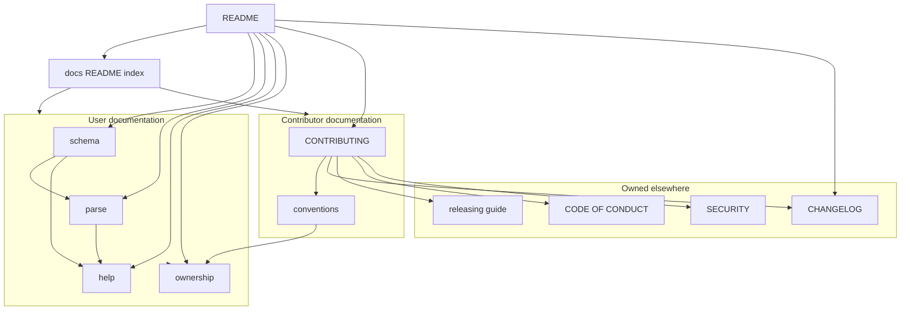
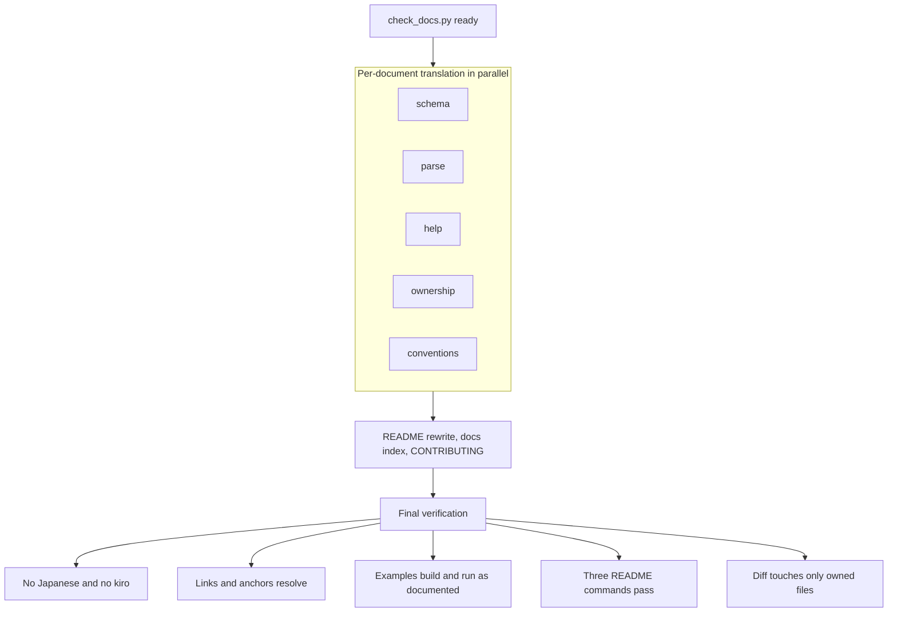

# Design Document

## Overview

**Purpose**: CLArgs の人向けの文書を英語だけにし、利用者向けと開発者向けに整理して、日本語も `.kiro/` も知らない第三者が、CLArgs を使い、開発に参加できるようにする。

**Users**: ライブラリ利用者は README と API の説明（schema、parse、help、ownership）を、コントリビューターは CONTRIBUTING.md と開発者向けの規約（conventions）を、メンテナーは CONTRIBUTING.md からリリース手順書（release-automation）をたどる。

**Impact**: README.md と `docs/` の 5 文書を英語に書き直し、`docs/ownership.md` の開発者だけに向けた記述を `docs/conventions.md` へ移し、索引 `docs/README.md` と CONTRIBUTING.md を足す。ライブラリのコード、テスト、ビルド、ワークフローは変えない。完了の判定には、スペックのディレクトリに置く検査スクリプトを使う。

### Goals

- 人向けのファイルに日本語の文字と `.kiro` の文字列が 1 つもない（要件 1、2、10、11）。
- 今の文書の内容を欠かさず、意味を変えずに英語で説明し、例はコンパイルでき、書いたとおりに動く（要件 1.4、3.4、5）。
- README から、どの文書にも 2 回以内のリンクでたどれ、すべての相対リンクとアンカーが解決する（要件 6、9）。
- ルートの CONTRIBUTING.md から、規約に沿った PR を出すまでの手順が分かる（要件 7）。

### Non-Goals

- API、挙動、ビルド、CI の変更。文書の誤りは文書を直す。
- CHANGELOG.md、リリース手順書（`docs/releasing.md`）、バージョン方針の文書（`docs/versioning.md`）、SemVer とプレリリースの規則の中身、「Version notes」の節の内容の更新（release-automation）。
- CODE_OF_CONDUCT.md、SECURITY.md、Issue と PR のテンプレートの変更。
- 恒久的な文書の検査（CI のジョブ、リポジトリの `scripts/`）。API リファレンスのサイト生成。
- `.kiro/`、`.claude/`、CLAUDE.md の中の文書。

## Boundary Commitments

### This Spec Owns

- README.md の本文と構成（バッジ、概要、特徴、例、ビルドとテスト、オプション、取り込み方法、文書とコントリビューションとリリースへの案内、ライセンス）。
- `docs/schema.md`、`docs/parse.md`、`docs/help.md`、`docs/ownership.md` の英語の本文。
- `docs/conventions.md` の英語の本文と構成。ただし「Version notes」の節は、英語にすることだけを持つ（内容は release-automation）。
- 新しい `docs/README.md`（文書の索引）と、ルートの CONTRIBUTING.md。
- 人向けの文書の見出しの英訳とアンカー（「見出しの対応表」）、文書間のリンク。
- 人向けのファイルの言語の点検と、その検査スクリプト `.kiro/specs/english-docs/check_docs.py`。

### Out of Boundary

- CHANGELOG.md、`docs/releasing.md`、`docs/versioning.md` の作成と中身、SemVer とプレリリースの規則、`Unreleased` への記録の規則、`Version notes` の内容の更新、`ci.yml` のトリガーとジョブ、required check の名前（release-automation）。
- CODE_OF_CONDUCT.md、SECURITY.md、`.github/ISSUE_TEMPLATE/*`、`.github/pull_request_template.md`（直接実装済み）。
- `include/`、`src/`、`tests/`、`cmake/`、CMakeLists.txt、`.github/workflows/` のコードと定義。点検で日本語が見つかった場合のコメントと文字列の英訳だけを例外とする（要件 10.2、12.1）。現状の走査では、該当はない。
- LICENSE、`.editorconfig`、`.gitattributes`、`.gitignore`。

### Allowed Dependencies

- 内容の正本: 公開ヘッダ `include/clargs/*.h` のコメント、`src/` の実装、`tests/` の期待値、CMake の定義（`CMakeLists.txt`、`cmake/*`）。文書と食い違えば、これらに合わせる（要件 1.5）。
- 用語の正本: 公開ヘッダのコメントの英語の用語（「用語の対応」）。
- 外部: GitHub の Markdown の表示とアンカーの生成規則、GitHub Actions のステータスバッジ、shields.io の静的バッジ。
- 検証の道具: Python 3（標準ライブラリだけ）、CMake 3.21 以上、C99 のコンパイラ。どれもリポジトリには足さない。
- release-automation の成果物へは、リンクだけで依存する（`CHANGELOG.md`、`docs/releasing.md`、`docs/versioning.md`。release-automation の設計の File Structure Plan と一致することを確認済み）。

### Revalidation Triggers

- release-automation が `CHANGELOG.md`、`docs/releasing.md`、`docs/versioning.md` のパスを変えた → README、CONTRIBUTING、`docs/README.md`、`docs/conventions.md` のディレクトリ構成のリンクと、検査スクリプトの保留のパスの一覧を直す。
- release-automation が `docs/conventions.md` のパス、または `Version notes` の見出しを変えた → README の find_package の節のリンクを直す。english-docs は両方を約束として固定する（パス `docs/conventions.md`、アンカー `#version-notes`）。
- `ci.yml` のファイル名が変わった → README の CI のバッジを直す。
- README の 3 つのコマンドを変える → `ci.yml` の `quickstart` ジョブとそのコメントの再確認（このスペックでは変えない）。
- 公開 API が変わった → 例と API の説明の再確認（このスペックの後の変更）。

## Architecture

### Existing Architecture Analysis

- 文書はすべて日本語で、README（311 行）と `docs/` の 5 文書（計 3,340 行）からなる。`docs/` に索引はない。
- `docs/ownership.md` は、利用者と開発者の両方を読者にしており、開発者の側の例（内部ヘッダを取り込むコード）、内部ユーティリティの表、スペックへの言及（`.kiro/steering/roadmap.md`、スペックの名前）を含む。
- `docs/conventions.md` は開発者向けで、冒頭で ownership.md を先に読むよう案内している。
- テストのコメント 2 か所が `docs/conventions.md` の節を英語の言い回し（"the failure of every allocation in turn"）で指している。
- `ci.yml` は README の 3 つのコマンドを、そのまま実行する。PR テンプレートはルートの CONTRIBUTING.md と CHANGELOG.md を URL で指す。

### Architecture Pattern & Boundary Map

文書を 3 つの群に分け、README を唯一の入口にする。ファイル名は変えず、群は索引と各文書の冒頭で示す。



**Architecture Integration**:

- **Selected pattern**: 入口（README）→ 索引（`docs/README.md`）→ 文書。README は全文書へ直接リンクするので、どの文書にも 1〜2 回でたどれる（要件 6.3）。
- **Domain boundaries**: 利用者向けの文書は、ライブラリを使う人が守る規則だけを持つ。ライブラリのソースを書く人の決まりは、開発者向けの文書だけが持つ（要件 6.1、8.2）。
- **Dependency direction**: 開発者向け → 利用者向け のリンクは許す（conventions が ownership の規則を参照する）。利用者向けの文書から開発者向けの文書へは、本文の根拠としてリンクしない（冒頭の「関係する文書」と索引を除く）。外部の成果物（CHANGELOG、リリース手順書、CoC、SECURITY）へは、リンクするだけで中身を書かない。
- **Existing patterns preserved**: ファイル名、文書ごとの冒頭の「扱うこと・扱わないこと・関係する文書」と目次、節の順序、例と表の構成。
- **New components rationale**: 索引は群を示すため、CONTRIBUTING は GitHub の PR と Issue の画面が案内する入口のため、検査スクリプトは完了を機械的に判定するために要る。

### Technology Stack

| Layer | Choice / Version | Role in Feature | Notes |
|-------|------------------|-----------------|-------|
| 文書 | GitHub Flavored Markdown | すべての人向けの文書 | 見出しのアンカーは GitHub の自動生成に従う |
| バッジ | GitHub Actions のステータスバッジ、shields.io の静的バッジ | README の CI とライセンスの表示 | 追加のサービスの設定は要らない |
| 検証 | Python 3（標準ライブラリだけ） | `check_docs.py` による言語・リンク・アンカーの検査と、例の取り出し | `.kiro/` の中に置き、人向けのファイルには足さない |
| 検証 | CMake 3.21 以上、C99 のコンパイラ | リポジトリのビルドとテスト、例のビルドと実行 | 既存の手順をそのまま使う |

## File Structure Plan

### Directory Structure

```
README.md                  # 入口。英語に書き直し、構成を変える（README の構成）
CONTRIBUTING.md            # 新規。コントリビューターの入口（CONTRIBUTING の構成）
docs/
├── README.md              # 新規。文書の索引（利用者向けと開発者向けの 2 群）
├── schema.md              # 英語に書き直す。利用者向け
├── parse.md               # 英語に書き直す。利用者向け
├── help.md                # 英語に書き直す。利用者向け
├── ownership.md           # 英語に書き直し、開発者だけに向けた記述を除く。利用者向け
└── conventions.md         # 英語に書き直し、ownership.md から移す記述を足す。開発者向け
.kiro/specs/english-docs/
└── check_docs.py          # 新規。検査スクリプト（人向けのファイルではない）
```

### Modified Files

- `README.md` — 英語化と再構成。3 つのコマンドと 4 つの取り込み方法の CMake の例は、`GIT_TAG` を除き、コードを変えない。
- `docs/schema.md`、`docs/parse.md`、`docs/help.md` — 英語化。見出しは対応表に従う。
- `docs/ownership.md` — 英語化。「ownership.md から移す記述」を除き、スペックへの言及を書き換える。
- `docs/conventions.md` — 英語化。ディレクトリ構成の `docs/` の一覧を更新し、`Applying the ownership rules` の節を足す。

### Files Not Modified

`include/`、`src/`、`tests/`、`cmake/`、CMakeLists.txt、`.github/`、CODE_OF_CONDUCT.md、SECURITY.md、LICENSE、`.editorconfig`、`.gitattributes`、`.gitignore`。検査で日本語が見つかった場合のコメントと文字列だけを例外とする（現状は該当なし）。テストのコメント（`tests/public/parse_failure_test.c`、`tests/public/schema_failure_test.c`）は、見出しの英訳をその言い回しに合わせることで、変えずに済ませる。

## System Flows

各文書の翻訳と、最終の確認の流れを示す。文書ごとの翻訳は、見出しの対応表を共有して並行に進められる。



- 各文書のタスクは、終わる前に `check_docs.py` をその文書について実行し、その文書から出るリンクとアンカーが解決することを確かめる。他の文書へのアンカーは、対応表の英語の見出しで書くので、相手の翻訳が終わる前でも書ける。相手がまだ日本語なら、そのアンカーは最終の確認まで未解決として報告される。
- release-automation のパスが未作成なら、検査は保留として報告し、失敗にしない（要件 9.5）。

## Requirements Traceability

| Requirement | Summary | Components | Interfaces | Flows |
|-------------|---------|------------|------------|-------|
| 1.1, 1.2 | 英語だけ、日本語の文字なし | 全文書、DocsChecker | `check` の `japanese` | Final verification |
| 1.3 | 日本語版を持たない | 全文書 | 翻訳の規則 | Final verification（差分の確認） |
| 1.4 | 欠けなく意味を変えない | UserGuides、DevConventions、ReadmeEntry | 翻訳の規則、見出しの対応表、移す記述の一覧 | 各文書のタスクのレビュー |
| 1.5 | 実装を正とする | 全文書 | 翻訳の規則（食い違いの扱い） | 各文書のタスク |
| 2.1 | `.kiro` なし | DocsChecker | `check` の `kiro` | Final verification |
| 2.2, 2.3, 2.4 | スペック・Kiro に触れない | OwnershipGuide、全文書、DocsChecker | `check` の `spec-term`、書き換えの一覧 | ownership のタスク |
| 3.1, 3.2, 3.3, 3.5, 3.6, 3.7, 3.8 | README の構成 | ReadmeEntry | README の構成 | README のタスク |
| 3.4 | README の例が動く | ReadmeEntry、DocsChecker | `extract` | Examples build and run |
| 4.1, 4.2, 4.3, 4.4, 4.5 | 取り込み方法 | ReadmeEntry | README の構成（Using CLArgs in your project） | README のタスク |
| 5.1–5.3, 5.5 | API の説明 | UserGuides | 翻訳の規則、用語の対応 | 各文書のタスク |
| 5.4 | 完全な例が動く | UserGuides、DocsChecker | `extract` | Examples build and run |
| 6.1 | 利用者向けと開発者向けを分ける | OwnershipGuide、DevConventions | 移す記述の一覧 | ownership と conventions のタスク |
| 6.2 | 索引 | DocsIndex | 索引の構成 | 索引のタスク |
| 6.3 | 2 回以内でたどれる | ReadmeEntry、DocsIndex、Contributing | リンクの構成 | Final verification |
| 6.4, 6.5 | 冒頭と目次 | 全文書 | 文書の共通の形 | 各文書のタスク |
| 7.1–7.10 | CONTRIBUTING | Contributing | CONTRIBUTING の構成 | CONTRIBUTING のタスク |
| 8.1, 8.3, 8.6 | 規約の英語化 | DevConventions | 見出しの対応表 | conventions のタスク |
| 8.2 | 開発者向けの記述を移す | DevConventions、OwnershipGuide | 移す記述の一覧 | ownership と conventions のタスク |
| 8.4, 8.5 | Version notes を意味を変えずに訳す | DevConventions | Version notes の扱い | conventions のタスク |
| 9.1, 9.2 | リンクとアンカーが解決する | 全文書、DocsChecker | `check` の `missing-file`、`missing-anchor` | Final verification |
| 9.3 | 古いファイル名を残さない | 全文書 | ファイル名を変えない決定 | Final verification |
| 9.4 | コメントが指す節がある | DevConventions | 見出しの対応表（The failure of every allocation in turn） | conventions のタスク |
| 9.5 | 未作成の release-automation のパス | DocsChecker、ReadmeEntry、Contributing、DocsIndex | `check` の `pending` | Final verification |
| 9.6 | Version notes へのリンク | ReadmeEntry | アンカー `#version-notes` | README のタスク |
| 10.1, 10.3 | コメントと文字列の点検 | DocsChecker | `check` の対象と `japanese` の範囲 | ソースの点検のタスク |
| 10.2 | 見つかれば英訳 | DocsChecker（検出）、該当するソースのファイル | 翻訳の規則、Error Handling | ソースの点検のタスク |
| 11.1, 11.2, 11.3, 11.4, 11.5 | 機械的な確認 | DocsChecker | `check` の契約 | Final verification |
| 12.1, 12.2 | 変更の範囲 | 全コンポーネント | Files Not Modified | Final verification（差分の確認） |
| 12.3 | 3 つのコマンドが通る | ReadmeEntry | — | Final verification |

## Components and Interfaces

| Component | Domain | Intent | Req Coverage | Key Dependencies | Contracts |
|-----------|--------|--------|--------------|------------------|-----------|
| ReadmeEntry | 入口 | `README.md`。OSS の入口 | 1, 2, 3, 4, 6.3, 6.4, 9.6, 12.3 | 公開ヘッダ、CMake の定義（P0）、release-automation のパス（P1） | 文書の構成 |
| DocsIndex | 入口 | `docs/README.md`。文書の索引 | 6.2, 6.3 | 各文書（P1） | 文書の構成 |
| UserGuides | 利用者向け | `docs/schema.md`、`parse.md`、`help.md`、`ownership.md` | 1, 2, 5, 6.1, 6.4, 6.5, 8.2, 9 | 公開ヘッダ（P0）、見出しの対応表（P0） | 翻訳の規則 |
| Contributing | 開発者向け | `CONTRIBUTING.md`。コントリビューターの入口 | 7, 6.3 | PR テンプレート、CoC、SECURITY（P1）、release-automation のパス（P1） | 文書の構成 |
| DevConventions | 開発者向け | `docs/conventions.md` | 8, 6.1, 9.4 | ownership.md の旧版（P0）、release-automation の節（P1） | 翻訳の規則 |
| DocsChecker | 検証 | `.kiro/specs/english-docs/check_docs.py` | 1.2, 2.1, 2.2, 3.4, 5.4, 9.1, 9.2, 9.5, 10.1, 10.3, 11 | Python 3（P0） | Batch |

### 共通: 翻訳の規則

すべての文書のコンポーネントが従う。

- **意味を変えない**: 文ごとに、元の日本語が述べる事実、条件、例外を落とさずに訳す。節を省かない。説明を足すのは、要件が求める構成上の文（冒頭の案内、索引、CONTRIBUTING）だけである。
- **写すもの**: 関数名、型名、マクロ名、エラーコード、CMake の変数とターゲット、コマンド、オプションの書き方、ライブラリが出力する文面（ヘルプ、エラーメッセージ）、コードの本体は、1 文字も変えずに写す（要件 5.3）。
- **訳すもの**: 本文、見出し、表、リンクの文字列、コードブロックの中のコメント、仮の値（`<インストール先>` → `<install-prefix>`、`<Naos のコピーのパス>` → `<path-to-naos>`、`<チェックアウトのパス>` → `<path-to-checkout>`、`<動的ライブラリのパス>` → `<path-to-shared-library>`、`<名前>` → `<name>`、`<メジャー>.<マイナー>` → `<major>.<minor>`）。
- **食い違いの扱い**: 訳す途中で、文書と実装（公開ヘッダのコメント、テスト、CMake の定義）の食い違いに気づいたら、実装に合わせて書き、タスクの記録に「どの記述を、何に合わせて直したか」を残す。実装は変えない（要件 1.5）。
- **言及の除去**: スペック、スペックの名前、ステアリング、`.kiro`、Kiro の手順への言及は、規則そのものを述べる文に書き換える（要件 2.3）。「このスペック」「後続のスペック」は、対象の関数群やライブラリの名前で言い換える。
- **名前を出さないもの**: 人向けの文書には、release-automation、english-docs などのスペックの名前を書かない。リリース手順書、CHANGELOG は、ファイルへのリンクと「release guide」「changelog」という呼び方で示す。
- **文体**: 平叙文の英語。利用者向けは "you" を主語にしてよい。開発者向けの規則は命令形（"Do not call ..."）で書く。米国式のつづり。
- **用語**: 下の「用語の対応」に従う。

#### 用語の対応

公開ヘッダのコメントの用語に合わせる。

| 日本語 | 英語 |
|---|---|
| スキーマ | schema |
| コマンド、ルートコマンド、サブコマンド | command, root command, subcommand |
| オプション、フラグ、カウント、値付きオプション | option, flag, count, option with a value (value option) |
| 否定できるフラグ | negatable flag |
| 位置引数 | positional |
| 値型、組み込みの値型、利用者定義の値型、選択肢 | value type, built-in value type, user-defined value type, choice |
| 個数（位置引数の） | arity |
| 検証 | validation（動詞 validate） |
| 解析、解析エラー、結果 | parse, parse error, result |
| 問題の要素 | offending element |
| 既定値、必須 | default value, required |
| 前提条件 | preconditions |
| 実行時の失敗、プログラムの誤り | runtime failure, programming error |
| 書き込み関数 | write function |
| 設定（ヘルプの） | help options |
| usage 行、見出し、注記、説明、説明の列、桁、表示幅、字下げ | usage line, heading, annotation, description, description column, column, width, indent |
| アロケータ、テスト用アロケータ | allocator, test allocator |
| 内部関数、公開関数、内部ヘッダ、公開ヘッダ | internal function, public function, internal header, public header |
| 静的ライブラリ、動的ライブラリ | static library, shared library |
| 組み込む（FetchContent、add_subdirectory） | embed |
| 取り込み方法 | ways to use CLArgs in your project |

### 共通: 文書の形

- 各文書は、`# <Title>`、1〜2 段落の導入（扱うこと、扱わないこと、関係する文書へのリンク、詳しい説明が公開ヘッダのコメントにあること）、`Contents:` の目次、本文の順に書く（要件 6.4、6.5）。README は目次の代わりに見出しで構成する。
- 目次は、`##` の見出しへのリンクを並べる。

### 共通: 見出しの対応表

各文書の見出しを、次の英語にする。アンカーは GitHub の規則で見出しから作られるもの（小文字にし、英数字・空白・`-`・`_` 以外を除き、空白を `-` にする）である。表にない見出し（コードブロックの中の `#include` などは見出しではない）を足すときは、同じ文書の中でアンカーが重ならないようにする。

**docs/schema.md** — `# Schemas`

| 今の見出し | 英語の見出し | アンカー |
|---|---|---|
| 一連の例 | A complete example | `#a-complete-example` |
| コマンド | Commands | `#commands` |
| オプション | Options | `#options` |
| 位置引数 | Positionals | `#positionals` |
| 値型 | Value types | `#value-types` |
| 利用者定義の値型の書き方 | Writing a user-defined value type | `#writing-a-user-defined-value-type` |
| 値型を借りる契約と破棄の順序 | Borrowed value types and the order of destruction | `#borrowed-value-types-and-the-order-of-destruction` |
| 誤りの一覧 | Definition errors | `#definition-errors` |
| ### 追加と設定の時点の誤り | Errors when adding and setting | `#errors-when-adding-and-setting` |
| ### 検証の時点の誤り | Errors found by validation | `#errors-found-by-validation` |
| ### エラーコードにならないもの | What is not an error code | `#what-is-not-an-error-code` |
| 検証と、失敗の調べ方 | Validation and finding the cause of a failure | `#validation-and-finding-the-cause-of-a-failure` |
| 検証済みのスキーマで成り立つこと | Guarantees of a validated schema | `#guarantees-of-a-validated-schema` |
| 読み取り | Reading a schema | `#reading-a-schema` |
| 前提条件 | Preconditions | `#preconditions` |

**docs/parse.md** — `# Parsing`

| 今の見出し | 英語の見出し | アンカー |
|---|---|---|
| 一連の例 | A complete example | `#a-complete-example` |
| 解析の入口 | Entry points | `#entry-points` |
| 引数の書き方 | Command-line syntax | `#command-line-syntax` |
| ### 要素の分類 | How elements are classified | `#how-elements-are-classified` |
| ### 値の取り方 | How options take values | `#how-options-take-values` |
| ### 複数回の指定 | Repeated options | `#repeated-options` |
| ### 位置引数の割り当て | Assigning positionals | `#assigning-positionals` |
| ### サブコマンド | Subcommands | `#subcommands` |
| 必須の検査と既定値 | Required checks and default values | `#required-checks-and-default-values` |
| 結果の読み取り | Reading the result | `#reading-the-result` |
| ### 読み取りの規則 | Rules for reading | `#rules-for-reading` |
| 解析エラー | Parse errors | `#parse-errors` |
| ### 種類とメッセージ | Kinds and messages | `#kinds-and-messages` |
| ### 解析エラーの情報 | Parse error details | `#parse-error-details` |
| ### 解析エラーのときの結果 | The result of a parse error | `#the-result-of-a-parse-error` |
| ### メッセージの表示 | Printing the message | `#printing-the-message` |
| `--help` の扱い | Handling `--help` | `#handling---help` |
| ワイド文字の argv | Wide-character argv | `#wide-character-argv` |
| 寿命の規則 | Lifetime rules | `#lifetime-rules` |
| 前提条件 | Preconditions | `#preconditions` |

**docs/help.md** — `# Help and Usage`

| 今の見出し | 英語の見出し | アンカー |
|---|---|---|
| 最小の例 | A minimal example | `#a-minimal-example` |
| `--help` とエラーの表示 | Printing `--help` and errors | `#printing---help-and-errors` |
| 生成の関数 | Generating functions | `#generating-functions` |
| 文面の規則 | Text layout rules | `#text-layout-rules` |
| ### 構成 | Structure | `#structure` |
| ### usage 行 | Usage line | `#usage-line` |
| ### 見出し | Headings | `#headings` |
| ### 注記 | Annotations | `#annotations` |
| ### 説明の列 | Description column | `#description-column` |
| ### 折り返し | Wrapping | `#wrapping` |
| 設定 | Help options | `#help-options` |
| 出力先 | Output | `#output` |
| ### 書き込み関数の契約 | The write function contract | `#the-write-function-contract` |
| ### 標準出力に出す | Writing to standard output | `#writing-to-standard-output` |
| ### バッファに生成する | Formatting into a buffer | `#formatting-into-a-buffer` |
| 制限 | Limits | `#limits` |
| ### 説明文の書き方についての注意 | Notes on writing descriptions | `#notes-on-writing-descriptions` |
| 失敗したとき | On failure | `#on-failure` |
| 寿命の規則 | Lifetime rules | `#lifetime-rules` |
| 前提条件 | Preconditions | `#preconditions` |

**docs/ownership.md** — `# Ownership and Lifetime`

| 今の見出し | 英語の見出し | アンカー |
|---|---|---|
| 規約の一覧 | The rules at a glance | `#the-rules-at-a-glance` |
| 実行時の失敗とプログラムの誤り | Runtime failures and programming errors | `#runtime-failures-and-programming-errors` |
| 1. 生成と破棄 | 1. Creation and destruction | `#1-creation-and-destruction` |
| 2. 利用者が渡す文字列 | 2. Strings you pass | `#2-strings-you-pass` |
| 3. ライブラリが返す文字列とオブジェクト | 3. Strings and objects the library returns | `#3-strings-and-objects-the-library-returns` |
| 4. NULL | 4. NULL | `#4-null` |
| 5. アロケータ | 5. Allocator | `#5-allocator` |
| 6. 解放するのは確保した側 | 6. Whoever allocates frees | `#6-whoever-allocates-frees` |
| 7. 失敗の返し方 | 7. How failures are returned | `#7-how-failures-are-returned` |
| 8. スレッド | 8. Threads | `#8-threads` |
| スキーマ、argv、結果への適用 | Schemas, argv and results | `#schemas-argv-and-results` |
| ヘルプへの適用 | Help | `#help` |
| このスペックの関数の従い方 | Allocator and error functions | `#allocator-and-error-functions` |

**docs/conventions.md** — `# Development Conventions`

| 今の見出し | 英語の見出し | アンカー |
|---|---|---|
| 命名規約 | Naming conventions | `#naming-conventions` |
| ディレクトリ構成 | Directory layout | `#directory-layout` |
| 手順 | Procedures | `#procedures` |
| ### 公開関数を足す | Adding a public function | `#adding-a-public-function` |
| ### 公開ヘッダを足す | Adding a public header | `#adding-a-public-header` |
| ### ソースを足す | Adding a source file | `#adding-a-source-file` |
| ### 内部関数を足す | Adding an internal function | `#adding-an-internal-function` |
| ### 公開 API のテストを足す | Adding a test of the public API | `#adding-a-test-of-the-public-api` |
| ### 内部関数のテストを足す | Adding a test of an internal function | `#adding-a-test-of-an-internal-function` |
| ### エラーコードを足す | Adding an error code | `#adding-an-error-code` |
| ### テスト用アロケータを使う | Using the test allocator | `#using-the-test-allocator` |
| #### 確保の各回を順に失敗させる | The failure of every allocation in turn | `#the-failure-of-every-allocation-in-turn` |
| ### `clargs_add_test()` の規則 | Rules of `clargs_add_test()` | `#rules-of-clargs_add_test` |
| 実装の規則 | Implementation rules | `#implementation-rules` |
| ### メモリを確保する | Allocating memory | `#allocating-memory` |
| #### 確保関数の検査 `clargs.allocations` | The allocation check `clargs.allocations` | `#the-allocation-check-clargsallocations` |
| #### グローバル状態 | Global state | `#global-state` |
| （新規）### | Applying the ownership rules | `#applying-the-ownership-rules` |
| （新規）#### | Forms that public functions do not take | `#forms-that-public-functions-do-not-take` |
| （新規）#### | Returning failures | `#returning-failures` |
| （新規）#### | How the internal utilities follow the rules | `#how-the-internal-utilities-follow-the-rules` |
| ### 前提条件の検査 | Checking preconditions | `#checking-preconditions` |
| ### 内部関数の戻り値 | Return values of internal functions | `#return-values-of-internal-functions` |
| テストを書くときの注意 | Writing tests | `#writing-tests` |
| 確かめ方 | Verifying a change | `#verifying-a-change` |
| バージョンについての注意 | Version notes | `#version-notes` |

- `#### The failure of every allocation in turn` は、テストのコメントの言い回しと一致させる（要件 9.4）。
- `## Version notes` の見出しとアンカーは、release-automation との約束であり、変えない。

### 入口

#### ReadmeEntry

| Field | Detail |
|-------|--------|
| Intent | OSS の入口。目的、特徴、最初のプログラム、取り込み、文書とコントリビューションへの案内 |
| Requirements | 1.1–1.5, 2.1–2.4, 3.1–3.8, 4.1–4.5, 6.3, 6.4, 9.1, 9.2, 9.6, 12.3 |

**README の構成**（この順。`##` の見出しとアンカー）:

1. `# CLArgs` と、その直下のバッジの行:
   - CI: `[](https://github.com/ktdevx/cargs/actions/workflows/ci.yml)`
   - ライセンス: `[](LICENSE)`
2. 概要の 1 段落（今の冒頭の段落の訳）。
3. `## Features` — 今の特徴の一覧の 7 項目をすべて訳す（要件 3.1）。最後に「利用者が取り込むヘッダは `<clargs/clargs.h>` だけ、リンクするターゲットは `CLArgs::clargs`」を置く。
4. `## Example` — 今のサンプルプログラム（コードはそのまま。コメントは既に英語）、実行の例（出力はそのまま）、例の後の 4 つの注意の訳。
5. `## Documentation` — 利用者向けの 4 文書と、`docs/README.md`（索引）へのリンク。各 1 行の説明（今の README の説明の訳）。開発者向けとして、[CONTRIBUTING.md](CONTRIBUTING.md) と [Development Conventions](docs/conventions.md) へのリンクも置く（要件 3.8）。
6. `## Building and testing` — 3 つのコマンド（変えない）、Naos とネットワーク、`FETCHCONTENT_SOURCE_DIR_NAOS`、`CLARGS_BUILD_TESTS=OFF`、複数の構成を持つジェネレータ（要件 3.5、3.6）。
7. `## Build options` — オプションの表と注意、`BUILD_SHARED_LIBS`（要件 3.7）。
8. `## Using CLArgs in your project` — 共通の説明と、`### FetchContent`、`### add_subdirectory`、`### find_package`、`### pkg-config`、`### Running the tests of an embedded CLArgs`（要件 4）。
   - FetchContent の例は `GIT_TAG v0.1.0` とし、直後に「最新のリリースのタグに置き換える。タグは `v<major>.<minor>.<patch>` の形で、[Releases](https://github.com/ktdevx/cargs/releases) に一覧がある。再現できるビルドにはタグかコミットのハッシュに固定する。ブランチ名も書けるが、内容が変わりうる」を置く（要件 4.2、4.3）。
   - find_package の節のバージョンの注意は `[Version notes](docs/conventions.md#version-notes)` へリンクする（要件 9.6）。
   - pkg-config の節は `[find_package](#find_package)` へリンクする。
9. `## Releases and changes` — 変更の記録は [CHANGELOG.md](CHANGELOG.md)、リリースは Releases のページ、タグは `v<SemVer>` の形、バージョンの番号と互換の方針は [docs/versioning.md](docs/versioning.md) にあることだけを述べる。バージョンの規則の中身は書かない。
10. `## Contributing` — [CONTRIBUTING.md](CONTRIBUTING.md) への案内（1〜2 文）と、行動規範（CODE_OF_CONDUCT.md）と脆弱性の報告（SECURITY.md）へのリンク。
11. `## License` — MIT と [LICENSE](LICENSE)。

**Implementation Notes**

- Integration: 3 つのコマンドは `ci.yml` の `quickstart` ジョブと一致させたまま変えない。CMake の例のコードは、`GIT_TAG` の行を除いて変えない。
- Validation: `check_docs.py check` と `extract`、例のビルドと実行（Testing Strategy）。
- Risks: `v0.1.0` は最初のリリースまで存在しない。Releases への案内で補う。

#### DocsIndex

| Field | Detail |
|-------|--------|
| Intent | `docs/` の索引。読者ごとに文書を分けて示す |
| Requirements | 6.2, 6.3 |

**索引の構成**: `# CLArgs Documentation`、1 文の導入、`## Using CLArgs`（schema、parse、help、ownership、versioning の各 1 行の説明。読む順は schema → parse → help、ownership と versioning は参照用。versioning は release-automation が作る）、`## Contributing to CLArgs`（`../CONTRIBUTING.md`、`conventions.md`）、`## Maintaining CLArgs`（`releasing.md` と `../CHANGELOG.md`。どちらも release-automation が作る）。各行は、読者と内容を 1 行で示す。

### 利用者向け

#### UserGuides

| Field | Detail |
|-------|--------|
| Intent | `docs/schema.md`、`docs/parse.md`、`docs/help.md`、`docs/ownership.md` の英語の本文 |
| Requirements | 1.1–1.5, 2.1–2.4, 5.1–5.5, 6.1, 6.4, 6.5, 8.2, 9.1, 9.2 |

**Responsibilities & Constraints**

- 各文書は、今の文書の節、例、表、一覧を、同じ順序で、欠かさずに持つ（要件 5.2）。見出しは対応表に従う。
- 完全なプログラムの例（schema 1、parse 2、help 2、ownership 1）は、コードを変えずに写し、コメントだけを訳す。
- 他の文書へのアンカーは、対応表の英語のアンカーで書く。

**ownership.md から除く記述と、書き換える記述**（要件 2、6.1、8.2）:

| 今の場所 | 扱い |
|---|---|
| 冒頭の読者の一覧の「ライブラリ開発者」の項（後続のスペックへの言及） | 除く。代わりに「ライブラリのコードがこの規則をどう実装するかは [Development Conventions](conventions.md#applying-the-ownership-rules) にある」と 1 文で示す |
| 冒頭の「オブジェクトを生成する公開関数は、後続のスペックが足す」 | 除く。`clargs_example_` が仮の名前である説明は残す |
| 目次の「このスペックの関数の従い方」 | `Allocator and error functions` に置き換える |
| 規則 6 の「開発者は、次の形の公開関数を作らない」と表 | conventions へ移す（`Forms that public functions do not take`） |
| 規則 7 の「開発者の側の書き方」の例と、その後の 3 項目 | conventions へ移す（`Returning failures`） |
| 規則 8 の「開発者は、`src/` に変更可能な…足さない」 | conventions の `Global state` へ合わせる（同じ内容は既にある。足りない文だけを足す） |
| 「スキーマ、argv、結果への適用」冒頭の `.kiro/steering/roadmap.md が挙げる 3 つの問い` | 「次の表は、スキーマ、argv、結果、値型の寿命について、よくある問いに規則を当てはめる」のように書き換える |
| 同節末の「argv-parser の設計で決めたものである」 | 除く。続く文（借りる関数はない、詳しくは parse.md）は残す |
| 「ヘルプへの適用」末の「help-formatter の設計で決めたものである」 | 除く。続く文は残す |
| 「このスペックの関数の従い方」 | 見出しを `Allocator and error functions` にし、公開関数の表（`clargs_set_allocator`、`clargs_error_message`）だけを残す。冒頭の文は「アロケータとエラーの公開関数も、この規則に従う」とする。内部ユーティリティの表、公開関数の形と違う 2 点、グローバル状態の段落は conventions へ移す（`How the internal utilities follow the rules`） |

#### OwnershipGuide、SchemaGuide、ParseGuide、HelpGuide

UserGuides の各ファイル。上の規則のほか、個別の注意はない。

### 開発者向け

#### Contributing

| Field | Detail |
|-------|--------|
| Intent | ルートの `CONTRIBUTING.md`。初めてのコントリビューターの入口 |
| Requirements | 6.3, 6.4, 7.1–7.10 |

**CONTRIBUTING の構成**（`# Contributing to CLArgs`）:

1. 導入: 歓迎の 1 文、行動規範への同意（[Code of Conduct](CODE_OF_CONDUCT.md)。要件 7.8）、目次。
2. `## Reporting bugs and requesting features` — Issue のフォーム（バグ報告、機能の要望）を使う。大きな変更は、先に Issue で相談する。
3. `## Reporting security vulnerabilities` — 公開の Issue にしない。[SECURITY.md](SECURITY.md) の手順に従う（要件 7.9）。
4. `## Development environment` — CMake 3.21 以上、C99 のコンパイラ、対応する環境（Linux の GCC と Clang、macOS の Clang、Windows の MSVC）、テストを有効にした構成は Naos を GitHub から取得するのでネットワークが要ること、ネットワークなしの構成への導線（README の Building and testing）（要件 7.2）。
5. `## Building and testing` — README の 3 つのコマンド（PR テンプレートの項目と同じ）と、静的と動的の両方での確認のコマンド（conventions の Verifying a change と同じコマンド）。確保関数の検査、export の確認、Release 構成の確認は [Verifying a change](docs/conventions.md#verifying-a-change) へ（要件 7.3）。
6. `## Coding conventions` — 変更の前に [Development Conventions](docs/conventions.md) を読む。命名、置き場所、手順、実装の規則、テストの注意がそこにある。所有権の規則は [Ownership and Lifetime](docs/ownership.md)（要件 7.5）。
7. `## Documentation and comments` — 文書、コードのコメント、メッセージは英語で書く。挙動や API を変えたら、文書を更新する（要件 7.7）。
8. `## Submitting a pull request` — フォークとブランチ、変更、テストの追加、ローカルでの確認、PR テンプレートの記入、CI がすべて合格すること、レビューと修正の流れ（要件 7.4）。CI の個々のジョブやチェックの名前は書かない（release-automation が決める）。
9. `## Recording changes` — 利用者に見える変更は、PR の中で [CHANGELOG.md](CHANGELOG.md) の `Unreleased` に記録する。書き方は CHANGELOG.md（とその冒頭の説明）に従う、とリンクで示すだけにし、記録の規則を CONTRIBUTING の中で別に定めない（要件 7.6）。
10. `## Releases` — メンテナー向け。リリースの手順は [docs/releasing.md](docs/releasing.md)、バージョンの方針は [docs/versioning.md](docs/versioning.md) にある、とだけ書く（要件 7.10）。
11. `## License` — 寄与は MIT License のもとで配布されることに同意したものとする、と [LICENSE](LICENSE) へリンクする。

**Implementation Notes**

- Integration: PR テンプレートのチェック項目（3 つのコマンド、テスト、文書、CHANGELOG、英語）と矛盾しない記述にする。PR テンプレートの URL がこのファイルを指す（要件 7.1）。
- Risks: CHANGELOG.md、`docs/releasing.md`、`docs/versioning.md` が未作成のことがある（要件 9.5）。

#### DevConventions

| Field | Detail |
|-------|--------|
| Intent | `docs/conventions.md` の英語の本文と、ownership.md から移した開発者向けの記述 |
| Requirements | 1.1–1.5, 2.1, 6.1, 8.1–8.6, 9.4 |

**Responsibilities & Constraints**

- 今の conventions.md の節を、同じ順序で、欠かさずに訳す（要件 8.1）。C、CMake、シェルの例は、コメントと仮の値の表記だけを訳す（要件 8.6）。
- 「ディレクトリ構成」の `docs/` の一覧に、`README.md`（索引）を足し、各ファイルの説明を英語にする。ルートの CONTRIBUTING.md は、ディレクトリ構成の外の説明（冒頭の導入）で触れる（要件 8.3）。release-automation の `releasing.md` と `versioning.md` は、その時点でリポジトリにあれば一覧に入れる。
- `### Applying the ownership rules`（`## Implementation rules` の中、`### Allocating memory` の後）を足し、ownership.md から移す記述を、意味を変えずに英語で置く（要件 8.2）。`Global state` に重なる文は、既存の `#### Global state` に統合し、同じ見出しを 2 つ作らない。
- 移す記述の原文は、英語化の前の `docs/ownership.md`（`git show HEAD:docs/ownership.md`）から取る。ownership.md の翻訳のタスクと同じファイルを編集しない。

**Version notes の扱い**（要件 8.4、8.5）:

- `## Version notes` は、英語にする時点の節の内容を、項目の数と順序を保って訳す。足さず、減らさず、例のコードを変えない。
- release-automation がその節を既に英語で書き換えていれば、その内容を変えない。日本語のまま書き換えていれば、書き換え後の内容を訳す。
- 節の見出しとアンカー（`#version-notes`）は変えない。

### 検証

#### DocsChecker

| Field | Detail |
|-------|--------|
| Intent | 人向けのファイルの言語と `.kiro` の検査、人向けの文書のリンクとアンカーの検査、文書の C の例の取り出し |
| Requirements | 1.2, 2.1, 2.2, 3.4, 5.4, 9.1, 9.2, 9.5, 10.1, 10.3, 11.1–11.5 |

**Responsibilities & Constraints**

- Python 3 の標準ライブラリだけを使う。ファイルを変更しない（`extract` の出力先を除く）。
- 対象の集合は 1 か所で決める: `git ls-files` の一覧から、`.kiro/` と `.claude/` で始まるパスと `CLAUDE.md` を除いたもの（要件 11.2）。人向けの文書は、そのうち `README.md`、`CONTRIBUTING.md`、`docs/**/*.md`。
- バイナリ（UTF-8 として読めないファイル）は、名前を報告して飛ばす。

**Contracts**: Batch [x]

##### Batch / Job Contract

- **Trigger**: 手動で実行する。`python3 .kiro/specs/english-docs/check_docs.py <mode> [options]`。リポジトリのルートで実行する（`--root <path>` で変えられる）。
- **Mode `check`**:
  - 出力は 1 行 1 件、`<path>:<line>: <kind>: <detail>`。最後に件数の要約を出す。
  - `japanese` — 人向けのファイルの、日本語の文字を含む行。日本語の文字は U+3000–U+303F、U+3040–U+30FF、U+3400–U+4DBF、U+4E00–U+9FFF、U+F900–U+FAFF、U+FF00–U+FFEF の文字とする。罫線などのほかの ASCII 外の文字は数えない（要件 10.3）。
  - `kiro` — 人向けのファイルの、`.kiro` を含む行（大文字小文字を区別しない）。
  - `spec-term` — 人向けの文書の、スペックの名前（build-foundation、core-runtime、command-schema、argv-parser、help-formatter、english-docs、release-automation）、`\bspecs?\b`、`steering`、`kiro` を含む行（大文字小文字を区別しない）。
  - `missing-file` — 人向けの文書の、相対リンク（`http:`、`https:`、`mailto:` で始まらないもの）の指すファイルまたはディレクトリが、作業ツリーにない。
  - `missing-anchor` — 人向けの文書の、`#` 付きのリンク（同じ文書の中を含む）のアンカーが、指す先の Markdown の見出しから作られるアンカーの集合にない。アンカーの生成は GitHub の規則（小文字化、`[^\w\- ]` の除去、空白を `-`、重複に `-1`、`-2`）に従う。コードブロックの中の `#` で始まる行は見出しとして数えない。
  - `pending` — `missing-file` のうち、指す先が release-automation のパスの一覧（`CHANGELOG.md`、`docs/releasing.md`、`docs/versioning.md`）にあるもの。失敗に数えない（要件 9.5）。
  - 終了コード: `pending` 以外が 0 件なら 0、1 件以上なら 1。
  - `--files <path>...` で、報告を指定したファイルに限れる（各文書のタスクの途中で使う）。アンカーの集合は、常に全文書から作る。
- **Mode `extract <outdir>`**:
  - 人向けの文書の ```` ```c ```` のコードブロックのうち、`main(` または `wmain(` の定義を含むものを、`<outdir>/<doc>-<n>.c`（`<doc>` はパスの `/` を `_` にしたもの、`<n>` は文書の中の C のブロックの通し番号）に書き出す。
  - `<outdir>/manifest.txt` に、1 行 1 件で `<file> <entry> <source>:<line>` を書く。`<entry>` は `main` または `wmain`。
  - 終了コード 0。書き出したファイルの数を出す。
- **Idempotency & recovery**: 何度実行しても同じ結果になる（要件 11.5）。`extract` は `<outdir>` の既存のファイルを上書きする。

**Implementation Notes**

- Integration: 各文書のタスクの完了前と、最終の確認で実行する。人向けのファイルではないので、それ自体は検査の対象外である。
- Validation: 英語化の前の作業ツリーで `check` を実行すると、research.md の数（6 ファイルの日本語、ownership の `.kiro`）と一致する報告が出ることを、スクリプトのタスクで確かめる。
- Risks: GitHub のアンカーの規則の細部（絵文字など）は実装しない。使わない記号に限るので影響しない。

## Error Handling

### Error Strategy

文書の作業での「誤り」は、検査と確認で見つかる不一致である。見つけたら、その文書のタスクの中で直す。

| 状況 | 扱い |
|---|---|
| `check` が `japanese`、`kiro`、`spec-term` を報告した | その行を訳すか書き換える。`spec-term` が正当な英語（例: 外部の仕様の名前）なら、言い換える |
| `missing-anchor` | 対応表と見出しを照らし、リンクか見出しを直す。対応表を変えるなら、その見出しを指すすべてのリンクを同じ変更で直す |
| `pending` | release-automation の成果物を待つ。完了の報告に、未解決のリンクの一覧を書く |
| 例がコンパイルできない、または出力が文書と違う | 翻訳の写し間違いなら直す。元の文書の時点で違っていれば、実装に合わせて文書を直し、記録に残す（要件 1.5） |
| ソースに日本語が見つかった | コメントと文字列だけを英訳し、ビルドとテストを通す（要件 10.2） |
| release-automation が先に `docs/conventions.md` を変えていた | 変更後の内容を基に訳す。`Version notes` の内容は意味を変えない |

## Testing Strategy

ライブラリのテストは足さない。文書の正しさを、次の確認で示す。

### 言語とリンク（DocsChecker）

1. 英語化の前の作業ツリーで `check` を実行し、6 ファイルの `japanese` と `docs/ownership.md` の `kiro` を報告することを確かめる（検査そのものの確認。要件 11.1）。
2. 英語化の後、`check` が `pending` 以外を 0 件で終了コード 0 を返す（要件 1.2、2.1、2.2、9.1、9.2、10.1、11.3）。
3. `japanese` が `tests/public/command_test.c` の罫線を報告しない（要件 10.3）。

### 例のビルドと実行

1. リポジトリを `cmake -S . -B build -DCLARGS_BUILD_TESTS=OFF` でビルドしてインストールし（`cmake --install build --prefix <scratch>/prefix`）、`extract` で取り出した `main` の例を、`-std=c99 -Wall -Wextra -Wpedantic -Werror` でコンパイルしてリンクする（要件 3.4、5.4）。`wmain` の例は、Windows 以外ではコンパイルだけを行う（`-c`）。
2. README の例を、README の実行例のコマンドラインで実行し、出力と終了コードが README と一致する（`greet --loud -n 2 world`、`greet`、`greet --count=many world`、`greet --help`）。
3. schema の例が `the schema of pack is valid` を出して 0 で終わる。parse と help の例を、それぞれの文書が示すコマンドラインで実行し、示した出力と一致する。
4. ownership の例（アロケータ）は、利用者の関数の定義を足した小さなファイルとリンクして実行し、0 で終わる。

### リポジトリの確認

1. README の 3 つのコマンド（`cmake -S . -B build`、`cmake --build build`、`ctest --test-dir build`）が成功する（要件 12.3）。
2. `git diff --stat <base>` が、README.md、CONTRIBUTING.md、`docs/*.md` だけを含む（ソースに日本語がなかった場合）。CHANGELOG.md、`docs/releasing.md`、`docs/versioning.md`、CODE_OF_CONDUCT.md、SECURITY.md、`.github/` を含まない（要件 1.3、9.3、12.1、12.2）。
3. 英語化の前後で、`docs/` のファイル名が同じである（要件 9.3）。

### 翻訳のレビュー（文書ごと）

1. 節、例、表、一覧の数が、元の文書と一致する（ownership と conventions は、移した分を差し引き、足した分を加えて一致する）（要件 1.4、5.2、8.1）。
2. 関数名、エラーコード、出力の文面が、元の文書と同じである（コードブロックの差分が、コメントと仮の値だけである）（要件 5.3、8.6）。
3. README から、各文書へのリンクの移動が 2 回以内である（要件 6.3）。

## Migration Strategy

利用者のコードには影響しない。文書のパスは変えないので、外部からのリンクのファイル名は切れない。日本語の見出しのアンカー（例 `docs/conventions.md#バージョンについての注意`）は無効になるが、リダイレクトの手段はなく、OSS としての公開の前なので、扱わない。
