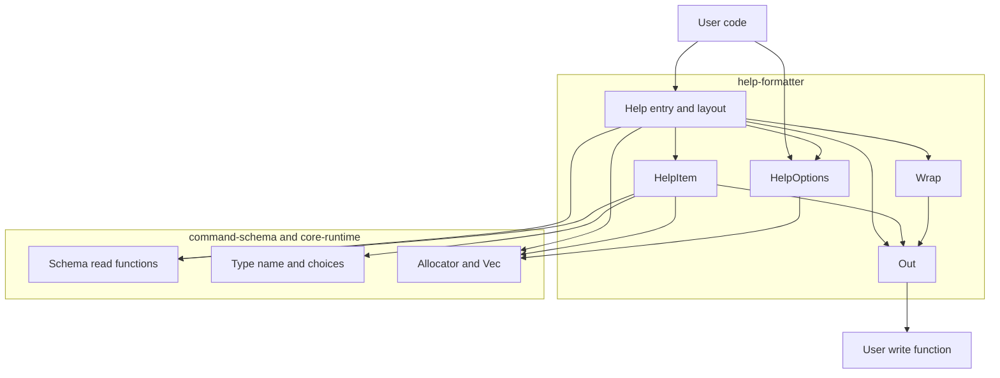
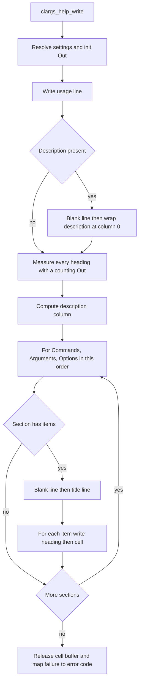

# Design Document

## Overview

**Purpose**: このスペックは、CLArgs の利用者が、検証済みのスキーマのコマンドを 1 つ渡して、そのコマンドのヘルプまたは usage 行を、自分で決めた出力先に出せるようにする。文面は、スキーマの定義からその場で作るので、定義とずれない。

**Users**: ライブラリ利用者（C のアプリケーション開発者）は、生成の関数を呼び、必要なら整形の設定を作る。プログラムの利用者は、出力されたヘルプを読む。

**Impact**: command-schema の上に、ヘルプのモジュールを足す。公開ヘッダ 1 つ（`help.h`）、エラーコード 1 つ、ソース 5 つが増える。既存の公開関数の形と意味は変えない。command-schema と argv-parser のソースと公開ヘッダは変更しない。

### Goals

- `clargs_help_write()` 1 回の呼び出しで、usage 行、説明、サブコマンド、位置引数、オプションの一覧を、要件 1〜7 の表記と整形で出力する。
- 出力先は、利用者の書き込み関数 1 つで表す。固定長のバッファは、その上の補助にする。`FILE *` 向けの補助は持たない。
- 整形の設定は不透明なオブジェクトで、設定関数を足していける。設定なし（`NULL`）でも生成できる。
- 文面は、ロケール、環境、OS によらず、バイト単位で同じにする。
- 失敗は、書き込みの失敗とメモリ確保の失敗の 2 つだけにする。

### Non-Goals

- argv の解析、`--help` の検出、ヘルプを出して終了する動作（argv-parser、利用者のコード）
- `--help` のようなオプションをスキーマに足すこと
- 多言語化、色付け、端末の幅の検出、ASCII 以外の文字の表示幅
- `FILE *` に直接出力する補助
- man ページ、Markdown、補完スクリプト。テンプレートやセクションの差し替え
- オプションを隠すこと、グループに分けること
- 別の形式のための中間のデータ構造（行の並びを利用者や別のモジュールに渡すこと）

## Boundary Commitments

### This Spec Owns

- 生成の入口 `clargs_help_write()` と `clargs_help_write_usage()`、補助 `clargs_help_format()`、`clargs_help_format_usage()`
- 書き込み関数の型 `clargs_help_write_fn_t` と、その呼び出しの契約
- 整形の設定の型 `clargs_help_options_t` と、生成、破棄、設定関数
- ヘルプの文面の規則: セクションの順序と名前、usage 行、見出し、注記、列の揃え、折り返し、行の形（要件 1〜7）
- 要件が定めていなかった 3 点の扱い（「主な決定」の表の末尾 3 行）
- エラーコード `CLARGS_ERROR_WRITE_FAILED`
- 利用者向けの文書 `docs/help.md`

### Out of Boundary

- スキーマの内部構造。`src/schema_internal.h` と `src/type_internal.h` を取り込まない
- 説明文、値の表示名などの属性の保持と、名前の規則、検証の規則（command-schema）
- 解析、解析の結果、解析エラーのメッセージ（argv-parser）。`src/parse_internal.h`、`src/message.h`、`src/lex.h` を取り込まない
- ヘルプを出すかどうかの判断、プロセスの終了、エラーのメッセージと usage 行を並べること（利用者のコード）
- `FILE *` への出力（利用者が、`fwrite()` を呼ぶ書き込み関数を書く）。改行の変換
- アロケータ、エラーコードの仕組み、内部ユーティリティ（core-runtime）

### Allowed Dependencies

- command-schema の公開関数: `<clargs/schema.h>` の読み取り（`clargs_command_*`、`clargs_option_*`、`clargs_positional_*` の読み取りと列挙、`clargs_command_is_validated()`）、`<clargs/type.h>` の `clargs_type_name()`、`clargs_type_kind()`、`clargs_type_choice_count()`、`clargs_type_choice_at()`
- core-runtime: 内部のメモリ関数（`src/alloc_internal.h`）、`clargs_vec_t`（`src/vec.h`）、`clargs_error_t` と `CLARGS_ERROR_LIST`、`CLARGS_API`
- C 標準ライブラリ: `<assert.h>`、`<stdbool.h>`、`<stddef.h>`、`<string.h>`
- テストでは、Naos とテスト用アロケータ（`tests/support/test_allocator.h`）
- 依存してはならないもの: argv-parser のコード。command-schema の内部ヘッダ。スキーマを変更する関数と `clargs_type_convert()`。ロケールに左右される関数（`<ctype.h>`、`<locale.h>`、`printf` 系の書式化）。`getenv`。OS の API。標準の確保関数。変更可能な `static` 変数。`<stdio.h>`（公開ヘッダでも、このスペックのソースでも取り込まない）

### Revalidation Triggers

次の変更があったら、ライブラリ利用者のコード（文面を比べるテストを持ちうる）は、統合を確かめ直す。

- 文面の規則の変更（セクションの名前と順序、見出し、注記、列の計算、折り返し）。1 バイトでも文面が変わる変更は、すべて当たる
- 既定の設定の値（表示幅 80、字下げ 2、説明の列の上限 32）の変更
- 書き込み関数の契約（戻り値の意味、長さ 0 で呼ばないこと、失敗の後は呼ばないこと）の変更
- `clargs_help_format()` が切り詰めを成功として返す、という決定の変更

次の command-schema の変更があったら、このスペックを確かめ直す。

- 読み取りの関数の形と、設定されていない属性の表し方（`NULL`）
- オプションの種類、位置引数の個数の種類、属性、値型の種類の追加（見出しまたは注記の規則を足す必要がある）
- 組み込みの値型の名前（`string`、`integer`、`float`、`choice`）の変更。値の表示名の代わりに文面に出る
- 位置引数とサブコマンドの併用、必須と既定値の併用についての検証の規則
- 親コマンドのオプションの継承が argv-parser に入ること（要件 3.8 の前提が変わる）

環境変数の対応（`roadmap.md` の Future boundaries）を足すときは、`HelpItem` に注記を 1 つ足す。公開関数の形は変わらない。

## Architecture

### Existing Architecture Analysis

- 層は「build-foundation → core-runtime → command-schema → argv-parser / help-formatter」の一方向である。このスペックは command-schema の公開関数だけを使い、argv-parser を知らない。
- 既存の型: 不透明ハンドル、`clargs_error_t` を返す関数と `**out`、`destroy` の `NULL` は何もしない、前提条件は `assert`、エラーコードは一覧の末尾に足す、変更可能な `static` 変数を持たない。
- 設定されていない属性は `NULL` で読める。空の文字列を設定した説明文は `""` で読める。
- 名前（位置引数、値の表示名）、既定値、選択肢、利用者定義の値型の名前は、改行や空白を含みうる。
- 既存の公開ヘッダは `<stdio.h>` を取り込んでいない。このスペックも取り込まない。

### Architecture Pattern & Boundary Map

文面を、「何を書くか」（項目の表記と並べ方）と「どう書くか」（折り返し、桁の管理と書き出し）に分ける。文面の全体は組み立てず、先頭から順に書き込み関数へ渡す。



**Architecture Integration**:

- Selected pattern: 逐次の書き出し。brief.md の Boundary Candidates（文面の組み立て、整形、出力先の抽象と補助）を、`Help` と `HelpItem`、`Wrap`、`Out` に対応させた。
- 依存の向き: `Out` は葉で、スキーマも設定も知らない。`Wrap` は `Out` だけを使う。`HelpItem` はスキーマの読み取りと `Out` を使い、設定を知らない。`Help` は全部を使う。逆向きの取り込みはしない。
- `Out` が、現在の桁と、まだ出していない空白を持つ。空白は、次の文字を出すときにはじめて出力するので、行末の空白（7.7）は、どの呼び出し側でも出ない。
- `Out` は、書き込み関数なしで作ると、桁だけを数える。見出しの幅を数えるときと出力するときに、同じ `HelpItem` の関数を使えるので、幅と文面がずれない。
- 説明と注記は、項目ごとに 1 つの文字列（セルの文字列）にしてから `Wrap` に渡す。注記は複数の部品からなり、語が部品をまたぐ（`json` と `,`）ので、連続した文字列にしてから折り返す。この領域だけがメモリを確保し、1 回の生成の中で使い回す。
- Existing patterns preserved: 不透明ハンドル、`create`/`destroy` の形、エラーコードの一覧、`assert` の前提条件、グローバル状態なし。
- Steering compliance: C99、C 標準ライブラリだけ、すべての確保はアロケータ経由、公開構造体を ABI にしない、利用者が指定していない出力先に書かない。

### 主な決定

| 決定 | 内容 | 理由 |
|---|---|---|
| 文面の作り方 | 先頭から順に書き込み関数へ渡す。全体を組み立てない | 確保が、セルの文字列の領域だけになる。失敗の経路が少ない。9.4 は呼び出しの回数を定めず、12.4 は途中まで出た文面が残ることを認めている |
| 書き込み関数の戻り値 | `bool`。`true` が成功 | 失敗の理由は利用者の側にある。ライブラリが区別する必要があるのは、成功か失敗かだけである |
| エラーコード | `CLARGS_ERROR_WRITE_FAILED`（"write failed"）を 1 つ足す | 12.7、12.8。メモリ確保の失敗と区別できれば足りる |
| 設定関数の戻り値 | `void`。値は拒まず、65535 を超える値は 65535 として扱う | 3 つの設定は数だけで、確保しない。上限を置くと、桁の計算が桁あふれしない。表示幅を環境から得た値で設定する利用者に、失敗の検査を求めない |
| `FILE *` の補助 | 持たない（利用者の判断で、要件から外した） | 利用者は、`fwrite()` を呼ぶ数行の書き込み関数で同じことができる。公開ヘッダが `<stdio.h>` を取り込まずに済み、Windows で `FILE *` を動的ライブラリの境界を越えて渡す問題も起きない。例を `docs/help.md` に載せる |
| バッファの補助 | 切り詰めは成功として返し、全体の長さを `*length` に入れる | 10.2〜10.4。`snprintf` と同じ使い方（長さ 0 で呼んで長さを得る）ができる |
| 幅を数える方法 | 桁だけを数える `Out` に、見出しを 1 回書く | 見出しの組み立てを 1 か所にする |
| 検証を済ませていないスキーマ | `assert(clargs_command_is_validated(command))` | 1.10。argv-parser と同じ |
| 見出しに入る改行や空白 | 変換せずにそのまま出す。幅は、見出しの全体のバイト数で数える | 4.5 のとおり。位置引数の名前や値の表示名に改行を入れると列が崩れることを、`docs/help.md` に書く。usage 行の項目は、中に空白があっても分けない（2.9） |
| 空の説明文 | 末尾の改行を除いて空になる説明文は、設定されていないものとして扱う | 空の段落や、説明のない行の後ろの空白を出さない（1.5、6.7 と同じ結果になる） |
| 改行で終わる説明文と注記 | 説明文が改行で終わるときは、注記を、区切りの空白を置かずに次の行から始める。セルの文字列の末尾の改行は出さない | 5.7 の空白が行頭に来て、7.7 と合わなくなるのを避ける。利用者は、説明文の末尾に改行を置けば、注記を独立した行にできる |

詳しい比較は `research.md` にある。

### Technology Stack

| Layer | Choice / Version | Role in Feature | Notes |
|-------|------------------|-----------------|-------|
| 言語 | C99、拡張なし | 全体 | 既存のスペックと同じ |
| 実行時 | C 標準ライブラリ | `<string.h>` の `strlen()`、`memcpy()`、`memchr()` | `<stdio.h>` は、公開ヘッダでも、このスペックのソースでも取り込まない |
| 上流 | command-schema の公開関数 | スキーマの読み取り | 内部ヘッダは取り込まない |
| メモリ | core-runtime の内部のメモリ関数、`clargs_vec_t` | 設定と、セルの文字列の領域 | 標準の確保関数を直接呼ばない |
| テスト | Naos v0.4.0、テスト用アロケータ | 公開 API と内部関数のテスト、失敗注入 | 既存の `clargs_add_test()` で登録する |

## File Structure Plan

### Directory Structure

```
include/clargs/
└── help.h                 clargs_help_write_fn_t、clargs_help_options_t、生成の入口、補助
src/
├── out.h                  内部: 桁を数えながら書き込み関数へ出す部品（宣言）
├── out.c                  文字列と空白と改行の書き出し、行末の空白の抑止、失敗の記憶、桁だけを数える動作
├── wrap.h                 内部: 折り返し（宣言）
├── wrap.c                 1 つの文字列を、開始の桁と表示幅に合わせて折り返して Out に書く
├── help_item.h            内部: 項目の表記（宣言）
├── help_item.c            オプション、位置引数の見出し、usage 行の項目、注記
├── help_internal.h        内部: struct clargs_help_options、既定の値と上限の定数
├── help_options.c         設定の生成、破棄、設定関数
└── help.c                 公開の入口、usage 行、セクションの並べ方、説明の列の計算、バッファの補助
tests/
├── public/
│   ├── help_test.c            セクションの構成（要件 1）と再現性（要件 11）
│   ├── help_usage_test.c      usage 行（要件 2）
│   ├── help_item_test.c       見出しと注記（要件 3、4、5）
│   ├── help_layout_test.c     列の揃え、折り返し、設定（要件 6、7、8）
│   ├── help_output_test.c     書き込み関数の契約と補助（要件 9、10）
│   └── help_failure_test.c    確保の各回を順に失敗させる（要件 12）
└── internal/
    ├── out_test.c         桁、空白の抑止、失敗の後は呼ばないこと
    └── wrap_test.c        折り返しの境界
docs/
└── help.md                利用者向け: 生成の例、表記の規則、設定、出力先、`--help` とエラー表示の例、制限、前提条件
```

- 公開ヘッダ `help.h` に対する内部ヘッダは `help_internal.h` とする（命名規約）。`out`、`wrap`、`help_item` は公開ヘッダがないので、内部ヘッダは `out.h`、`wrap.h`、`help_item.h` である。
- `help_internal.h` を取り込んでよいのは、`help_options.c` と `help.c` だけである。設定の構造体のフィールドを書くのは `help_options.c` だけで、`help.c` は読むだけである。
- `out.c`、`wrap.c` は、スキーマのヘッダ（`<clargs/schema.h>`、`<clargs/type.h>`）を取り込まない。

### Modified Files

- `include/clargs/error.h` — `CLARGS_ERROR_LIST` の末尾に `X(CLARGS_ERROR_WRITE_FAILED, "write failed")` を足す。
- `include/clargs/clargs.h` — `#include <clargs/help.h>` を足す。
- `src/CMakeLists.txt` — `CLARGS_SOURCES` に `help.c`、`help_item.c`、`help_options.c`、`out.c`、`wrap.c` を足す。
- `tests/CMakeLists.txt` — 上の 8 つのテストを `clargs_add_test()` で登録する。確保を伴うテストには `support/test_allocator.c` を足す。
- `tests/public/error_test.c` — エラーコードの一覧を確かめている箇所に、新しいコードを足す。
- `docs/ownership.md` — ヘルプへの適用を足す。設定は利用者が生成して破棄する。生成の関数は、利用者が解放するものを返さない。書き込み関数に渡す文字列は、その呼び出しの間だけ有効である。
- `docs/conventions.md` — ディレクトリ構成の一覧に `help.h` と `docs/help.md` を足す。
- `docs/parse.md` — `--help` の扱いの節から `docs/help.md` へ案内する。
- `docs/schema.md` — 説明文、値の表示名がヘルプでどう使われるかについて、`docs/help.md` へ案内する。
- `README.md` — 冒頭の現状の説明と例を、ヘルプまで出せる内容に改め、`docs/help.md` への案内を足す。

### Implementation Order

公開ヘッダに `CLARGS_API` で宣言した関数は、すべて export されていなければならない（`clargs.exports`）。公開ヘッダの宣言は、その関数を実装する作業の中で足す。

| 順 | 作業 | 触るファイル |
|---|---|---|
| 1 | エラーコード | `include/clargs/error.h`、`tests/public/error_test.c` |
| 2 | Out | `include/clargs/help.h`（新規。`clargs_help_write_fn_t` だけ）、`clargs.h`、`src/out.h`、`src/out.c`、`tests/internal/out_test.c` |
| 3 | Wrap | `src/wrap.h`、`src/wrap.c`、`tests/internal/wrap_test.c` |
| 4 | HelpOptions | `help.h`（設定の型と関数を追記）、`src/help_internal.h`、`src/help_options.c`、`tests/public/help_failure_test.c`（新規。設定の生成と破棄） |
| 5 | usage 行 | `help.h`（`clargs_help_write_usage()` を追記）、`src/help_item.h`、`src/help_item.c`（位置引数の見出し、usage 行の項目）、`src/help.c`、`tests/public/help_usage_test.c` |
| 6 | ヘルプ: 構成と見出し | `help.h`（`clargs_help_write()` を追記）、`src/help_item.c`（オプションの見出し）、`src/help.c`、`tests/public/help_test.c`、`tests/public/help_item_test.c` |
| 7 | 注記 | `src/help_item.c`、`src/help.c`、`tests/public/help_item_test.c` |
| 8 | 列の揃え、折り返し、設定 | `src/help.c`、`tests/public/help_layout_test.c` |
| 9 | 補助 | `help.h`（`format` 2 つを追記）、`src/help.c`、`tests/public/help_output_test.c` |
| 10 | 失敗注入のテスト、文書 | `tests/public/help_failure_test.c`（生成の失敗注入を追記）、`docs/`、`README.md` |

- どの作業も `src/CMakeLists.txt` と `tests/CMakeLists.txt` に追記する。同じファイルを触るので、並行させず、表の順に行う。
- 2 の時点の `help.h` は、書き込み関数の型だけを持つ。`out.h` がこの型を使うので、公開ヘッダを最初に作る。
- 4 の時点では、設定を使う関数がまだない。設定の値は、5 以降の文面のテストで確かめる。4 では、生成と破棄、`NULL` の破棄、確保の失敗を `help_failure_test.c` の最初の内容として入れる。
- 6 の時点では、説明の列は「最も広い見出しに合わせる」だけで、上限と、次の行に送る規則は 8 で入る。6 と 7 のテストは、見出しが短く、説明が 1 行に収まる内容にする。

## System Flows

### ヘルプの生成



- 失敗は 2 通りである。`Out` が書き込みの失敗を覚えたら、以後の書き出しは何もしない。`Help` は、項目ごとに失敗を確かめて、残りを飛ばす。セルの文字列の確保に失敗したら、その場で止める。どちらも、最後に領域を解放してからエラーコードを返す。
- 両方が起きることはない（先に起きたほうで止まる）。

### 項目 1 つの書き出し

次の表は、字下げを `I`、見出しの幅を `w`、説明の列を `C` としたときの、項目 1 つの行の形である。

| セルの文字列 | 条件 | 出力 |
|---|---|---|
| 空 | — | 空白 `I` 桁、見出し、改行（6.7） |
| 空でない | `I + w + 2 <= C` | 空白 `I` 桁、見出し、`C` の桁までの空白、セルを折り返して出力、改行（6.5） |
| 空でない | `I + w + 2 > C` | 空白 `I` 桁、見出し、改行、`C` の桁までの空白、セルを折り返して出力、改行（6.6） |

説明の列 `C` は、次の順に決める（6.3、6.4）。`W` は表示幅（0 は制限なし）、`M` は設定された上限、`w_max` はそのヘルプのすべての項目の見出しの幅の最大である。

1. 上限 `L` を `M` とする。`W > 0` で `W / 2 < L` なら、`L` を `W / 2` とする。
2. `L < I + 2` なら、`L` を `I + 2` とする。
3. `C` を `I + w_max + 2` とする。`C > L` なら、`C` を `L` とする。

## Requirements Traceability

| Requirement | Summary | Components | Interfaces |
|-------------|---------|------------|------------|
| 1.1 | ヘルプを出力して成功を返す | Help | `clargs_help_write()` |
| 1.2 | どのコマンドも対象にできる | Help | `clargs_help_write()` の `command` |
| 1.3 | セクションの順序 | Help | ヘルプの生成の流れ |
| 1.4 | セクションの名前の行 | Help | `Commands:`、`Arguments:`、`Options:` |
| 1.5 | 説明文がなければ出さない | Help | 「空の説明文」の決定 |
| 1.6 | 項目のない一覧を出さない | Help | ヘルプの生成の流れ |
| 1.7 | 空の行で区切る | Help | ヘルプの生成の流れ |
| 1.8 | 定義した順、1 項目ずつ | Help | 列挙の関数を番号の順に呼ぶ |
| 1.9 | 説明文を行頭から折り返す | Help、Wrap | `clargs_wrap_write()`（開始の桁 0） |
| 1.10 | 未検証のスキーマは前提条件の違反 | Help | `assert(clargs_command_is_validated())` |
| 2.1 | usage 行の並び | Help | usage 行の規則 |
| 2.2 | `[OPTIONS]` | Help | usage 行の規則 |
| 2.3 | 必須のオプション | Help、HelpItem | `clargs_help_item_usage_option()` |
| 2.4 | 位置引数 | Help、HelpItem | `clargs_help_item_positional_heading()` |
| 2.5 | `[COMMAND]` | Help | usage 行の規則 |
| 2.6 | 何も持たないコマンド | Help | usage 行の規則 |
| 2.7 | usage 行だけの生成 | Help | `clargs_help_write_usage()`。ヘルプと同じ内部関数 |
| 2.8 | 折り返しと 7 桁の字下げ | Help、Out | usage 行の規則 |
| 2.9 | 項目を途中で分けない | Help、Out | 項目の幅を数えてから出す |
| 3.1 | `-s, --long` | HelpItem | `clargs_help_item_option_heading()` |
| 3.2 | `-s` | HelpItem | 同上 |
| 3.3 | 空白 4 桁と `--long` | HelpItem | 同上 |
| 3.4 | `--[no-]long` | HelpItem | 同上 |
| 3.5 | カウントの `...` | HelpItem | 同上 |
| 3.6 | `<値の表示名>` | HelpItem | 同上 |
| 3.7 | 値型の名前で代える | HelpItem | `clargs_type_name()` |
| 3.8 | 対象のコマンドのオプションだけ | Help | `clargs_command_option_at()` だけを使い、親をたどらない |
| 3.9 | `--help` を特別に扱わず、足さない | Help | スキーマにある項目だけを出す |
| 4.1 | 位置引数の見出し | HelpItem | `clargs_help_item_positional_heading()` |
| 4.2 | サブコマンドの見出しは名前 | Help | `clargs_command_name()` |
| 4.3 | 直接の子だけ | Help | `clargs_command_subcommand_at()` だけを使う |
| 4.4 | 説明の最初の行 | Help | 最初の改行の手前までをセルに入れる |
| 4.5 | 文字を変換しない | HelpItem、Out | バイトをそのまま渡す |
| 5.1 | `[choices: …]` | HelpItem | `clargs_help_item_option_notes()`、`clargs_help_item_positional_notes()` |
| 5.2 | `[default: …]` | HelpItem | 同上 |
| 5.3 | `[default: on]` | HelpItem | `clargs_help_item_option_notes()` |
| 5.4 | オフでは添えない | HelpItem | 同上 |
| 5.5 | `[required]` | HelpItem | 同上 |
| 5.6 | 位置引数に `[required]` を添えない | HelpItem | `clargs_help_item_positional_notes()` |
| 5.7 | 注記の順序と区切り | HelpItem | 注記の規則 |
| 5.8 | 説明文がなければ注記だけ | HelpItem | 注記の規則 |
| 5.9 | 注記も折り返す | Help、Wrap | セルの文字列を `clargs_wrap_write()` に渡す |
| 6.1 | 字下げ | Help、Out | 項目 1 つの書き出し |
| 6.2 | すべての一覧で同じ列 | Help | 説明の列を 1 回だけ計算する |
| 6.3 | 説明の列の計算 | Help | 説明の列の手順 3 |
| 6.4 | 上限の計算 | Help | 説明の列の手順 1、2 |
| 6.5 | 同じ行に説明 | Help、Out | 項目 1 つの書き出し |
| 6.6 | 次の行に説明 | Help、Out | 項目 1 つの書き出し |
| 6.7 | 見出しだけの行 | Help | 項目 1 つの書き出し |
| 6.8 | 2 行目以降も説明の列 | Wrap | `clargs_wrap_write()` の `column` |
| 7.1 | 1 バイト 1 桁 | Out | `clargs_out_column()` |
| 7.2 | 空白の位置で折り返す | Wrap | 折り返しの規則 |
| 7.3 | 語を分けない | Wrap | 折り返しの規則 |
| 7.4 | 収まらない語は幅を超えて出す | Wrap | 折り返しの規則 |
| 7.5 | 改行で行を改める | Wrap | 折り返しの規則 |
| 7.6 | 折り返した位置の空白を出さない | Wrap | 折り返しの規則 |
| 7.7 | 行末の空白を出さない | Out | 空白を、次の文字まで出さない |
| 7.8 | 制限なしでは折り返さない | Wrap | `width` が 0 |
| 7.9 | `\n` だけ、`\n` で終える | Out、Help | `clargs_out_newline()` |
| 7.10 | 固定の語句は英語 | Help、HelpItem | 文字列の定数 |
| 8.1 | 既定の値の設定を生成 | HelpOptions | `clargs_help_options_create()` |
| 8.2 | 3 つの項目 | HelpOptions | 設定関数 3 つ |
| 8.3 | 既定の値 | HelpOptions | `help_internal.h` の定数 |
| 8.4 | 設定した値を使う | HelpOptions、Help | 設定関数、設定の解決 |
| 8.5 | 0 は制限なし | HelpOptions、Wrap | `clargs_help_options_set_width()` |
| 8.6 | 設定なしは既定の値 | Help | `options` が `NULL` |
| 8.7 | ヘルプと usage で同じ設定 | Help | 同じ型の引数 |
| 8.8 | 生成で設定を変えない | Help | `const clargs_help_options_t *` |
| 8.9 | 破棄で解放 | HelpOptions | `clargs_help_options_destroy()` |
| 8.10 | 後から項目を足せる | HelpOptions | 不透明ハンドルと設定関数 |
| 8.11 | 端末や環境を調べない | Help | Allowed Dependencies（`getenv`、OS の API を使わない） |
| 9.1 | 書き込み関数と利用者のデータ | Out | `clargs_help_write_fn_t` |
| 9.2 | 先頭から順に呼ぶ | Out | 書き込み関数の契約 |
| 9.3 | つなげると全体と一致 | Out | 書き込み関数の契約 |
| 9.4 | 分け方を定めない | Out | 書き込み関数の契約 |
| 9.5 | 失敗の後は呼ばない | Out、Help | `clargs_out_failed()`、`CLARGS_ERROR_WRITE_FAILED` |
| 9.6 | ほかへ書き込まない | 全体 | `<stdio.h>` を取り込まない |
| 9.7 | 中断も終了もしない | 全体 | `exit`、`abort` を呼ばない（`assert` を除く） |
| 10.1 | バッファに書いて終端する | Help | `clargs_help_format()` |
| 10.2 | 全体の長さを知らせる | Help | `*length` |
| 10.3 | 切り詰めて成功 | Help | `clargs_help_format()` |
| 10.4 | 大きさ 0 | Help | `clargs_help_format()` |
| 10.5 | 補助でも同じ文面 | Help | 補助は `clargs_help_write()` を呼ぶだけ |
| 11.1 | 繰り返しても同じ | 全体 | 状態を持たない |
| 11.2 | どの環境でも同じ | 全体 | 桁はバイト、改行は `\n`、OS の API を使わない |
| 11.3 | ロケール、環境、端末によらない | 全体 | Allowed Dependencies |
| 11.4 | スキーマを変更しない | Help、HelpItem | `const` の引数、読み取りだけ |
| 11.5 | 同時の生成 | 全体 | グローバル状態なし。生成の状態は呼び出しごとのスタックと領域 |
| 11.6 | 文面を比べるテスト | テスト | `tests/public/help_*_test.c` |
| 12.1 | アロケータ経由 | Help、HelpItem、HelpOptions | `clargs_malloc()`、`clargs_vec_t` |
| 12.2 | 確保の失敗 | Help、HelpOptions | `CLARGS_ERROR_OUT_OF_MEMORY`、領域の解放 |
| 12.3 | 失敗してもスキーマと設定は同じ | Help | `const` の引数 |
| 12.4 | 途中までの文面が残ることを文書に書く | 文書 | `docs/help.md`、`help.h` のコメント |
| 12.5 | 戻ったときに何も残さない | Help | セルの領域を戻る前に解放 |
| 12.6 | `NULL` の破棄 | HelpOptions | `clargs_help_options_destroy(NULL)` |
| 12.7 | エラーコードの追加 | エラーコード | `CLARGS_ERROR_WRITE_FAILED` |
| 12.8 | 書き込みの失敗を区別 | Help | 戻り値 |
| 12.9 | 前提条件 | 全体 | `assert`、`help.h` のコメント |
| 12.10 | グローバル状態なし | 全体 | 変更可能な `static` 変数を持たない |
| 12.11 | 失敗注入のテスト | テスト | `tests/public/help_failure_test.c` |
| 13.1 | 不透明ハンドル | HelpOptions | `clargs_help_options_t` |
| 13.2 | `clargs.h` だけで使える | 公開ヘッダ | `clargs.h` に 1 行 |
| 13.3 | 接頭辞 | 公開ヘッダ | `clargs_help_`、`CLARGS_ERROR_` |
| 13.4 | C99、C 標準ライブラリだけ | 全体 | Technology Stack |
| 13.5 | 解析に依存しない | 全体 | Allowed Dependencies |
| 13.6 | 文書 | 文書 | `docs/help.md` |

## Components and Interfaces

| Component | Layer | Intent | Req Coverage | Key Dependencies | Contracts |
|-----------|-------|--------|--------------|------------------|-----------|
| Out | 内部（葉） | 桁を数えながら書き込み関数へ出す | 7.1、7.7、7.9、9.1〜9.5 | 書き込み関数（P0） | Service、State |
| Wrap | 内部 | 1 つの文字列を折り返して出す | 6.8、7.2〜7.6、7.8 | Out（P0） | Service |
| HelpItem | 内部 | 見出し、usage 行の項目、注記 | 2.3、2.4、3.1〜3.7、4.1、4.5、5.1〜5.8 | スキーマの読み取り（P0）、Out（P0）、Vec（P0） | Service |
| HelpOptions | 公開 | 整形の設定 | 8.1〜8.5、8.9、8.10、12.6、13.1 | アロケータ（P0） | Service、State |
| Help | 公開 | 入口、usage 行、セクション、列、補助 | 1、2、3.8、3.9、4.2〜4.4、5.9、6、8.6〜8.8、10、12 | 上の 4 つ（P0）、スキーマの読み取り（P0） | Service |

### 内部

#### Out

| Field | Detail |
|-------|--------|
| Intent | 書き込み関数への出口を 1 つにまとめ、桁と行末の空白を管理する |
| Requirements | 7.1, 7.7, 7.9, 9.1, 9.2, 9.3, 9.4, 9.5 |

**Responsibilities & Constraints**

- 現在の桁（その行で、これまでに書いたバイト数と、まだ出していない空白の数の合計）を持つ。
- 空白は、数だけを覚えておき、次に文字列を書くときに出力する。改行のときは、覚えていた空白を捨てる。
- 書き込み関数が `false` を返したら、失敗を覚え、以後は書き込み関数を呼ばない。
- 書き込み関数を `NULL` にして初期化すると、何も出力せず、桁だけを数える。失敗しない。
- 書き込み関数を、長さ 0 で呼ばない。
- メモリを確保しない。スキーマを知らない。

**Dependencies**

- Inbound: Wrap、HelpItem、Help（P0）
- Outbound: 利用者の書き込み関数（P0）

**Contracts**: Service [x] / State [x]

##### Service Interface

```c
/* src/out.h */
typedef struct clargs_out {
    clargs_help_write_fn_t write_fn; /* NULL: 桁だけを数える */
    void *user_data;
    size_t column;  /* 現在の桁。出していない空白を含む */
    size_t pending; /* まだ出していない空白の数 */
    bool failed;    /* 書き込み関数が失敗を報告した */
} clargs_out_t;

void clargs_out_init(clargs_out_t *out, clargs_help_write_fn_t write_fn, void *user_data);
void clargs_out_text(clargs_out_t *out, const char *text, size_t length);
void clargs_out_string(clargs_out_t *out, const char *text); /* strlen() の長さで clargs_out_text() */
void clargs_out_spaces(clargs_out_t *out, size_t count);
void clargs_out_pad_to(clargs_out_t *out, size_t column);
void clargs_out_newline(clargs_out_t *out);
size_t clargs_out_column(const clargs_out_t *out);
bool clargs_out_failed(const clargs_out_t *out);
```

- `clargs_help_write_fn_t` は `<clargs/help.h>` の型である。`out.h` は `help.h` を取り込む。
- Preconditions: `out` は `NULL` でない。`text` は、`length` が 0 でなければ `NULL` でなく、改行を含まない（呼び出し側が、改行を `clargs_out_newline()` に分ける）。
- Postconditions:
  - `clargs_out_text()`: 長さが 0 なら何もしない。そうでなければ、覚えていた空白、続けて `text` を出力し、桁を `length` だけ進める。
  - `clargs_out_spaces()`: 桁を `count` だけ進め、空白を覚える。
  - `clargs_out_pad_to()`: 現在の桁が `column` より小さければ、差の分だけ `clargs_out_spaces()` を行う。
  - `clargs_out_newline()`: 覚えていた空白を捨て、`"\n"` を出力し、桁を 0 にする。
- Invariants: 失敗を覚えた後は、どの関数も書き込み関数を呼ばない。桁の計算は続ける。

##### State Management

- State model: 呼び出し側のスタックに置く構造体。1 回の生成の間だけ使う。
- Concurrency strategy: 共有しない。

**Implementation Notes**

- 覚えていた空白は、固定長の空白の文字列（たとえば 32 バイト）を、必要な回数だけ書き込み関数に渡して出力する。
- 書き込み関数の呼び出しをまとめるための内部のバッファは持たない（9.4 は分け方を定めていない）。

#### Wrap

| Field | Detail |
|-------|--------|
| Intent | 連続した 1 つの文字列を、開始の桁と表示幅に合わせて、語の切れ目で折り返して書く |
| Requirements | 6.8, 7.2, 7.3, 7.4, 7.5, 7.6, 7.8 |

**Responsibilities & Constraints**

- 入力は、長さの付いた 1 つの文字列である。語は、ASCII の空白（0x20）と改行（0x0A）以外のバイトの並びである。タブなど、ほかのバイトは語の一部として扱う。
- 最後の行の改行は書かない。呼び出し側が `clargs_out_newline()` を呼ぶ。
- メモリを確保しない。スキーマを知らない。

**Contracts**: Service [x]

##### Service Interface

```c
/* src/wrap.h */
void clargs_wrap_write(clargs_out_t *out, const char *text, size_t length,
                       size_t column, size_t width);
```

- Preconditions: `out` は `NULL` でない。`text` は、`length` が 0 でなければ `NULL` でない。`out` の現在の桁は `column` 以下である。`width` が 0 なら、制限なしである。
- Postconditions（折り返しの規則）:
  1. `text` の末尾の改行を、すべて取り除く。残りが空なら、何も書かない。
  2. 残りを、改行で論理行に分ける。論理行ごとに、`clargs_out_pad_to(out, column)` を行ってから書き、論理行の間で `clargs_out_newline()` を呼ぶ。空の論理行は、改行だけの行になる（空白は `Out` が捨てる）。
  3. 論理行の中では、空白の並びと語を、先頭から順に処理する。空白の並びは `clargs_out_spaces()` で覚える。
  4. 語を書く前に、その出力行にすでに語があり、`width > 0` で、「現在の桁（直前の空白を含む）+ 語の長さ」が `width` を超えるなら、`clargs_out_newline()`、`clargs_out_pad_to(out, column)` を行ってから語を書く。直前の空白は、改行で捨てられる（7.6）。
  5. その出力行にまだ語がないときは、収まらなくても、そのまま語を書く（7.4）。論理行の先頭の空白は、そのまま出力される。
  6. 論理行の末尾の空白は、次の改行で捨てられる（7.7）。
- Invariants: 語の途中で改行しない。入力のバイトを変換しない。

#### HelpItem

| Field | Detail |
|-------|--------|
| Intent | 定義要素 1 つの表記（見出し、usage 行の項目、注記）を作る |
| Requirements | 2.3, 2.4, 3.1, 3.2, 3.3, 3.4, 3.5, 3.6, 3.7, 4.1, 4.5, 5.1, 5.2, 5.3, 5.4, 5.5, 5.6, 5.7, 5.8 |

**Responsibilities & Constraints**

- 見出しと usage 行の項目は `Out` に書く。桁だけを数える `Out` に書けば、幅が分かる。
- 注記は、セルの文字列の領域（`char` の `clargs_vec_t`）の末尾に足す。確保に失敗しうるのは、この関数だけである。
- 設定（表示幅、字下げ）を知らない。改行と字下げは `Help` が行う。

**Dependencies**

- Outbound: スキーマの読み取り（`clargs_option_*`、`clargs_positional_*`、`clargs_type_*`）（P0）、Out（P0）、`clargs_vec_t`（P0）

**Contracts**: Service [x]

##### Service Interface

```c
/* src/help_item.h */
void clargs_help_item_option_heading(clargs_out_t *out, const clargs_option_t *option);
void clargs_help_item_positional_heading(clargs_out_t *out, const clargs_positional_t *positional);
void clargs_help_item_usage_option(clargs_out_t *out, const clargs_option_t *option);

clargs_error_t clargs_help_item_text_append(clargs_vec_t *text, const char *part, size_t length);
clargs_error_t clargs_help_item_option_notes(clargs_vec_t *text, const clargs_option_t *option);
clargs_error_t clargs_help_item_positional_notes(clargs_vec_t *text,
                                                 const clargs_positional_t *positional);
```

- Preconditions: どの引数も `NULL` でない。`text` は、項目の大きさが 1 で初期化された `clargs_vec_t` である。`clargs_help_item_usage_option()` の `option` は、値付きオプションである。
- Postconditions（見出し）: 次の表のとおりに書く。値の表示名は、`clargs_option_value_name()` が `NULL` でなければそれ、`NULL` なら `clargs_type_name(clargs_option_type(option))` である。

| 対象 | 表記 |
|---|---|
| オプションの名前の部分 | 短い名前と長い名前: `-s, --long`。短い名前だけ: `-s`。長い名前だけ: 空白 4 桁と `--long` |
| 否定できるフラグ | 長い名前を `--[no-]long` と書く |
| カウント | 名前の部分の直後に `...` |
| 値付きオプション | 名前の部分の後ろに、空白 1 つ、`<`、値の表示名、`>` |
| 位置引数 | 必須: `<name>`。任意: `[name]`。可変個: `[name]...`。必須の可変個: `<name>...` |
| usage 行の必須のオプション | 長い名前があれば `--long <値の表示名>`、なければ `-s <値の表示名>` |

- Postconditions（注記）: `clargs_help_item_*_notes()` は、次の注記を、この順に `text` に足す。`text` が空でなく、最後のバイトが改行でなければ、注記の前に空白を 1 つ足す。2 つ目以降の注記の前にも、空白を 1 つ足す。足す注記がなければ、`text` を変えない。

| 順 | 注記 | 条件 |
|---|---|---|
| 1 | `[choices: a, b, c]`（選択肢を定義した順に、`, ` で区切る） | 値付きオプションまたは位置引数で、値型の種類が選択肢 |
| 2 | `[default: <既定値>]` | 値付きオプションまたは位置引数で、既定値が `NULL` でない |
| 2 | `[default: on]` | 否定できるフラグで、初期の状態がオン |
| 3 | `[required]` | 値付きオプションで、必須。位置引数には付けない |

- Errors: `clargs_help_item_text_append()` と注記の関数は、確保に失敗すると `CLARGS_ERROR_OUT_OF_MEMORY` を返す。そのとき、`text` には途中まで足された内容が残ってよい（呼び出し側は、生成を止めて領域を解放する）。
- Invariants: スキーマの文字列を変換しない。スキーマを変更しない。

**Implementation Notes**

- 種類の列挙（`clargs_option_kind_t`、`clargs_arity_t`、`clargs_type_kind_t`）の `switch` は、知らない値を、いちばん単純な形（フラグ、必須の位置引数、選択肢でない型）として扱う。後のバージョンで種類が増えても、未定義の動作にならない。

### 公開: ヘルプ

公開ヘッダは `include/clargs/help.h` の 1 つである。

```c
#include <clargs/error.h>
#include <clargs/export.h>
#include <clargs/schema.h>

#include <stdbool.h>
#include <stddef.h>
```

#### HelpOptions

| Field | Detail |
|-------|--------|
| Intent | 整形の設定を、不透明なオブジェクトとして持つ |
| Requirements | 8.1, 8.2, 8.3, 8.4, 8.5, 8.9, 8.10, 12.6, 13.1 |

**Contracts**: Service [x] / State [x]

##### Service Interface

```c
typedef struct clargs_help_options clargs_help_options_t;

CLARGS_API clargs_error_t clargs_help_options_create(clargs_help_options_t **out);
CLARGS_API void clargs_help_options_destroy(clargs_help_options_t *options);

CLARGS_API void clargs_help_options_set_width(clargs_help_options_t *options, size_t width);
CLARGS_API void clargs_help_options_set_indent(clargs_help_options_t *options, size_t indent);
CLARGS_API void clargs_help_options_set_max_column(clargs_help_options_t *options, size_t column);
```

- Preconditions: `out` は `NULL` でない。設定関数の `options` は `NULL` でない。`assert` で検査する。
- Postconditions:
  - `create`: 成功すると、`*out` に、表示幅 80、字下げ 2、説明の列の上限 32 の設定を入れる。確保に失敗すると、`CLARGS_ERROR_OUT_OF_MEMORY` を返し、`*out` を `NULL` にする。
  - `destroy`: `NULL` なら何もしない。そうでなければ、設定を解放する。
  - 設定関数: 値を保持する。65535 を超える値は 65535 として保持する。表示幅の 0 は「制限なし」を表す。
- Invariants: 設定は、生成の関数によって変更されない。

##### State Management

- State model: `struct clargs_help_options { size_t width; size_t indent; size_t max_column; }`（`src/help_internal.h`）。既定の値と上限は、同じヘッダの定数 `CLARGS_HELP_DEFAULT_WIDTH`（80）、`CLARGS_HELP_DEFAULT_INDENT`（2）、`CLARGS_HELP_DEFAULT_MAX_COLUMN`（32）、`CLARGS_HELP_SETTING_MAX`（65535）とする。
- Concurrency strategy: 設定関数を呼んでいる間は、ほかのスレッドがその設定を使ってはならない。変更していない設定は、複数のスレッドから同時に生成に渡せる（11.5）。

#### Help

| Field | Detail |
|-------|--------|
| Intent | 生成の入口。usage 行、セクション、説明の列を決めて、項目を順に書く |
| Requirements | 1.1〜1.10, 2.1〜2.9, 3.8, 3.9, 4.2, 4.3, 4.4, 5.9, 6.1〜6.7, 7.9, 7.10, 8.6, 8.7, 8.8, 8.11, 10.1〜10.5, 11.1〜11.5, 12.1〜12.5, 12.8, 12.9 |

**Dependencies**

- Outbound: Out、Wrap、HelpItem、HelpOptions（P0）、スキーマの読み取り（P0）、`clargs_vec_t`（P0）

**Contracts**: Service [x]

##### Service Interface

```c
typedef bool (*clargs_help_write_fn_t)(void *user_data, const char *text, size_t length);

CLARGS_API clargs_error_t clargs_help_write(const clargs_command_t *command,
                                            const clargs_help_options_t *options,
                                            clargs_help_write_fn_t write_fn, void *user_data);
CLARGS_API clargs_error_t clargs_help_write_usage(const clargs_command_t *command,
                                                  const clargs_help_options_t *options,
                                                  clargs_help_write_fn_t write_fn, void *user_data);

CLARGS_API clargs_error_t clargs_help_format(const clargs_command_t *command,
                                             const clargs_help_options_t *options,
                                             char *buffer, size_t size, size_t *length);
CLARGS_API clargs_error_t clargs_help_format_usage(const clargs_command_t *command,
                                                   const clargs_help_options_t *options,
                                                   char *buffer, size_t size, size_t *length);
```

**書き込み関数の契約**（`clargs_help_write_fn_t`）

- ライブラリは、文面の一部（`text` から `length` バイト。終端のナル文字は付かない）と、利用者が渡した `user_data` を、そのまま渡す。`length` は 1 以上である。
- 呼び出しは文面の先頭から順で、渡した部分をつなげると文面の全体になる。いくつに分けるかは決まっていない。
- `text` は、その呼び出しの間だけ有効である。
- 書き込み関数は、成功なら `true`、失敗なら `false` を返す。`false` を返すと、それ以後は呼ばれない。
- 書き込み関数の中から、同じスキーマを変更したり破棄したりしてはならない。

**Preconditions**（`assert` で検査する）

- `command` は `NULL` でなく、`clargs_command_is_validated(command)` が真である。
- `write_fn` は `NULL` でない。
- `buffer` は、`size` が 0 でなければ `NULL` でない。
- `options` と `length` は `NULL` でよい。

**Postconditions**

- `clargs_help_write()`: `command` のヘルプの文面を書き込み関数に渡し、`CLARGS_ERROR_NONE` を返す。書き込み関数が失敗を報告したら `CLARGS_ERROR_WRITE_FAILED`、確保に失敗したら `CLARGS_ERROR_OUT_OF_MEMORY` を返す。失敗のときは、それまでに渡した部分が出力先に残る。
- `clargs_help_write_usage()`: 同じ設定での `clargs_help_write()` の usage 行（折り返した場合は複数の行。最後の `\n` まで）と、バイト単位で同じ文面を渡す。確保しないので、`CLARGS_ERROR_OUT_OF_MEMORY` を返さない。
- `clargs_help_format()`、`clargs_help_format_usage()`: `size` が 0 でなければ、文面の先頭から最大 `size - 1` バイトを `buffer` に書き、その直後に終端のナル文字を書く。`length` が `NULL` でなければ、文面の全体の長さ（終端を除く）を `*length` に入れる。切り詰めは失敗ではない。`clargs_help_format()` は、確保に失敗すると `CLARGS_ERROR_OUT_OF_MEMORY` を返し、そのとき `size` が 0 でなければ `buffer` は空の文字列になり、`*length` は 0 になる。
- どの関数も、スキーマと設定を変更せず、戻ったときに確保したメモリを残さない。

**usage 行の規則**

1. 項目を、次の順に並べる。
   1. `Usage: ` に、コマンドの経路を続けたもの（1 つの項目として扱う）。経路は、`clargs_command_parent()` でルートまでたどり、ルートから順に、名前を空白 1 つで区切って書く。
   2. `[OPTIONS]`。対象のコマンドに、必須でないオプション（フラグ、否定できるフラグ、カウント、`clargs_option_is_required()` が偽の値付きオプション）が 1 つ以上あるとき。
   3. 必須の値付きオプションのそれぞれ。定義した順。表記は `clargs_help_item_usage_option()`。
   4. 位置引数のそれぞれ。定義した順。表記は `clargs_help_item_positional_heading()`。
   5. `[COMMAND]`。対象のコマンドにサブコマンドが 1 つ以上あるとき。
2. 2 つ目以降の項目は、前の項目との間に空白を 1 つ置く。ただし、表示幅が 0 でなく、「現在の桁 + 1 + 項目の幅」が表示幅を超えるなら、空白の代わりに、改行と空白 7 桁を置く。項目の幅は、桁だけを数える `Out` に、その項目を 1 回書いて得る。
3. 最後に改行を書く。

- コマンドの経路を書くときは、対象のコマンドから親をたどって深さを数え、深さ `d` から 0 まで、そのつど親を `d` 回たどって名前を書く。メモリを確保しない。入れ子が浅いので、たどり直しの手間は問題にならない。

**ヘルプの規則**（System Flows の図と表を補う）

- 対象のコマンドの説明文は、末尾の改行を除いて空でなければ、空の行の後に、`clargs_wrap_write(out, text, length, 0, width)` で書き、改行する。
- セクションは、`Commands:`、`Arguments:`、`Options:` の順で、項目が 1 つ以上あるものだけを書く。それぞれ、空の行、名前の行、項目の順である。
- 項目のセルの文字列は、領域を空にしてから、説明文、注記の順に足して作る。
  - サブコマンド: 説明文のうち、最初の改行の手前まで。注記はない。
  - 位置引数: 説明文の全体と、`clargs_help_item_positional_notes()`。
  - オプション: 説明文の全体と、`clargs_help_item_option_notes()`。
  - 説明文が `NULL` のとき、または末尾の改行を除いて空のときは、説明文を足さない。
- 説明の列は、すべてのセクションの項目の見出しの幅から、1 回だけ計算する。サブコマンドの見出しの幅は、名前の長さである。

**Implementation Notes**

- Integration: `clargs_help_write()`、`clargs_help_write_usage()` は、設定を解決し（`options` が `NULL` なら既定の値）、`Out` を初期化して、内部の関数を呼ぶ。usage 行を書く内部の関数は、両方から同じものを呼ぶ（2.7）。
- Integration: `clargs_help_format()` の書き込み関数は、`help.c` の `static` 関数である。`buffer`、`size`、これまでの長さを持つ構造体を `user_data` にし、収まる分だけ複写して、常に `true` を返す。

### 文書

`docs/help.md` は、次を持つ（12.4、12.9、13.6）。

- ヘルプを標準出力に出す最小の例、usage 行だけを出す例
- 解析の結果から `--help` を読み取ってヘルプを出し、利用者のコードで終了する例。解析エラーのメッセージに usage 行を添える例
- 文面の規則の一覧（セクション、usage 行、見出し、注記、列、折り返し）と、出力の例
- 設定の一覧と既定の値、65535 の上限
- 書き込み関数の契約、バッファの補助の使い方（長さを得てから確保する例）、標準出力に出すための、`fwrite()` を呼ぶ書き込み関数の例（テキストモードのストリームでは、Windows で改行が変換されることの注意を添える）
- 制限: 幅はバイトで数える。ASCII 以外の文字では、行が表示幅より短く折り返される。名前や値の表示名に改行を入れると、列が崩れる
- 失敗したとき、途中までの文面が出力先に残ること
- 公開関数ごとの前提条件

## Data Models

### Domain Model

- **設定**（`clargs_help_options_t`）: 表示幅、字下げ、説明の列の上限。利用者が生成し、破棄する。スキーマとは独立である。
- **生成の状態**: 1 回の呼び出しの間だけ、スタックと 1 つの領域に置く。呼び出しをまたいで残るものはない。

### Logical Data Model

```c
/* src/help.c の中だけで使う */
typedef struct help_context {
    const clargs_command_t *command;
    size_t width;      /* 0: 制限なし */
    size_t indent;
    size_t max_column;
    size_t column;     /* 説明の列。一覧を書く前に計算する */
    clargs_out_t out;
    clargs_vec_t text; /* セルの文字列。項目ごとに count を 0 に戻して使い回す */
} help_context_t;
```

- `text` は、項目の大きさ 1 の `clargs_vec_t` である。項目ごとに、`count` を 0 に戻してから内容を足す。領域は、生成の終わりに `clargs_vec_destroy()` で解放する。
- 設定の値は 65535 以下で、見出しの幅はメモリ上の文字列の長さなので、桁の計算（`indent + w + 2` など）は `size_t` で桁あふれしない。

## Error Handling

### Error Strategy

- 実行時の失敗は、書き込みの失敗とメモリ確保の失敗の 2 つである。どちらも戻り値のエラーコードで返す。
- プログラムの誤り（`NULL`、検証を済ませていないスキーマ）は、`assert` の前提条件である。
- 失敗しても、スキーマと設定は変わらない。確保した領域は、戻る前に解放する。

### Error Categories and Responses

| 状況 | 検出する場所 | 戻り値 | 後の状態 |
|---|---|---|---|
| 書き込み関数が `false` を返した | Out | `CLARGS_ERROR_WRITE_FAILED` | それまでの文面が出力先に残る。以後、書き込み関数は呼ばれない |
| セルの文字列の確保に失敗した | HelpItem、Help | `CLARGS_ERROR_OUT_OF_MEMORY` | それまでの文面が出力先に残る。領域は解放済み |
| 設定の確保に失敗した | HelpOptions | `CLARGS_ERROR_OUT_OF_MEMORY` | `*out` は `NULL` |
| バッファに収まらない | — | `CLARGS_ERROR_NONE` | 切り詰めて終端する。`*length` が `size` 以上なら、切り詰められている |
| `command` が `NULL`、未検証、`write_fn` が `NULL` など | 入口の `assert` | — | Debug 構成では中断する |

## Testing Strategy

文面のテストは、スキーマを組み立て、書き込み関数（テストの中の、固定長の領域に足していく関数）またはバッファの補助で文面を受け取り、期待する文字列と、長さと内容の両方で比べる。期待する文字列は、ソースに `"...\n"` の形で書く。これが CI のすべての環境（Linux の GCC と Clang、macOS、Windows の MSVC。静的と動的）で走る（11.2、11.6）。

### 公開 API のテスト（`tests/public/`、静的・動的の両方）

- **`help_test.c`**（要件 1、11）
  - 説明、サブコマンド、オプションを持つルートコマンドのヘルプの全体が、期待する文字列と一致する（1.1、1.3、1.4、1.7）。
  - 位置引数とオプションを持つ、2 段目のサブコマンドのヘルプの全体が一致する（1.2）。
  - 説明のないコマンド、オプションだけのコマンド、何も持たないコマンドで、出ない部分と空の行の数が正しい（1.5、1.6、1.7）。
  - 定義した順に並ぶ（1.8）。親のオプションと孫のサブコマンドが出ない（3.8、4.3）。
  - 同じ入力で 2 回生成した文面が一致する。生成の前後で、スキーマの読み取りの結果と `clargs_command_is_validated()` が変わらない（11.1、11.4）。
- **`help_usage_test.c`**（要件 2）
  - `[OPTIONS]` の有無、必須のオプション（長い名前あり、短い名前だけ）、4 種類の位置引数、`[COMMAND]`、何も持たないコマンド（2.1〜2.6）。
  - `clargs_help_write_usage()` の文面が、同じ設定のヘルプの先頭と一致する（2.7）。
  - 表示幅を狭くして、項目の間で折り返され、続きが 7 桁の字下げになる。空白を含む値の表示名の項目が分かれない。1 つの項目が幅を超えるときは、そのまま出る（2.8、2.9）。
- **`help_item_test.c`**（要件 3、4、5）
  - オプションの見出しの全部の組み合わせ（名前 3 通り × 種類 4 つのうち成り立つもの）（3.1〜3.6）。
  - 値の表示名が未設定のとき、組み込みの型と利用者定義の型の名前が出る（3.7）。`--help` をフラグとして定義すると、ほかと同じに出る（3.9）。
  - サブコマンドの説明が、最初の行だけになる（4.4）。大文字と小文字、ASCII 以外のバイトがそのまま出る（4.5）。
  - 注記のそれぞれと、3 つが揃ったときの順序（5.1〜5.7）。説明のない項目の注記（5.8）。改行で終わる説明文の注記が次の行から始まる。
- **`help_layout_test.c`**（要件 6、7、8）
  - 説明の列が、すべてのセクションで同じになる（6.2）。上限を超える見出しがあるとき、列が上限になり、長い見出しの説明が次の行に送られる。境界（空白がちょうど 2 桁）で同じ行になる（6.3〜6.6）。
  - 表示幅の半分が上限になる場合、字下げ + 2 が下限になる場合（6.4）。
  - 長い説明が語の切れ目で折り返され、2 行目以降が説明の列から始まる。幅を超える語がそのまま出る。説明文の改行、空の行、行末の空白が出ないこと（6.8、7.2〜7.7）。
  - 表示幅 0 で折り返さない（7.8、8.5）。字下げと上限の設定が効く（8.4）。設定 `NULL` と、作ったままの設定で、文面が同じになる（8.3、8.6）。1 つの設定を 2 回使える（8.8）。65535 を超える値が 65535 として働く。
  - 文面のどの行も空白で終わらず、`\r` を含まず、`\n` で終わる（7.7、7.9）。
- **`help_output_test.c`**（要件 9、10）
  - 書き込み関数に渡された部分をつなげると、バッファの補助の文面と一致する。`user_data` がそのまま渡る。長さ 0 の呼び出しがない（9.1〜9.3、10.5）。
  - `n` 回目に `false` を返す書き込み関数で、戻り値が `CLARGS_ERROR_WRITE_FAILED` になり、呼び出しが `n` 回で止まる（9.5、12.8）。
  - バッファ: ちょうど収まる大きさ、1 バイト足りない大きさ、大きさ 1、大きさ 0 と `NULL`。終端の位置、`*length`、領域の外（番兵のバイト）が変わらないこと（10.1〜10.4）。`length` が `NULL` でも動く。
- **`help_failure_test.c`**（要件 12）
  - `clargs_help_options_create()` の確保を失敗させると、`CLARGS_ERROR_OUT_OF_MEMORY` で、`*out` が `NULL` になる。`clargs_help_options_destroy(NULL)` が何もしない（12.2、12.6）。
  - 注記と長い説明を持つスキーマで、`clargs_help_write()` と `clargs_help_format()` の確保の各回を順に失敗させる。毎回 `CLARGS_ERROR_OUT_OF_MEMORY` が返り、テスト用アロケータに生きている領域が増えず、その後の生成が成功して、文面が一致する（12.2、12.3、12.5、12.11）。
  - `clargs_help_write_usage()` が、1 回も確保しない。
  - `tests/public/error_test.c`: 新しいエラーコードの値が一覧の末尾で、説明文が `"write failed"` である（12.7）。

### 内部関数のテスト（`tests/internal/`）

- **`out_test.c`**: 桁の進み方。空白が次の文字まで出ないこと、改行で捨てられること。`clargs_out_pad_to()` の境界。失敗の後は書き込み関数を呼ばないこと。書き込み関数 `NULL` で桁だけが進むこと（7.1、7.7、9.5）。
- **`wrap_test.c`**: 幅にちょうど収まる語と 1 バイト超える語。先頭の語が幅を超える場合。連続する空白、論理行の先頭の空白、末尾の空白。改行、連続する改行、末尾の改行。空の文字列。幅 0。開始の桁が現在の桁より大きい場合（6.8、7.2〜7.8）。

### 検査（既存）

- `clargs.allocations`: 新しいソースが標準の確保関数を直接呼ばない（12.1）。
- `clargs.exports`: 動的ライブラリの export が、`help.h` の `CLARGS_API` の宣言 9 つを含めて、公開ヘッダと一致する（13.3）。
- `tests/consumer`: `<clargs/clargs.h>` だけを取り込む利用者のプログラムがビルドできる（13.2）。

### 自動のテストで確かめないもの

- 複数のスレッドからの同時の生成（11.5）: C99 にスレッドの機能がない。変更可能な `static` 変数を持たないことを、レビューで確かめる。
- ロケールと環境によらないこと（11.3、8.11）: `src/` の新しいソースが、`<ctype.h>`、`<locale.h>`、`<stdio.h>`、`getenv` を使わないことを、レビューで確かめる。
- プロセスを終了しないこと（9.7）: `exit`、`abort` を呼ばないことを、レビューで確かめる。

## Performance & Scalability

- 1 回の生成は、項目の数と文面の長さに比例する時間で終わる。見出しは、幅を数える回と出力する回の 2 回、組み立てる。
- 確保は、セルの文字列の領域の伸長だけで、回数は、最も長いセルの長さの対数に比例する。
- 書き込み関数の呼び出しは、語や空白の単位になる。利用者の書き込み関数が `fwrite()` を呼ぶなら、標準ライブラリがバッファするので、問題にならない。呼び出しの回数を減らす必要が出たら、`Out` の中に固定長のバッファを足せる（契約は変わらない）。
