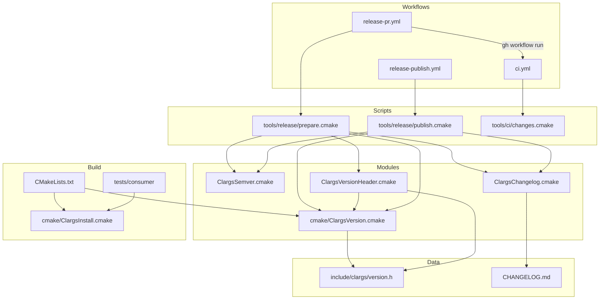
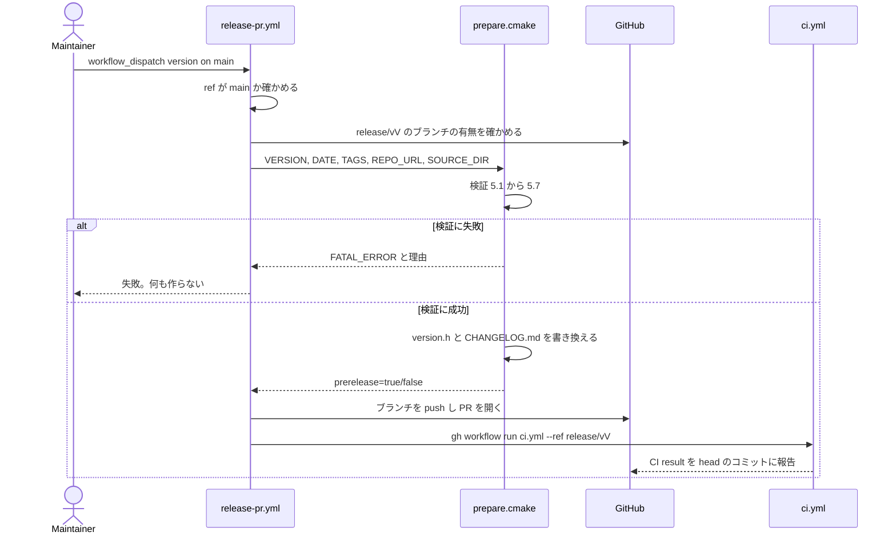
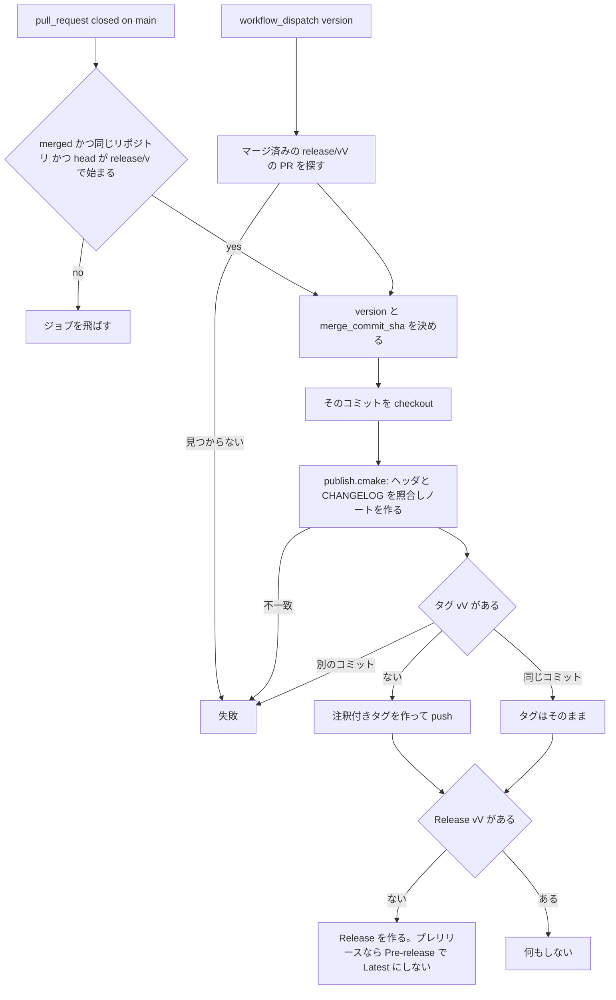
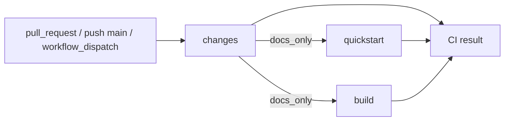

# Design Document

## Overview

**Purpose**: CLArgs のリリースを半自動にする。メンテナーが手動起動のワークフローにバージョンを渡すとリリース PR が開き、それをマージすると注釈付きタグ `v<SemVer>` と GitHub Release ができる。プレリリースも同じ流れで出す。あわせて、CI の起動を「PR、`main` への push、手動起動」に絞り、文書だけの変更では重いビルドを飛ばしつつ、required check にする集約チェックが必ず結果を返すようにする。

**Users**: メンテナーはリリース PR のワークフローとリリース手順書を使う。コントリビューターは PR で CHANGELOG の `Unreleased` に項目を足す。ライブラリ利用者はタグ、Release のノート、CHANGELOG、バージョン方針の文書を読む。

**Impact**: build-foundation のバージョンの仕組みに、プレリリースの識別子（`CLARGS_VERSION_PRERELEASE`）を足し、pkg-config と CMake のパッケージに完全なバージョンを渡す。`ci.yml` の起動の契機と判定を変える（ジョブの中身は変えない）。新しいワークフロー 2 つ、`tools/` の下の CMake スクリプト、CHANGELOG.md、英語の文書 2 つを足す。

### Goals
- `version.h` を唯一の出どころのまま、正式版とプレリリースを表せる。
- 誤った入力は、ブランチも PR も作る前に止まる。
- マージだけでタグと Release ができ、途中で失敗してもやり直せる。
- 追加のシークレットを要さない。ジョブごとに最小の権限にする。
- リリースの処理を GitHub の外で試せ、既存の CI のテストの中で自動テストされる。

### Non-Goals
- 新しい CI のジョブ（Sanitizer、lint など）、既存のジョブの中身の変更。
- ビルド済みバイナリの添付、パッケージ管理への登録。
- 完全なバージョンの文字列を返す公開関数（`clargs_version_string()` など）。
- README.md、CONTRIBUTING.md の本文、`docs/` の英語化と再編。
- 実際の v0.1.0 のリリースの操作。

## Boundary Commitments

### This Spec Owns
- バージョンの表現: `include/clargs/version.h` の `CLARGS_VERSION_PRERELEASE`、`cmake/ClargsVersion.cmake` の読み取りの規則、pkg-config の `Version` と `CLArgs_VERSION_FULL` / `CLArgs_VERSION_PRERELEASE` の意味。
- consumer check の版の比較（プレリリースを含める部分だけ）。
- CHANGELOG.md の形式、中身の最初の版、`Unreleased` に記録する規則。
- バージョン方針の文書 `docs/versioning.md`（英語）とリリース手順書 `docs/releasing.md`（英語）の中身とファイルの場所。
- `docs/conventions.md` の「バージョンについての注意」の節の内容（言語は english-docs が持つ）。
- リリースの処理のスクリプト（`tools/release/`、`tools/ci/`）とそのテスト（`tests/release/`）。
- ワークフロー: `.github/workflows/release-pr.yml`、`.github/workflows/release-publish.yml`、`.github/workflows/ci.yml` の起動の契機・判定ジョブ・集約ジョブ。
- required check の名前: `CI result`。リリースのブランチ名 `release/v<V>`、タグ名 `v<V>`、Release の題名 `v<V>`。

### Out of Boundary
- `ci.yml` の `quickstart` と `build` のジョブの中身（matrix、steps、ジョブの名前）。足すのは `needs` と `if` だけ。
- README.md、CONTRIBUTING.md（english-docs）。`docs/` のほかのファイルと、`docs/conventions.md` の他の節、`docs/conventions.md` の英語化（english-docs）。
- CODE_OF_CONDUCT.md、SECURITY.md、`.github/ISSUE_TEMPLATE/*`、`.github/pull_request_template.md`（実装済み。変えない）。
- `clargs_version()`、`CLARGS_VERSION_NUMBER`、`CLARGS_MAKE_VERSION` の意味、SOVERSION と `find_package` の互換判定の規則。
- リポジトリの設定（ブランチの保護、ruleset、Actions の権限の設定）。手順書で案内するだけ。

### Allowed Dependencies
- build-foundation: `cmake/ClargsVersion.cmake`（拡張して再利用）、`cmake/ClargsInstall.cmake`、`tests/consumer/`、`tests/CMakeLists.txt` の登録の仕組み。
- GitHub-hosted runner（`ubuntu-latest`）に入っている `git`、`gh`、`cmake`（3.21 以上）、bash。
- `actions/checkout@v7`（既存と同じ版）。ほかのサードパーティのアクションは使わない。
- `GITHUB_TOKEN` のみ。依存の向きは「ワークフロー → 入口のスクリプト → モジュール → `ClargsVersion.cmake`」で、逆向きの参照をしない。ライブラリのビルド（`CMakeLists.txt`）は `tools/` を参照しない。

### Revalidation Triggers
- `CLARGS_VERSION_PRERELEASE` の書式、`CLArgs_VERSION_FULL`/`CLArgs_VERSION_PRERELEASE` の名前や意味の変更 → consumer check、english-docs の README の取り込みの説明を確かめ直す。
- required check の名前 `CI result` の変更 → 手順書、メンテナーのブランチ保護の設定（english-docs の CONTRIBUTING は check の名前に触れない）。
- `docs/releasing.md`、`docs/versioning.md`、`CHANGELOG.md` の場所の変更 → english-docs のリンク、CHANGELOG の冒頭のリンク、PR テンプレートのリンク。
- english-docs が `docs/` を再編してこの 2 つのファイルの場所を変えたい場合 → このスペックの File Structure Plan と手順書を改める。
- 実装の順序: このスペックを先に実装し、english-docs はそのあとに実装する（english-docs が release-automation に依存する）。english-docs は、このスペックが作るファイル（`tools/`、`tests/release/`、`CHANGELOG.md`、`docs/releasing.md`、`docs/versioning.md`、ワークフロー）が既にある前提で、`docs/conventions.md` 全体の英語化とその「Directory layout」の節を書く。このスペックは「バージョンについての注意」の節を、まだ日本語のファイルの中で日本語で更新する。
- CHANGELOG の見出しやリンクの書式の変更 → `ClargsChangelog.cmake` とそのテスト、PR テンプレートの案内。

## Architecture

### Existing Architecture Analysis
- バージョンは `version.h` → `clargs_read_version()` → `project(VERSION)` → `PROJECT_VERSION` → SOVERSION、`CLArgsConfigVersion.cmake`、`clargs.pc` の一方向に流れる。数字の部分の流れは変えず、完全なバージョンの流れを横に足す。
- `clargs_read_version()` は `cmake -P` からも呼べ、`project()` に依存しない。リリースのスクリプトはこれを再利用し、ヘッダの解析を二重に持たない。
- CTest のテストは `tests/CMakeLists.txt` が登録し、CI の `quickstart` と `build` の `ctest` がすべて走らせる。`clargs.allocations` のように `cmake -P` のスクリプトをテストとして登録する前例がある。
- `ci.yml` は全ブランチの push と PR で動き、権限は `contents: read`。

### Architecture Pattern & Boundary Map



**Architecture Integration**:
- Selected pattern: 「薄いワークフロー＋テストできるスクリプト」。GitHub に触れる操作（ブランチ、PR、タグ、Release、dispatch）はワークフローの `git`/`gh` のステップに置き、判断と書き換え（検証、ヘッダ、CHANGELOG、ノート、変更の判定）は `cmake -P` のスクリプトに置く。スクリプトはネットワークに触れない。
- Domain/feature boundaries: バージョンの表現（ヘッダ・ビルド・パッケージ）／変更履歴（CHANGELOG と規則）／リリースのワークフロー／CI の起動の制御、の 4 つ。リリースのワークフローは、バージョンの表現と変更履歴をモジュール経由でだけ扱う。
- Existing patterns preserved: `version.h` が唯一の出どころ。`cmake -P` で走るチェックを CTest に登録する方式。ワークフローの権限の最小化。英語のコメント。
- New components rationale: SemVer の比較（5.3、5.4、6.5）、CHANGELOG の解析と書き換え（3、4.3、5.7、6.3、6.8）、ヘッダの書き換え（4.2）、変更の判定（7.3、7.4）は、どれも GitHub の外でテストする必要がある（9.1〜9.4）。
- Steering compliance: 実行時の依存は増えない（ライブラリのコードはマクロ 1 つだけ）。CMake 3.21 以上。

### Technology Stack

| Layer | Choice / Version | Role in Feature | Notes |
|-------|------------------|-----------------|-------|
| Library header | C99 | `CLARGS_VERSION_PRERELEASE` の文字列リテラル | 公開関数は足さない |
| Build | CMake 3.21+ | バージョンの読み取り、パッケージへの反映 | 既存 |
| Release scripts | CMake スクリプトモード（`cmake -P`） | 検証、書き換え、ノート、変更の判定 | 新規。`cmake_policy(VERSION 3.21)` |
| Tests | CTest（`add_test` で `cmake -P` を登録、ラベル `release`） | スクリプトの自動テスト | Naos は使わない |
| CI / Automation | GitHub Actions、`ubuntu-latest`、`actions/checkout@v7`、`gh` CLI、`git` | ワークフロー | 追加のアクションなし、`GITHUB_TOKEN` のみ |
| Formats | SemVer 2.0.0、Keep a Changelog 1.1.0 | バージョンと CHANGELOG | |

## File Structure Plan

### Directory Structure
```
.github/workflows/
├── ci.yml                    # (変更) 起動の契機、concurrency、changes ジョブ、CI result ジョブ
├── release-pr.yml            # (新規) 手動起動でリリース PR を作り、CI を dispatch する
└── release-publish.yml       # (新規) リリース PR のマージ（または手動のやり直し）でタグと Release を作る
tools/
├── release/
│   ├── ClargsSemver.cmake        # SemVer 2.0.0 の解析と優先順位の比較
│   ├── ClargsChangelog.cmake     # CHANGELOG の解析、Unreleased の移動、リンクの更新、ノートの取り出し
│   ├── ClargsVersionHeader.cmake # version.h の 4 つのマクロの値の書き換えと、読み直しによる確認
│   ├── prepare.cmake             # 入口: リリース PR の前の検証と、ヘッダ・CHANGELOG の書き換え
│   └── publish.cmake             # 入口: マージ後の照合、ノートの作成、Pre-release の判定
└── ci/
    └── changes.cmake             # 入口: 変更されたファイルの一覧から、文書だけの変更かを判定する
tests/release/
├── ReleaseTestHelpers.cmake      # テスト用のアサーションと、フィクスチャの写しの作成
├── version_read_test.cmake       # clargs_read_version のプレリリースの読み取り
├── semver_test.cmake             # ClargsSemver.cmake
├── changelog_test.cmake          # ClargsChangelog.cmake
├── version_header_test.cmake     # ClargsVersionHeader.cmake
├── prepare_test.cmake            # prepare.cmake を子プロセスで走らせ、成功と各失敗を確かめる
├── publish_test.cmake            # publish.cmake を子プロセスで走らせる
├── changes_test.cmake            # changes.cmake を子プロセスで走らせる
└── fixtures/                     # version.h と CHANGELOG.md の見本（正しいもの、壊れたもの）
CHANGELOG.md                      # (新規) Keep a Changelog 1.1.0。0.1.0 の内容を Unreleased に記録
docs/
├── versioning.md                 # (新規・英語) バージョン方針（SemVer、互換、破壊的変更、プレリリース）
└── releasing.md                  # (新規・英語) メンテナー向けのリリース手順書
```

### Modified Files
- `include/clargs/version.h` — `#define CLARGS_VERSION_PRERELEASE ""` とその説明のコメントを足す。冒頭のコメントに 4 つ目のマクロの書式を足す。
- `cmake/ClargsVersion.cmake` — `clargs_read_version(<header> <out-var> [<prerelease-out-var>])`。プレリリースのマクロを常に検査し、3 つ目の引数があれば識別子を返す。
- `CMakeLists.txt` — プレリリースを読み、`clargs_version_prerelease` と `clargs_version_full` を設定する。`project(VERSION)` は数字のまま。
- `cmake/ClargsInstall.cmake` — `clargs.pc` の `Version` を完全なバージョンにし、`CLArgsConfig.cmake` に完全なバージョンとプレリリースを渡す。
- `cmake/clargs.pc.in` — `Version: @clargs_version_full@`。
- `cmake/CLArgsConfig.cmake.in` — `CLArgs_VERSION_FULL` と `CLArgs_VERSION_PRERELEASE` を設定する。
- `tests/consumer/CMakeLists.txt`、`tests/consumer/main.c` — パッケージのバージョンの正規表現にプレリリースを許し、識別子をヘッダの `CLARGS_VERSION_PRERELEASE` と比べる。
- `tests/public/version_test.c` — `CLARGS_VERSION_PRERELEASE` が文字列リテラルとして使えることのテストを足す。
- `tests/CMakeLists.txt` — `tests/release/*_test.cmake` を `release.<name>` の名前、`release` のラベルで登録する。
- `docs/conventions.md` — 「バージョンについての注意」の節だけ。プレリリースのマクロの書式、パッケージでの扱い、`docs/versioning.md` と `docs/releasing.md` への案内を足す。

## System Flows

### リリース PR の作成



- 書き換えは、すべての検証が通ってから行う。ブランチの push は書き換えの後、PR の作成は push の後。push の後に PR の作成が失敗した場合の後始末は手順書に書く（ブランチを消して起動し直す）。

### マージ後の公開



### CI の判定と集約



- `quickstart` と `build` は `needs: changes`、`if: needs.changes.outputs.docs_only != 'true'`。
- `CI result` は `if: always()`。`changes` が `success` で、`quickstart` と `build` がそれぞれ `success`、または（`docs_only == 'true'` のときに限り）`skipped` なら成功。それ以外（`failure`、`cancelled`、文書だけでないのに `skipped`、`changes` の失敗）は失敗。

## Requirements Traceability

| Requirement | Summary | Components | Interfaces | Flows |
|-------------|---------|------------|------------|-------|
| 1.1 | SemVer とタグの形 | VersioningDoc | — | — |
| 1.2 | 0.x と 1.x の互換 | VersioningDoc | — | — |
| 1.3 | 破壊的変更の列挙 | VersioningDoc | — | — |
| 1.4 | プレリリースの意味 | VersioningDoc | — | — |
| 1.5 | SECURITY.md と一致 | VersioningDoc | — | — |
| 1.6 | 利用者・開発者からのリンク | VersioningDoc, ChangelogFile, ConventionsVersionNotes | english-docs のリンク | — |
| 2.1 | ヘッダにプレリリース | VersionHeader | `CLARGS_VERSION_PRERELEASE` | — |
| 2.2 | ヘッダだけから読む | VersionReader, PackageVersion | `clargs_read_version` | — |
| 2.3 | パッケージに完全な版 | PackageVersion | `CLArgs_VERSION_FULL`, pc `Version` | — |
| 2.4 | 正式版は今と同じ形 | PackageVersion | 同上 | — |
| 2.5 | 互換判定と SOVERSION は数字 | PackageVersion | `PROJECT_VERSION` | — |
| 2.6 | 数値の意味を変えない | VersionHeader | `CLARGS_VERSION_NUMBER` | — |
| 2.7 | 不正な識別子で構成失敗 | VersionReader | `clargs_read_version` | — |
| 2.8 | consumer check が合格 | ConsumerCheck | — | CI |
| 3.1 | Keep a Changelog と Unreleased | ChangelogFile | CHANGELOG の書式 | — |
| 3.2 | 見出しと分類 | ChangelogFile, ChangelogModule | 同上 | — |
| 3.3 | 比較リンク | ChangelogFile, ChangelogModule | `clargs_changelog_promote` | リリース PR |
| 3.4 | 0.1.0 の内容を Unreleased に | ChangelogFile | — | — |
| 3.5 | 冒頭の宣言とリンク | ChangelogFile | — | — |
| 3.6 | 記録の規則 | ChangelogFile, ReleasingDoc | — | — |
| 4.1 | ブランチと PR | ReleasePRWorkflow | `release/v<V>` | リリース PR |
| 4.2 | ヘッダの書き換え | PrepareScript, VersionHeaderWriter | `clargs_version_header_write` | リリース PR |
| 4.3 | Unreleased の移動 | PrepareScript, ChangelogModule | `clargs_changelog_promote` | リリース PR |
| 4.4 | PR の本文 | ReleasePRWorkflow | PR 本文の雛形 | リリース PR |
| 4.5 | CI の起動 | ReleasePRWorkflow, CIWorkflow | `gh workflow run` | リリース PR |
| 4.6 | 2 ファイルだけ変える | PrepareScript, ReleasePRWorkflow | — | リリース PR |
| 4.7 | 同時に走らない | ReleasePRWorkflow | `concurrency` | — |
| 5.1 | SemVer の書式 | PrepareScript, SemverModule | `clargs_semver_parse` | リリース PR |
| 5.2 | 0〜255 | PrepareScript, SemverModule | 同上 | リリース PR |
| 5.3 | タグ以下を拒む | PrepareScript, SemverModule | `clargs_semver_compare` | リリース PR |
| 5.4 | ヘッダ未満を拒む | PrepareScript, SemverModule | 同上 | リリース PR |
| 5.5 | 未タグのヘッダ版は受け付ける | PrepareScript | — | リリース PR |
| 5.6 | タグ・ブランチの重複 | PrepareScript, ReleasePRWorkflow | — | リリース PR |
| 5.7 | Unreleased が空・形が違う | PrepareScript, ChangelogModule | `clargs_changelog_parse` | リリース PR |
| 5.8 | main 以外で拒む | ReleasePRWorkflow | — | リリース PR |
| 6.1 | 注釈付きタグ | PublishWorkflow | `git tag -a` | 公開 |
| 6.2 | 同じ実行で Release | PublishWorkflow | `gh release create` | 公開 |
| 6.3 | CHANGELOG からノート | PublishScript, ChangelogModule | `clargs_changelog_notes` | 公開 |
| 6.4 | Pre-release、Latest にしない | PublishScript, PublishWorkflow | `prerelease` 出力 | 公開 |
| 6.5 | 先行プレリリースへの参照 | PublishScript, ChangelogModule, SemverModule | `clargs_changelog_notes` | 公開 |
| 6.6 | ソースだけ | PublishWorkflow | — | 公開 |
| 6.7 | 対象外の PR は無視 | PublishWorkflow | job の `if` | 公開 |
| 6.8 | 照合の失敗 | PublishScript | — | 公開 |
| 6.9 | 別のコミットのタグ | PublishWorkflow | — | 公開 |
| 6.10 | やり直しで重複しない | PublishWorkflow | `workflow_dispatch` | 公開 |
| 7.1 | 起動の契機 | CIWorkflow | `on:` | CI |
| 7.2 | 古い実行の取り消し | CIWorkflow | `concurrency` | CI |
| 7.3 | 文書だけで飛ばす | CIWorkflow, ChangesScript | `docs_only` | CI |
| 7.4 | 判定できなければ全部 | ChangesScript, CIWorkflow | 同上 | CI |
| 7.5 | 手動起動は全部 | CIWorkflow | 同上 | CI |
| 7.6 | 集約チェックが必ず終わる | CIWorkflow | `CI result` | CI |
| 7.7 | 失敗の集約 | CIWorkflow | 同上 | CI |
| 7.8 | ジョブの中身を変えない | CIWorkflow | — | — |
| 7.9 | 読み取りの権限だけ | CIWorkflow | `permissions` | — |
| 7.10 | `tests/` の下の Markdown は文書でない | ChangesScript, CIWorkflow | `docs_only` | CI |
| 8.1 | 手順 | ReleasingDoc | — | — |
| 8.2 | リポジトリの設定 | ReleasingDoc | — | — |
| 8.3 | 権限とシークレット | ReleasingDoc | — | — |
| 8.4 | 戻し方 | ReleasingDoc | — | — |
| 8.5 | CI の起動し直し | ReleasingDoc | — | — |
| 8.6 | 試験用の通し確認 | ReleasingDoc | — | — |
| 8.7 | 非公開の脆弱性報告を有効にする | ReleasingDoc | — | — |
| 8.8 | README の取り込みの例のタグの確認 | ReleasingDoc | — | — |
| 9.1 | 手元で実行できる | PrepareScript, PublishScript, ChangesScript | 入口のスクリプトの引数 | — |
| 9.2 | 成功と失敗のテスト | ReleaseTests | — | — |
| 9.3 | 既存の CI の中で走る | ReleaseTests | `tests/CMakeLists.txt` | CI |
| 9.4 | 指定した場所だけ書き換える | PrepareScript | `CLARGS_SOURCE_DIR` | — |
| 10.1 | 英語 | 全成果物 | — | — |
| 10.2 | `.kiro/` に触れない | 全成果物 | — | — |
| 10.3 | README/CONTRIBUTING を変えない | — （境界） | — | — |
| 10.4 | conventions の節だけ | ConventionsVersionNotes | — | — |
| 10.5 | 最小の権限 | ReleasePRWorkflow, PublishWorkflow, CIWorkflow | `permissions` | — |
| 10.6 | 設定を変えない | ReleasePRWorkflow, PublishWorkflow | — | — |
| 10.7 | 文書で "spec"/"specs"/"steering" を使わない | ChangelogFile, VersioningDoc, ReleasingDoc | — | — |

## Components and Interfaces

| Component | Domain/Layer | Intent | Req Coverage | Key Dependencies (P0/P1) | Contracts |
|-----------|--------------|--------|--------------|--------------------------|-----------|
| VersionHeader | バージョンの表現 | ヘッダにプレリリースのマクロを持つ | 2.1, 2.6 | — | State |
| VersionReader | バージョンの表現 | ヘッダを読みプレリリースを検査する | 2.2, 2.7 | VersionHeader (P0) | Service |
| PackageVersion | バージョンの表現 | pkg-config と CMake のパッケージに完全なバージョンを渡す | 2.2, 2.3, 2.4, 2.5 | VersionReader (P0) | State |
| ConsumerCheck | バージョンの表現 | パッケージのバージョンとヘッダの一致を確かめる | 2.3, 2.8 | PackageVersion (P0) | Batch |
| SemverModule | リリースの処理 | SemVer の解析と比較 | 5.1, 5.2, 5.3, 5.4, 6.5 | — | Service |
| ChangelogModule | 変更履歴 | CHANGELOG の解析、移動、ノート | 3.2, 3.3, 4.3, 5.7, 6.3, 6.5 | SemverModule (P1) | Service |
| VersionHeaderWriter | リリースの処理 | ヘッダの値の書き換え | 4.2 | VersionReader (P0) | Service |
| PrepareScript | リリースの処理 | PR 前の検証と書き換え | 4.2, 4.3, 4.6, 5.1–5.7, 9.1, 9.4 | 上の 3 モジュール (P0) | Batch |
| PublishScript | リリースの処理 | マージ後の照合とノート | 6.3, 6.4, 6.5, 6.8, 9.1 | ChangelogModule, VersionReader (P0) | Batch |
| ChangesScript | CI の起動 | 文書だけの変更の判定 | 7.3, 7.4, 7.10, 9.1 | — | Batch |
| ReleasePRWorkflow | ワークフロー | リリース PR の作成と CI の起動 | 4.1–4.7, 5.6, 5.8, 10.5, 10.6 | PrepareScript (P0), gh (P0) | Batch |
| PublishWorkflow | ワークフロー | タグと Release | 6.1–6.10, 10.5, 10.6 | PublishScript (P0), gh (P0) | Batch |
| CIWorkflow | ワークフロー | 起動、判定、集約 | 4.5, 7.1–7.10, 10.5 | ChangesScript (P0) | Batch |
| ReleaseTests | 検証 | スクリプトの自動テスト | 9.2, 9.3 | 各スクリプト (P0) | Batch |
| ChangelogFile | 変更履歴 | CHANGELOG.md の中身 | 1.6, 3.1–3.6, 10.7 | — | State |
| VersioningDoc | 文書 | `docs/versioning.md` | 1.1–1.6, 10.7 | — | — |
| ReleasingDoc | 文書 | `docs/releasing.md` | 3.6, 8.1–8.8, 10.7 | — | — |
| ConventionsVersionNotes | 文書 | `docs/conventions.md` の 1 節 | 1.6, 10.4 | VersioningDoc (P1) | — |

### バージョンの表現

#### VersionHeader（`include/clargs/version.h`）

| Field | Detail |
|-------|--------|
| Intent | 4 つ目のマクロでプレリリースの識別子を持つ |
| Requirements | 2.1, 2.6 |

**Contracts**: State [x]

##### State Management
- 足す行（1 行、ほかの 3 つのマクロの直後）:
  ```c
  /* The pre-release identifiers of the version without the leading hyphen, such as "rc.1".
     An empty string for a release. */
  #define CLARGS_VERSION_PRERELEASE ""
  ```
- 不変条件: 値は 1 つの文字列リテラル。中身は空、または SemVer 2.0.0 のプレリリースの識別子（`.` で区切った `[0-9A-Za-z-]+`、数字だけの識別子は先頭に 0 を付けない）。
- `CLARGS_MAKE_VERSION`、`CLARGS_VERSION_NUMBER`、`clargs_version()` は変えない（2.6）。

#### VersionReader（`cmake/ClargsVersion.cmake`）

| Field | Detail |
|-------|--------|
| Intent | 数字の部分とプレリリースの識別子を読み、書式を検査する |
| Requirements | 2.2, 2.7 |

**Contracts**: Service [x]

##### Service Interface
```cmake
# clargs_read_version(<header-path> <out-var> [<prerelease-out-var>])
#   <out-var>            "<major>.<minor>.<patch>"（今と同じ）
#   <prerelease-out-var> 識別子（ハイフンなし）。正式版では空文字列
```
- Preconditions: 引数は 2 つまたは 3 つ。それ以外は FATAL_ERROR。
- Postconditions: 3 つの数字のマクロに加え、`CLARGS_VERSION_PRERELEASE` が 1 行の `#define CLARGS_VERSION_PRERELEASE "<id>"` の形でちょうど 1 回あり、`<id>` が空か正しい識別子であること。違反はすべて集めて、ヘッダのパスとマクロの名前を示す 1 つの FATAL_ERROR にする（2.7）。3 つ目の引数を渡さない呼び出しも同じ検査をする。
- Invariants: `project()` に依存しない（`cmake -P` から呼べる）。コメントの中のマクロは数えない（既存の規則）。

#### PackageVersion（`CMakeLists.txt`、`cmake/ClargsInstall.cmake`、`cmake/clargs.pc.in`、`cmake/CLArgsConfig.cmake.in`）

| Field | Detail |
|-------|--------|
| Intent | 完全なバージョンを pkg-config と CMake のパッケージに渡す |
| Requirements | 2.2, 2.3, 2.4, 2.5 |

**Contracts**: State [x]

##### State Management
- `CMakeLists.txt`: `clargs_read_version(... clargs_version clargs_version_prerelease)`。`clargs_version_full` は、識別子が空なら `clargs_version`、空でなければ `${clargs_version}-${clargs_version_prerelease}`。`project(CLArgs VERSION ${clargs_version})` は変えない。
- `clargs.pc`: `Version: @clargs_version_full@`（2.3、2.4）。
- `CLArgsConfig.cmake`: `set(CLArgs_VERSION_FULL "@clargs_version_full@")`、`set(CLArgs_VERSION_PRERELEASE "@clargs_version_prerelease@")`。`CLArgs_VERSION`（互換判定から来る値）は数字のまま。
- `CLArgsConfigVersion.cmake` と SOVERSION は `PROJECT_VERSION` から作り、規則を変えない（2.5）。
- add_subdirectory / FetchContent で取り込んだ場合のための変数は足さない（要件がない）。

#### ConsumerCheck（`tests/consumer/CMakeLists.txt`、`tests/consumer/main.c`）

| Field | Detail |
|-------|--------|
| Intent | パッケージが知らせるバージョン（プレリリースを含む）がヘッダと一致することを確かめる |
| Requirements | 2.3, 2.8 |

**Contracts**: Batch [x]

##### Batch / Job Contract
- find_package: `CLArgs_VERSION` は今の正規表現で検査し、互換の検査も今のまま。加えて `CLArgs_VERSION_FULL` を `^([0-9]+)\.([0-9]+)\.([0-9]+)(-([0-9A-Za-z.-]+))?$` で分け、プレリリースの部分を `CONSUMER_PACKAGE_VERSION_PRERELEASE="<id>"` で `main.c` に渡す。
- pkg_config: `CLARGS_VERSION`（pkg-config の `Version`）を同じ正規表現で分ける。
- `main.c`: `CONSUMER_PACKAGE_VERSION_PRERELEASE` が定義されていれば、`strcmp` で `CLARGS_VERSION_PRERELEASE` と比べ、違えば両方を表示して 1 を返す。
- 正式版のヘッダでは、識別子は空同士で一致し、今と同じ結果になる（2.8）。手順（`run.cmake`）と CI のステップは変えない。

### リリースの処理（`tools/release/`、`tools/ci/`）

共通の規則: すべて `cmake_minimum_required(VERSION 3.21)` 相当の方針で `cmake -P` から動く。ネットワーク、`git`、`gh` を呼ばない。エラーは `message(FATAL_ERROR "error: <理由>")` で、理由は英語の 1 文以上（どの値がどの規則に反したか）。モジュールは `include_guard(GLOBAL)`。

#### SemverModule（`tools/release/ClargsSemver.cmake`）

| Field | Detail |
|-------|--------|
| Intent | SemVer 2.0.0 の書式の検査と優先順位の比較 |
| Requirements | 5.1, 5.2, 5.3, 5.4, 6.5 |

**Contracts**: Service [x]

##### Service Interface
```cmake
# clargs_semver_parse(<version> <prefix>)
#   Sets <prefix>_VALID (TRUE/FALSE), <prefix>_ERROR (reason or ""),
#        <prefix>_MAJOR, <prefix>_MINOR, <prefix>_PATCH (decimal strings),
#        <prefix>_PRERELEASE (identifiers without "-", or ""),
#        <prefix>_CORE ("<major>.<minor>.<patch>")
#   Accepts only <major>.<minor>.<patch>[-<pre-release>]; build metadata ("+...") is invalid.
#   Each of major/minor/patch must be 0-255 without leading zeros.
#
# clargs_semver_compare(<a> <b> <out-var>)
#   <out-var> = -1, 0 or 1 by SemVer 2.0.0 precedence. Both must be valid (FATAL_ERROR otherwise).
```
- 比較の規則: 数字の部分を数値で比べる → 片方だけプレリリースならそちらが小さい → 識別子を順に、数字だけ同士は数値（桁数→文字列の順で比べ、`math()` の桁あふれを避ける）、英数字同士は ASCII の順、数字は英数字より小さい → 共通部分が等しければ識別子の少ない方が小さい。
- 0〜255 の検査は CLArgs のヘッダの制約であり、`clargs_semver_parse` の中で行う（5.2）。

#### ChangelogModule（`tools/release/ClargsChangelog.cmake`）

| Field | Detail |
|-------|--------|
| Intent | CHANGELOG の解析、`Unreleased` の移動とリンクの更新、ノートの取り出し |
| Requirements | 3.2, 3.3, 4.3, 5.7, 6.3, 6.5 |

**Contracts**: Service [x]

##### Service Interface
```cmake
# clargs_changelog_parse(<text> <prefix>)
#   Sets <prefix>_VALID, <prefix>_ERROR,
#        <prefix>_VERSIONS (list of released versions, newest first, as in the file),
#        <prefix>_UNRELEASED_ENTRIES (number of list items under [Unreleased])
#
# clargs_changelog_promote(<text> <version> <date> <repo-url> <out-var>)
#   Returns the text with the body of [Unreleased] moved to "## [<version>] - <date>",
#   [Unreleased] left empty, and the link definitions updated.
#   FATAL_ERROR if the text is not valid, [Unreleased] has no entry, or <version> is already listed.
#
# clargs_changelog_notes(<text> <version> <repo-url> <out-var>)
#   Returns the body of the section of <version> (without its heading), followed, for a release
#   without pre-release identifiers, by a reference to the pre-releases of the same
#   <major>.<minor>.<patch> listed right below it. FATAL_ERROR if the section is missing.
```
- 受け付ける形（Data Models を参照）に合わないものはすべて `_VALID = FALSE` と理由。
- `promote` のリンク: `[Unreleased]: <repo>/compare/v<version>...HEAD`。新しい版のリンクは、ファイルの中で直下の版 `P` があれば `[<version>]: <repo>/compare/v<P>...v<version>`、なければ `[<version>]: <repo>/releases/tag/v<version>`。新しいリンクは `[Unreleased]:` の行の直後に入れる。
- `notes` の先行プレリリースへの参照（6.5）: 対象が正式版で、ファイルの中で直下に続く版が同じ `<core>` のプレリリースである間、それらを集める。1 つ以上あれば、本文の後に空行と次の 1 文を足す。
  `This release also includes the changes in the pre-releases [v<pre1>](<repo>/releases/tag/v<pre1>), ... .`
- 本文の範囲: 見出しの次の行から、次の `## ` の見出しまたはリンク定義（`^\[[^]]+\]: `）の行の前まで。前後の空行は除く。

#### VersionHeaderWriter（`tools/release/ClargsVersionHeader.cmake`）

| Field | Detail |
|-------|--------|
| Intent | `version.h` の 4 つのマクロの値だけを書き換える |
| Requirements | 4.2 |

**Contracts**: Service [x]

##### Service Interface
```cmake
# clargs_version_header_render(<text> <major> <minor> <patch> <prerelease> <out-var>)
#   Replaces the value on each of the four "#define CLARGS_VERSION_<PART>" lines; keeps every other byte.
#   FATAL_ERROR if a line is not found exactly once.
```
- 書いたあと（呼び出し側の `prepare.cmake`）、`clargs_read_version()` で読み直して、渡した値と一致することを確かめる。

#### PrepareScript（`tools/release/prepare.cmake`）

| Field | Detail |
|-------|--------|
| Intent | リリース PR の前の検証と、2 つのファイルの書き換え |
| Requirements | 4.2, 4.3, 4.6, 5.1, 5.2, 5.3, 5.4, 5.5, 5.6, 5.7, 9.1, 9.4 |

**Contracts**: Batch [x]

##### Batch / Job Contract
- Trigger: `cmake -D <var>=<value> ... -P tools/release/prepare.cmake`
- Input:

  | Variable | Required | Meaning |
  |----------|----------|---------|
  | `CLARGS_RELEASE_VERSION` | yes | リリースするバージョン（例 `0.2.0-rc.1`） |
  | `CLARGS_RELEASE_DATE` | yes | `YYYY-MM-DD`（ワークフローは `date -u +%F`） |
  | `CLARGS_RELEASE_REPO_URL` | yes | `https://github.com/<owner>/<repo>` |
  | `CLARGS_SOURCE_DIR` | yes | `include/clargs/version.h` と `CHANGELOG.md` を持つ根（9.4） |
  | `CLARGS_RELEASE_TAGS_FILE` | yes | 既存のタグの一覧（1 行に 1 つ。空のファイル可）。`v` で始まり、残りが正しい SemVer のものだけを使う |
  | `CLARGS_RELEASE_OUTPUT` | no | 結果を `key=value` の行で追記するファイル（ワークフローの `$GITHUB_OUTPUT`） |
  | `CLARGS_RELEASE_CHECK_ONLY` | no | 真なら検証だけでファイルを書かない |

- Validation（この順、最初に見つかった違反で止まる。どれもファイルを書く前）:
  1. 必須の入力がある。日付が `YYYY-MM-DD`。
  2. `clargs_semver_parse`（5.1、5.2）。
  3. タグの一覧に `v<V>` がない（5.6）。
  4. すべての既存のリリースタグ `T` について `V > T`（5.3）。
  5. ヘッダのバージョン `H`（完全な形）について `V >= H`（5.4）。`V == H` は、`v<H>` のタグがないときだけ受け付ける（5.5。`v<H>` があれば 3 か 4 で既に拒まれている）。
  6. `clargs_changelog_parse` が有効で、`Unreleased` の項目が 1 つ以上、`V` がまだ載っていない（5.7）。
- Output: `version.h` と `CHANGELOG.md` だけを書き換える（4.6）。ヘッダを読み直して確かめる。`CLARGS_RELEASE_OUTPUT` に `version=<V>`、`tag=v<V>`、`prerelease=true|false` を追記する。標準出力に何を変えたかを書く。
- Idempotency & recovery: 書き換えは 2 つのファイルの新しい中身をすべて作ってから書く。同じ入力で 2 回走らせると 2 回目は 6 で止まる（`V` が載っている）。

#### PublishScript（`tools/release/publish.cmake`）

| Field | Detail |
|-------|--------|
| Intent | マージされたコミットの照合と、ノートと Pre-release の判定 |
| Requirements | 6.3, 6.4, 6.5, 6.8, 9.1 |

**Contracts**: Batch [x]

##### Batch / Job Contract
- Input: `CLARGS_RELEASE_VERSION`、`CLARGS_RELEASE_REPO_URL`、`CLARGS_SOURCE_DIR`、`CLARGS_RELEASE_NOTES`（ノートを書くファイル）、`CLARGS_RELEASE_OUTPUT`（任意）。
- Validation: バージョンが正しい。ヘッダの完全なバージョンが `V` と等しい。CHANGELOG が有効で、最新の版（`_VERSIONS` の先頭）が `V`（6.8）。
- Output: `CLARGS_RELEASE_NOTES` にノート（`clargs_changelog_notes`）を書く。ノートが空なら失敗する。`CLARGS_RELEASE_OUTPUT` に `prerelease=true|false`、`title=v<V>` を追記する（6.4）。

#### ChangesScript（`tools/ci/changes.cmake`）

| Field | Detail |
|-------|--------|
| Intent | 変更されたファイルの一覧から、文書だけの変更かを判定する |
| Requirements | 7.3, 7.4, 7.10, 9.1 |

**Contracts**: Batch [x]

##### Batch / Job Contract
- Input: `CLARGS_CHANGED_FILES`（1 行に 1 つのパスのファイル。なくてもよい）、`CLARGS_CHANGES_OUTPUT`（任意）。
- 規則: 文書のファイルは次のどれかに当たるパス。
  - 拡張子が `.md` のファイルのうち、リポジトリの根の直下、`docs/` の下、`.github/` の下にあるもの（7.10。`tests/release/fixtures/*.md` などの CHANGELOG のフィクスチャはテストの入力なので文書とみなさない。ほかの階層の `.md` も文書とみなさない）
  - `docs/` の下のファイル
  - `LICENSE`
  - `.github/ISSUE_TEMPLATE/` の下のファイル
- Output: 一覧のファイルがなく、空で、または文書でないパスが 1 つでもあれば `docs_only=false`。すべてが文書なら `docs_only=true`（7.4）。判定と、文書でなかった最初のパスを標準出力に書く。`CLARGS_CHANGES_OUTPUT` に `docs_only=<value>` を追記する。

### ワークフロー

共通の規則: 英語のコメント。最上位の `permissions: {}`、ジョブごとに必要な権限だけ（10.5）。ワークフローの入力やイベントの値は `env:` で渡し、`run:` の中に `${{ }}` で直接埋め込まない。リポジトリの設定を変える API を呼ばない（10.6）。コミットとタグの作者は `github-actions[bot]`（`41898283+github-actions[bot]@users.noreply.github.com`）。

#### ReleasePRWorkflow（`.github/workflows/release-pr.yml`）

| Field | Detail |
|-------|--------|
| Intent | 手動起動でリリース PR を作り、その head で CI を起動する |
| Requirements | 4.1, 4.2, 4.3, 4.4, 4.5, 4.6, 4.7, 5.6, 5.8, 10.5, 10.6 |

**Contracts**: Batch [x]

##### Batch / Job Contract
- Trigger: `workflow_dispatch`、入力 `version`（string、必須。説明に例 `0.2.0`、`0.2.0-rc.1`）。`name: Release PR`。
- Concurrency: `group: release-pr`、`cancel-in-progress: false`（4.7）。
- Job `release-pr`（`ubuntu-latest`）、権限 `contents: write`、`pull-requests: write`、`actions: write`。
- Steps:
  1. `github.ref` が `refs/heads/main` でなければ失敗（5.8）。
  2. `actions/checkout@v7`（`fetch-depth: 0`、タグを含む）。
  3. `git ls-remote --exit-code --heads origin "release/v$VERSION"` が見つけたら失敗（5.6）。
  4. `git tag --list 'v*' > "$RUNNER_TEMP/tags.txt"`。
  5. `cmake -D ... -P tools/release/prepare.cmake`（`CLARGS_RELEASE_OUTPUT=$GITHUB_OUTPUT`、`CLARGS_RELEASE_REPO_URL=$GITHUB_SERVER_URL/$GITHUB_REPOSITORY`）。
  6. `git switch -c "release/v$VERSION"`、`git add include/clargs/version.h CHANGELOG.md`、`git status --porcelain` でほかの変更がないことを確かめる（4.6）、コミット `Release v<V>`、push。
  7. `gh pr create --base main --head release/v<V> --title "Release v<V>" --body-file <本文>`（4.1、4.4）。本文の雛形:
     - 1 行目: `This pull request releases CLArgs v<V>.`（プレリリースなら `This is a pre-release.` を足す）
     - `## What this pull request changes`: version.h と CHANGELOG の 2 点。
     - `## What happens on merge`: タグ `v<V>` と GitHub Release（Pre-release かどうか）ができる。
     - `## Before merging`: CHANGELOG の節を読み直す、`CI result` が通っている、日付が遅れたら直してよい。
     - リリース手順書へのリンク（`docs/releasing.md`）。
  8. `gh workflow run ci.yml --ref "release/v$VERSION"`（4.5）。失敗したら、PR は残したままジョブを失敗させ、手順書の CI の起動し直しを案内する。
- Idempotency & recovery: 1〜5 で止まった場合は何も残らない。6 以降の失敗の戻し方は手順書（8.4）。
- 書くステップは `$GITHUB_STEP_SUMMARY` に、PR の URL か失敗の理由を書く。

#### PublishWorkflow（`.github/workflows/release-publish.yml`）

| Field | Detail |
|-------|--------|
| Intent | マージされたリリース PR からタグと Release を作る |
| Requirements | 6.1, 6.2, 6.3, 6.4, 6.6, 6.7, 6.8, 6.9, 6.10, 10.5, 10.6 |

**Contracts**: Batch [x] / State [x]

##### Batch / Job Contract
- Trigger: `pull_request`（`types: [closed]`、`branches: [main]`）と `workflow_dispatch`（入力 `version`、やり直し用）。`name: Release`。
- Job `publish` の `if`: `workflow_dispatch`、または `github.event.pull_request.merged == true && github.event.pull_request.head.repo.full_name == github.repository && startsWith(github.event.pull_request.head.ref, 'release/v')`（6.7）。
- Concurrency: `group: release-publish-<version または head ref>`、`cancel-in-progress: false`。
- 権限: `contents: write`（タグと Release）、`pull-requests: read`（やり直しのときの PR の検索）。
- Steps:
  1. Resolve: PR のイベントなら `VERSION = head.ref` から `release/v` を除いたもの、`SHA = pull_request.merge_commit_sha`。dispatch なら `github.ref` が `main` であることを確かめ、`gh pr list --state merged --base main --head "release/v$VERSION" --json mergeCommit` の 1 件から `SHA` を得る（なければ失敗）。
  2. `actions/checkout@v7`（`ref: SHA`、`fetch-depth: 0`）。
  3. `cmake -P tools/release/publish.cmake`（ノートは `$RUNNER_TEMP/notes.md`）（6.3、6.4、6.8）。
  4. Tag: `git ls-remote --tags origin "refs/tags/v$VERSION"` で調べる。なければ `git tag -a "v$VERSION" -m "CLArgs v$VERSION" "$SHA"` と push（6.1）。あってその指すコミット（`^{}` で剥がした値）が `SHA` なら飛ばす。別なら失敗（6.9）。
  5. Release: `gh release view "v$VERSION"` が見つけたら飛ばす（6.10）。なければ `gh release create "v$VERSION" --verify-tag --title "v$VERSION" --notes-file notes.md`、プレリリースなら `--prerelease --latest=false`（6.2、6.4）。資産のファイルは渡さない（6.6）。
- Idempotency & recovery: タグと Release のどちらも「あれば確かめて飛ばす」。失敗した実行の再実行、またはワークフローを直したあとの dispatch で、足りないものだけを作る（6.10）。
- `$GITHUB_STEP_SUMMARY` に、作ったもの・飛ばしたもの・失敗の理由を書く。

#### CIWorkflow（`.github/workflows/ci.yml`）

| Field | Detail |
|-------|--------|
| Intent | 起動の契機を絞り、文書だけの変更で重いジョブを飛ばし、集約チェックを必ず返す |
| Requirements | 4.5, 7.1, 7.2, 7.3, 7.4, 7.5, 7.6, 7.7, 7.8, 7.9, 7.10, 10.5 |

**Contracts**: Batch [x]

##### Batch / Job Contract
- `on`: `pull_request`、`push`（`branches: [main]`）、`workflow_dispatch`（7.1、4.5）。
- `concurrency`: `group: ${{ github.workflow }}-${{ github.event.pull_request.number || github.ref }}`、`cancel-in-progress: ${{ github.event_name == 'pull_request' }}`（7.2）。
- `permissions: contents: read`（変えない。7.9）。
- Job `changes`（`ubuntu-latest`）: `actions/checkout@v7`（`fetch-depth: 0`）。イベントごとに一覧を作る。
  - `pull_request`: `git diff --name-only "$BASE_SHA...$HEAD_SHA"`（`pull_request.base.sha`、`pull_request.head.sha`）。
  - `push`: `before` が全部 0、またはそのコミットが取得できなければ一覧を作らない。そうでなければ `git diff --name-only "$BEFORE" "$GITHUB_SHA"`。
  - `workflow_dispatch`: 一覧を作らない（7.5）。
  - `git diff` が失敗したら一覧を作らない（7.4）。
  - そのあと `cmake -P tools/ci/changes.cmake`（`CLARGS_CHANGES_OUTPUT=$GITHUB_OUTPUT`）。出力 `docs_only`。
- `quickstart`、`build`: `needs: changes`、`if: needs.changes.outputs.docs_only != 'true'` だけを足す。名前、matrix、steps は変えない（7.8）。
- Job `result`（`name: CI result`、`ubuntu-latest`、`needs: [changes, quickstart, build]`、`if: always()`）: 1 つの bash のステップで、上の「CI の判定と集約」の規則を評価し、ジョブの結果と理由を `$GITHUB_STEP_SUMMARY` に書き、成功なら 0、失敗なら 1 で終わる（7.6、7.7）。

### 検証

#### ReleaseTests（`tests/release/`）

| Field | Detail |
|-------|--------|
| Intent | スクリプトとモジュールの自動テスト |
| Requirements | 9.2, 9.3 |

**Contracts**: Batch [x]

##### Batch / Job Contract
- 各 `*_test.cmake` は `cmake -D CLARGS_SOURCE_ROOT=<repo> -D CLARGS_TEST_WORK_DIR=<dir> -P <file>` で走り、失敗した確認をすべて表示して FATAL_ERROR で終わる。成功なら 0。確認が 1 つも走らなければ失敗する（Naos の規則に合わせる）。
- `tests/CMakeLists.txt` で `release.version_read`、`release.semver`、`release.changelog`、`release.version_header`、`release.prepare`、`release.publish`、`release.changes` として登録し、`LABELS release` を付ける。作業ディレクトリは `${CMAKE_CURRENT_BINARY_DIR}/release/<name>`。静的・動的のどちらの構成でも登録する（ビルドに依存しない）。
- 入口のスクリプトのテストは、フィクスチャを作業ディレクトリに写してから子プロセス（`execute_process(COMMAND ${CMAKE_COMMAND} ... -P ...)`）で走らせ、終了コード、メッセージの一部、ファイルの中身（失敗のときは変わっていないこと）を確かめる。

### 文書と CHANGELOG

#### ChangelogFile（`CHANGELOG.md`）

| Field | Detail |
|-------|--------|
| Intent | Keep a Changelog 1.1.0 の CHANGELOG と記録の規則 |
| Requirements | 1.6, 3.1, 3.2, 3.3, 3.4, 3.5, 3.6, 10.7 |

- 冒頭: 題 `# Changelog`、Keep a Changelog 1.1.0 と Semantic Versioning 2.0.0 に従うこと、`docs/versioning.md` へのリンク、記録の規則（3.6）の短い説明（「Every pull request with a change visible to users adds an entry under `Unreleased`, in the matching category」）。PR テンプレートの文言と同じ意味にする。
- `## [Unreleased]` の下に、0.1.0 に載せる内容（3.4）。分類は `### Added`。項目は最初の公開の機能（ビルダーと不透明ハンドルのスキーマ、オプション・位置引数・サブコマンド、型付き値と利用者定義の型、argv の解析とワイド文字 argv、ヘルプと usage、差し替え可能なアロケータとエラーコード、静的/動的ライブラリと 4 つの取り込み方法）。実装時に README と `docs/` の現状から確かめて書く。
- 末尾: `[Unreleased]: https://github.com/ktdevx/cargs/commits/main`（タグがまだないため）。

#### VersioningDoc（`docs/versioning.md`、英語）

| Field | Detail |
|-------|--------|
| Intent | 利用者と開発者のためのバージョン方針 |
| Requirements | 1.1, 1.2, 1.3, 1.4, 1.5, 1.6, 10.7 |

- 節: Version numbers and tags（1.1）／Compatibility before and after 1.0（1.2。`find_package` の互換判定と SOVERSION との対応）／What counts as a breaking change（1.3）／Pre-releases（1.4。`-rc.N` など、支援しない、`find_package(CLArgs 0.2)` が `0.2.0-rc.1` も見つけること、pkg-config がプレリリースを正式版より新しいとみなすこと）／Supported versions（1.5。SECURITY.md へのリンクで支援の方針を述べ、内容を繰り返さない）／Checking the version in code（`CLARGS_VERSION_*`、`CLARGS_VERSION_PRERELEASE`、`clargs_version()`、`CLArgs_VERSION_FULL`、pkg-config の `Version`）。
- 1.6: CHANGELOG の冒頭と `docs/conventions.md` の節からリンクする。README と CONTRIBUTING からのリンクは english-docs が張る。

#### ReleasingDoc（`docs/releasing.md`、英語）

| Field | Detail |
|-------|--------|
| Intent | メンテナー向けのリリース手順書 |
| Requirements | 3.6, 8.1, 8.2, 8.3, 8.4, 8.5, 8.6, 8.7, 8.8, 10.7 |

- 節:
  1. Overview — 流れの図（文章）と、使うワークフロー（`Release PR`、`Release`、`CI`）。
  2. One-time repository setup（8.2）— Settings > Actions > General の「Allow GitHub Actions to create and approve pull requests」、`main` のブランチ保護または ruleset（PR を必須、required check `CI result`）、タグの ruleset を使う場合は GitHub Actions に作成を許すこと、Workflow permissions の既定は read のままでよいこと（各ワークフローが明示的に求める）。Settings > Code security > Private vulnerability reporting を有効にすること（8.7。SECURITY.md と `.github/ISSUE_TEMPLATE/config.yml` がこの報告の窓口を案内しているため）。
  3. Permissions and secrets（8.3）— 各ジョブの権限の表。追加のシークレットは要らないこと。
  4. Keeping the changelog（3.6）— 記録の規則と、リリース前に `Unreleased` を整えること。
  5. Making a release / Making a pre-release（8.1）— 起動の手順、入力の例、検証で止まる条件、PR の確認、マージ、できあがるもの。
  6. When the release PR shows no CI result（8.5）— Actions のタブから `CI` を `release/v<V>` で手動起動する、または PR を閉じて開き直す。
  7. Recovering from failures（8.4）— 検証で止まった（直して起動し直す）／PR を取り下げる（PR を閉じ、ブランチを消す）／push の後で PR の作成に失敗した（ブランチを消して起動し直す）／タグや Release の作成が途中で失敗した（失敗した実行を再実行、または `Release` を `version` を渡して手動起動）／誤って出したリリース（Release を消し、タグを消し、次のパッチまたはプレリリースで出し直す。公開したタグは使い回さない）。
  8. Rehearsing the release process（8.6）— フォークで Actions を有効にし、試験用のプレリリース（例 `0.2.0-rehearsal.1`。ヘッダの版 0.1.0 より大きい版でなければ要件 5.4 の検証で止まる。同じ理由で、ヘッダにある版そのもののプレリリース（例 `0.1.0-rc.1`）は出せないことも手順書に書く）で全体を通す。確かめる項目: 検証の失敗の例、PR の内容、`CI result` が PR に示され required check を満たすこと、タグと Pre-release、やり直しの dispatch。終わったらフォークのタグと Release を消す。手元では `cmake -P tools/release/prepare.cmake`（`CLARGS_RELEASE_CHECK_ONLY` と作業ツリーの写し）で試せること。最初の本番のリリースの前の注意（8.8）: README.md の FetchContent の例が、これから作るタグを指していることを確かめる（手順書の英文はスペック名に触れず、README の今の内容に依らない形で書く。例: "Before the first release, check that the FetchContent example in README.md pins the tag you are about to create."）。違う場合は、リリース PR とは別の PR で README を先に直す（リリース PR は `version.h` と `CHANGELOG.md` だけを変える）。
- 語の制約（10.7）: 3 つの英語の文書（この手順書、`docs/versioning.md`、`CHANGELOG.md`）では、単独の語 "spec"、"specs" と "steering" を使わない。SemVer に触れるときは "Semantic Versioning 2.0.0" または "specification" と書く（english-docs の検査が `docs/**/*.md` で `\bspecs?\b`、`steering`、`kiro` を拒むため）。

#### ConventionsVersionNotes（`docs/conventions.md` の「バージョンについての注意」）

| Field | Detail |
|-------|--------|
| Intent | 開発者向けのバージョンの注意を、プレリリースを含めて更新する |
| Requirements | 1.6, 10.4 |

- 足す内容: 4 つ目のマクロ `CLARGS_VERSION_PRERELEASE` の書式（1 行、文字列リテラル、ハイフンなし、正式版は空）、バージョンを手で上げずにリリースのワークフローで上げること、パッケージでの扱い（`CLArgs_VERSION` は数字、`CLArgs_VERSION_FULL`、pkg-config の `Version`）、`docs/versioning.md` と `docs/releasing.md` へのリンク。既存の 3 つの項目（唯一の出どころ、`#if` での比較、`find_package` の互換判定）は残す。ただし最初の項目（唯一の出どころを `MAJOR`/`MINOR`/`PATCH` の 3 つのマクロとする文）は、節が食い違わないように、`CLARGS_VERSION_PRERELEASE` を含む 4 つのマクロを挙げる形に改める（数字の 3 つのマクロの書式の説明は残す）。
- english-docs との順序: release-automation を先に実装し、english-docs はそのあとに実装する。この節の編集は release-automation の最後のタスクにし、その時点のファイルの言語（日本語）で書く。この節の外は変えない。english-docs はあとでこの節を含むファイル全体を英語にする（english-docs は節の内容を変えない）。英語化済みの見出しへのリンクを張るときは、ファイルへのリンクにし、日本語の見出しのアンカーに依存しない。節の見出しは変えない（english-docs は英語化後の見出し `Version notes` とアンカー `#version-notes` を README からのリンクに使う）。

## Data Models

### CHANGELOG の受け付ける形
```
# Changelog
<preamble: any lines that are not "## " headings or link definitions>
## [Unreleased]
<body>
## [<version>] - <YYYY-MM-DD>        (0 or more, newest first)
<body>
<link definitions: lines "[<label>]: <url>", at the end>
```
- `## [Unreleased]` はちょうど 1 回、最初の `## ` の見出しである。
- 版の見出しは `^## \[(<semver>)\] - ([0-9]{4}-[0-9]{2}-[0-9]{2})$`。同じ版は 2 回出ない。版は上から SemVer の優先順位で降順。
- 本文の「項目」は `- ` または `* ` で始まる行。分類の見出しは `### Added|Changed|Deprecated|Removed|Fixed|Security`。それ以外の `### ` は無効。
- リンク定義に `[Unreleased]:` がちょうど 1 つある。
- 改行は LF と CRLF を受け付け、書くときは元のファイルの改行を保つ。

### バージョンの値
- 入力の文字列 `V` = `<core>[-<pre>]`。`<core>` = 3 つの 0〜255 の 10 進。`<pre>` = `.` で区切った識別子。タグ = `v<V>`、ブランチ = `release/v<V>`、Release の題名 = `v<V>`。

## Error Handling

### Error Strategy
- 検証は早く、書く前に（Fail Fast）。スクリプトの FATAL_ERROR は `error: ` で始まる英語の理由を持ち、ワークフローはその出力をそのままログに残し、`$GITHUB_STEP_SUMMARY` に要約を書く。
- 外部への操作（push、PR、タグ、Release、dispatch）は、それぞれの前に「既にあるか」を確かめ、公開の側は「あれば確かめて飛ばす」で冪等にする。

### Error Categories and Responses
- **入力の誤り**（5.1〜5.8）: リリース PR ワークフローが何も作らずに失敗。理由を表示。メンテナーは入力か CHANGELOG を直して起動し直す。
- **状態の衝突**（タグ・ブランチが既にある、6.9 の別コミットのタグ）: 失敗して理由を表示。手順書の戻し方へ。
- **照合の失敗**（6.8）: タグも Release も作らない。PR の内容を直す新しいリリース PR で出し直す。
- **GitHub の一時的な失敗**（push、API）: ジョブが失敗する。公開は再実行または dispatch でやり直す（6.10）。リリース PR は戻し方に従う。
- **判定の失敗**（7.4）: 文書だけでないとみなし、全部を走らせる（安全側）。

### Monitoring
- 各ワークフローは `$GITHUB_STEP_SUMMARY` に結果を書く。追加の監視は持たない。

## Testing Strategy

- **Unit Tests**（CTest、`release` ラベル）:
  - `release.version_read`: プレリリースが空・`rc.1`・`alpha.beta.1` のヘッダを読める。欠けている、2 回ある、`"01"`、`"rc..1"`、`"rc_1"`、文字列でない値で、パスとマクロ名を含む FATAL_ERROR（2.7）。3 つ目の引数なしの呼び出しが今と同じ値を返す（2.2）。
  - `release.semver`: 正しい書式・誤った書式（`1.2`、`01.2.3`、`1.2.3+b`、`1.2.3-`、`256.0.0`）（5.1、5.2）。SemVer 仕様の例の順序 `1.0.0-alpha < 1.0.0-alpha.1 < 1.0.0-alpha.beta < 1.0.0-beta < 1.0.0-beta.2 < 1.0.0-beta.11 < 1.0.0-rc.1 < 1.0.0`、長い数字の識別子（5.3、5.4）。
  - `release.changelog`: 解析の成功と各無効な形（5.7）。最初の版と 2 つ目の版の `promote` のリンク（3.3、4.3）。`notes` の本文の範囲、先行プレリリースへの参照の有無（6.3、6.5）。CRLF の保持。
  - `release.version_header`: 4 つの値だけが変わり、ほかのバイトが変わらない（4.2）。
- **Integration Tests**（入口のスクリプトを子プロセスで）:
  - `release.prepare`: 最初のリリース（ヘッダ 0.1.0、タグなし、`0.1.0`）が成功（5.5）。通常（タグ `v0.1.0`、`0.2.0-rc.1`）が成功し、2 つのファイルだけが期待どおりに変わり、出力が `prerelease=true`（4.2、4.3、4.6）。5.1〜5.4、5.6（タグ）、5.7 の各失敗で終了コードが 0 でなく、ファイルが変わらない。`CLARGS_RELEASE_CHECK_ONLY` で何も書かない（9.4）。
  - `release.publish`: 一致する場合のノートと出力。ヘッダや CHANGELOG の不一致で失敗（6.8）。
  - `release.changes`: 文書だけ、混在、空、一覧のファイルなし、`docs/` の下の画像、`.github/workflows/ci.yml`（文書でない）（7.3、7.4）。`tests/release/fixtures/CHANGELOG-valid.md` のような `tests/` の下の `.md` だけの一覧は `docs_only=false`、根の `CHANGELOG.md` と `.github/` の下の `.md` は文書（7.10）。
  - consumer check（既存の CI のステップ）: 正式版のヘッダで今と同じく合格（2.8）。プレリリースの経路は、プレリリースのリリース PR の CI で consumer check が走ることで確かめる（2.3）。
- **E2E**（手順書の通し確認、8.6）:
  - フォークでの試験用プレリリース: PR の内容、`CI result` が PR に示されること（4.5）、マージでタグと Pre-release ができること（6.1、6.2、6.4）。
  - 文書だけの PR で `quickstart` と `build` が飛ばされ、`CI result` が成功すること（7.3、7.6）。コードの PR で全ジョブが走ること。
  - 公開のやり直しの dispatch が、既存のタグと Release を重複させないこと（6.10）。
- **Static checks**（実装の最後の確認）: 新しいファイルと変更したファイルに日本語の文字と `.kiro`/`Kiro` の文字列がないこと（10.1、10.2。`docs/conventions.md` はまだ日本語なので言語の確認から除く）。`CHANGELOG.md`、`docs/releasing.md`、`docs/versioning.md` に、大文字と小文字を区別しない `\bspecs?\b` と `steering` の一致がないこと（10.7。"specification" は `\b` の境界で一致しないので許される）。README.md と CONTRIBUTING.md に差分がないこと（10.3）。
- **差分の基準**: 差分による確認（README.md と CONTRIBUTING.md に差分がない、`docs/conventions.md` の差分が「バージョンについての注意」の節の中だけ、`ci.yml` の既存のジョブの差分が `needs` と `if` だけ、新しいファイルと変更したファイルの一覧）は、`git diff <base>` で行う。`<base>` は、このスペックの最初の実装タスク（1.1）のコミットの直前のコミットとし、実装の開始時に記録しておく。これにより、あとの作業（english-docs など）がこの確認に影響しない。

## Security Considerations
- 追加のシークレットを使わない。`GITHUB_TOKEN` の権限はジョブごとに最小（`ci.yml` は `contents: read` のまま）。
- ワークフローの入力（`version`）は `env:` 経由でだけシェルに渡し、`prepare.cmake` の検証の前は、`git ls-remote` の引数の文字列として以外に使わない（引用符で囲む）。
- 公開のワークフローは `pull_request`（`closed`）で動くが、フォークからの PR は head のリポジトリの条件で除く。フォークの PR に対する `GITHUB_TOKEN` は読み取りのみなので、二重の防御になる。`pull_request_target` は使わない。
- タグは注釈付きで、作者は `github-actions[bot]`。署名は対象外。
