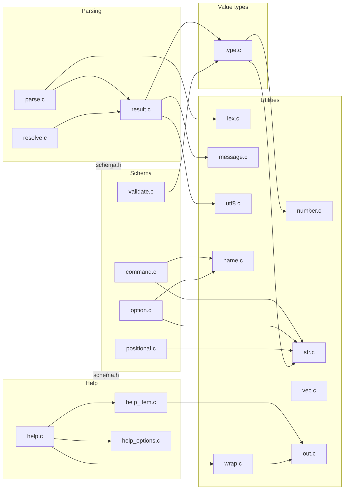
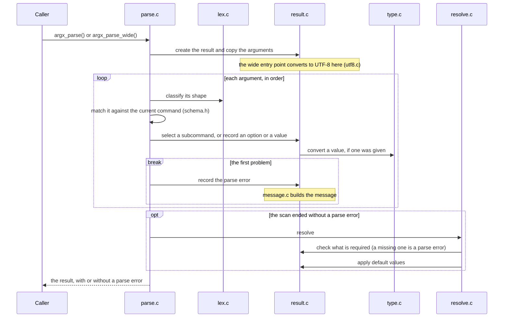
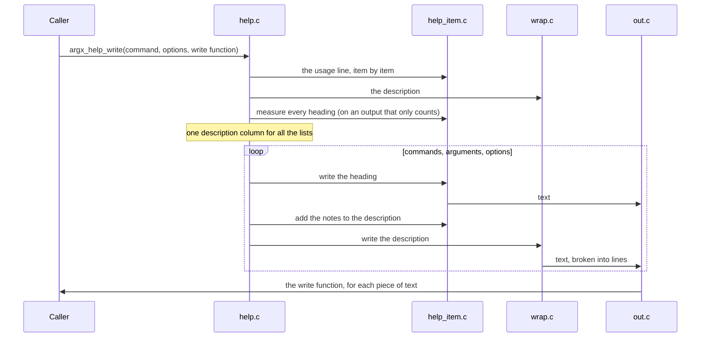

# Architecture

How the sources in `src/` are divided and how they depend on each other. Read it before you change the code, to know where a change belongs. Why the library behaves as it does is in [Design](../guides/design.md). The rules for writing the code are in [Development Conventions](conventions.md).

## Parts

The library has four parts, built on internal utilities. Each part implements a public header. Three small headers apply to the whole library.

| Part | Public headers | Sources |
| --- | --- | --- |
| Schema | `schema.h` | `command.c`, `option.c`, `positional.c`, `validate.c` |
| Value types | `type.h` | `type.c` |
| Parsing | `parse.h` | `parse.c`, `resolve.c`, `result.c` |
| Help | `help.h` | `help.c`, `help_item.c`, `help_options.c` |
| Library-wide | `alloc.h`, `error.h`, `version.h` | `alloc.c`, `error.c`, `version.c` |

`argx.h` includes every public header. `export.h` defines `ARGX_API`.

Dependencies go in one direction. An arrow points from a source to what it uses. Arrows to `alloc.c` and `vec.c` are left out, since most sources use them.

Parsing and help do not know each other. Both read the schema only through the public functions of `<argx/schema.h>`, never through its structures.

## Who owns which structure

Each structure has one place that reads and writes its fields. Every other source goes through functions.

| Structure | Internal header | Only these sources touch the fields |
| --- | --- | --- |
| Command, option, positional | `schema_internal.h` | `command.c`, `option.c`, `positional.c`, `validate.c` |
| Value type | `type_internal.h` | `type.c` |
| Result | `parse_internal.h` | `result.c` |
| Help options | `help_internal.h` | `help_options.c` writes them; `help.c` only reads them |

`parse.c` and `resolve.c` include `parse_internal.h`, but they build a result through its functions and read it through the public functions of `<argx/parse.h>`.

## Sources

### Utilities

Internal, with no knowledge of a schema. Each has a test in `tests/internal/`.

| Source | Role |
| --- | --- |
| `alloc.c` | The current allocator and the four internal memory functions. The only source that calls the standard `malloc`, `realloc`, `calloc` and `free` |
| `str.c` | Copying a string with the current allocator |
| `vec.c` | The growing array of items of one size |
| `name.c` | The rules for option and subcommand names |
| `number.c` | Converting a string to a 64-bit integer or a finite double |
| `utf8.c` | Converting a wide string to UTF-8 (UTF-16 or UTF-32, depending on the width of `wchar_t`) |
| `lex.c` | Classifying one argument by its shape: plain, long option, short option bundle, or `--` |
| `message.c` | Building the English message of a parse error |
| `out.c` | The help output: passes text to a write function and counts columns |
| `wrap.c` | Writing one text to an output, broken into lines at blanks |

### Value types

`type.c` makes the built-in, choice and user-defined value types. All of them share one structure, so converting a value is always a call to its conversion function. It uses `number.c` for the integer and float types.

### Schema

| Source | Role |
| --- | --- |
| `command.c` | The command tree, and the helpers shared by the schema sources |
| `option.c` | Adding the four option kinds, setting their attributes, and reading them |
| `positional.c` | Adding positionals, setting their attributes, and reading them |
| `validate.c` | The checks that need the whole tree, such as whether each default value converts |

Each command, option and positional is a separate allocation, so a handle stays valid while the tree grows. The tree copies every string and borrows its value types.

A successful validation sets the validated state in the root. A change to the tree clears it. Parsing and help require a validated tree and check it with `assert`.

### Parsing

| Source | Role |
| --- | --- |
| `parse.c` | The entry points `argx_parse()` and `argx_parse_wide()`, and the scan of the arguments |
| `resolve.c` | What happens after a scan without a parse error: checking required elements and applying default values |
| `result.c` | The result: copying the arguments, the selected commands, the values, the parse error, and the public functions that read a result |

### Help

| Source | Role |
| --- | --- |
| `help.c` | The public functions that write the help and the usage line, and the order of the parts |
| `help_item.c` | How one option or positional is written: its heading, its usage item and its notes |
| `help_options.c` | The layout settings: width, indent and maximum column |

## Parsing an argv

1. `argx_parse()` creates a result (`result.c`). The result copies the arguments into one allocation. `argx_parse_wide()` converts each argument to UTF-8 at this step (`utf8.c`). From here on, both entry points are the same.
2. `parse.c` reads each argument once, in order. `lex.c` classifies it by its shape, and `parse.c` matches it against the current command of the schema. A subcommand name selects that command and pushes a new frame onto the result. Each option or value is recorded through the functions of `parse_internal.h`. A value is converted when it is recorded, through `argx_type_convert()`.
3. The first problem stops the scan. `result.c` records it as the parse error and builds its message (`message.c`).
4. If the scan ends without a parse error, `resolve.c` makes two passes over the selected commands. The first checks that every required option and positional was given, and records the first missing one as the parse error. If nothing is missing, the second gives the rest their default values.
5. If memory runs out at any step, the result is destroyed and no result is returned. Otherwise the caller gets the result, with or without a parse error.

The scan state is a local variable of the scan. Nothing is kept between two parses.

`--help` gets no special treatment: it is an ordinary flag the program defines.

## Writing the help

1. `help.c` walks one command of the schema and decides the order: the usage line, the description, then the commands, arguments and options sections.
2. `help_item.c` writes each heading and usage item, and adds the notes such as `[default: VALUE]` after a description. To measure an item, `help.c` writes it once to an output that only counts bytes, so measuring and writing use the same code.
3. Every byte goes through an output (`out.c`), which tracks the column. Descriptions are wrapped by `wrap.c`.
4. The write function is the caller's. `argx_help_format()` and `argx_help_format_usage()` pass a write function that copies the text into the caller's buffer and counts its whole length.

The rules of the text itself are in [Help Text Layout](../references/help-layout.md).

## Tests

| Directory | What it tests |
| --- | --- |
| `tests/public/` | The public API, one or more files for each part |
| `tests/internal/` | The utilities and the internal functions of the result |
| `tests/support/` | Not tests: the test allocator and the code shared by the tests |
| `tests/consumer/` | Using an installed package from another project |
| `tests/release/` | The release scripts in `tools/` |

How to add each kind of test is in [Development Procedures](procedures.md).
